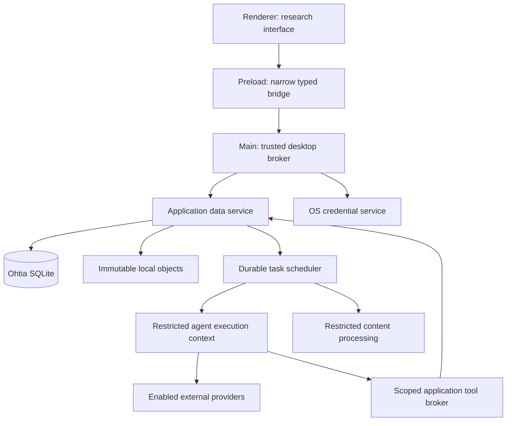

# System architecture

## Responsibilities and decisions

[Product definition](product-definition.md) owns research behavior and trust. [Thesis workflow](thesis-workflow.md) owns academic stages. This document owns runtime responsibilities and operational authority. [Frontend architecture](frontend-architecture.md), [Data model](data-model.md) and [Draft format](draft-format.md) define their separate contracts. Significant choices and alternatives live in the [ADR register](adr/index.md). Security verification uses [the desktop applicability framework](adr/adr-0000-security-verification-frameworks.md); its required controls and evidence apply to the actual enabled components.

Ohtia runs on the researcher's computer as an Electron application. React and TypeScript implement its interface, with TypeScript application services behind typed boundaries. [ADR-0002](adr/adr-0002-typescript-product-and-local-ipc.md) selects the product language and local IPC; Python remains developer tooling rather than an application-server dependency. No hosted Ohtia control plane, account service or server database is required. Optional provider connections can perform remote work; local storage is not a promise of exclusively local processing.

## Application, local library and research project

**Ohtia** is the installed application. A **research project** is one thesis, paper or other research undertaking managed by that application. The **local library** contains reusable sources and their versioned material for the operating-system user's Ohtia data store. The data service owns the application database and managed object directory. Product scope lives in the product definition; this storage boundary is not an interface for other applications.

The **application data service** is Ohtia's trusted component for database access, domain commands and task coordination. It serves all research projects through explicitly scoped commands. Selecting a project limits that operation's context; it does not open a separate SQLite database or automatically give an agent access to the whole library.

The [data model](data-model.md) is canonical for entity ownership, associations and their invariants. Application commands resolve that ownership before access; selecting a project is an operation scope, not a database-storage capability.

## Process and trust boundaries



The renderer presents data and researcher intent. It has no direct filesystem, database, credential or process access. Preload exposes named domain operations rather than a generic IPC, path, shell or SQL proxy. Main validates the sender and envelope, owns native dialogs and brokered credentials, and supervises the application data service. These choices implement the [Electron boundary decision](adr/adr-0003-electron-desktop-boundaries.md). Electron's isolation guidance informs this boundary; isolation alone is not a complete content or child-process sandbox.[^electron-security]

The desktop broker is single-instance per operating-system user; additional windows attach to that instance. It coordinates connection admission across open projects. One application data service in a supervised utility process owns the application SQLite connection boundary, scoped domain commands and local task coordination across research projects. It keeps database work and large transformations out of the renderer and main event loop. Untrusted parsers and provider runtimes execute in separate restricted processes; a worker thread or merely using a child process does not establish OS isolation.

The operating-system user controls their files and installation. Ohtia's application checks protect against accidental cross-project operations and agent overreach; they do not defend against malware or a person with equivalent OS access. Local files are not application-encrypted by default. Treat pre-migration copies as sensitive application data.

## Application data authority

The application data service owns `<ohtia-data>/ohtia.db3` and the managed `objects/` directory, as specified in [ADR-0006](adr/adr-0006-sqlite-application-storage.md). SQLite supports application-local persistence without an administered server.[^sqlite-use] [ADR-0007](adr/adr-0007-sqlite-repositories-and-migrations.md#sqlite-binding-and-packaged-artifact) selects better-sqlite3 with Kysely's built-in SQLite dialect. Storage conformance identifies the engine actually embedded by that binding and checks it against the version line owned by ADR-0006.

The database is authoritative for projects, source records and their BibLaTeX entries, retained source-content versions, project associations, retained analysis text, notes, claims, arguments, restrictions, human review, manuscript revisions, task intent and execution receipts. The [data model](data-model.md) defines the foundational relationships. Local files retain originals, images and other attachments referenced by immutable identity/hash.

A logical data-directory layout is:

```text
<ohtia-data>/
  ohtia.db3
  objects/
    <first-two-sha256-hex>/<full-sha256-hex>
  derived/
  logs/
    ohtia.jsonl
    ohtia.<1-4>.jsonl
  scratch/
  recovery/
    migrations/
      <operation-id>/
        ohtia.db3
        manifest.json
```

`objects/` retains original and attachment bytes, including retained file representations used as evidence. Imported retained files are copied into this collection with the exact SHA-256 keys `objects/<first-two-hex>/<full-64-hex>`; original display names remain metadata and opening a retained file does not depend on its original path. [ADR-0009](adr/adr-0009-managed-imported-files.md) defines this choice and its portability/availability limits. Manuscript text is stored as `TEXT` in SQLite rather than as an object file. Deduplication may reuse identical file bytes within this data store while preserving separate source identity, acquisition provenance, restrictions and associations. A shared filename or DOI alone is not proof that two records should merge.

`logs/` contains local structured diagnostic files owned by the broker; [ADR-0013](adr/adr-0013-private-content-free-structured-logging.md#local-files-and-rotation) defines their byte limits, rotation, access and deletion.

`derived/` contains rebuildable indexes, thumbnails and caches. `scratch/` contains disposable per-attempt contexts and incomplete outputs, with recovery information in SQLite. Reviewed representations and researcher work cannot be discarded merely because an agent or parser produced them. Large binary representations can be object-backed; retained textual content can use database text columns without becoming a disposable cache.

The managed data-directory location is a [bootstrap setting](#application-preferences-and-bootstrap), not a setting repeated for each thesis or an additional SQLite preference key. Machine paths, provider installations and secrets are separate from research relationships, and credentials are excluded from research records and pre-migration checkpoints. Local actor references distinguish researcher actions, process recording and agent provenance without requiring an Ohtia login. Imported actor labels remain attributed declarations.

The database schema and stored format versions evolve independently of application releases. Entity IDs are stable opaque UUIDv7 values generated by the trusted data service, following [ADR-0008](adr/adr-0008-uuidv7-entity-identifiers.md); titles, citekeys and provider thread IDs are not primary keys. [ADR-0007](adr/adr-0007-sqlite-repositories-and-migrations.md) selects better-sqlite3 for native SQLite access, Kysely for typed repository queries and its Migrator for packaged SQL migrations, with transactions and compatibility checks owned by the data service. All access goes through the data service, with the research project and allowed library associations resolved from the trusted command context. Each command is limited to its authorized research scope.

## Application preferences and bootstrap

[ADR-0036](adr/adr-0036-application-preferences-and-bootstrap.md) selects typed application preferences in the existing SQLite store with a separate broker-owned data-location locator. These are application configuration, not project research records. They are shared across projects in the selected data store, excluded from research interchange and exposed only through named, runtime-validated preference operations. The renderer never receives an arbitrary key/value, SQL or filesystem interface.

The data service owns `application_preferences`: one record per declared key, with a schema version, monotonic revision and validated value. The declared keys are `appearance`, `interface_locale`, `execution_limits` and `workspace_layout`; their value contracts belong to the owning feature specifications. Preference commands update only their named record and preserve all others. Commits and receipts follow the same SQLite failure guarantees as other durable writes. Execution-limit updates and task admission serialize through the same data-service transaction boundary; window layout writes obey the explicit last-accepted-write policy in [Workspace layout](workspace-layout.md#desktop-preference-boundary). No unreviewed arbitrary preference keys or payloads are accepted.

The `appearance` value is exactly `system`, `light` or `dark`, defaulting to `system`. A confirmed change applies to all application windows, survives restart and leaves research/editor state intact. `system` follows the current OS appearance. [ADR-0024](adr/adr-0024-typed-localization-catalogs.md) owns interface-language selection, [ADR-0011](adr/adr-0011-bounded-durable-local-tasks.md) owns execution-limit fields and [Workspace layout](workspace-layout.md) owns its record. Their requirements are not duplicated as another schema here.

Before SQLite can open, main resolves a fixed configuration location from Electron's `app.getPath("userData")`; Electron documents this as the native application-configuration path.[^electron-paths] Under it, `settings/data-location.json` contains only the exact record `{version: 1, data_directory: <absolute-directory-string>}`. Validate its JSON, exact keys/types, supported version and size at no more than 64 KiB before use. The locator is outside `<ohtia-data>`, so changing the research storage location does not move or redefine the locator. Do not redirect Electron's configuration path as an effect of that selection. Reject overlap in either direction between the selected data directory and the fixed settings directory, including native path aliases. A missing locator opens the one-time graphical data-location choice; do not infer a research-data default from Electron's configuration directory. Admit the selected location only under the local-storage support policy in [Opening, writing and manuscript revisions](#opening-writing-and-manuscript-revisions); a directory picker alone does not establish support for a network, redirected or concurrently synchronized location. Opening an existing store requires its compatibility/integrity checks, and creating a new one requires explicit graphical confirmation. All projects share the selected application store; creating another thesis does not repeat this location choice.

Only the single trusted main broker writes the locator, through the separately authorized storage-location flow after validating the selected store. Publish a complete validated record through a temporary file in the same directory and an atomic replacement, with the file/directory synchronization and interruption checks required on the target OS. Never truncate the previous locator in place or report durable success before the platform's verified publication procedure completes. Serialize changes, preserve the previous confirmed location on a failed transition and retain both data stores if the final publication outcome is uncertain. Reject unsupported/corrupt/unreadable locator data without creating, replacing or silently migrating a research store; present graphical selection/recovery and preserve the evidence. This locator is not a credential store or a research backup. Before a validated data location is available, present controlled bootstrap/locator errors graphically; do not write to an unknown log root, the working directory or a second fallback log store. Managed diagnostics begin under ADR-0013 only after their data-store location is established.

Load application preferences after the data store's normal compatibility/migration checks and before research windows or task admission use them. When the database cannot open, graphical recovery can use system appearance and system-language resolution without claiming that saved choices were loaded. A missing/invalid presentation record uses its feature's controlled fallback; decoding failure does not mutate the stored value. An explicit valid preference replacement/reset may atomically replace that rejected value without copying its raw payload into logs. Fresh store creation and applicable migrations initialize a missing `execution_limits` record with [ADR-0011's defaults](adr/adr-0011-bounded-durable-local-tasks.md#scheduling-and-required-limits), in the same initialization transaction and before task admission. Preserve an existing valid limit record rather than resetting it. A corrupt, unreadable or unsupported-version execution-limit record blocks new admission until a valid setting is established; unexpected absence from an already initialized current schema is a controlled integrity error, not permission to silently reset policy. Write failures leave previous confirmed values intact and return a controlled error. A layout or appearance preview may remain visibly unsaved in memory, without being reported as durable. Schema recovery rereads preferences from the recovered store before admitting work; it does not revive pending tasks.

Verify fixed native bootstrap paths, alternate data locations, malformed/newer locator records, interrupted replacement and uncertain publication, per-record schema/revision checks, preservation of unrelated preferences, cross-window behavior, restart persistence, fresh/migrated default-limit initialization without overwriting saved limits, default/failure presentation and concurrent limit changes/admission. These are delivery requirements, not claims that preference persistence is implemented.

## Opening, writing and manuscript revisions

Application startup opens the configured Ohtia data store after compatibility/integrity checks. Creating a research project inserts its identity and context in this store; opening one selects existing scoped data and does not ask for a project database file. Any change of the managed storage location, restoration or external-file import uses a separate explicit operation and validates its inputs.

The single application broker supervises one data-service writer boundary. SQLite transactions serialize writes from windows, projects and task completions; opening another project does not create an independent writer/transaction regime. An additional application instance attaches to the existing broker or fails with a clear conflict. Live storage on network shares or concurrently synchronized folders requires a separately demonstrated support contract; pre-migration checkpoints remain distinct from the live database.

Every domain command has an operation ID and an expected content version where it changes existing data. Validate structure, current restrictions, project/library scope and domain preconditions, then commit content, its history and required task intent together. Repeating an idempotent command returns its recorded outcome; conflicting payloads cannot reuse the identifier.

For a new attachment, validate and durably install the immutable object before committing its database reference. Interrupted installation can leave an unreferenced file, not a confirmed source with missing bytes. Cleanup checks references from all projects, history and retained pre-migration checkpoints before deletion. Removing a source from one project does not remove its library record or files used elsewhere.

The researcher edits manuscripts only through Ohtia. `drafts` owns manuscript identity and points to its current `draft_revisions` row; that row owns the complete Markdown as `TEXT`. In one transaction, check the expected current revision, insert the new immutable revision and advance the pointer. The current manuscript text has one authority. An exported `draft.md`, editor JSON or search projection is not an independently editable counterpart.

Start with full-text revisions and grouped autosaves, not a revision for every keystroke. A saved revision records its predecessor, observed time, action attribution and save reason. The [data model](data-model.md#manuscripts-and-revisions) owns their fields and invariants. Comments and academic review target exact revisions. Restoring an earlier version creates a new revision that records its origin; it does not move historical comments or discard intermediate history.

Retain revisions required by deliveries, comments, reviews and evidence. Any policy for pruning unreferenced autosaves requires explicit retention rules; a storage optimization cannot silently change what was examined. Diffs can be computed for presentation without making a chain of patches the only recoverable manuscript.

Disk-full, permission, transaction and I/O failures preserve the previous confirmed state and show that saving failed. Unsaved editor content remains recoverable without representing it as a committed revision. Delayed agent results keep their input versions and cannot overwrite a newer manuscript or human confirmation. The [academic draft format](draft-format.md) owns text semantics independently of SQLite storage.

## Inference-agent adapter contract

An inference adapter encapsulates a supported agent runtime or programmatic provider surface. It is not merely a function accepting a prompt. It translates a normalized lifecycle into provider-specific sessions, events, permissions and errors without leaking provider types into domain services.

Every adapter declares:

- Identity and compatibility: adapter version, runtime/protocol version, verified platform support and supported authentication modes.
- Capabilities: text or attachment inputs, structured output, streaming, scoped tools, interruption, resumable sessions, model/effort selection and usage reporting.
- Enforcement: supported read roots, write roots, tool exclusions, network constraints, inherited-configuration controls and effective-policy inspection.
- Access conditions: required installation, account or credential type, provider restrictions and known integration limitations.

The normalized operations are `probe`, `connect`, `disconnect`, `start`, `resume`, `interrupt` and `inspect`. A start request identifies project, task/attempt, operation policy version, immutable input manifest, language, selected connection, effective model settings when available, permitted tools and work limits. These names describe the internal contract, not presumed methods of every provider SDK.

Events carry attempt identity, monotonically increasing sequence, event kind and bounded payload. Distinguish started work, progress, text deltas, proposed tool calls, approval requests, usage observations and terminal outcomes. Adapter terminal outcomes include `completed`, `failed`, `cancelled` and `uncertain`. Persisted task/attempt states and their transitions are defined in [ADR-0011](adr/adr-0011-bounded-durable-local-tasks.md#task-states-and-transitions); an approval wait is an attempt phase, not an invented successful outcome. A returned process status or a stream ending is not enough to infer a completed research operation.

The adapter records provider session/turn references, runtime and effective model information when exposed. Missing identity or usage remains unknown. Validate output structure and evidence references before accepting a result as a proposal. A valid JSON object does not establish factual correctness or human review.

### Initial provider routes

For OpenAI, use a local Codex app-server over stdio as the initial rich-integration route. Its documented surface supports threads, streamed turns, managed account login and approval requests; the adapter must check the pinned runtime protocol and account capabilities. Model access is tested separately from listing a catalog. Do not expose remote app-server listeners or make experimental fields a silent requirement.[^codex-app-server]

For Anthropic, target a supported programmatic Claude integration behind the same contract. Anthropic's current Agent SDK documentation requires prior approval for offering claude.ai login or rate limits in third-party products. Therefore API-key access is the baseline candidate; subscription-backed access is unavailable in Ohtia unless its permitted integration is established. Wrapping a locally signed-in CLI does not by itself establish permission. The SDK and programmatic CLI provide integration candidates, not evidence of Ohtia-specific authentication eligibility.[^claude-agent-sdk][^claude-programmatic]

Both routes require version-specific conformance and a supported graphical setup path before release. Never scrape provider token stores, reuse another product's OAuth client identity, copy personal sessions into projects or bypass provider restrictions. Optional direct model-API adapters can be introduced later without replacing the agent contract or claiming equivalent behavior.

## Agent authority and context

Ohtia selects and materializes only permitted input versions into a per-attempt disposable context. The agent does not receive the Ohtia data directory, application database, mutable manuscript, unselected library material, other projects' private work or general home-directory access. Its provider-owned credential state is a separate, narrowly scoped dependency, never an excuse for broad read access. Prompts guide behavior; enforced permissions define the boundary.

An integration is enabled only when the effective configuration can be verified to disable unwanted inherited hooks, tools, plugins, memory and external connectors and enforce the operation's access policy on that platform. A read-only filesystem policy alone does not constrain network access or authorize transmission of restricted material. If the runtime cannot provide a required guarantee, reject that operation or use an explicitly supported lower-capability mode; do not silently relax the guarantee.

The application tool broker accepts only registered, typed research operations, bound to the active project, attempt, input versions and authorization scope. Identity comes from the trusted execution context, never model arguments. Tools can read permitted representations or create proposals. They cannot confirm knowledge, overwrite the researcher manuscript, execute arbitrary SQL/shell, choose arbitrary file paths or send arbitrary HTTP requests.

Restrict provider runtime subprocesses, tool servers and descendants to the same approved scope. Tool outputs are untrusted data and pass through the same transfer policy before reentering external context. An agent request for additional authority is shown as a specific pending action with its consequences or denied; source text cannot authorize it. Permission changes never retroactively authorize an earlier attempted action.

## Search adapter contract

Search adapters are independently configurable connections. A provider can expose `public`, `api_key` or `provider_login` modes, but supports only modes explicitly declared and verified against its documentation and conditions. The same provider can offer several connections with distinct rate limits, accounts and allowed operations. Never infer public-query support from the existence of a public website.

The operations are `probe`, `search`, optional `fetch_metadata`, and optional `fetch_content`. They accept a bounded query with filters, cursor, timeout and result limit. Outputs preserve provider and connection identity, query, filters, timing, pagination/cursors, normalized bibliographic fields, original provider identifiers, retrieval failures and whether content is metadata, abstract or full text.

Deduplicate candidates by well-founded identifiers while retaining original records and unresolved collisions. A DOI match does not prove two downloaded representations are identical. Record which enabled sources succeeded, failed or were not queried; a partial aggregate remains partial. Respect rate limits, account restrictions and retry guidance. A disabled provider never becomes an implicit fallback.

Metadata discovery and full-text retrieval have separate capabilities and permissions. Preview the outbound query, including potentially sensitive topics or unpublished hypotheses. Authentication or a user's ability to view a page is not evidence that automated download, local reuse or external inference is permitted. The provider's conditions and material restrictions apply to every stage.

Individual discovery providers are selected with the discovery delivery work. This foundation fixes the contract; it does not promise every named academic index has a public endpoint or complete coverage.

## Transfers, credentials and privacy

All external transfers initiated by Ohtia pass a trusted connection broker that checks current project restrictions, input versions, destination, operation and user authorization immediately before dispatch. This includes prompts, attachments, search queries, retrieved excerpts and tool returns. [ADR-0028](adr/adr-0028-mediated-provider-transfers.md) defines admission, permit timing and the limits of direct versus agent-owned dispatch. A policy check cannot recall bytes already sent. Pending work uses current policy, not a previously cached permission.

Agents may manage inference transport internally. For those integrations, Ohtia authorizes the materialized input scope and restricts available network/tool routes before launch; it cannot truthfully claim interception of every internal request. Disable such an operation if its required data-transfer controls cannot be enforced. Preserve a manifest of material made available and any more precise per-request evidence the runtime supplies.

Keep secrets outside projects, exports, renderer state, logs and command-line arguments. Credentials managed by Ohtia use OS-backed protected storage when available; runtime-owned login remains owned by that runtime in its isolated configuration. Electron documents platform-dependent protection and a Linux plaintext fallback, so absence of a suitable protected backend must be detected. Offer session-only use or leave the connection unavailable; never silently persist secrets with weak fallback.[^electron-secrets]

Following [ADR-0013](adr/adr-0013-private-content-free-structured-logging.md), diagnostics use its versioned local JSONL profile and explicit OpenTelemetry Logs Data Model mapping. The broker validates the typed event catalog and allowed metadata before writing. Prompts, source text, responses, credentials, local document titles and paths are excluded by default. Diagnostic exports are user-initiated, previewable and redacted; arbitrary child stdout/stderr is not automatically a safe diagnostic. No default project upload, usage analytics or remote error-content capture is required for core operation.

Provider training/retention conditions depend on the service, account and selected mode. Store the connection's documented conditions and communicate limitations; a local project does not establish an external provider's privacy guarantees. Restriction-sensitive operations remain unavailable when required conditions cannot be established.

## Durable work and consumption

SQLite records task intent with the domain command that requires it. [ADR-0011](adr/adr-0011-bounded-durable-local-tasks.md) is canonical for task/attempt states, atomic admission, configurable concurrency defaulting to one inference and one local-processing attempt, required policy bounds, retry/cessation evidence, application exit and restart. The local supervisor executes scoped attempts; [ADR-0012](adr/adr-0012-attempt-bound-process-capabilities.md) binds their allowed effects to the current capability/generation.

[ADR-0029](adr/adr-0029-operation-profiles-and-usage-reports.md) defines model/operation settings and bounded late usage reports. An enabled operation supplies the numeric limits required by ADR-0011. User-facing estimates distinguish enforceable work bounds from unreported tokens/cost or opaque provider internals.

Cache analysis by exact input versions, operation/prompt policy, language, adapter/runtime version and effective model settings where known. An unknown setting limits safe reuse and reproducibility. Reusing a result preserves its original producer and coverage and never refreshes a human confirmation. Do not deduplicate solely by a prompt string.

Recovery reconciles persisted attempts and object-install receipts before new dispatch. Uncertain attempts retain quarantined capacity and cannot publish research effects. Reopening Ohtia does not automatically repeat potentially dispatched work; the ADR defines the evidence and human actions required for continuation or replacement.

## Untrusted files and exports

Validate size, type, structure, archive paths, expansion ratio and resource references before processing. Do not execute macros, imported scripts, raw HTML, embedded commands or document-supplied configuration. External file access and network use by parsers/converters are disabled unless an explicitly scoped operation requires them.

Use platform-verified process confinement, restricted environment and limits on CPU, memory, time and output, following [ADR-0015](adr/adr-0015-isolated-content-processing.md). [ADR-0034](adr/adr-0034-pandoc-typst-manuscript-delivery.md) selects isolated Pandoc/Typst deliveries from the validated manuscript AST. An Electron renderer sandbox does not sandbox an arbitrary parser executable. If the required isolation is unavailable on a target, leave that processing feature unavailable with a recoverable explanation. Previewed content has no privileged bridge.

## Schema migration recovery and manuscript delivery

[ADR-0010](adr/adr-0010-pre-migration-recovery.md) defines an internal recovery checkpoint before a release applies a database-schema migration. The broker obtains exclusive access, quiesces writers, creates and validates a SQLite snapshot plus its manifest in `recovery/migrations/<operation-id>/`, then executes the packaged Kysely migration target inside the transaction and artifact-verification boundary defined by [ADR-0007](adr/adr-0007-sqlite-repositories-and-migrations.md#exclusive-transaction-and-execution). SQLite provides a backup API for consistent database snapshots; casually copying an active database file is not the procedure.[^sqlite-backup]

The checkpoint contains `ohtia.db3` and `manifest.json`. Original files remain immutable in `objects/`, protected from cleanup while their checkpoint references are retained. Schema-only migration does not copy the library or provide a general-purpose backup/restore feature. A file-format migration requires its own reviewed recovery procedure.

An interrupted or failed migration blocks normal database access until retry or verified pre-migration recovery is resolved. Close connections before replacing database state, verify the restored schema against a compatible app path, and never restart pending provider work automatically. A release that does not migrate the schema does not create this checkpoint merely because its version changed.

Deleting research work follows its explicit retention rules and protects material still referenced by research history or an unresolved/retained migration checkpoint. Before admitting destructive erasure, apply the [checkpoint purge boundary](adr/adr-0010-pre-migration-recovery.md#retention-erasure-and-disclosure) so retained recovery or failed-state copies cannot silently retain the erased content. Removing local data does not retract prior deliveries or provider transmissions.

Manuscript DOCX/PDF and generated Markdown/BibLaTeX outputs retain their own fidelity contracts. The complete knowledge-interchange serialization is a later contract preserving stable identities, content versions, relationships and provenance. It does not define the internal migration checkpoint. Repository documentation follows the existing OKF conventions in [AGENTS.md](../AGENTS.md#documentation-and-open-knowledge-format).

## Verification and subsequent choices

Desktop application foundation must demonstrate process/IPC isolation, data-service startup, exclusive data-store opening, a minimal durable command, safe shutdown, graphical dependency diagnostics and deterministic tests without provider credentials. Later integrations prove real protocol/authentication and isolation on every supported platform using synthetic data and explicit permission for chargeable tests.

Before release, select the supported OS versions/CPU architectures, packaging/signing/update tooling and platform-specific confinement mechanisms. Verify the selected SQLite binding's native artifact and embedded engine in each packaged target. Before enabling an agent, demonstrate effective policy, permitted account access, scoped tool execution, cancellation and unknown/partial-result behavior. Before editor/export delivery, validate the selected components against the [format corpus](draft-format.md#fidelity-and-validation), packaging and dependency-license obligations.

[Shared quality and coverage gates](adr/adr-0016-shared-quality-and-coverage-gates.md), [real-boundary integration](adr/adr-0017-real-boundary-integration-tests.md) and [versioned artifacts](adr/adr-0021-versioned-desktop-artifacts.md) define verification and release responsibilities. These are bounded delivery prerequisites whose evidence identifies the actual desktop implementation. The local definitions and ADRs remain reviewable together before their integration.

[^electron-security]: Electron's documented isolation, sandbox, navigation and IPC guidance informs the desktop trust boundary.

[^sqlite-use]: SQLite documents application-local persistence as an intended use; Ohtia's project-authority rules are its own contract.

[^codex-app-server]: The documented integration surface is a protocol candidate; Ohtia must verify its pinned runtime and effective policy.

[^claude-agent-sdk]: Anthropic documents authentication restrictions for third-party products; no subscription eligibility is inferred.

[^claude-programmatic]: Claude's programmatic interfaces supply integration candidates; they do not waive account-access conditions.

[^electron-secrets]: Protected storage varies by platform and backend; Ohtia must detect unavailable or inadequate protection.

[^electron-paths]: Electron defines the per-application `userData` configuration path; Ohtia selects the fixed locator beneath it independently of the research data directory.

[^sqlite-backup]: SQLite's backup facilities support pre-migration database snapshots; retained object references remain protected during that recovery window.
