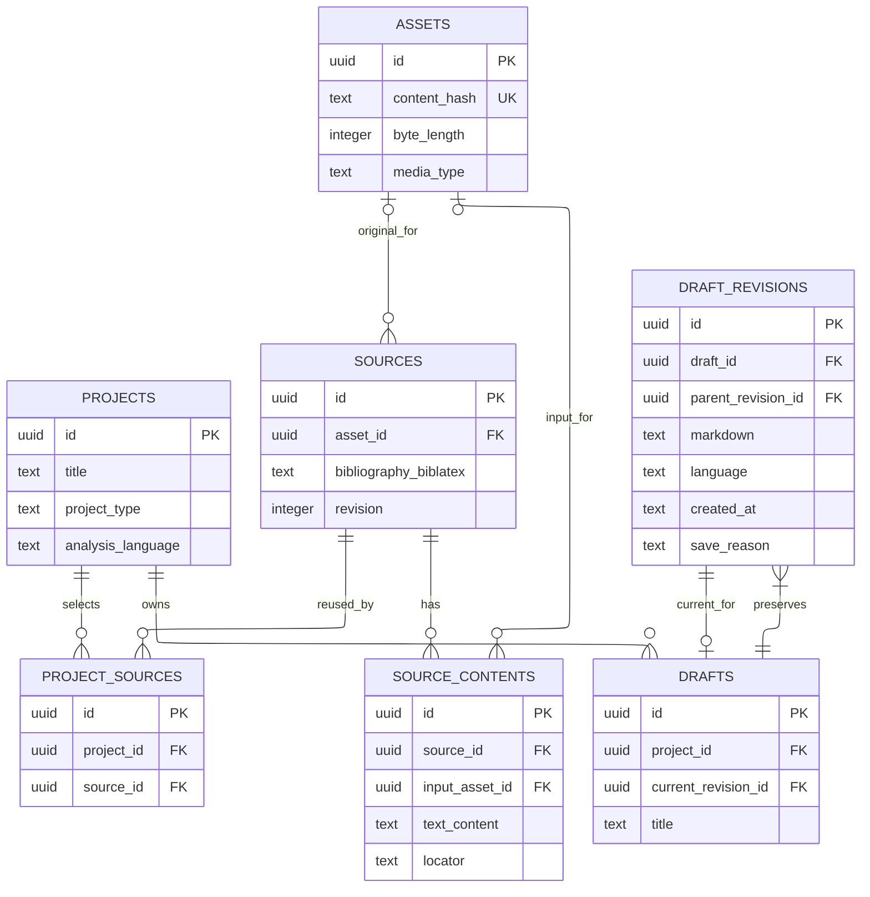

# Data model

## Scope and ownership

This is the foundational logical data model for one operating-system user's Ohtia data store. [Product definition](product-definition.md#research-model) owns the meaning of research entities; [Architecture](architecture.md#application-data-authority) owns storage/process boundaries; [Draft format](draft-format.md) owns manuscript syntax.

A **research project** is a thesis, paper or other investigation. It is neither the Ohtia application nor a separate database file. Library sources and retained bytes can be associated with several projects; using the same source does not copy another project's interpretation, review or manuscript into the active investigation.

The diagram and fields below establish ownership, identity and consistency requirements. They are not SQL migrations or the complete future product schema. Add the detailed tables for claims, arguments, research review, tasks and other capabilities when their behavior is specified, preserving these boundaries. Do not implement a placeholder table for every conceptual product entity merely because it appears in the vocabulary.

## Foundational ERD



Each committed draft has at least one revision and exactly one current revision belonging to that draft. The two draft/revision relationships are intentional: historical membership and the current pointer have different meanings. The `uuid` notation denotes an internal UUIDv7 identity stored as a 16-byte SQLite `BLOB`, not a native SQLite UUID type. [ADR-0008](adr/adr-0008-uuidv7-entity-identifiers.md) defines generation, encoding and validation; foreign keys use the same encoding as their referenced keys. External identifiers, citekeys, content hashes and manuscript block identifiers retain their separate contracts. An optional original asset permits sources without a retained file; it does not imply bytes were downloaded. Content input references preserve which retained file an extraction used.

## Source library

### `sources`

Each source has one library record containing its identity, bibliography and descriptive information.

- `id`: stable identity of a library source, independent of title, DOI, citekey and file path.
- `asset_id`: optional direct reference to the retained original file in `assets`. For an imported PDF source, this is the PDF opened from the source record. Sources without a retained original leave it empty.
- `bibliography_biblatex TEXT`: the complete bibliographic entry using BibLaTeX entry types and fields. The entry text is the stored bibliography; a parsed object or search index is derived rather than another independently editable bibliography.
- `revision`: a counter checked when updating the source record, so a stale edit cannot overwrite a newer one. It does not introduce a separate source-version entity or preserve past metadata by itself.
- Kind, publication condition, relevant origin/acquisition statements and use restrictions describe the source with their actual scope and provenance.
- Creation/update times and producer attribution record observed facts rather than inferred verification.
- Publication/external identifiers support discovery and duplicate assessment; they do not authorize an automatic merge of different editions or materials.

The source is reusable across research projects. Correcting its library description updates the same source record. The source opens its original through `asset_id` and lists extracted/corrected text through `source_contents.source_id`. Retained contents and their derivation remain independently identifiable; correcting bibliography does not overwrite a PDF or an extraction. Manuscript revisions and deliveries retain the bibliography entries they actually used, so a later source edit cannot silently rewrite an earlier citation or delivery.

BibLaTeX uses `.bib` bibliographic data with its supported fields and entry types.[^biblatex] Store the entry itself without Markdown code fences. Serialize field lines with two spaces of indentation and exactly one space on each side of `=`; do not use tabs or padding to align columns.

Generate citekeys using `nameyearkeyword`: the author's family name, publication year and a meaningful title keyword, combined in lowercase ASCII without spaces or diacritics. For example, García, 2025 and Aprendizaje produce `garcia2025aprendizaje`. Check for collisions in the bibliography mapping rather than silently binding the same key to a different source. Assigned or imported keys are not silently regenerated when bibliographic metadata changes.

Store bibliography text as UTF-8. Keep names, titles and other literal text in Unicode normalized to NFC, preserving their original spelling and accents.[^unicode-normalization] Do not convert accented letters to TeX escape sequences merely for encoding consistency. Treat syntax-sensitive characters according to the field's BibLaTeX rules; Unicode normalization does not replace syntax-aware parsing or escaping, and must not rewrite identifiers, verbatim values or protected TeX expressions.

A synthetic example is:

```bibtex
@article{garcia2025aprendizaje,
  author = {García, Ana},
  title = {Aprendizaje y escritura académica},
  journaltitle = {Revista de Investigación},
  date = {2025},
  volume = {12},
  pages = {15--30}
}
```

The citekey belongs to bibliography resolution, not to the source's UUID identity. Preserve imported supported fields and any required string definitions or inherited entries under the bibliography import contract. Report unsupported or unresolved dependencies instead of silently discarding them. Author/title/year lookup can use derived fields; editing them must update this source entry rather than create a second editable record. The parser and import/export fidelity checks are selected with that implementation.

A source update checks and advances its record revision in the same transaction. Dispatch always checks restrictions currently in force; a historical bibliography snapshot or earlier permission does not authorize a new transfer after restrictions changed. Input content used as evidence remains reconstructable independently of the current bibliographic description.

### `assets`

- `id`: opaque retained-file identity.
- `content_hash`: SHA-256 of the unmodified file bytes, stored as 64 lowercase hexadecimal characters and unique within the managed object collection. The exact file key is derived by [ADR-0009](adr/adr-0009-managed-imported-files.md).
- `byte_length` and `media_type` describe retained content. Derive the managed object key from `content_hash`; do not store a second editable path or accept arbitrary caller-supplied paths.
- The original display filename is metadata; the managed object key uses fixed ASCII components and the content hash. [ADR-0009](adr/adr-0009-managed-imported-files.md) defines why retained files are copied into Ohtia-managed storage rather than depending on their original paths.

Identical bytes can be stored once and referenced more than once. Byte deduplication does not merge source records, provenance, rights or academic review. PDF originals, images and other attachments live in the object directory; the database stores their relationships and exact identities. A URL alone is not an asset with retained bytes.

### `source_contents`

For an imported PDF, `sources.asset_id` gives direct access to the retained original. Text extracted from that PDF is stored in `source_contents`, linked back through `source_id`. Opening the source can therefore show both its original PDF and the extracted/corrected text. The PDF does not need another content row just to be accessible.

- `id` and `source_id` identify one content item or text version belonging to the source.
- `text_content TEXT` retains extracted or corrected text in SQLite when text has been obtained. Recording only an external locator does not establish that content is available.
- Optional `input_asset_id` identifies the exact retained original file used for extraction. It preserves provenance even if a source's selected original later changes.
- Derivation/predecessor identifies an earlier content record when correcting or transforming its text; it is distinct from the original input file.
- Kind, language, processing coverage, locator and content identity preserve what the processing or examination actually used. Explicitly distinguish externally referenced content from retained text.

For example, import a scanned PDF and attach its asset to the source, then create a content row with the OCR text and that PDF's `input_asset_id`. Correcting OCR creates another content version linked to its predecessor; it does not overwrite text used by an earlier analysis. The PDF bytes remain stored once.

Assets describe files and their managed locations. Source contents retain the text Ohtia can read or analyze and its origin. Images attached to a manuscript can be assets without being source contents; extracted text does not require a separate text file.

An original PDF, extraction, corrected extraction and later edition are not interchangeable. Evidence identifies the source and exact file/content examined plus the actual locator/quote. A proposed mapping to new content is separately reviewable; anchors do not migrate silently. Recording a physical object's catalogue information does not imply a digital original or extracted text exists.

## Research projects and source selection

### `projects`

- `id`: stable research-project identity.
- `title`, analysis language and observed creation/update metadata describe the investigation.
- `project_type` classifies the research undertaking using a code-owned typed catalog. SQLite enforces the released catalog with a `CHECK` constraint; the application validates the same values. It is not a user-editable lookup table. Localized display names live in interface message catalogs, while stored values are stable English identifiers. Catalog changes require coordinated application/schema changes, and the feature contract defines the exact values before implementation.
- The research profile, plan and workflow state belong to this project under their respective feature contracts.

The diagram defines manuscript ownership and cardinality. A project title is not a storage path. Interface locale and manuscript language remain separate from project analysis language.

### `project_sources`

- `id`, `project_id` and `source_id` identify one source's explicit inclusion in a project's working library.
- The project/source pair is unique. The association points directly to the source record and does not duplicate its bibliography.
- Project work identifies the exact `source_contents` records it examined. Historical manuscript bibliography snapshots remain separate from the source's current description.
- Project selection, reading priorities and any narrower processing restrictions stay with the association rather than altering every other project's use.

Library existence and project incorporation are different acts. A user can add an existing source to another project without downloading its files again. That does not transfer notes, arguments, scoped reviews or prior human confirmations. Any reusable analysis must satisfy its exact input/configuration and current-restriction contract and keep its original provenance.

A command or agent attempt can access only the project's authorized source associations and deliberately selected library material. Access to application storage does not grant blanket permission to transmit library content to a connected provider. Removing an association leaves other projects and the library source intact.

## Manuscripts and revisions

### `drafts`

- `id`: stable manuscript identity.
- `project_id`: the research project owning this manuscript.
- `title`: a user-facing label, independent of an export filename.
- `current_revision_id`: the authoritative pointer to one committed revision of this same manuscript.

Do not add another authoritative `markdown` column here merely to duplicate the current revision's text. Read current content through the referenced revision. An implementation can add rebuildable projections for performance, but they do not become independent editable copies.

### `draft_revisions`

- `id` and `draft_id`: immutable revision and manuscript identities.
- `parent_revision_id`: the immediately preceding current revision; absent only for the initial revision, and never pointing to another manuscript.
- `markdown TEXT`: the complete canonical manuscript text in [the academic profile](draft-format.md), including its format metadata and stable block identities.
- `language`: the manuscript writing-language tag retained with this immutable revision, using the most precise known BCP 47 tag; null explicitly means unknown. Read the current manuscript language through its current revision, without adding another mutable authoritative copy to `drafts`.
- `created_at`: the observed save instant in UTC.
- `save_reason`: an explicit action category such as initial creation, grouped autosave, manual save or restoration.
- Action/producer attribution and content hash distinguish who wrote the content from which process recorded the save.
- An optional restoration-origin revision identifies the old version being restored; it is distinct from the current predecessor in the revision chain.

The initial manuscript language comes from the researcher's explicit choice or supported imported metadata, not an inferred equality with analysis language. A manuscript-language correction creates a new revision, even when Markdown bytes are unchanged. Changing the project analysis language or interface locale never relabels previous or current manuscript text. Restoration retains the restored revision's language alongside its text. Unknown language remains explicit in rendering and export rather than receiving a fabricated tag. This document-level value does not solve mixed-language passages: the draft profile's attribute restriction remains an accessibility blocker documented in the [design system](design-system.md#conformance-blockers).

The researcher edits only through Ohtia. A generated `draft.md` is an output, not a file watched for external changes. Editor JSON and ASTs are working representations; they are not the only stored manuscript. The first implementation preserves complete revision text rather than relying exclusively on patch-chain reconstruction. Diffs for comparison can be computed later.

Creating a revision and advancing `drafts.current_revision_id` occur in one transaction after checking the expected predecessor. A stale save yields conflict instead of overwriting a newer revision. Initial creation installs the manuscript and its first revision in the same command; an externally observable committed manuscript cannot have a dangling current pointer. Repeated delivery of the same idempotent command cannot create duplicate revisions.

Restoration creates a new revision based on the old text while retaining the current predecessor and recording restoration origin. It does not delete intermediate history or move earlier comments/reviews to the restored text. Group autosaves rather than creating a full revision per keystroke. No pruning policy is selected here: any future compaction must preserve revision-chain integrity and content needed by deliveries, comments, reviews and historical evidence.

Observation and research-review storage is defined with its feature's commands and lifecycle, rather than introducing a generic comment table here. Its targets must retain the exact manuscript revisions, source content identities and input evidence examined. A comment or stable block ID cannot stand in for a human confirmation or make an old observation current after an edit.

## Referential and lifecycle invariants

Enforce foreign-key relationships, ownership checks and relevant uniqueness constraints in the database and trusted data service. The current manuscript pointer must target a revision of that same manuscript; source contents must belong to the source referenced by the operation. Expected-version checks, idempotent command receipts and related history belong to the same domain transaction. [ADR-0007](adr/adr-0007-sqlite-repositories-and-migrations.md) defines the Kysely repository and migration boundary, including the separate technical metadata for migration artifact identities. The physical migration must demonstrate these invariants, including initial creation and rollback, rather than relying on a diagram alone.

Stable IDs survive renaming, movement and supported migration. Content/representation versions remain immutable where used as evidence; correction creates a new version and identifies dependencies needing review. No agent-generated field can replace the project's trusted identity or issue a human confirmation.

Deleting a research project affects its owned work and associations under explicit retention rules; it does not cascade through library sources or files used elsewhere. Removing library material requires checking references across all projects and historical evidence. A pre-migration checkpoint records and protects the retained object identities referenced by its database snapshot; it does not create a general library backup.

Credentials, provider-owned authentication files, transient host paths and disposable execution contexts do not enter these research records or pre-migration checkpoints. [ADR-0011](adr/adr-0011-bounded-durable-local-tasks.md) defines logical task/attempt identities, states, transition receipts and admission/recovery invariants. Physical task/provider tables are specified with their implementation, preserving that contract, project scoping and current restrictions. The complete knowledge-interchange serialization is a later contract; identifiers, version links, relationships and provenance are preserved now so it can be built without reconstructing missing research history.

[^biblatex]: BibLaTeX defines the bibliography types/fields and processes `.bib` bibliographic data. Ohtia retains those entries instead of defining a competing bibliography vocabulary; this does not select a LaTeX compiler or parser implementation.

[^unicode-normalization]: Unicode defines NFC as canonical normalization; Ohtia applies it to literal bibliographic text while preserving field syntax and identifiers.
