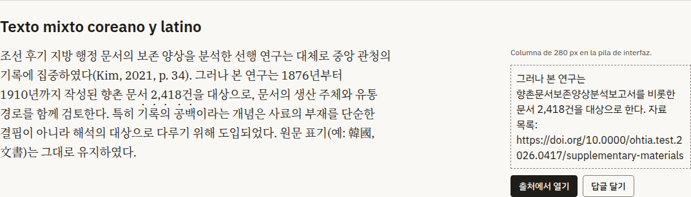
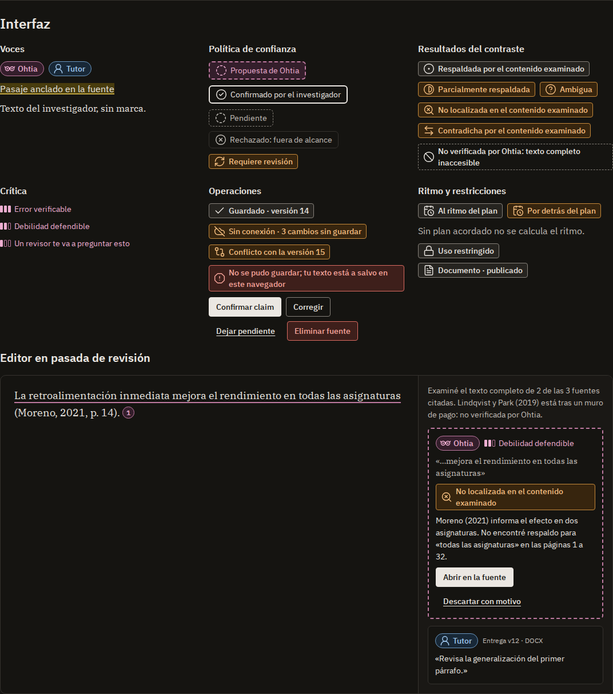

# Ohtia design system

This document defines the visual identity and design system of Ohtia's interface: principles, tokens, typography, iconography, symbol and character, composition, accessibility, localization, components, patterns and states. It is the canonical location for design tokens, typography selection by script and interface accessibility criteria.

## Scope and relationship to other documents

- The [product definition](product-definition.md) retains authority over entity meanings, trust policy, comparison outcomes, levels of criticism and the pace indicator. This document defines their presentation without redefining them.
- [Ohtia and agent identity](agents/agent-identity.md) owns the distinction between the product character, named AI contributors and human supervisors, along with labels, event-batch behavior and character-presentation preferences. [Agent collaboration](agents/agent-collaboration.md) owns the specialists' research responsibilities and authority.
- [ADR-0025](adr/adr-0025-bundled-plex-and-noto-fonts.md) establishes the IBM Plex roles and justifies distribution, loading, coverage, fallback and use in exports. This document specifies stacks by script, evaluated files, scales and weights.
- [ADR-0024](adr/adr-0024-typed-localization-catalogs.md) defines message catalogs and locale resolution. This document establishes visual localization rules.
- [ADR-0023](adr/adr-0023-desktop-accessibility-verification.md) sets the accessibility target: WCAG 2.2 AA and the adopted AAA criteria. This document defines their application, blockers and verification.
- [ADR-0014](adr/adr-0014-restricted-rendering-and-csp.md) defines safe rendering of untrusted content. The components in this document assume that boundary and add no route for inserting HTML.
- [ADR-0006](adr/adr-0006-sqlite-application-storage.md) defines optimistic manuscript saving; this document defines how a conflict is presented.
- [Draft format](draft-format.md) defines the structures presented by the editor, and [Thesis workflow](thesis-workflow.md) defines the stages guiding the Navigator.

Tokens and components are specified independently of platform. The interface and editor stack is selected in the [ADR register](adr/index.md). This document defines requirements; primitive implementation and catalog usage are documented with their delivery. Their tests do not establish the behavior of product pages not covered by those tests. Examples use fictitious projects, authors and citations.

## Identity principles

1. **The researcher's text is the page.** It appears as ink on paper, without color or branding. Everything else is distinguished from it, never the reverse. This follows PRIN-002 and PRIN-003.
2. **Every voice is identified.** Source, Ohtia and supervisor each have their own label, shape and color. Adopting a proposal does not erase its attribution to the system, following PRIN-004, PRIN-005 and the [trust policy](product-definition.md#proposals-and-human-review).
3. **Color does not certify.** No color communicates that something is correct, true or high-quality. Color indicates who is speaking, what awaits a researcher decision or which operation failed. This follows PRIN-006.
4. **Visible reasoning, invisible technology.** The interface does not use sparkles, gradients, robots, brains or wands to represent Ohtia. Ohtia presents its evidence, coverage and limitations, following PRIN-011 and PRIN-007. Its symbol is a pair of glasses, described in [Ohtia's symbol and character](#ohtias-symbol-and-character).
5. **Reading first.** Warm low-glare paper, Serif for the researcher's text, a bounded line measure and a calm interface support long sessions and research lasting years. This follows PRIN-015.

## Tokens

### Layers and names

Tokens are organized into three layers:

- **Reference:** physical values named `ref.<category>.<ramp>.<step>`. Components do not consume them directly.
- **Semantic:** an intention, such as `surface.page` or `voice.ohtia.content`. These form the normal interface for components.
- **Component:** `component.<component>.<part>`, only when a component needs a decision that no semantic token expresses. Each declares its justification. The component tokens below complement rather than replace semantic tokens. [Workspace component measurements](workspace-layout.md#workspace-component-measurements) own layout-specific tokens and alias the shared tokens here.

Identifiers are in English. An alias references another token's name rather than copying its value. Components contain no literal values for color, family, size, spacing, radius, shadow, opacity or duration.

Every semantic color token has a value in `light` and `dark` modes. The user chooses system, light or dark; system follows `prefers-color-scheme`. The [application appearance preference](architecture.md#application-preferences-and-bootstrap) defines persistence and default selection. System reduced-motion and forced-color preferences modify presentation according to the corresponding sections.

Implemented tokens are generated from their canonical definitions here and in Workspace layout, or checked against those definitions in tests. A difference between them is a defect corrected in the same change.

### Color

#### Reference palette

Each ramp retains a single hue. Its step number is OKLCH lightness multiplied by 100 and rounded, so distance between steps anticipates contrast. The canonical value is hexadecimal sRGB; the OKLCH column records the parameters from which it was derived, all within sRGB gamut.[^css-color-4]

| Token                     | Value     | OKLCH derivation         |
| ------------------------- | --------- | ------------------------ |
| `ref.color.neutral.98`    | `#faf8f5` | `oklch(0.980 0.004 80)`  |
| `ref.color.neutral.96`    | `#f4f1ed` | `oklch(0.960 0.006 80)`  |
| `ref.color.neutral.93`    | `#ebe7e2` | `oklch(0.930 0.008 80)`  |
| `ref.color.neutral.88`    | `#dad7d2` | `oklch(0.880 0.008 80)`  |
| `ref.color.neutral.80`    | `#c1bdb7` | `oklch(0.800 0.010 80)`  |
| `ref.color.neutral.61`    | `#87827b` | `oklch(0.610 0.012 80)`  |
| `ref.color.neutral.41`    | `#4e4a43` | `oklch(0.410 0.012 80)`  |
| `ref.color.neutral.32`    | `#35322e` | `oklch(0.320 0.008 80)`  |
| `ref.color.neutral.26`    | `#262420` | `oklch(0.260 0.008 80)`  |
| `ref.color.neutral.23`    | `#1f1d19` | `oklch(0.230 0.008 80)`  |
| `ref.color.neutral.21`    | `#1a1815` | `oklch(0.210 0.007 80)`  |
| `ref.color.neutral.19`    | `#151411` | `oklch(0.190 0.006 80)`  |
| `ref.color.plum.95`       | `#fae9f2` | `oklch(0.950 0.022 345)` |
| `ref.color.plum.82`       | `#edaed1` | `oklch(0.820 0.085 345)` |
| `ref.color.plum.66`       | `#be79a0` | `oklch(0.660 0.100 345)` |
| `ref.color.plum.60`       | `#ae648f` | `oklch(0.600 0.110 345)` |
| `ref.color.plum.40`       | `#6f2b55` | `oklch(0.400 0.110 345)` |
| `ref.color.plum.27`       | `#341e2b` | `oklch(0.270 0.040 345)` |
| `ref.color.blue.95`       | `#e4f0fc` | `oklch(0.950 0.020 248)` |
| `ref.color.blue.88`       | `#c1dbf4` | `oklch(0.880 0.045 248)` |
| `ref.color.blue.82`       | `#a1c9f0` | `oklch(0.820 0.070 248)` |
| `ref.color.blue.66`       | `#6a97c1` | `oklch(0.660 0.080 248)` |
| `ref.color.blue.60`       | `#5385b4` | `oklch(0.600 0.090 248)` |
| `ref.color.blue.40`       | `#184a75` | `oklch(0.400 0.090 248)` |
| `ref.color.blue.27`       | `#182837` | `oklch(0.270 0.035 248)` |
| `ref.color.yellow.92`     | `#f6e5a4` | `oklch(0.920 0.085 95)`  |
| `ref.color.yellow.72`     | `#bca341` | `oklch(0.720 0.120 95)`  |
| `ref.color.yellow.60`     | `#977e0d` | `oklch(0.600 0.120 95)`  |
| `ref.color.yellow.36`     | `#483c0d` | `oklch(0.360 0.065 95)`  |
| `ref.color.amber.95`      | `#fcecd9` | `oklch(0.950 0.030 70)`  |
| `ref.color.amber.84`      | `#f5bf81` | `oklch(0.840 0.100 70)`  |
| `ref.color.amber.68`      | `#c78a3b` | `oklch(0.680 0.120 70)`  |
| `ref.color.amber.62`      | `#b77610` | `oklch(0.620 0.130 70)`  |
| `ref.color.amber.42`      | `#6b4306` | `oklch(0.420 0.088 70)`  |
| `ref.color.amber.28`      | `#37250e` | `oklch(0.280 0.045 70)`  |
| `ref.color.red.95`        | `#fceae7` | `oklch(0.950 0.020 27)`  |
| `ref.color.red.80`        | `#f8a59b` | `oklch(0.800 0.100 27)`  |
| `ref.color.red.66`        | `#db6c62` | `oklch(0.660 0.140 27)`  |
| `ref.color.red.57`        | `#c8433c` | `oklch(0.570 0.170 27)`  |
| `ref.color.red.42`        | `#8b1e1c` | `oklch(0.420 0.145 27)`  |
| `ref.color.red.28`        | `#3e1f1b` | `oklch(0.280 0.050 27)`  |
| `ref.color.jade.95`       | `#e0f4eb` | `oklch(0.950 0.025 166)` |
| `ref.color.jade.84`       | `#98dcbf` | `oklch(0.840 0.080 166)` |
| `ref.color.jade.80`       | `#85d0b1` | `oklch(0.800 0.088 166)` |
| `ref.color.jade.48`       | `#286c53` | `oklch(0.480 0.080 166)` |
| `ref.color.jade.40`       | `#07553e` | `oklch(0.400 0.080 166)` |
| `ref.color.jade.27`       | `#142c22` | `oklch(0.270 0.035 166)` |
| `ref.color.terracotta.95` | `#feeae1` | `oklch(0.950 0.025 45)`  |
| `ref.color.terracotta.84` | `#faba9d` | `oklch(0.840 0.085 45)`  |
| `ref.color.terracotta.80` | `#f1ab8b` | `oklch(0.800 0.094 45)`  |
| `ref.color.terracotta.48` | `#854d33` | `oklch(0.480 0.085 45)`  |
| `ref.color.terracotta.40` | `#6c371d` | `oklch(0.400 0.085 45)`  |
| `ref.color.terracotta.27` | `#352118` | `oklch(0.270 0.035 45)`  |
| `ref.color.indigo.95`     | `#eaeefe` | `oklch(0.950 0.022 275)` |
| `ref.color.indigo.84`     | `#bbc7fe` | `oklch(0.840 0.078 275)` |
| `ref.color.indigo.80`     | `#adbaf7` | `oklch(0.800 0.088 275)` |
| `ref.color.indigo.48`     | `#505a8b` | `oklch(0.480 0.080 275)` |
| `ref.color.indigo.40`     | `#3b4372` | `oklch(0.400 0.080 275)` |
| `ref.color.indigo.27`     | `#212538` | `oklch(0.270 0.035 275)` |
| `ref.color.olive.95`      | `#edf1df` | `oklch(0.950 0.025 118)` |
| `ref.color.olive.84`      | `#c5d38f` | `oklch(0.840 0.090 118)` |
| `ref.color.olive.80`      | `#b8c77c` | `oklch(0.800 0.099 118)` |
| `ref.color.olive.48`      | `#596423` | `oklch(0.480 0.090 118)` |
| `ref.color.olive.40`      | `#444e05` | `oklch(0.400 0.090 118)` |
| `ref.color.olive.27`      | `#252915` | `oklch(0.270 0.035 118)` |
| `ref.color.petrol.95`     | `#def3fb` | `oklch(0.950 0.025 225)` |
| `ref.color.petrol.84`     | `#95d6f0` | `oklch(0.840 0.075 225)` |
| `ref.color.petrol.80`     | `#81cae6` | `oklch(0.800 0.083 225)` |
| `ref.color.petrol.48`     | `#24667d` | `oklch(0.480 0.075 225)` |
| `ref.color.petrol.40`     | `#025066` | `oklch(0.400 0.075 225)` |
| `ref.color.petrol.27`     | `#112a33` | `oklch(0.270 0.035 225)` |
| `ref.color.graphite.95`   | `#f1eee9` | `oklch(0.950 0.008 80)`  |
| `ref.color.graphite.84`   | `#cfcac2` | `oklch(0.840 0.012 80)`  |
| `ref.color.graphite.80`   | `#c2bdb5` | `oklch(0.800 0.012 80)`  |
| `ref.color.graphite.48`   | `#615d56` | `oklch(0.480 0.012 80)`  |
| `ref.color.graphite.40`   | `#4b4741` | `oklch(0.400 0.012 80)`  |
| `ref.color.graphite.27`   | `#292622` | `oklch(0.270 0.009 80)`  |
| `ref.color.violet.95`     | `#f6eafa` | `oklch(0.950 0.025 318)` |
| `ref.color.violet.84`     | `#e1bbed` | `oklch(0.840 0.080 318)` |
| `ref.color.violet.80`     | `#d6ace3` | `oklch(0.800 0.088 318)` |
| `ref.color.violet.48`     | `#704f7b` | `oklch(0.480 0.080 318)` |
| `ref.color.violet.40`     | `#593963` | `oklch(0.400 0.080 318)` |
| `ref.color.violet.27`     | `#2e2132` | `oklch(0.270 0.035 318)` |

#### Semantic color tokens

Light and Dark name the `ref.color` step used in each mode.

| Token                          | Light        | Dark         | Use                                 |
| ------------------------------ | ------------ | ------------ | ----------------------------------- |
| `surface.page`                 | `neutral.98` | `neutral.19` | Page and manuscript background      |
| `surface.panel`                | `neutral.96` | `neutral.21` | Panels, bars and lists              |
| `surface.emphasis`             | `neutral.93` | `neutral.26` | Navigation selection and emphasis   |
| `content.primary`              | `neutral.23` | `neutral.93` | Main and researcher text            |
| `content.secondary`            | `neutral.41` | `neutral.80` | Secondary text and metadata         |
| `content.disabled`             | `neutral.61` | `neutral.61` | Inactive controls                   |
| `border.subtle`                | `neutral.88` | `neutral.32` | Decorative separators               |
| `border.control`               | `neutral.61` | `neutral.61` | Control borders                     |
| `border.strong`                | `neutral.23` | `neutral.93` | Confirmed knowledge                 |
| `action.primary.surface`       | `neutral.23` | `neutral.93` | Primary action                      |
| `action.primary.surface-hover` | `neutral.32` | `neutral.80` | Primary action on hover             |
| `action.primary.content`       | `neutral.98` | `neutral.19` | Primary action text                 |
| `focus.ring`                   | `neutral.23` | `neutral.93` | Focus indicator                     |
| `selection.surface`            | `blue.88`    | `blue.40`    | Selected text                       |
| `voice.ohtia.content`          | `plum.40`    | `plum.82`    | Ohtia text and symbol               |
| `voice.ohtia.surface`          | `plum.95`    | `plum.27`    | Ohtia label background              |
| `voice.ohtia.border`           | `plum.60`    | `plum.66`    | Ohtia proposal border               |
| `voice.tutor.content`          | `blue.40`    | `blue.82`    | Supervisor comment text             |
| `voice.tutor.surface`          | `blue.95`    | `blue.27`    | Supervisor label background         |
| `voice.tutor.border`           | `blue.60`    | `blue.66`    | Supervisor border                   |
| `evidence.surface`             | `yellow.92`  | `yellow.36`  | Anchored passage fill               |
| `evidence.line`                | `yellow.60`  | `yellow.72`  | Anchored passage rule               |
| `attention.content`            | `amber.42`   | `amber.84`   | Text awaiting a decision            |
| `attention.surface`            | `amber.95`   | `amber.28`   | Attention notice background         |
| `attention.border`             | `amber.62`   | `amber.68`   | Attention notice border             |
| `danger.content`               | `red.42`     | `red.80`     | Failure and destructive action text |
| `danger.surface`               | `red.95`     | `red.28`     | Failure background                  |
| `danger.border`                | `red.57`     | `red.66`     | Failure and destructive borders     |

Two additional tokens complete overlay layers:

- `overlay.scrim`: `neutral.23` at 40% opacity in light mode and `neutral.19` at 72% in dark mode. It sits behind modal dialogs and drawers.
- `shadow.overlay`: vertical offset 8 px and blur 24 px in `neutral.23` at 16% opacity. In dark mode the shadow does not separate layers; therefore menus, popovers and dialogs use `surface.panel` and a `border.subtle` border in both modes.

#### Contributor identity colors

Each named AI contributor has three identity tokens for its full illustration and avatar: `line` for strokes, hair, eyes and drawn outlines; `accent` for clothing and small prop details such as tabs, flags, paragraph blocks and a pencil body; and `surface` for skin, paper and props. Their hues avoid the plum, blue, yellow, amber and red ramps that carry provenance, supervisor, evidence, attention and danger meanings. [Contributor characters and avatars](#contributor-characters-and-avatars) defines where they apply.

| Token                          | Light           | Dark            | Use                                  |
| ------------------------------ | --------------- | --------------- | ------------------------------------ |
| `character.virgilio.line`      | `jade.40`       | `jade.84`       | Virgilio drawing lines               |
| `character.virgilio.accent`    | `jade.80`       | `jade.48`       | Virgilio clothing and prop details   |
| `character.virgilio.surface`   | `jade.95`       | `jade.27`       | Virgilio skin, paper and props       |
| `character.josefa.line`        | `terracotta.40` | `terracotta.84` | Josefa drawing lines                 |
| `character.josefa.accent`      | `terracotta.80` | `terracotta.48` | Josefa clothing and prop details     |
| `character.josefa.surface`     | `terracotta.95` | `terracotta.27` | Josefa skin, paper and props         |
| `character.jorge-luis.line`    | `indigo.40`     | `indigo.84`     | Jorge Luis drawing lines             |
| `character.jorge-luis.accent`  | `indigo.80`     | `indigo.48`     | Jorge Luis clothing and prop details |
| `character.jorge-luis.surface` | `indigo.95`     | `indigo.27`     | Jorge Luis skin, paper and props     |
| `character.erasmus.line`       | `olive.40`      | `olive.84`      | Erasmus drawing lines                |
| `character.erasmus.accent`     | `olive.80`      | `olive.48`      | Erasmus clothing and prop details    |
| `character.erasmus.surface`    | `olive.95`      | `olive.27`      | Erasmus skin, paper and props        |
| `character.thomas.line`        | `petrol.40`     | `petrol.84`     | Thomas drawing lines                 |
| `character.thomas.accent`      | `petrol.80`     | `petrol.48`     | Thomas clothing and prop details     |
| `character.thomas.surface`     | `petrol.95`     | `petrol.27`     | Thomas skin, paper and props         |
| `character.boris.line`         | `graphite.40`   | `graphite.84`   | Boris drawing lines                  |
| `character.boris.accent`       | `graphite.80`   | `graphite.48`   | Boris clothing and prop details      |
| `character.boris.surface`      | `graphite.95`   | `graphite.27`   | Boris skin, paper and props          |
| `character.maria.line`         | `violet.40`     | `violet.84`     | María drawing lines                  |
| `character.maria.accent`       | `violet.80`     | `violet.48`     | María clothing and prop details      |
| `character.maria.surface`      | `violet.95`     | `violet.27`     | María skin, paper and props          |

#### Color usage rules

- Researcher text, notes and decisions use `content.primary` without another color.
- `voice.ohtia.*` is reserved for system/AI-origin contributions, the product symbol and its character. Named AI contributors share this provenance family while retaining their own author labels; using it does not attribute their text to the Ohtia character. It is not used for links, actions, states or unrelated decoration.
- `character.<contributor>.*` colors only that contributor's full illustration and avatar. It identifies the character, not provenance, state, quality or authority. It never colors text, voice labels, symbols, interface borders, links, actions or states; the contributor symbol and its label use `voice.ohtia.*`.
- `voice.tutor.*` identifies the original human supervisor comment from a returned document. Agent extraction and interpretation of that comment use `voice.ohtia.*` with the actual AI contributor's label, without inheriting human authorship.
- Primary actions use `action.primary.*`, in ink. Links use `content.primary` and are always underlined.
- `attention.*` indicates something awaiting a researcher decision: content needing review, a comparison result worth examining, a save conflict, invalid form input or a pace behind the plan.
- `danger.*` is reserved for risk of data loss, operation failure and destructive actions. It is not used for comparison outcomes, criticism or counts.
- There is no success token or semantic green. A completed operation is communicated in neutral colors with an icon and text. The jade and olive contributor identity ramps are drawing colors and never indicate success.
- `evidence.*` marks anchored source passages. The fill alone carries no information: `evidence.line` supplies non-text contrast and the accessible label identifies the anchor.
- Voice and notice `*.surface` backgrounds are never the only indicator. Their border or line meets 3:1 and the element has text.
- No state is communicated by color alone: it has text and an icon or shape, following criterion 1.4.1.

#### Verified contrast pairs

The inventory is closed: every foreground/background combination used by a component must appear in it. Values were calculated using WCAG 2.x relative luminance and contrast ratio on the reference palette's hexadecimal colors.[^wcag22] The 7:1 minimum for text applies the adopted criterion 1.4.6; 3:1 applies criterion 1.4.11 to borders, lines, icons and focus indicators. WCAG exempts inactive controls, but this system requires them to meet 3:1 so they remain legible. Contributor identity drawings contain no text; their lines meet 3:1 against the drawing's own fills and the surfaces where avatars appear.

| Foreground                  | Background                     | Minimum | Light   | Dark    |
| --------------------------- | ------------------------------ | ------- | ------- | ------- |
| `content.primary`           | `surface.page`                 | 7:1     | 15.87:1 | 14.97:1 |
| `content.primary`           | `surface.panel`                | 7:1     | 14.94:1 | 14.39:1 |
| `content.primary`           | `surface.emphasis`             | 7:1     | 13.67:1 | 12.59:1 |
| `content.secondary`         | `surface.page`                 | 7:1     | 8.31:1  | 9.85:1  |
| `content.secondary`         | `surface.panel`                | 7:1     | 7.82:1  | 9.47:1  |
| `content.secondary`         | `surface.emphasis`             | 7:1     | 7.15:1  | 8.28:1  |
| `voice.ohtia.content`       | `surface.page`                 | 7:1     | 9.20:1  | 10.15:1 |
| `voice.ohtia.content`       | `surface.panel`                | 7:1     | 8.66:1  | 9.77:1  |
| `voice.ohtia.content`       | `surface.emphasis`             | 7:1     | 7.93:1  | 8.54:1  |
| `voice.tutor.content`       | `surface.page`                 | 7:1     | 8.71:1  | 10.64:1 |
| `voice.tutor.content`       | `surface.panel`                | 7:1     | 8.20:1  | 10.23:1 |
| `voice.tutor.content`       | `surface.emphasis`             | 7:1     | 7.50:1  | 8.95:1  |
| `attention.content`         | `surface.page`                 | 7:1     | 8.15:1  | 11.10:1 |
| `attention.content`         | `surface.panel`                | 7:1     | 7.67:1  | 10.67:1 |
| `attention.content`         | `surface.emphasis`             | 7:1     | 7.02:1  | 9.33:1  |
| `danger.content`            | `surface.page`                 | 7:1     | 8.61:1  | 9.51:1  |
| `danger.content`            | `surface.panel`                | 7:1     | 8.11:1  | 9.15:1  |
| `danger.content`            | `surface.emphasis`             | 7:1     | 7.42:1  | 8.00:1  |
| `content.primary`           | `selection.surface`            | 7:1     | 11.78:1 | 7.50:1  |
| `content.primary`           | `evidence.surface`             | 7:1     | 13.35:1 | 8.85:1  |
| `content.primary`           | `voice.ohtia.surface`          | 7:1     | 14.42:1 | 12.48:1 |
| `content.primary`           | `voice.tutor.surface`          | 7:1     | 14.56:1 | 12.21:1 |
| `content.primary`           | `attention.surface`            | 7:1     | 14.53:1 | 11.90:1 |
| `content.primary`           | `danger.surface`               | 7:1     | 14.47:1 | 12.04:1 |
| `voice.ohtia.content`       | `voice.ohtia.surface`          | 7:1     | 8.36:1  | 8.47:1  |
| `voice.tutor.content`       | `voice.tutor.surface`          | 7:1     | 7.99:1  | 8.68:1  |
| `attention.content`         | `attention.surface`            | 7:1     | 7.46:1  | 8.83:1  |
| `danger.content`            | `danger.surface`               | 7:1     | 7.85:1  | 7.66:1  |
| `action.primary.content`    | `action.primary.surface`       | 7:1     | 15.87:1 | 14.97:1 |
| `action.primary.content`    | `action.primary.surface-hover` | 7:1     | 12.03:1 | 9.85:1  |
| `border.control`            | `surface.page`                 | 3:1     | 3.60:1  | 4.83:1  |
| `border.control`            | `surface.panel`                | 3:1     | 3.39:1  | 4.65:1  |
| `border.control`            | `surface.emphasis`             | 3:1     | 3.10:1  | 4.06:1  |
| `border.strong`             | `surface.page`                 | 3:1     | 15.87:1 | 14.97:1 |
| `border.strong`             | `surface.panel`                | 3:1     | 14.94:1 | 14.39:1 |
| `border.strong`             | `surface.emphasis`             | 3:1     | 13.67:1 | 12.59:1 |
| `focus.ring`                | `surface.page`                 | 3:1     | 15.87:1 | 14.97:1 |
| `focus.ring`                | `surface.panel`                | 3:1     | 14.94:1 | 14.39:1 |
| `focus.ring`                | `surface.emphasis`             | 3:1     | 13.67:1 | 12.59:1 |
| `voice.ohtia.border`        | `surface.page`                 | 3:1     | 3.95:1  | 5.64:1  |
| `voice.ohtia.border`        | `surface.panel`                | 3:1     | 3.72:1  | 5.43:1  |
| `voice.ohtia.border`        | `surface.emphasis`             | 3:1     | 3.40:1  | 4.74:1  |
| `voice.tutor.border`        | `surface.page`                 | 3:1     | 3.68:1  | 5.97:1  |
| `voice.tutor.border`        | `surface.panel`                | 3:1     | 3.47:1  | 5.74:1  |
| `voice.tutor.border`        | `surface.emphasis`             | 3:1     | 3.17:1  | 5.02:1  |
| `evidence.line`             | `surface.page`                 | 3:1     | 3.73:1  | 7.42:1  |
| `evidence.line`             | `surface.panel`                | 3:1     | 3.52:1  | 7.13:1  |
| `evidence.line`             | `surface.emphasis`             | 3:1     | 3.22:1  | 6.24:1  |
| `attention.border`          | `surface.page`                 | 3:1     | 3.53:1  | 6.25:1  |
| `attention.border`          | `surface.panel`                | 3:1     | 3.32:1  | 6.01:1  |
| `attention.border`          | `surface.emphasis`             | 3:1     | 3.04:1  | 5.26:1  |
| `danger.border`             | `surface.page`                 | 3:1     | 4.58:1  | 5.56:1  |
| `danger.border`             | `surface.panel`                | 3:1     | 4.31:1  | 5.34:1  |
| `danger.border`             | `surface.emphasis`             | 3:1     | 3.95:1  | 4.67:1  |
| `content.disabled`          | `surface.page`                 | 3:1     | 3.60:1  | 4.83:1  |
| `content.disabled`          | `surface.panel`                | 3:1     | 3.39:1  | 4.65:1  |
| `content.disabled`          | `surface.emphasis`             | 3:1     | 3.10:1  | 4.06:1  |
| `character.virgilio.line`   | `character.virgilio.surface`   | 3:1     | 7.70:1  | 9.43:1  |
| `character.virgilio.line`   | `character.virgilio.accent`    | 3:1     | 4.90:1  | 3.97:1  |
| `character.virgilio.line`   | `surface.page`                 | 3:1     | 8.33:1  | 11.69:1 |
| `character.virgilio.line`   | `surface.panel`                | 3:1     | 7.84:1  | 11.24:1 |
| `character.virgilio.line`   | `surface.emphasis`             | 3:1     | 7.17:1  | 9.83:1  |
| `character.josefa.line`     | `character.josefa.surface`     | 3:1     | 8.21:1  | 9.10:1  |
| `character.josefa.line`     | `character.josefa.accent`      | 3:1     | 4.97:1  | 4.05:1  |
| `character.josefa.line`     | `surface.page`                 | 3:1     | 9.00:1  | 11.03:1 |
| `character.josefa.line`     | `surface.panel`                | 3:1     | 8.47:1  | 10.61:1 |
| `character.josefa.line`     | `surface.emphasis`             | 3:1     | 7.75:1  | 9.28:1  |
| `character.jorge-luis.line` | `character.jorge-luis.surface` | 3:1     | 8.14:1  | 9.17:1  |
| `character.jorge-luis.line` | `character.jorge-luis.accent`  | 3:1     | 4.99:1  | 4.00:1  |
| `character.jorge-luis.line` | `surface.page`                 | 3:1     | 8.88:1  | 11.15:1 |
| `character.jorge-luis.line` | `surface.panel`                | 3:1     | 8.36:1  | 10.73:1 |
| `character.jorge-luis.line` | `surface.emphasis`             | 3:1     | 7.64:1  | 9.38:1  |
| `character.erasmus.line`    | `character.erasmus.surface`    | 3:1     | 7.81:1  | 9.30:1  |
| `character.erasmus.line`    | `character.erasmus.accent`     | 3:1     | 4.92:1  | 4.00:1  |
| `character.erasmus.line`    | `surface.page`                 | 3:1     | 8.47:1  | 11.48:1 |
| `character.erasmus.line`    | `surface.panel`                | 3:1     | 7.98:1  | 11.04:1 |
| `character.erasmus.line`    | `surface.emphasis`             | 3:1     | 7.30:1  | 9.65:1  |
| `character.thomas.line`     | `character.thomas.surface`     | 3:1     | 7.82:1  | 9.38:1  |
| `character.thomas.line`     | `character.thomas.accent`      | 3:1     | 4.92:1  | 4.02:1  |
| `character.thomas.line`     | `surface.page`                 | 3:1     | 8.46:1  | 11.54:1 |
| `character.thomas.line`     | `surface.panel`                | 3:1     | 7.96:1  | 11.10:1 |
| `character.thomas.line`     | `surface.emphasis`             | 3:1     | 7.29:1  | 9.70:1  |
| `character.boris.line`      | `character.boris.surface`      | 3:1     | 7.97:1  | 9.24:1  |
| `character.boris.line`      | `character.boris.accent`       | 3:1     | 4.94:1  | 4.01:1  |
| `character.boris.line`      | `surface.page`                 | 3:1     | 8.70:1  | 11.30:1 |
| `character.boris.line`      | `surface.panel`                | 3:1     | 8.19:1  | 10.87:1 |
| `character.boris.line`      | `surface.emphasis`             | 3:1     | 7.49:1  | 9.50:1  |
| `character.maria.line`      | `character.maria.surface`      | 3:1     | 8.25:1  | 9.08:1  |
| `character.maria.line`      | `character.maria.accent`       | 3:1     | 4.96:1  | 4.05:1  |
| `character.maria.line`      | `surface.page`                 | 3:1     | 9.04:1  | 10.99:1 |
| `character.maria.line`      | `surface.panel`                | 3:1     | 8.52:1  | 10.57:1 |
| `character.maria.line`      | `surface.emphasis`             | 3:1     | 7.79:1  | 9.24:1  |

A new pair is calculated in both modes and added to this list before use.

### Typography

#### Families and stacks

[ADR-0025](adr/adr-0025-bundled-plex-and-noto-fonts.md) establishes the roles: IBM Plex Sans for the interface, IBM Plex Serif for authored documents, IBM Plex Mono for content marked as code and IBM Plex Math for rendered formulas, with Noto as the fallback by script. Family tokens define the order of each stack:

- `font.family.ui`: IBM Plex Sans, IBM Plex Sans KR, Noto Sans KR.
- `font.family.document`: IBM Plex Serif, Noto Serif KR, Noto Sans (U+207F only).
- `font.family.code`: IBM Plex Mono, Noto Sans KR, Noto Sans (U+207F only).
- `font.family.math`: IBM Plex Math.

Plex Sans precedes Plex Sans KR because Plex Sans KR lacks accented Latin letters, the nonbreaking space U+00A0, the narrow space U+202F and the ₹ sign. The stacks include only verified scripts: Latin for the 25 locales and Korean. Any other script, for example a quotation in Greek or Arabic, is added to the stack with the corresponding Noto variant after checking its coverage against specific files, according to ADR-0025.

#### Application rules

- The text's role determines the family, not the surface where it appears. A draft passage quoted in a comment retains Serif; the comment label uses Sans.
- Mono applies only to content explicitly marked as code, inline or in a block, including LaTeX shown as literal text. Numbers, dates, DOIs, bibliographic references, citekeys, filenames and links retain the family of their surrounding text; their content does not make them Mono.
- A rendered formula uses Math even when its persistent representation is LaTeX. The editor shows LaTeX in Mono only while it is edited as literal text.
- The interface displays `kind`, `publication` and `origin` values using their localized catalog labels, not their protocol identifiers.
- A required academic template may impose another typeface when exporting a submission without altering its content, according to ADR-0025.

#### Interface scale

| Token                | Family | Size / line height | Weight | Use                            |
| -------------------- | ------ | ------------------ | ------ | ------------------------------ |
| `type.ui.display`    | Sans   | 32/40              | 600    | Navigator main heading         |
| `type.ui.title`      | Sans   | 24/32              | 600    | Screen title                   |
| `type.ui.heading`    | Sans   | 20/28              | 600    | Section or panel heading       |
| `type.ui.subheading` | Sans   | 16/24              | 600    | Group heading and object name  |
| `type.ui.body`       | Sans   | 16/24              | 400    | Interface text                 |
| `type.ui.body-small` | Sans   | 14/21              | 400    | Panel and comment text         |
| `type.ui.label`      | Sans   | 14/20              | 500    | Single-line labels and buttons |
| `type.ui.caption`    | Sans   | 12/18              | 400    | Single-line metadata and notes |
| `type.ui.code`       | Mono   | 14/21              | 400    | Interface code                 |

No text is set below 12 px. `type.ui.label` is used only for single-line text; text that may span multiple lines uses a style with line height of at least 1.5.

#### Document scale

Applies to the manuscript in the editor, the source reader and documents Ohtia produces for on-screen reading.

| Token              | Family | Size / line height | Weight | Use                              |
| ------------------ | ------ | ------------------ | ------ | -------------------------------- |
| `type.doc.title`   | Serif  | 32/40              | 600    | Manuscript title, level 1        |
| `type.doc.h2`      | Serif  | 26/34              | 600    | Section, level 2                 |
| `type.doc.h3`      | Serif  | 22/30              | 600    | Subsection, level 3              |
| `type.doc.h4`      | Serif  | 19/28              | 600    | Level 4                          |
| `type.doc.h5`      | Serif  | 18/30              | 600    | Levels 5 and 6                   |
| `type.doc.body`    | Serif  | 18/30              | 400    | Paragraphs, lists and quotations |
| `type.doc.note`    | Serif  | 15/24              | 400    | Footnotes                        |
| `type.doc.caption` | Serif  | 15/24              | 400    | Figure and table captions        |
| `type.doc.table`   | Serif  | 15/24              | 400    | Table cells                      |
| `type.doc.code`    | Mono   | 15/24              | 400    | Literal code                     |
| `type.doc.math`    | Math   | 18                 | 400    | Inline and display formulas      |

- `measure.reading` is `34em`. According to Plex Serif's advances, a line contains an average of 71 to 74 characters in Spanish, English, German and Finnish, at any size; in the [rendered specimen](#renderable-specimen), full Spanish lines contain 63 to 74. Korean fits at most 35 syllables, because each Noto Serif KR syllable advances 0.966 em; in the specimen, full Korean lines contain 42 to 47 characters, of which 18 to 32 are full-width. Counting each full-width character as one CJK position and each Latin character, sign or space as half a position, they occupy 32.5 to 38.5 positions. These values are below criterion 1.4.8's limit of 80 characters, or 40 for CJK, which equates one CJK character to approximately two non-CJK characters.[^wcag-visual-presentation] The measure is not expressed in `ch`: in IBM Plex, `1ch` equals the width of a digit (0.6 em), and `66ch` would produce 83 to 86 characters per line.
- Paragraphs are separated by `1em`. With line height of at least 1.5, the top of a paragraph's first line is at least 2.5 times the font size from the top of the preceding paragraph's last line, according to the explanation of criterion 1.4.8.
- Text aligns to the start of the line and is never justified on screen. Automatic hyphenation is allowed when the element declares its language.
- Block quotations are indented by `space.6` on the start side, without italics; italics remain for emphasis and titles marked by the researcher.
- Section, figure, table, equation and note numbering follows the [draft format](draft-format.md#cross-references). The level-one title is not numbered.
- `line-height: normal` is not used: Korean fonts declare line heights different from Plex's and the block would grow when scripts mix. Every style specifies a numeric line height.

#### Weights, styles and numerals

- Required faces are Sans 400, 400 italic, 500 and 600; Serif 400, 400 italic, 600 and 600 italic; Mono 400; and Math Regular, the only style in the examined package. Korean uses Plex Sans KR 400, 500 and 600 and Noto Serif KR 400 and 600. Noto Sans KR, which in the interface only supplies Hanja, jamo and signs missing from Plex Sans KR, provides 400, 500 and 700: its static files do not include 600, and text at weight 600 that reaches it is set at 700.
- `font-synthesis: none` prevents synthetic bold and italics. Each face in the scale is therefore distributed as its own file.
- In IBM Plex Sans Regular and IBM Plex Serif Regular from the examined commit, all ten digits have the same advance of 600 units and the GSUB table offers neither `pnum` nor `tnum`. Numerals are tabular by default, and numeric columns align to the right. `onum` exists but is not enabled.
- Letter spacing is 0 in every style. `text-transform` is not used to change case: each locale's catalog writes the correct form, according to ADR-0024.

#### Korean

IBM Plex publishes only one Korean family, IBM Plex Sans KR; the examined commit contains neither Korean Serif nor Korean Mono. Hangul therefore uses a different font according to its role:

| Role             | Hangul                           | Latin and numerals | Missing Hanja and CJK signs  |
| ---------------- | -------------------------------- | ------------------ | ---------------------------- |
| Interface        | IBM Plex Sans KR (400, 500, 600) | IBM Plex Sans      | Noto Sans KR (400, 500, 700) |
| Document         | Noto Serif KR (400, 600)         | IBM Plex Serif     | Noto Serif KR                |
| Code             | Noto Sans KR (400)               | IBM Plex Mono      | Noto Sans KR                 |
| Rendered formula | None; not verified               | IBM Plex Math      | None                         |

Two fonts coexist on a single line: Latin, numerals and Latin punctuation come from Plex, and Hangul comes from the role's Korean font.

- The `ko-KR` interface declares `lang="ko-KR"`. The manuscript declares the writing language retained with its revision, independently of the project's analysis language; generated content declares the language actually used by its analysis operation. Korean passages inside another context declare their language, according to the [accessibility](#language-of-parts) rules. This section's rules apply through the `:lang(ko)` selector, which matches any Korean tag.
- Korean text uses `word-break: keep-all` and `overflow-wrap: anywhere`. The former prevents breaks within a word; the latter contains URLs, DOIs and words longer than the column. The tradeoff is more lines and a more irregular margin.
- Emphasis in Korean does not slant Hangul. `em` in a Korean passage uses `font-style: normal` and emphasis dots with `text-emphasis: filled dot`, positioned with `text-emphasis-position: over right`. Bold and underlining already have other meanings in Ohtia: `strong` and links.
- Code containing Hangul does not maintain a grid of two Latin columns per syllable. Space-aligned columns become misaligned on lines containing Hangul, and Hangul is not enlarged to compensate.
- Subsets such as the 2350-syllable KS X 1001 repertoire are not used for content: they would remove 8822 of the 11 172 syllables a researcher can write. Partial loading uses `unicode-range` fragments only when they preserve the repertoire and its features, according to ADR-0025. Plex Sans KR uses its original fragments; Noto KR retains complete regional faces to shape NFC and NFD Hangul, ancient jamo and tones within a single face.

#### Evaluated files

The stacks are based on these packages, all under SIL Open Font License 1.1 with `fsType` 0:

- IBM Plex at commit `71f558992315a12ca1f06a2215d57962a1992162`.[^plex] Its `fonts/` directories match the published versions `@ibm/plex-sans@1.1.0`, `@ibm/plex-serif@2.0.0`, `@ibm/plex-mono@2.5.0`, `@ibm/plex-math@1.1.0` and `@ibm/plex-sans-kr@1.1.0`. Internal versions of the static files: Sans 3.005, Serif 3.006, Mono 2.005, Math 1.000 and Sans KR 1.003.
- Noto Sans KR 2.004 at tag `Sans2.004` and Noto Serif KR 2.003 at tag `Serif2.003` from Noto CJK, from the `SubsetOTF/KR` regional subsets.[^noto-cjk-sans][^noto-cjk-serif]

The static files are distributed. Variable fonts at the same commit have different internal versions (Sans 3.000, Serif 1.000 and Mono 1.000), and their rendering was not verified. In Plex Sans KR, `ttf/hinted/` contains files without hinting instructions and `ttf/unhinted/` contains files with them; no Hangul glyph has instructions. Selection is based on each file's verified contents rather than its directory name. “Plex” is a reserved name under the license: an independently made subset or conversion is a modified version that cannot use that name without permission. Its treatment belongs to the distribution defined in ADR-0025; no legal interpretation has been sought.

#### Typographic evidence

The checks were performed on October 17, 2026 on Fedora 44, using fontTools 4.62.1, Node.js 24.15.0 (ICU 78.2, CLDR 48.0), Chromium 155.0.8059.79 and poppler 26.01.0. Each file was downloaded from its pinned commit and checked against the tree's Git blob hash.

- **Hangul coverage.** Plex Sans, Serif, Mono and Math contain no Hangul in any of their files. Plex Sans KR contains all 11 172 syllables and 94 compatibility jamo, but no jamo from U+1100 to U+11FF or their A and B extensions, no Hanja, and only 22 of the 64 characters from U+3000 to U+303F. Noto Sans KR and Noto Serif KR cover all Hangul blocks and 8138 CJK unified ideographs.
- **Launch locales.** Dates, times, intervals, numbers, percentages, compact forms, lists, relative time and fourteen currencies were generated with `Intl` in all 25 locales, with an added list of letters and signs specific to those languages. Plex Sans, Serif and Mono lack none of the `Intl` output characters or the list's Latin letters and signs, including U+202F, U+2212, U+2019, ₹, ₩, ŀ, ij and ẞ. Node and Chromium output differs in 20 cases: Node separates intervals with a thin space (U+2009) and Chromium with an ordinary space, and in `ko-KR` Chromium writes `오후` where Node writes `PM`.
- **Fallback.** Noto Sans KR and Noto Serif KR lack Ŀ, ŀ, IJ, ij, Ÿ, ẞ and ₹, and Chromium renders Š, š, Ž and ž with a displaced caron. None of those characters reaches Noto in the defined stacks because Plex covers them first.
- **Superscript.** ⁿ (U+207F), present in the Korean KS X 1001 repertoire, occurs only in Plex Sans KR among the examined files. The document and code stacks supply it through Noto Sans Regular 2.008, whose file contains the glyph and has `fsType` 0.[^noto-sans-superscript] It is distributed converted to WOFF2, with `unicode-range: U+207F`, copyright and OFL without a reserved name; its coverage and hash are checked with the remaining assets. It adds no general Latin fallback.
- **Mixed metrics.** With `line-height: normal`, a 16 px line grows from 20 px to 23 or 24 px when it contains Hangul; with numeric line heights of 1.2 and 1.5 it does not grow. Noto Sans KR Hangul sits approximately 0.06 em higher than Plex Sans KR Hangul. Plex Sans KR Latin has the same advances as Plex Sans, although it forms more ligatures.
- **Code.** Plex Mono advances 0.6 em per character and a Noto Sans KR syllable 0.92 em: the ratio is 1.53, not 2. Noto Sans Mono CJK KR does not solve this: its syllables are identical to Noto Sans KR's, in a file 3.5 times larger.
- **Rendering.** In Chromium, Hangul in `em` is synthetically slanted by default and remains upright with `font-synthesis: none`. `text-emphasis` dots are drawn above the syllables. `keep-all` prevents the within-word breaks produced by `normal`, and only `overflow-wrap: anywhere` contains a long URL in a 280 px column. In a handwritten MathML specimen containing fractions, roots, sums, integrals, matrices, cases, Greek letters, ℝ and ∇, all 97 mathematical text elements were rendered with Plex Math. `mathvariant="bold"` did not produce bold, whereas Unicode bold mathematical characters were rendered.
- **Chromium PDF.** When printing to PDF, Chromium embeds TTFs as CID TrueType fonts and OTFs with CFF outlines as Type 3. All fonts are embedded as subsets with a ToUnicode table, and `pdftotext` extracts Korean. This PDF is not Ohtia's exporter.
- **Size.** A Plex Sans KR Regular WOFF2 subset, generated with `pyftsubset` from the TTF with ASCII, compatibility jamo, U+3000 to U+303F and U+FF00 to U+FFEF, occupies 377 224 bytes with all 11 172 syllables and 131 040 bytes with the 2350 KS X 1001 syllables.

The following were not verified:

- IME composition, the editor and Ohtia's DOCX and PDF exporters, whose evidence belongs to the [editor](adr/adr-0032-prosemirror-editor-boundary.md) and [delivery](adr/adr-0034-pandoc-typst-manuscript-delivery.md) evaluations;
- LaTeX-to-MathML conversion and Hangul inside a formula; Plex Math contains neither Hangul nor ₩;
- Firefox, Safari, other systems and other screen densities;
- variable-font rendering and network loading with `unicode-range`;
- vertical text, ancient Hangul and Unicode normalization;
- optional typographic review by a native speaker.

### Spacing

| Token      | Value |
| ---------- | ----- |
| `space.0`  | 0     |
| `space.1`  | 4 px  |
| `space.2`  | 8 px  |
| `space.3`  | 12 px |
| `space.4`  | 16 px |
| `space.5`  | 20 px |
| `space.6`  | 24 px |
| `space.8`  | 32 px |
| `space.10` | 40 px |
| `space.12` | 48 px |
| `space.16` | 64 px |

- Inside a component, use `space.1` to `space.3`; between components in a group, `space.4` to `space.6`; between sections, `space.8` to `space.12`.
- The page's side margin is `space.4` in the `compact` width class, `space.6` in `medium` and `space.8` from `expanded` onward. The workspace occupies the full window width and does not apply this margin.
- Groups are separated by space before lines. Separators use `border.subtle`.

### Shape

- `radius.none` is 0; `radius.small`, 4 px, for controls, buttons and state labels; `radius.medium`, 6 px, for cards, panels and notices; `radius.large`, 10 px, for dialogs and drawers; `radius.pill`, 9999 px, only for voice labels.
- `border-width.default` is 1 px. `border-width.state` is 2 px and marks trust state: dashed for proposed or pending, and solid in `border.strong` for researcher-confirmed content.
- `focus.width` is 3 px and `focus.offset` is 2 px.

### Component measurements

The following component tokens prevent scattered visual values in primitives:

- `component.target.minimum`: 24 px, the minimum control target; `component.target.coarse`: 44 px with a coarse pointer.
- `component.rail.width`: 40 px; `component.rail.coarse`: 48 px. They preserve reopening and the footer of the hidden explorer.
- `component.separator.line`: 4 px; `component.separator.guard`: 10 px and `component.separator.guard-coarse`: 20 px. They reserve the separator target within its neighbors without changing the distributable width.
- `component.panel.header-minimum`: 48 px. Allows controls and growth for translations.
- `component.dialog.max-width`: 480 px. Applies the Settings dialog's width limit, preserving at least `space.4` on each side of the window.
- `component.tooltip.max-width`: 256 px; `component.menu.max-width`: 384 px. Bound the help and action layers, which are also constrained to the viewport and positioned using CSSOM.
- `component.palette.max-width`: 600 px. Bounds the command palette, which is also constrained to the viewport with at least `space.4` on each side.

### Elevation and layers

- Only overlay layers have a shadow (`shadow.overlay`). Panels and cards are separated by borders.
- Stacking order is `z.base` 0, `z.sticky` 10 for fixed bars, `z.drawer` 20, `z.popover` 30, `z.dialog` 40 and `z.toast` 50.

### Motion

- `motion.duration.quick` is 120 ms for control-state changes; `motion.duration.standard`, 200 ms, for opening panels and drawers; `motion.duration.slow`, 320 ms, for transitions between views.
- `motion.easing.standard` is `cubic-bezier(0.2, 0, 0, 1)`.
- With `prefers-reduced-motion: reduce`, all durations are 0 ms: motion is removed, not shortened.
- There is no decorative motion, parallax or flashing. The only exceptions are [Ohtia's animations](#animations) and [contributor character animations](#contributor-characters-and-avatars), with their own bounded presentation rules.
- No animation repeats indefinitely. A process longer than five seconds shows determinate progress or phase text without continuous animation, according to criterion 2.2.2.

### Iconography

Icons come from Lucide, under the ISC license, except Feather derivatives, which retain the MIT license.[^lucide] Names were checked at the cited commit, and the version is pinned upon implementation. Ohtia's icon is original: the [icon variant](#icon-variant) of its glasses.

- A 24 px grid, `icon.stroke` of 1.75 and sizes `icon.size.small` of 16 px, `icon.size.medium` of 20 px and `icon.size.large` of 24 px.
- An icon's color matches its accompanying text. A decorative icon is hidden from assistive technologies; an icon-only button has an accessible name and a tooltip.
- An icon is never the sole carrier of meaning.
- `sparkles`, `wand-sparkles`, `bot` and `brain` represent neither Ohtia nor its results.

Fixed mappings:

| Meaning                       | Icon                   |
| ----------------------------- | ---------------------- |
| Ohtia                         | Original glasses       |
| Navigator                     | `signpost`             |
| Supervisor                    | `user-round`           |
| `document`                    | `file-text`            |
| `dataset`                     | `database`             |
| `media`                       | `image`                |
| `software`                    | `code`                 |
| `object`                      | `archive`              |
| Researcher-confirmed          | `circle-check`         |
| Proposed or pending           | `circle-dashed`        |
| Rejected                      | `circle-x`             |
| Requires review               | `refresh-cw`           |
| Restricted use                | `lock`                 |
| Saved                         | `check`                |
| Copied                        | `clipboard-check`      |
| Saving operation in timeline  | `save`                 |
| Archive conversation          | `folder-archive`       |
| Offline                       | `cloud-off`            |
| Version conflict              | `git-compare`          |
| Attention in a form or notice | `triangle-alert`       |
| Operation failure             | `octagon-alert`        |
| Information                   | `info`                 |
| Plan pace                     | `calendar-clock`       |
| Application menu              | `menu`                 |
| Interface zoom indicator      | `zoom-in`              |
| Command palette               | `search`               |
| Keyboard shortcuts            | `keyboard`             |
| Ohtia help                    | `circle-question-mark` |
| Separator grip                | `grip-vertical`        |

Icons for comparison outcomes are defined in [domain components](#comparison-outcomes).

## Ohtia's symbol and character

Ohtia is represented by round glasses. In large spaces, the full character appears: a female researcher wearing those same glasses. She represents the product and research environment, separately from Virgilio and the specialist contributors. Brand and character use only `voice.ohtia.*`, according to the [color usage rules](#color-usage-rules), and always accompany text identifying the actual voice. The [identity contract](agents/agent-identity.md) preserves that distinction when she accompanies another contributor's finding.

This section is the reference for the final illustration. It specifies geometry, sizes, personality and animations so they can be redrawn without interpretation, but does not replace that illustration. The [character specimen](#character-specimen) reproduces the drawings and all 31 animations.

### Glasses


They are drawn on a 64 × 64 unit grid, with round-ended strokes. The [dimensioned drawing](assets/ohtia/symbol-dimensions.svg) shows every measurement on the grid.

- **Lenses:** centers (19; 34) and (45; 34), radius 11 and stroke 4.5. Fill `voice.ohtia.surface` and stroke `voice.ohtia.content`.
- **Bridge:** quadratic curve from (28.5; 31.5) to (35.5; 31.5) with control at (32; 27.5), stroke 4.
- **Temples:** from (8.6; 29.5) to (4.5; 22.5) and from (55.4; 29.5) to (59.5; 22.5), stroke 4.
- **Pupils:** radius 4.2, in `voice.ohtia.content`. At rest they are centered in the lenses; when moving, their centers travel at most 4.5 from each lens center.

The glasses are used below 96 px: favicon, Ohtia icon, `VoiceLabel`, context bar and any other small location. Up to 24 px, including the favicon, use the [icon variant](#icon-variant); from 25 to 95 px, use the 64 × 64 piece with its fills. They are neither distorted nor rotated at rest, and their pupils stay within the specified range.

#### Icon variant

On [iconography's](#iconography) 24 px grid, geometry is multiplied by 0.375 and shifted −0.75 on y to center the lenses:

- **Lenses:** centers (7.125; 12) and (16.875; 12), radius 4.125, no fill.
- **Bridge:** from (10.6875; 11.0625) to (13.3125; 11.0625) with control at (12; 9.5625).
- **Temples:** from (3.225; 10.3125) to (1.6875; 7.6875) and from (20.775; 10.3125) to (22.3125; 7.6875).
- **Pupils:** radius 1.575, filled.

Strokes use `icon.stroke` and the accompanying text's color, as other icons do.

### Character


She is drawn within the frame from (−16; 0) to (136; 152). The [dimensioned drawing](assets/ohtia/illustration-dimensions.svg) numbers each piece on the grid. Left and right refer to the viewer facing the screen. Angles follow SVG's system: 0° points right, the y axis increases downward and angles increase clockwise. The pieces, from back to front:

- **Neck:** rectangle at (53; 88), 14 × 18, stroke 3.
- **Lab coat:** outline `M24 152 L30 116 Q60 100 90 116 L96 152 Z`, stroke 3; lapels `M48 107 L60 128 L72 107` and opening `M60 128 L60 152`, stroke 2.5.
- **Pocket:** rectangle at (74; 128), 12 × 9, corner radius 1.5 and stroke 2.5, no fill. It is empty: the pencil is in the bun.
- **Curls:** nine quadratic curves around (60; 62) between 150° and 390°, with valleys at radius 31 and controls at radii 47, 49 and 51 in a cycle; fill and stroke 2.
- **Strands:** `M31 50 Q22 66 28 80 Q33 90 27 98` and its reflection about x = 60; stroke 3.5.
- **Bun:** circle centered at (60; 17), radius 12, stroke 1.5, with a highlight from (52.5; 14) to (61.5; 8.5) controlled at (55; 8.5), stroke 2.
- **Pencil:** from (46; 24) to (76; 6), stroke 3.5, with a band from (69.5; 7.6) to (71.5; 11), stroke 1.5. The tip is (46; 24).
- **Face:** circle centered at (60; 66), radius 30, stroke 3.
- **Eyebrows:** from (38; 45) to (56; 44) controlled at (47; 40), and from (64; 44) to (82; 45) controlled at (73; 40); stroke 3.5.
- **Mouth:** smile from (51; 84) to (69; 84) controlled at (60; 91); straight from (53; 86) to (67; 86); open, an ellipse centered at (60; 86) with radii 3.5 and 4.5. Stroke 3; only one is visible at a time.
- **Glasses:** the 64 × 64 piece translated to (28; 30), with lenses at (47; 64) and (73; 64).

Fills use `voice.ohtia.surface`; strokes, curls, bun and pencil use `voice.ohtia.content`. The bun highlight and pencil band use `voice.ohtia.surface`. Open lines (lapels, opening, strands, pencil, highlight, eyebrows and mouth) have round ends; the lab-coat outline, curls and lapels have round joins.

- **Threshold:** the character is used from 96 px upward; below that, only the glasses appear. To move between the two, the framing travels from the full frame to the glasses' rectangle over 700 ms, with a cubic ease-in-out curve, while the remaining pieces fade with opacity 1 − 1.6 × p, where p is the framing's progress from 0 to 1. If the transition reverses halfway, it starts from its current point and lasts the proportional remaining duration. With reduced motion, the change is instantaneous. This transition is used only when available space changes, never to enter or exit because of an event.
- **Tone:** she is a curious colleague, not the AI research guide or a human supervisor. She neither approves nor orders: she expresses the product's curiosity, doubts and willingness to examine what is missing. A finding retains its actual agent/source attribution, and a human supervisor retains a separate voice. Eccentricity stays in her appearance, not in what she says.
- **When she appears:** only for specific events. The rest of the time, Ohtia is identified by its small glasses.
- **Where she appears:** only in a large space: the central area when it does not show the draft, such as the Navigator, welcome view or an empty screen, and a contextual notice or empty state in nearly full-screen chat. She never replaces Virgilio's or a specialist's conversational avatar; location does not confer authorship. The character-presentation preference and event-batch rules in [Ohtia and agent identity](agents/agent-identity.md) further constrain these appearances.
- **Where she does not appear:** never over or beside the draft, according to PRIN-002 and the first [identity principle](#identity-principles). When the draft is visible, Ohtia appears only as small glasses in voice labels, always still, without pupil movement.
- **Decided events:**
  - a contradiction between sources, with [Hair standing on end](#hair-standing-on-end);
  - a completed milestone, with [Milestone](#milestone);
  - final submission, with [Graduation cap](#graduation-cap);
  - welcome and first use, with [Peeking in](#peeking-in);
  - returning to a project after 168 hours or more without accessing it, with [Waking up](#waking-up), once per return.
- **Waking up greeting:** the bubble shows a short greeting from the message catalog, translated into each locale. It is warm and does not reproach the absence, because research advances with pauses. “Long time no see!” is the specimen's example greeting, translated from “¡Cuánto tiempo!”. The bubble is an interface element beside the character, not part of the drawing: its text uses the interface scale, never less than 12 px, and the bubble grows with each locale's text. The same greeting forms part of the character's accompanying text so it reaches assistive technologies.
- **Contradiction while the draft is visible:** notify with text and the small static glasses. The first explicit opening of the Navigator may present Hair standing on end beside the qualified notice only under the [single deferred-presentation rule](agents/agent-identity.md#events-attention-and-scientific-uncertainty). It consumes the original event batch's animation allowance and checks current relevance, presentation mode and whether that batch already animated. Passive restoration or restart shows the notice statically; resolved findings produce no reaction, and several pending findings do not create an animation queue.
- **Entry and exit:** the character appears without a transition when the event occurs, except as specified for a contradiction while the draft is visible, performs her animation once and disappears without a transition; the small glasses remain. With reduced motion, follow each animation's declaration: generally, she remains still in the main pose for the animation's duration; in Milestone, still at rest, and in Blinking, unchanged.
- **Accessibility:** she is decorative and hidden from assistive technologies; her accompanying text communicates the state.

### Name and gender

- The character has no separate personal name: she is Ohtia.
- In the 13 languages of the [interface locales](product-definition.md#languages-and-accessibility), “Ohtia” sounds feminine or neutral, never masculine. The character is therefore a female researcher.
- Text names Ohtia and avoids pronouns and grammatical agreement when the language permits. When a language requires gender, use the feminine. This rule accompanies keys naming Ohtia in ADR-0024's catalogs as a translation note.
- The drawing avoids gender clichés: no eyelashes, painted lips or bows. Her personality is that of a scientist who critiques and says “not yet,” according to PRIN-006 and PRIN-016, rather than a compliant assistant.

### Animations

Character and glasses animations are the only exception to the [motion](#motion) rule excluding decorative movement:

- They occur only because of a committed, relevant event, play once and never loop. They last at most 4.6 s, and because the character's entry and exit have no transition, no sequence exceeds criterion 2.2.2's five seconds. Use [event-batch coalescing and character-presentation controls](agents/agent-identity.md#events-attention-and-scientific-uncertainty) to prevent consecutive events from creating a continuous animation queue; an expression never certifies scientific validity.
- None is the only notification: accompanying text communicates the same information, as with icons.
- With `prefers-reduced-motion: reduce`, there is no movement. Each animation declares its behavior; generally, the main pose appears without a transition and disappears when the duration ends.
- The glasses alone repeat pupil movements and the Milestone jump; the rest belongs to the character. They move only where no draft is visible and the full character does not fit.
- Props appear only during the animation. Hands are floating circles, without arms. Everything uses `voice.ohtia.*` except the Highlighting highlight, which uses `evidence.*`.
- Key poses are expressed as a fraction of the duration. The [pose sheet](assets/ohtia/poses.svg) draws them frozen at those instants, and the [specimen](#character-specimen) defines intermediate frames and each movement's curves.
- Except for the [decided events](#character), no animation has yet been assigned the product event that triggers it. Each is implemented with the screen using it, and its event is decided then.
- Falling apart needs a frequency rule before use so it does not lose its effect. Waking up occurs once per return and Graduation cap only once, at final submission.

#### States

##### Reading

- **Expresses:** attention to reading.
- **Movement:** The pupils scan two lines from left to right and the eyebrows lower slightly.
- **Duration:** 2.4 s.
- **Key poses:** 40% (main) and 80%.
- **Pieces:** pupils and eyebrows.
- **Props:** none.
- **Reduced motion:** shows the 40% pose without a transition and returns to rest after 2.4 s.

##### Thinking

- **Expresses:** reflection.
- **Movement:** Looks upward, raises the right eyebrow, tilts her head and straightens her mouth.
- **Duration:** 1.6 s.
- **Key poses:** 50% (main).
- **Pieces:** pupils, right eyebrow, head and mouth.
- **Props:** none.
- **Reduced motion:** shows the 50% pose without a transition and returns to rest after 1.6 s.

##### Disagreement

- **Expresses:** two positions that do not agree.
- **Movement:** Each pupil looks to a different side, the eyebrows sit at different heights and the head tilts.
- **Duration:** 1.8 s.
- **Key poses:** 50% (main).
- **Pieces:** pupils, eyebrows, head and mouth.
- **Props:** none.
- **Reduced motion:** shows the 50% pose without a transition and returns to rest after 1.8 s.

##### Not yet

- **Expresses:** insufficient evidence.
- **Movement:** Lowers her gaze, raises the inner ends of her eyebrows, shrugs her shoulders and straightens her mouth.
- **Duration:** 1.8 s.
- **Key poses:** 50% (main).
- **Pieces:** pupils, eyebrows, lab coat and mouth.
- **Props:** none.
- **Reduced motion:** shows the 50% pose without a transition and returns to rest after 1.8 s.

##### Blinking

- **Expresses:** completion of an action.
- **Movement:** The pupils close and reopen.
- **Duration:** 0.26 s.
- **Key poses:** 50% (main).
- **Pieces:** pupils.
- **Props:** none.
- **Reduced motion:** no change: accompanying text communicates the state.

##### Milestone

- **Expresses:** brief joy.
- **Movement:** Makes a short jump with her mouth open and eyebrows raised.
- **Duration:** 0.52 s.
- **Key poses:** 36% (main).
- **Pieces:** entire character, eyebrows and mouth.
- **Props:** none.
- **Reduced motion:** shows the character still at rest, without a jump, for 0.52 s.

##### Falling apart

- **Expresses:** something being rebuilt.
- **Movement:** The pieces fall and bounce; the glasses, on the ground, look around; the pieces return to their places in order and the glasses return last.
- **Duration:** 3.6 s.
- **Key poses:** 30% (main), 36% and 80%.
- **Pieces:** lab coat, face, hair, bun, pencil, glasses, pupils and mouth.
- **Props:** none.
- **Reduced motion:** shows the 30% pose without a transition and returns to rest after 3.6 s.

##### Without glasses

- **Expresses:** lack of vision.
- **Movement:** Her glasses fall, she raises her eyebrows with concern and the glasses jump back into place.
- **Duration:** 2.6 s.
- **Key poses:** 45% (main).
- **Pieces:** glasses, eyebrows and mouth.
- **Props:** none.
- **Reduced motion:** shows the 45% pose without a transition and returns to rest after 2.6 s.

#### Gestures

##### Waking up

- **Expresses:** resuming work.
- **Movement:** Sleeps with her head tilted over an open book, eyes closed and rising “Z”s; wakes with a start, opens her eyes wide, looks to both sides and a comic speech bubble appears with a greeting, such as “Long time no see!” (a translation of “¡Cuánto tiempo!”).
- **Duration:** 3.8 s.
- **Key poses:** 20%, 52% and 85% (main).
- **Pieces:** head, pupils, eyebrows and mouth.
- **Props:** open book, “Z”s and a greeting bubble.
- **Reduced motion:** shows the 85% pose without a transition and returns to rest after 3.8 s.

##### Cleaning the glasses

- **Expresses:** looking again carefully.
- **Movement:** One hand holds the glasses away from her face while she squints; another rubs them with a cloth; the glasses return and she blinks.
- **Duration:** 3.6 s.
- **Key poses:** 35% (main) and 50%.
- **Pieces:** glasses, eyebrows, pupils and mouth.
- **Props:** two floating hands, cloth and squinting eyes.
- **Reduced motion:** shows the 35% pose without a transition and returns to rest after 3.6 s.

##### Hair standing on end

- **Expresses:** surprise at a finding.
- **Movement:** Her hair stands up and trembles, the bun and pencil shake, the pupils shrink and her mouth opens.
- **Duration:** 1.7 s.
- **Key poses:** 30% (main).
- **Pieces:** hair, bun, pencil, pupils, eyebrows, head and mouth.
- **Props:** none.
- **Reduced motion:** shows the 30% pose without a transition and returns to rest after 1.7 s.

##### Peeking in

- **Expresses:** arrival.
- **Movement:** Enters leaning in from the right edge, looks left, retreats slightly and enters all the way to her place.
- **Duration:** 3 s.
- **Key poses:** 40% (main) and 86%.
- **Pieces:** entire character, pupils, eyebrows and mouth.
- **Props:** none.
- **Reduced motion:** shows the 40% pose without a transition and returns to rest after 3 s.

##### Stack of books

- **Expresses:** a load of material.
- **Movement:** Raises a wobbling stack of four books; balances it by moving her head, looks at it, sets it down and lets go.
- **Duration:** 3.8 s.
- **Key poses:** 40% (main) and 80%.
- **Pieces:** head, pupils and mouth.
- **Props:** four books and two floating hands.
- **Reduced motion:** shows the 40% pose without a transition and returns to rest after 3.8 s.

##### Taking notes

- **Expresses:** recording.
- **Movement:** A notebook appears beside her; the pencil leaves the bun, writes three lines and returns.
- **Duration:** 3.6 s.
- **Key poses:** 38% (main) and 66%.
- **Pieces:** pencil, pupils, eyebrows and mouth.
- **Props:** notebook with a floating hand.
- **Reduced motion:** shows the 38% pose without a transition and returns to rest after 3.6 s.

#### Searching and selecting

##### Spyglass

- **Expresses:** searching.
- **Movement:** Extends a spyglass from her right eye, winks her left eye and scans the horizon; opens her mouth on finding something and retracts the spyglass.
- **Duration:** 3.2 s.
- **Key poses:** 30% (main) and 50%.
- **Pieces:** pupils, eyebrows and mouth.
- **Props:** spyglass with a floating hand.
- **Reduced motion:** shows the 30% pose without a transition and returns to rest after 3.2 s.

##### Card file

- **Expresses:** presenting items for a decision.
- **Movement:** Takes three cards out of a box, one by one; each card rises, she looks at it and it moves toward the viewer.
- **Duration:** 3.8 s.
- **Key poses:** 24% (main) and 30%.
- **Pieces:** pupils and mouth.
- **Props:** box with three cards and two floating hands.
- **Reduced motion:** shows the 24% pose without a transition and returns to rest after 3.8 s.

##### Keeping without discarding

- **Expresses:** preserving what was rejected.
- **Movement:** Brings a sheet toward a wastebasket, shakes her head and stores it in a drawer that opens and closes.
- **Duration:** 4.2 s.
- **Key poses:** 30% (main) and 62%.
- **Pieces:** head, pupils and mouth.
- **Props:** sheet with a floating hand, wastebasket and filing cabinet.
- **Reduced motion:** shows the 30% pose without a transition and returns to rest after 4.2 s.

#### Reading and extracting

##### Highlighting

- **Expresses:** marking evidence.
- **Movement:** Holds a page and passes a marker over its middle line, which remains highlighted in `evidence.surface`.
- **Duration:** 3 s.
- **Key poses:** 46% (main).
- **Pieces:** pupils, eyebrows and mouth.
- **Props:** page with two floating hands and a marker with its tip in `evidence.line`.
- **Reduced motion:** shows the 46% pose without a transition and returns to rest after 3 s.

##### Dictionary

- **Expresses:** consulting another language.
- **Movement:** Opens a closed dictionary, turns two pages, reads and nods.
- **Duration:** 3.8 s.
- **Key poses:** 38% (main) and 70%.
- **Pieces:** pupils, head and mouth.
- **Props:** dictionary with two floating hands.
- **Reduced motion:** shows the 38% pose without a transition and returns to rest after 3.8 s.

##### Blank card

- **Expresses:** missing data.
- **Movement:** Shows a blank card and draws a question mark on it; the card rocks while she tilts her head and raises an eyebrow.
- **Duration:** 3.2 s.
- **Key poses:** 50% (main).
- **Pieces:** head, right eyebrow, pupils and mouth.
- **Props:** card with two floating hands.
- **Reduced motion:** shows the 50% pose without a transition and returns to rest after 3.2 s.

#### Relating and comparing

##### Joining with a thread

- **Expresses:** a proposed relationship.
- **Movement:** Two pinned papers appear on either side; a hand stretches a thread from one to the other and the papers pulse once.
- **Duration:** 3.8 s.
- **Key poses:** 40% (main) and 68%.
- **Pieces:** pupils, eyebrows and mouth.
- **Props:** two papers with pushpins, thread and a floating hand.
- **Reduced motion:** shows the 40% pose without a transition and returns to rest after 3.8 s.

##### Comparing

- **Expresses:** comparison.
- **Movement:** Holds two texts and passes a magnifying glass from one to the other twice, following it with her gaze and head; nods at the end.
- **Duration:** 3.8 s.
- **Key poses:** 32% (main) and 44%.
- **Pieces:** pupils, head, eyebrows and mouth.
- **Props:** two texts with floating hands and a magnifying glass.
- **Reduced motion:** shows the 32% pose without a transition and returns to rest after 3.8 s.

##### Indecisive scales

- **Expresses:** partial support.
- **Movement:** A balance with a claim on one pan and a source on the other oscillates without tipping; at the end she shrugs her shoulders with worried eyebrows.
- **Duration:** 3.8 s.
- **Key poses:** 22% (main) and 82%.
- **Pieces:** pupils, lab coat, eyebrows and mouth.
- **Props:** balance.
- **Reduced motion:** shows the 22% pose without a transition and returns to rest after 3.8 s.

#### Planning

##### Huge map

- **Expresses:** finding one's way through the plan.
- **Movement:** Unfolds a map that grows until it covers her mouth and becomes tangled; reduces it to a manageable size and a pin drops.
- **Duration:** 4.2 s.
- **Key poses:** 36% (main) and 74%.
- **Pieces:** pupils, eyebrows and mouth.
- **Props:** map and pin.
- **Reduced motion:** shows the 36% pose without a transition and returns to rest after 4.2 s.

##### Pocket watch

- **Expresses:** a question about time.
- **Movement:** Takes a watch from her pocket, its long hand makes two revolutions and she looks at the person in front of her with her head tilted; then puts the watch away.
- **Duration:** 3.4 s.
- **Key poses:** 35% (main) and 70%.
- **Pieces:** pupils, head, eyebrows and mouth.
- **Props:** watch with a floating hand.
- **Reduced motion:** shows the 35% pose without a transition and returns to rest after 3.4 s.

##### Raising a hand

- **Expresses:** a question.
- **Movement:** A hand rises and waves, a bubble with a question mark appears, she tilts her head and raises her eyebrows.
- **Duration:** 3 s.
- **Key poses:** 45% (main).
- **Pieces:** head, eyebrows and mouth.
- **Props:** floating hand and bubble.
- **Reduced motion:** shows the 45% pose without a transition and returns to rest after 3 s.

#### Limits and problems

##### Locked book

- **Expresses:** inaccessible material.
- **Movement:** Tries to open a padlocked book, which shakes twice; shrugs her shoulders and takes notes in her notebook with the pencil from her bun.
- **Duration:** 4.6 s.
- **Key poses:** 18% (main), 48% and 75%.
- **Pieces:** lab coat, eyebrows, pencil, pupils and mouth.
- **Props:** padlocked book, two floating hands and a notebook with a floating hand.
- **Reduced motion:** shows the 18% pose without a transition and returns to rest after 4.6 s.

##### Restricted-use ribbon

- **Expresses:** a usage restriction.
- **Movement:** Wraps a sheet with a striped ribbon and sets it aside with a serious expression in her eyebrows.
- **Duration:** 3.6 s.
- **Key poses:** 30% (main) and 70%.
- **Pieces:** pupils, eyebrows and mouth.
- **Props:** sheet with two floating hands and striped ribbon.
- **Reduced motion:** shows the 30% pose without a transition and returns to rest after 3.6 s.

#### Delivering and celebrating

##### Package with a bow

- **Expresses:** handing over a delivery.
- **Movement:** Gathers three sheets, ties them with crossed ribbon, a bow appears and she brings the package toward the viewer.
- **Duration:** 4 s.
- **Key poses:** 45% (main) and 80%.
- **Pieces:** pupils, eyebrows and mouth.
- **Props:** three sheets, ribbon, bow and two floating hands.
- **Reduced motion:** shows the 45% pose without a transition and returns to rest after 4 s.

##### Export box

- **Expresses:** completing a collection.
- **Movement:** Three pieces fall into a box labeled OKF; its flaps close, ribbon ties it and it makes a short jump.
- **Duration:** 4 s.
- **Key poses:** 24%, 58% (main) and 70%.
- **Pieces:** pupils, mouth and entire character.
- **Props:** box with flaps and two floating hands, three pieces and ribbon.
- **Reduced motion:** shows the 58% pose without a transition and returns to rest after 4 s.

##### Graduation cap

- **Expresses:** completion of the project.
- **Movement:** A graduation cap lands on her, she jumps, throws it spinning and the cap falls back onto her head.
- **Duration:** 3.8 s.
- **Key poses:** 16%, 39% (main) and 82%.
- **Pieces:** entire character, pupils, eyebrows and mouth.
- **Props:** graduation cap.
- **Reduced motion:** shows the 39% pose without a transition and returns to rest after 3.8 s.

### Final illustration

The final illustration preserves:

- the glasses' geometry and position on the face;
- the color tokens and 96 px threshold;
- the silhouette: curls, strands, bun with pencil and lab coat;
- the separate pieces in the described layer order, because animations move them independently;
- each animation's key poses.

It may refine stroke style and ends, each curl's shape, the lab coat's folds, eyebrow and mouth expression within each pose and the drawing of props.

## Contributor characters and avatars

Virgilio, Josefa, Jorge Luis, Erasmus, Thomas, Boris and María have original characters within Ohtia's visual family. Preserve rounded line endings, simple geometric shapes, restrained detail and consistent visual weight. Give each character a distinguishable silhouette and role motif; changing a hat or prop on an identical face is insufficient. Historical inspirations remain naming homages rather than likenesses, impersonation or inherited qualifications. The operational profiles under [Agents](agents/index.md) own each character's motif, reference drawings and three gesture animations; this section owns their shared rendering, drawing and timing contract.

### Representations and color

Each contributor has a full illustration, a compact static avatar and a simplified static symbol. Use the full illustration at 96 px or larger in an explicit contributor profile, dedicated introduction or contextual notice with sufficient space. Use the avatar or symbol in conversations, selectors, lists, previous messages and result cards; these compact representations remain still. Ohtia retains the glasses as her product symbol. Contributor assets do not reuse Ohtia's portrait or reserve the human-supervisor identity.

Draw the full illustration and avatar with the contributor's [identity colors](#contributor-identity-colors): `line` for strokes, hair, eyes and outlines; `accent` for clothing and small prop details; and `surface` for skin, paper and props. The avatar's circular frame uses `line` over `surface`. The simplified symbol and the contributor's voice label remain in `voice.ohtia.*`, so AI provenance stays one shared signal beside every contributor. Identity colors distinguish characters; they do not indicate provenance, state, quality or authority, and they are not semantic tokens for interface elements. Do not borrow evidence, warning, error, confirmation or human-supervisor colors to distinguish characters.

Names, role labels, silhouette and motif remain the primary distinction, and identity remains recognizable in grayscale, under simulated color-vision deficiencies and with decoration hidden. Under deuteranopia simulation, the identity colors of Jorge Luis, Thomas and María converge, and María's violet stays close to Ohtia's plum; their silhouettes and motifs must distinguish them without color.

Always provide the actual name, localized role and AI attribution through the shared identity treatment. Role motifs are decorative: drawn cards, text blocks or diagrams do not contain actual findings, citations or interface messages. Put meaningful text in localized interface elements outside the drawing. Gender and historical references do not determine competence, status or visual seniority.

### Drawing conventions

Each contributor profile lists its illustration and symbol pieces from back to front, with their geometry. Its reference files are in `docs/assets/agents/<contributor>/`: `illustration.svg`, `avatar.svg` and `symbol.svg`, with `illustration-dimensions.svg` and `symbol-dimensions.svg` numbering every piece on the grid. Its `specimen.html` plays the profile's three gestures with motion and reduced motion, and its `poses.svg` draws them at 25%, 50% and 75%. These reference drawings and prototypes fix each character's silhouette, motif, proportions, colors and key poses for implementation, as [Ohtia's character](#character) and [specimen](#character-specimen) do for hers; Ohtia's files are in `docs/assets/ohtia/`. Final artwork may refine them only as [Drawing and recognition requirements](#drawing-and-recognition-requirements) allow.

- **Frame:** the illustration uses Ohtia's frame, from (−16; 0) to (136; 152). Left and right refer to the viewer facing the screen. Angles follow SVG's system: 0° points right, the y axis increases downward and angles increase clockwise.
- **Avatar:** the same drawing, unchanged, clipped to a circle at (60; 72) with radius 44 over `surface`, with a `line` ring of stroke 3. Its frame runs from (14; 26) to (106; 118).
- **Symbol:** drawn on [iconography's](#iconography) 24 px grid in `voice.ohtia.content` and `voice.ohtia.surface`, with round ends and joins. Unlike icons drawn with `icon.stroke`, a symbol's outer shapes use stroke 1.8 to 2 and its inner details 1.2 to 2, as each profile lists.
- **Strokes:** skin, hands and clothing outlines 3; small prop details in `accent` 3; paper and other props 2.5; detail lines 2.5; text lines on props 2; mouth 3; eyebrows 3.5. Hair is filled in `line` with stroke 2, and its highlights use `surface` with stroke 2. Eyes are filled ellipses in `line`; small rings on props use stroke 1.8. Open lines have round ends, and outlines have round joins.
- **Hands and props:** hands are floating circles of radius 6 without arms, as in [Ohtia's animations](#animations). Props, including a free hand, are hidden at rest and appear only during a gesture.
- **Gesture prototypes:** a gesture moves pieces with translation, rotation and scale about stated origins, and props with opacity or a stroke drawn along a path. The specimen and pose sheet use the same key poses, so a frozen pose matches the animation at that instant.

### Initial animation repertoire

Each contributor has three single-play gestures: introduction, active contribution and result available. The [identity event bindings](agents/agent-identity.md#contributor-presentation-events) determine whether a gesture is eligible; these are alternatives, not a three-step sequence. They share Ohtia's workspace-wide animation allowance. Ohtia accompanies product events; a contributor gesture represents that contributor's own introduction or contribution without reassigning authorship.

Use these duration tokens for the initial contributor repertoire:

- `motion.duration.contributor.introduction`: 1200 ms.
- `motion.duration.contributor.active`: 1000 ms.
- `motion.duration.contributor.result`: 1200 ms.

Use `motion.easing.standard`. Enter and exit the presentation without additional transitions, and keep framing and the avatar's surrounding layout fixed. For each gesture, 0% is the neutral pose, 25% begins the gesture, 50% is its main pose, 75% begins returning and 100% is neutral again. Position and rotation use the shared easing between key poses; do not add idle blinking, repeated page turns or motion during the subsequent wait. The textual work state supplies continuing progress.

At most one character animates in a workspace at a time, and at most one animation plays for one originating presentation batch, including its coincident notices and Ohtia reactions. A currently playing animation is not interrupted by another gesture: subsequent notices remain static and no animation queue is created. An intervention's start and result share their original batch allowance, so animating the start leaves the result static. An already consumed batch cannot be reset by a new phase, contributor, provider attempt or handoff. If several eligible events are considered together, select the most relevant current notice under the identity contract.

### Static, hidden and interrupted presentation

With Static selected or system reduced motion effective, show the appropriate main pose without movement or transition. In an event presentation, the still pose may occupy the same bounded presentation interval as the normal gesture; the accompanying text and result remain available afterwards. A persistent profile uses a neutral still illustration outside that interval. Hidden omits full decorative character presentation while preserving compact static contributor symbols, labels and research controls. [Character presentation preference](agents/agent-identity.md#character-presentation-preference) owns persistence, effective preference resolution and cancellation.

Never animate while a manuscript is visible. Use compact static attribution and textual notices, without inserting, covering or shifting manuscript content. Contributor gestures suppressed for lack of space, hidden decoration, a background view or an ineligible phase are not queued for later playback. The existing single deferred Navigator presentation for an eligible finding does not authorize replaying contributor introductions, start gestures or result gestures.

Changing project, hiding/closing the presentation surface, losing the relevant contributor selection, cancellation, invalidated event relevance, switching to Static/Hidden or enabling reduced motion cancels current movement and discards pending contributor gestures. Keep the appropriate current text and static state; do not return with an obsolete success pose. Restoring the surface or switching animation back on does not replay the event. Motion does not take focus, follow the pointer, play sound or trigger inference.

### Drawing and recognition requirements

Like [Ohtia's final illustration](#final-illustration), a contributor's final artwork preserves the reference silhouette, motif, proportions, identity colors and key poses. It may refine stroke ends, curve shapes, clothing folds and expression within each pose. The reference drawings and specimens do not imply an implemented runtime binding. Before adopting final assets, inspect their neutral and 50% poses, light/dark rendering, full/avatar/symbol variants and actual target sizes. Keep meaningful text and author labels legible independently of the drawing. [Agent collaboration evaluation](agents/agent-collaboration-evaluation.md#contributor-animation-recognition) owns recognition and distraction trials in the conversation context; those trials are required before enabling the full animated family.

## Composition

### Width classes

The class depends on the container's available width, not the device:

- `compact`: below 600 px.
- `medium`: 600 to 1023 px.
- `expanded`: 1024 to 1279 px.
- `wide`: 1280 px or more.

The minimum supported width is 320 CSS px, equivalent to 1280 px at 400% zoom.

### Workspace

The context bar contains the active-project selector, the Plus button for creating one and controls that recover regions. Below it, the left explorer shows only the active project's materials; the center contains tabbed documents; the right contains chat and conversation history. Changing conversations does not change the document.

- The Navigator is the center's first tab, fixed and without a close action, with the `signpost` icon; the explorer offers it as the first row, above material groups. Opening a project activates its tab. Its integration follows the [frontend architecture](frontend-architecture.md).
- All three panels can be resized and hidden independently under the [workspace visibility contract](workspace-layout.md#visibility-focus-mode-and-narrow-layout); the last visible region cannot be hidden. The top bar remains available. The workspace contract defines the hidden explorer rail and the other hidden regions.
- The [workspace geometry contract](workspace-layout.md#deterministic-wide-geometry) owns initial/minimum panel widths, separator allocation, space yielding, rounding, reopening and behavior for pairs or a single region. No fixed `layout.panel.width` or drawer applies to `expanded`. Text retains the `measure.reading` maximum.
- Accessible separators, dragging, arrows, Shift, Home/End and Minus/Plus buttons allow resizing. The gesture is canceled by Esc, `pointercancel`, focus loss, unmounting or a geometry change; it leaves neither capture nor cursor locked. Targets meet 24 px and 44 with a coarse pointer.
- Expanding a document retains the layout so it can be restored; a manual change exits that focus mode. Reset layout restores initial sizes and visibility without deleting content or changing the theme.
- In the workspace contract's narrow layout, there is one full-width region and selectors remain available in the bar. Switching preserves its state. There is no modal overlay, rail, separator or sizing control; returning to a wide layout restores its preferences. Extensive mobile editing remains outside scope; reflow does not add it.
- Measurements and visibility persist between sessions through the [desktop preference boundary](workspace-layout.md#desktop-preference-boundary), without IDs, titles or private content. Hiding regions does not destroy input, selection, scroll position or execution. Corrupt data or blocked storage does not prevent use of the interface.
- PanelLeft controls the explorer, AppWindow documents and PanelRight chat; Maximize2/Minimize2 control focus mode, RotateCcw resets, Settings opens Settings and the provider sign-out control disconnects the corresponding account. Controls follow the local [visibility and focus contract](workspace-layout.md#visibility-focus-mode-and-narrow-layout) for names, tooltips and focus behavior. Only one modal dialog is open at a time; right-side history is a view, not a modal or another column.
- Loading, empty, failed, unavailable and populated are distinct states. A missing provider makes only operations requiring that provider unavailable; retained materials, conversation history, local reading, editing and review remain available. Fixtures serve the catalog and tests, never as product data. Bars do not cover focus, and containers reserve their height with `scroll-padding`.

The local [acceptance scenarios](workspace-layout.md#acceptance-scenarios) and [presentation integration](workspace-layout.md#presentation-integration) specify surface responsibilities, observable measurements and behavior under the desktop research/task contracts. Publishing these requirements does not establish their implementation.

### Hierarchy

- Each screen has exactly one level-one heading, and levels are not skipped.
- Each region has at most one primary action.
- Summary precedes detail: the Navigator shows what to do now before counts.
- The researcher's text occupies the center of the main area; observations sit in the margin, never over the text.

## Accessibility

### Conformance target

[ADR-0023](adr/adr-0023-desktop-accessibility-verification.md) establishes WCAG 2.2 Level AA conformance as the required target for Ohtia's interface. According to the recommendation itself, WCAG 2.2-conforming content also conforms to WCAG 2.1 and 2.0. Conformance is defined for complete pages and cannot be achieved by excluding part of a page.[^wcag22]

The primitives catalog contributes component-level checks; conformance then requires evaluating each complete page. No page is declared conformant until it passes [verification](#verification), and [known blockers](#conformance-blockers) prevent such a declaration until resolved.

General AAA conformance is not claimed. W3C does not recommend requiring Level AAA as a general policy for entire sites because some content cannot satisfy all its criteria.[^wcag-conformance] Instead, ADR-0023 adopts the AAA criteria in the following list as requirements, with details of how they apply in Ohtia.

### Adopted AAA criteria

- **1.4.6 Contrast (Enhanced).** All text, including secondary text, reaches 7:1 against the backgrounds on which it appears, according to the [verified pairs](#verified-contrast-pairs).
- **1.4.8 Visual Presentation.** The reader, editor and long interface text apply `measure.reading`, start alignment, line height and paragraph spacing defined in typography. Text can be enlarged to 200% without horizontal scrolling. Colors are chosen through themes, system forced colors and rendering settings.
- **2.1.3 Keyboard (No Exception).** All functions can be operated using the keyboard, including selecting passages, regions and intervals to anchor evidence and reordering the outline.
- **2.2.4 Interruptions.** No new observations, notices or suggestions appear during writing. They accumulate for the review pass, according to the [timing of criticism](product-definition.md#manuscript-and-feedback). The researcher can defer any notice except a risk of data loss.
- **2.2.5 Re-authenticating.** If a connected provider's session expires, the researcher authenticates again and continues without losing writing or form input.
- **2.2.6 Timeouts.** Any inactivity that could cause data loss, and its duration, is disclosed unless data is retained for more than 20 hours.
- **2.4.8 Location.** The context bar identifies the project, screen and open item.
- **2.4.10 Section Headings.** Screens, panels and groups of observations are organized with headings.
- **2.4.12 Focus Not Obscured (Enhanced).** No part of the focused component is covered by bars, panels or notices.
- **2.4.13 Focus Appearance.** The indicator is an outline of `focus.width` separated by `focus.offset` from the component, in `focus.ring`, with contrast of at least 3:1 between focused and unfocused states.
- **3.3.6 Error Prevention (All).** Every action that submits information is reversible, checked or confirmed. Knowledge confirmations can be withdrawn, rejections retain their reason and destructive actions require confirmation.

### AAA criteria not adopted

- **3.1.5 Reading Level:** academic text written by the researcher or found in sources cannot be reduced to a lower-secondary education level without alteration.
- **3.1.3 Unusual Words and 3.1.4 Abbreviations:** do not apply to researcher or source content. Interface copy avoids jargon and unexplained abbreviations as a writing rule.
- **1.2.6 through 1.2.9:** audiovisual material is supplied by the researcher as a source; Ohtia does not produce it.
- Other AAA criteria, such as 2.5.5 or 3.2.5, are not mandatory. They may be adopted later together with their verification.

### Conformance scope

- **Ohtia interface.** Screens, components, messages and states. This is the scope of the conformance target.
- **Ohtia-generated content.** Summaries, comments and explanations declare the language in which they were generated and use headings, lists and descriptive links.
- **Researcher's draft.** Ohtia acts as an authoring tool and uses ATAG 2.0 Part B as guidance for facilitating accessible content: figure alternative text, already required by the draft format, headings without skipped levels, table headers and language of parts.[^atag20] It never rewrites the researcher's text.
- **Third-party sources.** An external original may be inaccessible. If a view cannot conform solely because of an original Ohtia does not control, a statement of partial conformance due to third-party content may be issued; W3C regards this as a statement of nonconformance.[^wcag-conformance] Representations Ohtia extracts, such as text and passages, follow this system.
- **Exports.** The target is a tagged PDF according to PDF/UA and a DOCX with structure, alternative text and declared language. Exporters are selected in [ADR-0034](adr/adr-0034-pandoc-typst-manuscript-delivery.md). No export is declared accessible without verification.

### Conformance blockers

These issues prevent a page from being declared conformant until resolved. They arise from decisions or formats Ohtia controls, so a statement of partial conformance due to third-party content does not apply.

- **Quotations in another language within the manuscript.** `ohtia-markdown-v1` admits only the `id` attribute and cannot declare the language of a quotation or passage. An editor page containing such a passage does not meet criterion 3.1.2 and therefore does not conform to Level AA. Resolution requires a new version of the [draft format](draft-format.md).
- **Unknown or inaccurate manuscript language.** The editor must declare the writing language retained with the manuscript revision, as defined in the [data model](data-model.md#draft_revisions). An unknown or inaccurate value cannot establish correct language identification. Changing analysis language never changes this value; correcting the manuscript-language declaration creates a new revision and does not translate existing passages. A differing language within the manuscript remains subject to the preceding mixed-language blocker.
- **Provider authentication.** Criterion 3.3.8 depends on the connected provider's authentication flow and its integration. That flow must be verified before a conformance declaration covers it.

### Rules by area

#### Keyboard and editor

- Focus order follows visual order.
- Single-key shortcuts operate only when focus is inside their component, or can be disabled and remapped, according to criterion 2.1.4.
- In the editor, Tab and Shift+Tab change indentation only within lists and move between cells within tables. Esc returns focus to the editor container, from which Tab exits. Editor help explains how to exit, according to criterion 2.1.2.

#### Pointer

- Targets measure at least 24 by 24 CSS px (2.5.8) and 44 by 44 px with `pointer: coarse`.
- Every dragging action has a single-pointer alternative (2.5.7). The outline can also be reordered through the “Move” menu.

#### Status messages

Saving, processing progress, completion of a review pass and conflicts are announced in a `status` live region without moving focus (4.1.3). A failure blocking the task uses `alert`.

#### Language of parts

The interface declares its resolved locale with region, for example `lang="es-MX"`. Each piece of content declares its own language, not the current value of a setting that can change:

- Generated content declares the language in which it was generated, retained as part of its provenance according to the [product definition](product-definition.md#languages-and-accessibility). A subsequent change to the project's analysis language does not relabel it.
- The manuscript declares the writing language retained with its exact revision, with region when known, for example `lang="es-AR"`. It never derives that language from the current project analysis language or interface locale. An unknown or inaccurate declaration is a [conformance blocker](#conformance-blockers); the [data model](data-model.md#draft_revisions) defines immutable manuscript-language metadata and explicit corrections.

Source content and passages in another language declare the most precise known tag: if metadata indicates only the language, for example `de`, declare it without a region rather than inventing one. The `lang` attribute also determines font fallback, Korean line breaking and hyphenation. Content that may be written right to left, such as an Arabic or Hebrew quotation, is isolated with `dir="auto"` even though no interface locale uses that direction.

`ohtia-markdown-v1` admits only the `id` attribute, so a quotation in another language within the manuscript cannot yet declare its language. This is another [conformance blocker](#conformance-blockers).

#### Reflow, spacing and overlaid content

- At 320 CSS px there is no two-directional scrolling except within tables, formulas and code blocks. Those elements scroll inside their own container, which is focusable and has an accessible name (1.4.10).
- No text container has a fixed height. Content supports criterion 1.4.12's values without loss: line height of 1.5, paragraph spacing of 2 times font size, letter spacing of 0.12 times and word spacing of 0.16 times.
- Tooltips and popovers close with Esc, allow moving the pointer over them and remain visible while the pointer or focus is over them (1.4.13).
- With `forced-colors: active`, states remain distinguishable through borders, strokes and icons; none depends on a background color.

#### Authentication and help

- Provider authentication allows pasting and password managers (3.3.8). It depends on the provider's authentication forms and challenge integration and must be verified before declaring conformance.
- Help occupies the same location on every screen (3.2.6), and information already entered in the same process is not requested again (3.3.7).

### Verification

Once implementation exists, every interface change checks:

1. Contrasts in the closed pair inventory, with a test that fails for an unlisted pair.
2. An automated accessibility analysis in the component catalog and end-to-end tests, with error severity. The tool is selected with the stack.
3. Complete keyboard traversal of the main flows.
4. Widths of 320, 600, 1024 and 1280 px and zoom levels of 200% and 400%.
5. Criterion 1.4.12 text spacing, forced colors, reduced motion and both themes.
6. Names, roles, states, semantics and the accessible tree of surfaces, including `ko-KR`, plus the native desktop assistive-technology checks required by [ADR-0023](adr/adr-0023-desktop-accessibility-verification.md). Tree inspection alone does not establish the screen-reader experience or Korean speech quality.
7. Pseudolocalization and the longest translations.

The desktop verification platforms and native assistive combinations follow ADR-0023. A rendering reference checked on Linux x86-64 with Chromium, Firefox and WebKit does not substitute for desktop verification. An automated pass alone does not establish WCAG conformance: evidence is needed for all applicable criteria over complete pages and processes.

Every report declares platform, tools, versions and results. An unexecuted check does not count as passed. The reference evidence here consists of palette contrast calculations, [typographic checks](#typographic-evidence) and automated analysis of the [renderable specimen](#renderable-specimen); it does not establish manual verification or desktop conformance.

## Localization

- The interface offers the 25 locales in the [product definition](product-definition.md#languages-and-accessibility). Locale resolution follows ADR-0024.
- No text has a fixed width. Buttons grow with their labels, and labels wrap to two lines before truncation. Truncation is allowed only when the complete text remains available in the accessible name and a tooltip. States, outcomes and notices are never truncated.
- Pseudolocalization lengthens every string by at least 40% and replaces letters with accented variants. Tests also use the longest real translations.
- Long compound words, common in German and Finnish, break with `hyphens: auto` when the element declares its language. `overflow-wrap: anywhere` is limited to containers with URLs, DOIs and identifiers, and to Korean text.
- Dates, numbers and quantities use internationalization APIs, according to ADR-0024. The interface formats them using the resolved interface locale; generated content and values Ohtia inserts into it use the analysis language recorded for the operation. With an `es-ES` interface and an `es-MX` project, the interface writes `1234,5` and generated content writes `1,234.5`. They are not constructed by concatenating parts. Extended views spell out the month. Tests do not compare formatted strings across different environments because each ICU version produces different spacing and text.
- A locale change does not translate sources, researcher text or existing results, according to the [product definition](product-definition.md#languages-and-accessibility).
- Korean typography and line breaks follow the [Korean](#korean) rules.
- Text naming Ohtia follows the [name and gender](#name-and-gender) rules.

## Components

### Specification template

Each component is specified with its purpose, anatomy, variants, states, consumer-supplied content, behavior by width class, accessibility, tokens and rules. Possible states are `default`, `hover`, `focus`, `active`, `disabled`, `loading`, `error`, `selected` and `expanded`; each component declares those it supports. Base components follow ARIA Authoring Practices Guide patterns and document only their deviations.[^apg]

### Base components

- **Button.** Variants `primary`, in `action.primary.*`; `secondary`, with `border.control`; `quiet`, as underlined text; and `destructive`, in `danger.*`. The label is a verb with its object, for example “Confirm claim.” While loading, it retains its label and announces the state. Prefer allowing the action and explaining the error over disabling it; if disabled, the reason is visible.
- **Icon button.** Has an accessible name and tooltip, and its target meets pointer measurements.
- **Link.** Always underlined. An external link indicates that in its text or an icon with an accessible name.
- **Text field.** Visible label above, help below and error below in `attention.*`, with an icon and text explaining how to correct it. Optional fields are marked, not required ones.
- **Selector.** A native `select`, or an APG combobox when the list is long or searchable.
- **Checkbox, radio button and switch.** A switch is used only for settings applied immediately.
- **Tabs.** Activation is manual: arrows move focus and Enter or Space activates a tab.
- **Menu.** Contains actions, never navigation between screens.
- **Dialog.** Traps focus, closes with Esc and restores focus to the element that opened it.
- **Confirmation dialog.** Its title is a question naming the action and object. Its body describes consequences, including affected arguments, relationships and comments. The primary action repeats the verb, and initial focus goes to the safe option.
- **Tooltip and popover.** Meet criterion 1.4.13. A tooltip contains no indispensable information.
- **Notice.** An inline notice with icon, title and action; uses `attention.*` or `danger.*` according to color rules.
- **Toast.** Only one appears at a time. An error is never communicated solely through a toast.
- **State label.** Icon, text and tone. Never truncated.
- **Data table.** Uses column and row headers, announces applied sorting, right-aligns numerals and fixes the header. In `compact` it becomes a list.
- **Skeleton and progress.** The skeleton marks its region with `aria-busy`. Determinate progress shows quantity and phase.
- **Drawer and side panel.** Workspace panels are nonmodal regions; in `compact` and `medium`, a single full-width region is exchanged. They do not become overlaid drawers. A dialog for another task retains dialog rules.

The `component.list-row.selection-indicator` token is a 2 px indicator in `content.primary` for the selected row, distinct from `border-width.state`, which is reserved for trust state. Hover uses `surface.emphasis` without that indicator; selection and focus are independent states. Icon exports are `ClipboardCheck` for “Copied,” `Save` for the saving operation in all its states and `FolderArchive` for archiving conversations; `Check` still indicates “Saved” and `Archive` the `object` source type.

### Domain components

Component names are identifiers and remain in English.

#### Voice

The `voice.ohtia.*` tokens identify system/AI-origin contributions and the product character. Named AI contributors share this provenance family while retaining their distinct avatar/symbol, name and role under [Ohtia and agent identity](agents/agent-identity.md#visual-family-and-attribution). These tokens do not define specialist capabilities, grant research authority or imply human authorship. `voice.tutor.*` remains reserved for original human supervisor feedback; Virgilio never inherits that treatment.

- **`VoiceLabel`.** Identifies the actual speaker: Ohtia for product notices, with its glasses; a named AI contributor, with its own static symbol/avatar, name, localized role and AI label; or the human supervisor, with `user-round` and `voice.tutor.*`. Product and AI-origin labels use `voice.ohtia.*` without merging their authorship. Researcher text retains the ordinary unlabelled treatment. A composed response preserves attribution to its linked specialist findings.
- **`EvidenceHighlight`.** Marks an anchored source passage with `evidence.surface` and the `evidence.line` rule. A confirmed claim has a fill and solid rule; a proposed claim has only a 2 px dashed underline in `evidence.line`. The accessible name states source, page or location, and state.
- **`TutorComment`.** Shows the original human supervisor comment in quotation marks, the author according to the file or user declaration, and the submitted version. An AI interpretation is nested below with its own actual contributor's `VoiceLabel`; neither the product character nor a named agent inherits the human comment's authority.

#### Trust policy

`ProposalCard` presents content Ohtia proposes and offers confirmation, correction, rejection or leaving it pending. Each action states what is being reviewed: quotation, paraphrase, a relationship's basis or adoption of an interpretation.

| State                | Shape                     | Icon            | Tokens              |
| -------------------- | ------------------------- | --------------- | ------------------- |
| Ohtia proposal       | 2 px dashed border        | `circle-dashed` | `voice.ohtia.*`     |
| Researcher-confirmed | 2 px solid border         | `circle-check`  | `border.strong`     |
| Pending              | 1 px dashed border        | `circle-dashed` | `border.control`    |
| Rejected             | Secondary text and reason | `circle-x`      | `content.secondary` |
| Requires review      | Notice with cause         | `refresh-cw`    | `attention.*`       |

“Confirmed” indicates what the researcher reviewed and at which version; it does not certify correctness.

#### Comparison outcomes

`ContrastResult` represents outcomes defined by [citation verification](product-definition.md#manuscript-and-feedback). Its reason and examined coverage always accompany it. No outcome uses green or red.

| Outcome                          | Icon                   | Tone                       |
| -------------------------------- | ---------------------- | -------------------------- |
| Supported by examined content    | `circle-dot`           | Neutral                    |
| Partially supported              | `contrast`             | `attention`                |
| Ambiguous                        | `circle-question-mark` | `attention`                |
| Not found in examined content    | `search-x`             | `attention`                |
| Contradicted by examined content | `arrow-left-right`     | `attention`                |
| Not verified by Ohtia            | `ban`                  | Neutral with dashed border |

#### Criticism and review

- **`CritiqueLevel`.** Represents the [levels of criticism](product-definition.md#manuscript-and-feedback) using three marks in Ohtia's voice and the level label: three marks for “verifiable error,” two for “defensible weakness” and one for “a reviewer will ask you this.” It uses neither alarm nor grading colors.
- **`ObservationCard`.** A review-pass observation with its `VoiceLabel`, level, examined passage, outcome and actions. It is anchored to a draft version and block.
- **`ReviewRequired`.** Indicates that content on which an observation, relationship or argument depended has changed. Explains what changed and offers review again. The prior observation remains as history; it is not moved to another passage.
- **`CoverageStatement`.** Declares what was examined: reviewed records, complete texts, inaccessible sources and uncovered material types, according to PRIN-007. It accompanies every search, review pass and aggregate outcome.

#### Sources and processing

- **`SourceRow`.** A library source with title, authorship and year; `kind`, `publication` and `origin` with their localized labels; processing state; restrictions and counts of confirmed and proposed claims.
- **`ProcessingStatus`.** Distinguishes received, processing with its phase, complete text, partial reading with omitted parts, and unprocessable with its cause. A received file is not presented as read.
- **`RestrictionBadge`.** Marks usage restrictions with `lock`, including LLM-processing restrictions, and their inheritance by claims and arguments.

#### Navigator

- **`WeeklyActions`.** The week's actions, identified as Ohtia proposals. The Navigator shows at most five; the set of three to five is selected by the capability generating actions. Each action states what to do, why now, how to know it is done and estimated time, according to the [thesis workflow](thesis-workflow.md#navigator-behavior).
- **`StageStatus`.** Represents stage, stage state and current focus separately. States are “Not started,” “In progress” and “Done,” always as badge text. The focused stage carries a 1 px `border.strong` border and “Focus” marker; it does not use `border-width.state` thickness, which is reserved for trust state. A pending change proposal is marked “Pending proposal” in `voice.ohtia.content`. In the horizontal map, stage names use 12/18 at weight 500 and may wrap; the vertical list uses `type.ui.body-small`.
- **`PaceIndicator`.** Appears only with an agreed deadline and plan. “At the planned pace” uses neutral tone and “behind the plan” uses `attention`; without a plan there is no indicator, only explanatory text. It is never applied to an argument's strength.

#### Saving

- **`SaveStatus`.** “Saved” with version number, in neutral; “Saving”; “Unsaved changes,” in `attention`, with pending local-change count; “Could not save,” in `danger`, indicating whether text is safe and how to retry. “Offline” belongs to provider connectivity, separate from local persistence; a missing network does not prevent saving.
- **`VersionConflict`.** When another save has advanced the draft, preserves local text, explains which version was saved first and offers comparison and recovery, according to ADR-0006. It does not replace the researcher's work.

## Patterns and states

### Navigation

- The context bar shows the project, location and save state. The first focusable element is a skip-to-content link.
- Main navigation marks the current screen with `aria-current` and retains the same order on every screen. Its sections are defined by the product and its EPICs; Navigator, Library and Draft are examples.
- Nested locations, such as a page within a source, show the path to them.

### Forms

- Validation occurs on leaving the field and on submission, never while typing. Submitting with errors moves focus to a summary linked to each field.
- Rejected input retains what was typed and explains how to correct it.
- Form actions are grouped at the end, with the primary action first in focus order.

### Lists and tables

- Long lists are paginated or loaded in batches through an explicit action; scrolling does not load content without notice.
- Active filters are visible and can be removed individually.
- Actions on multiple items indicate how many are selected and what the action will do. Batch confirmation does not replace the review required by the trust policy: the researcher must be able to inspect every item.

### Dialogs and confirmations

- Destructive or irreversible actions require confirmation. Reversible actions execute and offer undo.
- A knowledge confirmation names its scope: what was reviewed and at which version.

### Loading and long processes

- A short load shows a skeleton shaped like the content.
- A long process, such as processing a source or a review pass, shows its phase, progress when measurable and what can be done meanwhile. Work continues if the user leaves the screen.
- On completion, the result is announced in the status region and retains its coverage.

### Absence of data

- **First use.** The Navigator exists from day zero and shows ways to start provided by available capabilities. [Entry journeys](product-definition.md#desktop-experience) without a corpus, with sources and with a draft appear as their capabilities become available; absent capabilities are not advertised.
- **No results.** Distinguishes “there are no items” from “there are no items matching these filters” and offers to remove filters.
- **Not applicable.** Shows “—” with an accessible explanation. A metric that cannot be calculated is shown as neither 0% nor 100%.
- **Unknown.** Shows “Unknown” when data should exist but is not known, for example an unrecorded dependency between sources.
- **Not verified.** States the cause: access, processing, restriction or scope.

### Errors

An error states what failed, whether data is safe and what the user can do. It uses service error codes and parameters translated by the catalog, according to ADR-0024. It neither apologizes nor blames the user. An error affecting one part of the screen appears there and does not block the rest.

### Conflicts

- **Save conflict.** Follows `VersionConflict`.
- **Disagreement between sources.** Is represented as such, with propositions, their evidence and comparison conditions, according to PRIN-008. It is not presented as an error.
- **Comment on changed text.** Remains at its original version with `ReviewRequired`.

### Preference saving

Application preferences save immediately, without Save or Cancel buttons, and each Settings group shows its own state beside its heading. Every state has text and an icon; none uses color alone, and there is no success color.

- **Submitting.** The control keeps the new value; `circle-dashed` with Saving… in `content.secondary`.
- **Confirmed.** `check` with Saved in `content.secondary`.
- **Rejected or failed.** Inline danger notice with `octagon-alert` and an alert role, naming the setting and the retained previous value; Try again creates a new explicit intent.
- **Uncertain.** Inline attention notice with `triangle-alert` and a status role, stating that the outcome is not yet known and is being checked without resending; Check queries the original receipt.
- **Conflict.** Inline attention notice with `git-compare`, stating that another window saved a value meanwhile and that value is now used; Choose again.
- **Saved but not applied in this window.** Inline attention notice with `triangle-alert`; Apply again retries only the rendering application.
- **Changed from another window.** Inside an open Settings dialog only, a neutral `info` status that never moves focus.

Failure notices stay inline and inspectable. The [EPIC-002 Settings specification](epics/EPIC-002-basic-interface/epic.md#spec-002-025-settings-presentation-and-preference-save-states) and its [reference specimen](epics/EPIC-002-basic-interface/epic.md#spec-002-027-reference-specimen-captures-and-measurements) show each treatment.

### Reference screens

These descriptions establish composition and states for the main tasks. They are not an implementation and do not decide the product's information architecture.

#### Navigator

Answers “where was I, and what do I do now?” It shows, in this order:

1. project name, last session and current focus;
2. ways to start, only on day zero and when available;
3. stages with their state (`StageStatus`) and details of the selected stage;
4. proposed state changes;
5. the week's actions (`WeeklyActions`);
6. counts with their coverage and the `PaceIndicator` when a plan exists;
7. checks requiring review.

A section with no items is not shown, except the heading for the week's actions.

#### Source library

A `SourceRow` list with search and filters by `kind`, publication, processing state and pending proposals. Discovery suggestions derived from the corpus appear as Ohtia proposals with their basis. Sources affected by a retraction or new version show a notice with its provenance and affected arguments.

#### Source reader

The source representation occupies the document column, with `EvidenceHighlight` for anchored passages. Confirmed and proposed claims appear in the margin as `ProposalCard`. The bar identifies the representation and version being read; an anchor never migrates to another representation.

#### Editor

Has two explicit modes. In **writing**, only text, outline and save state are shown. In **review**, passages with observations carry a 2 px underline in their voice's color and a numbered marker, and the panel shows observations, the pass's `CoverageStatement` and supervisor comments.

#### Comments and review panel

Groups `ObservationCard`, `TutorComment` and `ReviewRequired` by draft position. Supports filtering by voice, level and outcome, and keyboard navigation between observations and their passages.

## Renderable specimen

[`assets/design-system-specimen.html`](assets/design-system-specimen.html) is a renderable reference illustrating tokens and typography with fictitious content: extended reading with notes, italics, a block quotation, table and rendered formulas; literal LaTeX code and a code table containing Hangul; a Korean paragraph with Latin, numerals, Hanja and emphasis; a narrow column containing a URL; voices and states; and an editor passage in a review pass. It shows the light theme by default and dark when `#dark` is added to the address.

The specimen and its captures retain the original Spanish reference content. Their Offline/unsaved and safe-in-this-browser labels describe the reference specimen, not the desktop save-state contract: [SaveStatus](#saving) separates provider connectivity from local persistence and reports only established buffer safety. [ADR-0025](adr/adr-0025-bundled-plex-and-noto-fonts.md) owns font distribution; the specimen demonstrates rendering rather than packaged distribution. Those preserved labels/comments are not implementation requirements.

The specimen loads fonts from pinned IBM Plex and Noto CJK commits so its measured result can be reproduced without copying font files. It does not load the current Noto Sans U+207F fallback and cannot qualify that glyph's document/code rendering. Product distribution and required glyph coverage follow ADR-0025 and the current [font stacks](#families-and-stacks). Icons are Lucide SVGs from the cited commit, with their license notice, except Ohtia's glasses.

### Chromium results

The reference specimen was rendered on October 17, 2026 with Chromium 155.0.8059.79 on Fedora 44, at 1200 px width and scale 1, controlled through the DevTools Protocol:

- **Fonts.** All used faces loaded from pinned commits and none failed. `CSS.getPlatformFontsForNode` confirmed Plex Serif in reading text; Noto Serif KR and Plex Serif in the Korean paragraph; Plex Sans KR and Plex Sans in the Korean interface; Plex Mono and Noto Sans KR in code; and Plex Math in formulas. No checked node used system fonts.
- **Measure.** The reading column measures 612 px. Full lines contain 63 to 74 Spanish characters and occupy 32.5 to 38.5 CJK positions in Korean, according to the [document scale](#document-scale) rule.
- **Automated accessibility.** axe-core 4.13.0, using rules tagged for WCAG 2.0, 2.1 and 2.2 Levels A and AA and Level AAA rules, detected no violations in either theme and passed 27 rules in each. It marked 7 MathML nodes incomplete because their contrast could not be calculated; their computed color is `content.primary` over `surface.page`, a verified pair.
- **Code font application.** The browser stylesheet assigns `font-family: monospace` to `code`, which does not inherit the `pre` family. Apply the `font.family.code` stack directly to `code` to prevent that default from selecting system fonts.
- **Rendering with Ohtia's glasses.** On October 19, 2026, using Playwright 1.64.0's Chromium 156.0.8078.4 on Fedora 44 at 1200 px, the specimen loaded all 18 faces without errors, the reading column measured 612 px and axe-core 4.13.0 detected no violations in either theme: it passed 27 rules and marked 7 MathML nodes incomplete. The two interface captures come from that rendering.

These historical results cover only the examined reference nodes and content. They do not qualify unexercised glyphs, current desktop operation labels, the [local workspace contract](workspace-layout.md), manual [verification](#verification) or the real editor's behavior.







### Reproduction

1. Open the specimen in a browser with access to `raw.githubusercontent.com` and wait for `document.fonts.ready`.
2. Use developer tools to check which font each node uses and that no `FontFace` has `error` status.
3. Inject `axe.min.js` from axe-core 4.13.0 (SHA-256 `c24f097bd2f451d4f933e8bc7d8d539f8672a2ebcb5cc9f9f3eec8ca9470a0c1`) and run `axe.run` with tags `wcag2a`, `wcag2aa`, `wcag21a`, `wcag21aa`, `wcag22aa` and `wcag2aaa`, in light and with `#dark`.
4. Count a font file's coverage using fontTools:

   ```python
   from fontTools.ttLib import TTFont

   cmap = TTFont("IBMPlexSansKR-Regular.otf").getBestCmap()
   print(sum(0xAC00 <= cp <= 0xD7A3 for cp in cmap))  # Hangul syllables: 11172
   ```

5. Generate regional formats with the environment's `Intl` API and compare every character against each family's `cmap`:

   ```js
   for (const locale of ["es-ES", "es-MX", "es-AR"]) {
     console.log(locale, new Intl.NumberFormat(locale).format(1234.5));
   }
   ```

Font files come from URLs `https://raw.githubusercontent.com/IBM/plex/71f558992315a12ca1f06a2215d57962a1992162/packages/<package>/fonts/complete/<format>/<file>` and `https://raw.githubusercontent.com/notofonts/noto-cjk/<commit>/<Sans|Serif>/SubsetOTF/KR/<file>`, using commits from the [cited sources](#evaluated-files).

### Character specimen

[`assets/ohtia/specimen.html`](assets/ohtia/specimen.html) reproduces [Ohtia's symbol and character](#ohtias-symbol-and-character): the character with all 31 animations, the glasses alone in the same state, the transition from character to brand, the size strip and key poses. It shows the light theme by default and dark when `#dark` is added to the address. It loads external resources only for fonts, from the pinned IBM Plex commit.

The specimen and pose sheet draw the Waking up bubble within the stage as a reference for its position; in the specimen, its text appears at 12 px or larger. In the product, the bubble is an interface element, as [Character](#character) specifies.

Each key pose is obtained by stopping its animation at the indicated instant, without playing it, and copying each shape with its matrix, opacity and color. [`assets/ohtia/poses.svg`](assets/ohtia/poses.svg) gathers these 57 poses and the rest pose.

On October 20, 2026, using Playwright 1.64.0's Chromium 156.0.8078.4, the reference specimen loaded without console errors, with motion and reduced motion. All 31 buttons were pressed, and each animation's measured duration matched the catalog. When the system switched to reduced motion midway through an animation, the specimen stopped without pending animations. Without the Web Animations API, it disables its buttons and explains why. The dimensioned drawings and pose sheet use, in addition to `voice.ohtia.*` and Highlighting's `evidence.*`, interface neutrals for backgrounds, grids and labels.

## Integration requirements

- **Language of quotations and manuscript text.** The first two [conformance blockers](#conformance-blockers) cover mixed-language passages and unknown or inaccurate revision-language metadata. Correct language identification is required both for accessibility and for applying each passage's script-specific typographic rules.
- **Stack and integration.** Complete pages must integrate primitives and their checks on the stack in [ADR-0022](adr/adr-0022-react-vite-renderer.md). Editor and export integration must resolve the font for Hangul inside formulas, save-announcement frequency, focus rules for scrollable containers within the editor and Korean emphasis in exports.
- **Signs outside the stacks.** U+207F is covered by Noto Sans 2.008, restricted to that glyph. Other academic signs appearing in quotations and sources are checked per file before incorporation; coverage is not inferred from a family's name.
- **Information architecture.** Define the main navigation sections with their product feature contracts and verify complete keyboard journeys across them.
- **Brand.** Show the Ohtia name in `type.ui.subheading` beside glasses in `voice.ohtia.content`. A wordmark has its own visual contract and must preserve this identity and legibility.
- **Character illustration.** The delivered illustration must preserve every requirement in [Final illustration](#final-illustration); validate its geometry, layers, scaling and key poses against that contract.
- **Animation events.** Each enabled animation declares its event binding; Falling apart also declares its frequency rule. Verify those bindings before connecting animations to product events.
- **Coincident events.** Navigator integration applies [the identity contract's event-batch rules](agents/agent-identity.md#events-attention-and-scientific-uncertainty), including Waking up or Peeking in coinciding with a pending Hair standing on end. Present at most one animation per batch, keep other notices static and verify current relevance rather than creating an implicit animation queue.
- **Named contributors.** Verify recognition of Ohtia, Virgilio, specialists and a human supervisor across layouts, reduced-motion and hidden-character modes. New role artwork must preserve the shared design family without reusing the human supervisor's identity or implying a capability not established by its operation contract.
- **Optional review of the name.** Fluent or native speakers may review the connotations of “Ohtia”; record the actual reviewed language and scope. This is not a prerequisite for delivery.
- **Optional Korean linguistic review.** Native Korean readers may assess naturalness and typographic quality in the implemented journeys. Record that review only when performed; it is not a prerequisite for delivery. Required glyph, wrapping, emphasis, native input and assistive checks remain separate.

[^wcag22]: W3C, Web Content Accessibility Guidelines (WCAG) 2.2, recommendation of December 12, 2024. Cited criteria, contrast formula and compatibility with WCAG 2.1 and 2.0.

[^wcag-conformance]: W3C, Understanding Conformance. Recommendation about Level AAA and statements of partial conformance due to third-party content.

[^wcag-visual-presentation]: W3C, Understanding Success Criterion 1.4.8: Visual Presentation. Line length, alignment, line height and paragraph spacing.

[^atag20]: W3C, Authoring Tool Accessibility Guidelines (ATAG) 2.0. Part B: support for producing accessible content.

[^apg]: W3C, ARIA Authoring Practices Guide. Base-component patterns.

[^css-color-4]: W3C, CSS Color Module Level 4. Definition of OKLab and OKLCH.

[^plex]: IBM, IBM Plex at commit `71f5589`. Examined static and variable files and licenses.

[^noto-cjk-sans]: Noto CJK Sans at tag `Sans2.004`. Examined Noto Sans KR and Noto Sans Mono CJK KR.

[^noto-cjk-serif]: Noto CJK Serif at tag `Serif2.003`. Examined Noto Serif KR.

[^noto-sans-superscript]: Noto Sans Regular 2.008. Examined fallback file for U+207F.

[^lucide]: Lucide, repository at commit `1ef60af`. ISC and MIT licenses and verified icon names.
