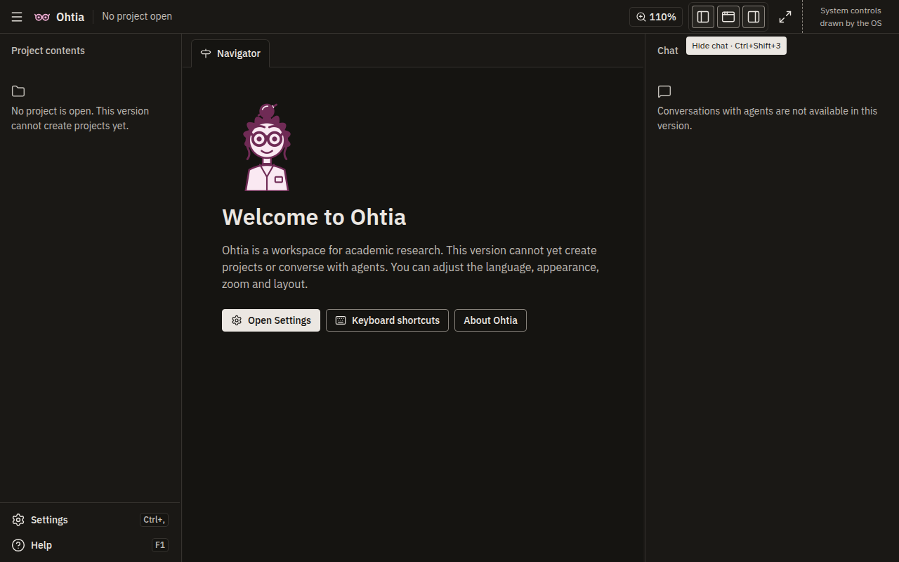
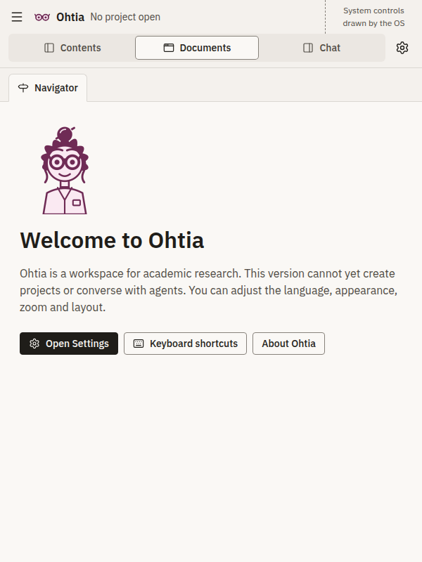
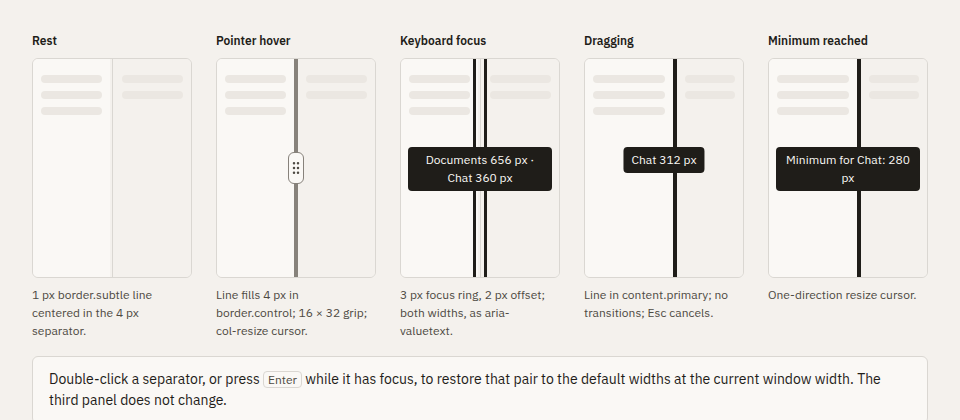
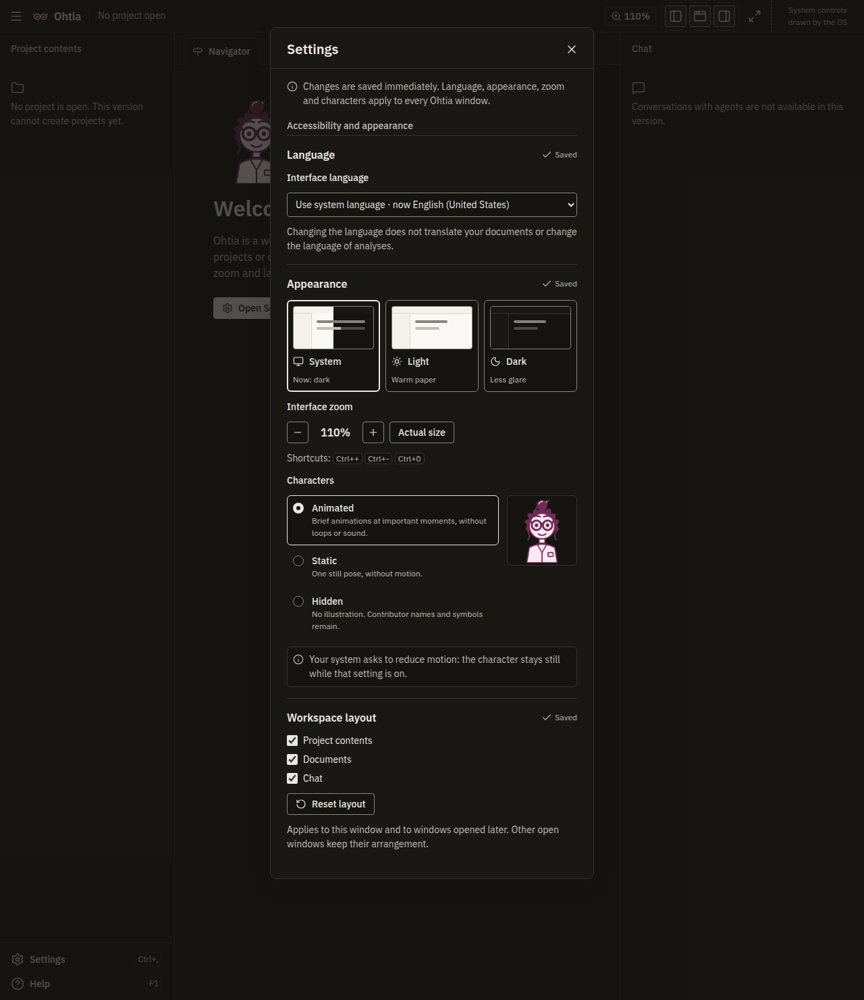
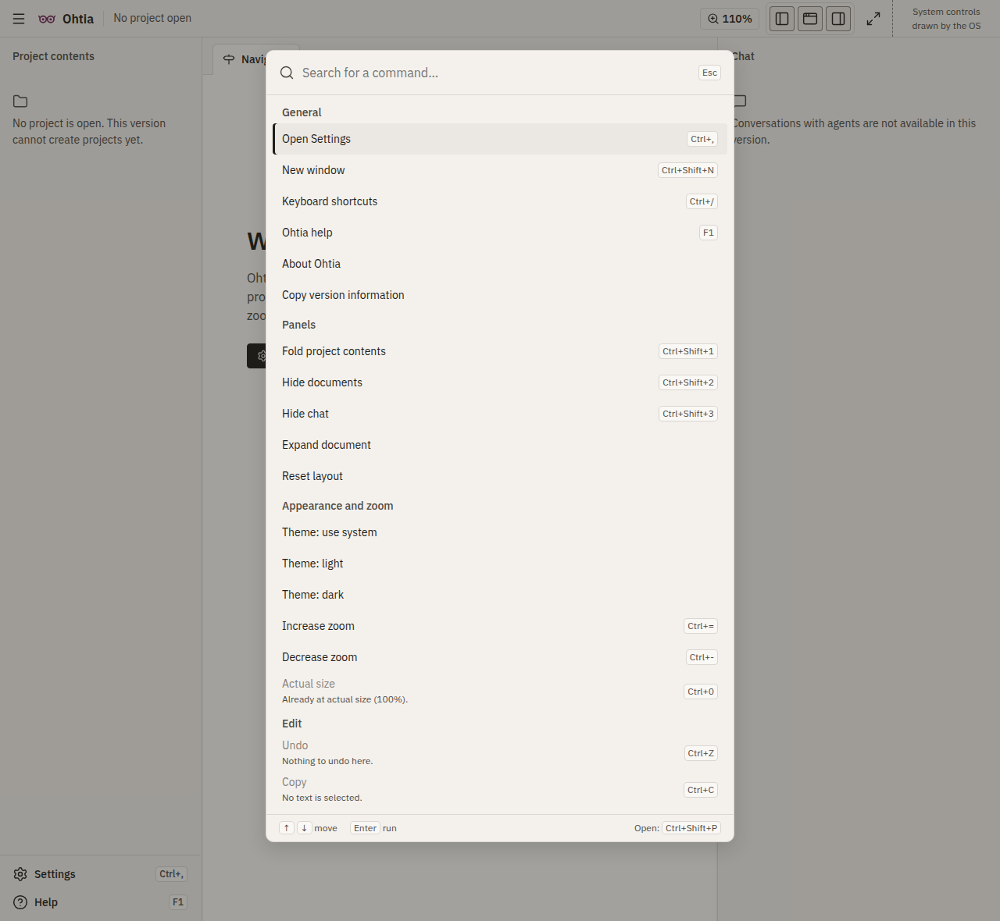
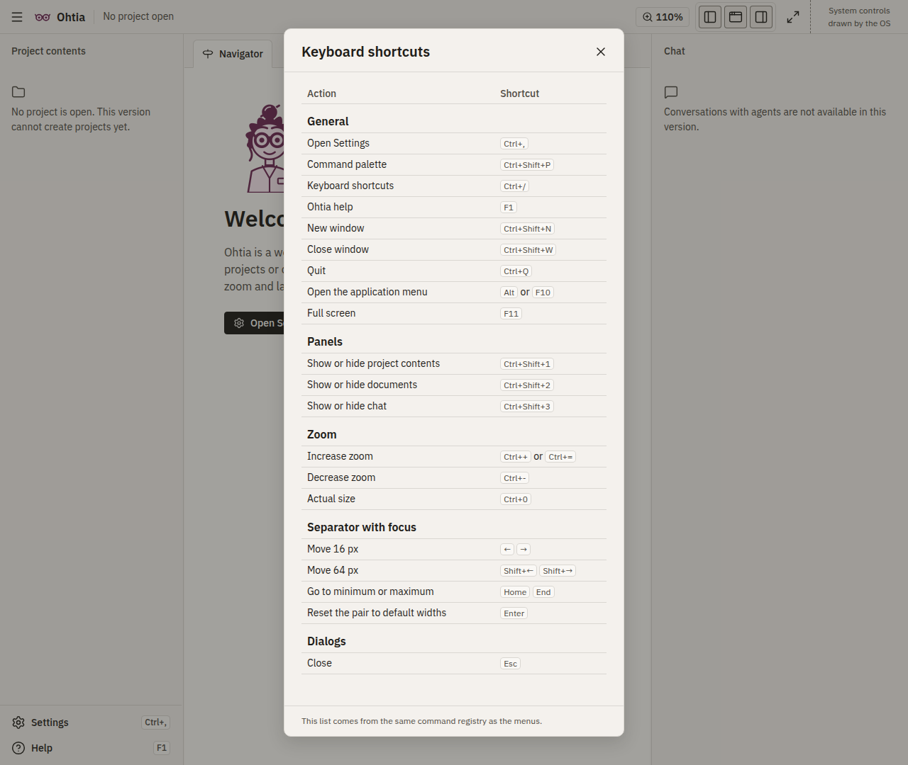

# EPIC-002 — Basic interface

## Description

Deliver the accessible, localized desktop interface: an integrated single-row title bar, native menus, workspace controls, a command palette, keyboard-shortcut help, Help/About, compact Settings and reusable visual primitives. The increment follows the desktop foundation and supplies the interface used by later research features.[^roadmap]

## Functional and technical specification

### SPEC-002-001: Purpose and delivery boundaries

The product principles retain their exact meanings: PRIN-002 researcher authorship, PRIN-004 provenance, PRIN-005 evidence versus inference, PRIN-006 uncertainty, PRIN-007 examined coverage, PRIN-008 disagreement, PRIN-010 correction, PRIN-011 task-centered language, PRIN-013 process preservation and PRIN-016 honest capability limits.[^product]

### SPEC-002-002: Application boundaries and progressive integration

Build strict TypeScript React presentation against the typed application port, with separate feature controllers and main/preload/data-service authority. Reuse the EPIC-001 shared locale service, bounded application-port schemas, isolated runtime and typed SQLite preference boundary when delivered; do not create competing services. Main validates sender/frame/origin, command identity and payload; the service rechecks versions and domain conditions. Rendering has no generic IPC, SQL, filesystem, provider SDK or arbitrary preference-key access. Retain sandbox, context isolation, no Node integration and the actual packaged CSP.[^frontend][^preferences]

Named preference operations carry the existing revision, idempotency and receipt contracts. Show submitting, confirmed, rejected, conflicting and uncertain separately; reconcile uncertain writes using their original operation identity. A refresh failure after success does not repeat the write. Confirmed preferences preserve unrelated records, private buffers and task state. Settings and layout never authorize inference, human knowledge confirmation or external transfers.

Observed implementation starting points at the pinned foundation revision: `packages/contracts/src/port.ts` owns the closed status/appearance messages and runtime decoders; `packages/preload/src/foundation-port.ts` owns the named client, generation/correlation checks and bounded streams; `packages/domain/src/appearance-command.ts` owns the transaction-supplied appearance receipt semantics; `packages/main/src/port-admission.ts` owns shared synthetic admission; and `packages/renderer/src/index.tsx` exposes a controlled appearance selector. Extend these verified boundaries rather than create a parallel command bus. The shared fixtures are `tests/fixtures/port-corpus.ts` and `tests/port.test.ts`. These sources establish portable contracts, not installed Electron wiring, durable SQLite, locale/layout/zoom operations or native conformance. The latter operations and adapters remain deliveries of their declared owners.[^port][^developer-workspace]

Integration plan: independent implementation can begin against the approved schemas and deterministic doubles; the real broker/data-service and packaged checks release integration gates. Revalidate doubles against the actual port, not an invented parallel API. The Dependencies table defines every execution input and its release condition. No EPIC-001 issue must wait for EPIC-002 to finish its own scope.

Issue relationships use native sub-issues and blocked-by dependencies. Every unsatisfied prerequisite backed by an issue is projected as consumer blocked by producer, including integrate and complete phase gates; the issue body retains the exact phase, required output and release evidence. This does not prohibit earlier design/unit/harness work allowed by the declared phase. Satisfied prerequisites remain in the durable output design but do not acquire an active blocker merely because their producer issue exists. External facilities with no issue stay documented; do not invent issue identities. Every story is a direct native sub-issue of the EPIC, separately from execution dependencies. Verify parentage, both dependency directions, acyclicity and actual output satisfaction before publication.

### SPEC-002-003: Token layers, bundled typography and static branding

About uses the approved original character PNG. The retained image is 512×512 RGBA, 32,224 bytes, SHA-256 `060657782a833c77461a0d099765a09b7dd397c60cc57d04d9765dc04c6fd4cb`. Keep its transparent background and square aspect ratio; do not redraw, recolor, crop or distort its source pixels. At 100% interface zoom, display it at 128 by 128 CSS px, capped by the available content width, with its square aspect ratio intact. The approved local SVG is the density-independent rendition of the same character: use it when the required physical image width exceeds the original 512-pixel raster. Keep the original PNG unchanged and available; do not describe resampling as new detail. Compare the two renditions before enabling the density switch and verify zoom and monitor-density changes in the native artifact. Package this controlled local asset with the delivered About surface. Existing character visibility/manuscript-safe rules remain applicable; compact branding continues to use the canonical local SVG glasses.[^character-raster]

Implement reference, semantic and justified component tokens from the current design system and workspace specification. Preserve aliases by name; components use semantic/component tokens rather than copied physical values. Export CSS variables and typed numerical metrics from a controlled representation, with deterministic generation or parity checks against both canonical documents. Check every defined token, not only colors. Keep light/dark values, overlays, shape, spacing, elevation, motion and icon mappings. Verify every permitted foreground/background pair; reject unlisted pairs. The design contract requires text 7:1, nontext 3:1 and inactive controls 3:1.[^design][^workspace]

The implementation uses three mechanisms: deterministic CSS/metric generation with a read-only drift check; an explicit contrast-pair allowlist checked by independent luminance calculations; and a font manifest checked against actual bytes and CSS declarations. Avoid a second hand-maintained size/stack/motion/z-index map that can drift while generation still passes. Missing or duplicate definitions, unresolved aliases and absent workspace tokens must fail validation. Theme tests distinguish explicit light/dark from system changes; reduced motion resolves all ordinary transition durations to zero. Forced colors preserve borders, strokes, labels and focus using appropriate system colors.

Bundle the ADR-0025 selected local faces and licenses with exact package patches, native font versions, hashes and actual repertoires. UI Sans, authored-document Serif, literal-code Mono and rendered-math Math roles follow content, including quoted passages, rather than surface. Apply all declared UI and document scales; no text below 12 px, no synthesized faces, numeric line heights, 34em reading measure, start alignment and paragraph spacing. Keep Plex before Korean fallback for accented Latin, nonbreaking spaces and currency signs. Validate all 11,172 Hangul syllables, required jamo/tones/Hanja, mixed scripts and U+207F's restricted fallback. Korean uses keep-all plus anywhere wrapping and upright emphasis dots; code does not promise two-column Hangul. Math faces need actual MATH data; formula parsing and unverified Hangul-in-math support are not enabled here.[^fonts][^design]

Use local Lucide assets with their licenses and actual export checks; pin their exact version at implementation under the repository decision rules. The compact original glasses, 24px icon variant, 25–95px filled variant, static character silhouette and Ohtia name follow the existing local SVG geometry and scale contract. The name uses type.ui.subheading beside the glasses. Existing assets are inspected reference material, not proof of packaged rendering or permission to distort geometry.

Verification: mutate a token, remove an alias, introduce an unlisted color pair and alter a font byte/CSS range; each appropriate check must fail. Exercise both themes, system changes, forced colors, 40% expansion, offline font loading and each type role with Latin/Korean specimens. This story delivers styling/assets and scoped automated checks, without waiting for downstream primitives or claiming manual linguistic/accessibility certification.

Publication moves the retained original PNG into `docs/assets/ohtia/illustration.png`, beside the existing SVG, and rebases its references. It must not leave a duplicate product image in the published EPIC directory. Preparation retains the one staging copy until that approved move.

### SPEC-002-004: One locale service and complete catalogs

Ownership and closure: STORY-002-002 delivers the locale service/schema, the 25 JSON files and complete messages for its own language controls and inherited delivered foundation surfaces. It does not wait for messages from menus, primitives, Settings or later research specimens. Each consuming story adds the complete 25-locale values for its own new keys in its own logical change, using the same contracts and files; it cannot defer those values back to the locale producer. STORY-002-010 checks the final union of delivered message keys and surfaces, and STORY-002-011 validates catalog structure, provenance and contextual presentation without requiring human translators. This preserves a closable locale producer and avoids a return dependency from that producer to its consumers.

Create one UTF-8 JSON file named `<locale>.json` for each of the 25 supported locales in the renderer's shared localization module, reusing its foundation-established package layout. `en-US.json` is the authoring/reference catalog. The localized values include every delivered visible message, help, error, progress state, menu item and accessible label. Every feature adding a key updates all 25 files in the same logical change; no runtime machine translation is required to use the installed interface.

Message keys and interpolation identifiers are stable English identifiers. Use semantic dotted names such as `menu.help.about`, `settings.language.useSystem` and `settings.appearance.theme.dark`, rather than a source-language sentence, array position or translated label as an identifier. Only message values are translated; protocol IDs and keys retain their original English spelling. Derive/check TypeScript message and parameter contracts from the shared schema so unsupported keys, missing/extra keys, malformed message syntax, missing parameters and invalid locale-specific plural/select forms fail. Do not require every language to have identical plural categories; apply the shared message contract with each locale's required forms.

Creation sequence: define the message inventory and typed parameter contracts, author the English reference values, produce complete translations for the other 24 locales, run structural/formatting checks, exercise the messages in their actual surfaces and record the actual model generation provenance. Human linguistic review is optional future improvement, not an acceptance or release gate. Machine assistance is allowed and disclosed; repeated text in regional variants is not proof of regional review. Pseudolocalization is a separate synthetic test resource, not a 26th supported locale or a fallback for missing translations. Exact private module/file organization can follow the real foundation package, but the 25 JSON filenames and complete key/value obligations are fixed.

Extend the single EPIC-001 typed locale service for every delivered menu, control, error, progress, notification and accessible label. The complete inventory is en-US, en-GB, en-AU, en-CA, es-ES, es-MX, es-AR, pt-BR, pt-PT, fr-FR, fr-CA, fr-BE, de-DE, de-AT, de-CH, it-IT, nl-NL, nl-BE, sv-SE, da-DK, nb-NO, fi-FI, ca-AD, ca-ES and ko-KR. Validate exact key/parameter/type/plural/select and syntax parity for all 25 catalogs; never mask missing messages with per-key fallback.[^product][^locale]

Main obtains app.getPreferredSystemLanguages(). A supported explicit choice wins; otherwise process OS tags in order, canonicalize with Intl.getCanonicalLocales, skip malformed tags, strip extensions, try full base locale then language+region without script/variants then the explicit language mapping, and only then advance to the next OS preference. Mappings: en→en-US, es→es-ES, pt→pt-PT, fr→fr-FR, de→de-DE, it→it-IT, nl→nl-NL, sv→sv-SE, da→da-DK, nb/no→nb-NO, fi→fi-FI, ca→ca-AD, ko→ko-KR; nn has no Bokmål mapping. Exhaustion uses en-US.

Test every exact locale and mapping: explicit es-AR beats [en-GB, fr-CA]; [es-CL, en-GB]→es-ES; [zz-ZZ, fr-CA]→fr-CA; ca-ES stays ca-ES; ca-ES-valencia→ca-ES; de-Latn-CH/de-CH-1996→de-CH; pt-AO→pt-PT; en-IN→en-US; no/no-NO→nb-NO; [nn-NO, en-GB]→en-GB; empty/unavailable/unmatched lists→en-US. Test invalid tags and extension stripping.

Reject a new unsupported explicit value without replacing saved state. An invalid/unavailable saved choice reports a controlled error and uses system resolution without rewriting the rejected record. Resolve at startup and when returning to system mode. Confirmed choice changes Ohtia messages, menu labels, formats, future notifications and html.lang across windows without remounting away unsaved input. Do not promise arbitrary live OS-language detection through browser events or change OS-owned text. Catalogs use controlled error codes/parameters, not parsed diagnostic prose. UI, analysis, source and revision manuscript language remain separate; no setting translates existing content. Test locale formatting within its actual ICU environment rather than asserting cross-runtime byte equality. STORY-002-011 records that the initial translations are model-generated and not human-reviewed; structural and presentation checks do not certify fluency.

### SPEC-002-005: Semantic primitives and isolated development catalog

Create local semantic React primitives for the concrete interface tasks: button/icon button/link; labeled text field, selector, checkbox/radio/switch; manual-activation tabs; action menus and contextual menus; dialog/confirmation; tooltip/popover; notice/toast/state label; simple data table, skeleton/progress and nonmodal panel/separator. Document each delivered purpose, anatomy, variants, supported states, consumer content/callbacks, width behavior, ARIA pattern/deviations and tokens. Use native select first; introduce a combobox only for demonstrated searchable/long-list needs. Primitives receive translated content and callbacks without storage/provider authority.[^design][^frontend]

Buttons retain labels while loading. Disabled actions explain their condition; icon-only buttons have full names/tooltips. Links are underlined. Field errors identify correction, remain visible and preserve input; validate on blur/submit, not during composition/typing, and link an error summary to fields. Menus contain actions; tabs activate on Enter/Space rather than arrows. Close controls are sibling buttons, never nested. One modal makes background inert, contains focus, closes by button/Esc and restores its trigger; destructive confirmations initially focus the safe option. Tooltip/popover content is dismissible, hoverable and persistent under the specified conditions, and contains no indispensable tooltip-only information.

Status/alert semantics distinguish accepted completion from blocking failure without moving focus. One toast at a time; errors have a durable inline location. Pending/rejected/confirmed/review-required states use labels and shapes, never color alone. Tables expose headers/sort and right-aligned numerals, with compact list presentation. Long lists use explicit batch/page actions. Skeletons mark aria-busy and long operations use phase/determinate progress without looping decorative motion.

Status primitives keep requested, accepted, uncertain, failed and confirmed outcomes distinct. Repeated passive snapshots do not announce a new completion, field acknowledgements never clear newer input, and disposal prevents late focus/toast callbacks. Expose controlled callbacks only; untrusted success or approval prose cannot enable an action. Verify these orderings with synthetic callbacks and clocks, including listener/timer cleanup. These presentation checks do not certify any task or durable effect.

Create a separate synthetic catalog entry/build with the same tokens and restrictive CSP. Product assets, workers and entry graphs must exclude catalogs, fixtures, test transports and specimen routes. Do not add an independently distributed design-system product. Verify semantic interactions, forced colors, keyboard focus, IME-safe fields, loading/errors, compact states and negative build-admission tests. The primitive story closes on its standalone contracts and catalog, not on delivery of later pages.

### SPEC-002-006: Named commands, native menus, Help and About

Registry ownership and staged integration: STORY-002-004 delivers the named command/availability/context contract, native menu/shortcut dispatch and its own functioning Help/About surface. It defines the Settings, zoom, New window, open-application-menu, command palette and keyboard-shortcuts command entries with their accelerators from SPEC-002-024, and tests registration, unavailable reasons, invocation and handler disposal with deterministic handlers. It also supplies its own local help handler. The concrete Settings and persisted zoom handlers are supplied by STORY-002-007; workspace visibility/focus/reset handlers are supplied by STORY-002-006 using STORY-002-005; New window and open-application-menu handlers are supplied by STORY-002-013; the command palette and keyboard-shortcuts handlers are supplied by STORY-002-014. Until the real handler is registered, its menu/shortcut entry accurately reports unavailable and performs no pretend action. The command-registry producer closes on those declared contracts and its own real native menu/Help/About checks, without waiting for those consumers. STORY-002-012 composes the actual handlers and entry points; STORY-002-010 verifies them before EPIC acceptance.

About receives a controlled effective decoration state supplied by the trusted composition, with static fallback and Hidden-state rendering tests against that declared input. A missing future Settings controller never becomes a hidden dependency of the menu producer. STORY-002-007 supplies the confirmed preference/controller notifications, while STORY-002-010 verifies their real multiwindow propagation into About and the interaction with character visibility. Keep the full character out of a manuscript-visible arrangement under the identity contract; the text/name/version/compact branding remain available. The view/control input checks are not evidence that the later persisted Settings integration has passed.

About contains the Ohtia name and character illustration, a short localized description of the academic research workspace, the actual running version and build identity, the repository's author/copyright notice, the MIT license, bundled third-party/font notices, and links to this project's repository, documentation and issue-reporting surface. Derive version/build values from trusted running-artifact metadata, and copyright/license text from controlled bundled notices; do not invent an author, year, build number or unverified update status. Include a localized Copy version information action; announce success only after actual clipboard confirmation, and report a controlled failure without losing dialog focus. Copy only the displayed version/build identity and the displayed operating-system family and CPU architecture, not private paths, project data or credentials.

Agreed About layout from the mockup review:[^mockups] a modal dialog using `component.dialog.max-width`, with a close button at the top end, the 128 CSS px character, the glasses symbol beside the name `Ohtia` as the dialog's H1, and the one-sentence description. A bordered version box shows Version, Build and System as a definition list; System shows the localized operating-system family and CPU architecture (for example `Linux · x86-64`) obtained by main from the running process, without OS version strings, host names or user names. The Copy version information button sits inside that box; its confirmed result appears beside it as a neutral `clipboard-check` status reading Copied, and its controlled failure as an inline danger alert saying that the version text can be selected and copied manually. The copied text contains exactly the displayed product name, version, build, OS family and architecture. Repository, Documentation and Report a problem are underlined links followed by a caption with the `external-link` icon stating that links open in the browser. The MIT license line names the copyright holders from the bundled notice. Third-party notices sit in a disclosure button (`aria-expanded`, `aria-controls`) that reveals a named, focusable list with its own bounded scroll; each entry names the component and its license. A footer Close button repeats the close action. With characters Hidden the illustration is omitted and the glasses symbol with the name remain; no empty space is reserved.

The name, description, version/build and license/notices remain available offline; visiting external links is an explicit broker-authorized action. Updating/checking for updates retains the separately delivered foundation lifecycle and is not an implied About capability. The image is static, uses the 128-CSS-px size and PNG/SVG density rule in SPEC-002-003, and preserves transparency and aspect ratio and accompanies textual branding; treat it as decorative for assistive technology when the adjacent name already conveys its meaning. Test its actual bounds, theme/background treatment, hidden-character behavior and zoom without claiming that a raster is an animation asset.

View's Increase zoom, Decrease zoom and Actual size actions use the named commands, platform shortcuts and single preference contract defined in SPEC-002-019.

Define one typed named-command registry shared by native menus, shortcuts and contextual/chrome entry points. Its contract identifies command, localized label, availability/reason, invocation context, handler lifecycle and result. Presentation commands operate on the originating window controller; native menu state follows the focused window. Domain commands remain bounded application-port operations and cannot gain permission from a menu or accelerator. Dispose handlers on window teardown and reject stale contexts or unregistered IDs.[^roadmap][^frontend]

Use File, Edit, View and Help, adapted to native conventions including the macOS application menu. Keep Settings in stable chrome and its appropriate native menu. Supply functioning Edit undo/redo/clipboard only for the focused delivered surface; respect native roles, OS conventions and composition. View offers the command palette, delivered region visibility, document focus mode, reset, zoom and appearance entry actions; Help offers local help, keyboard shortcuts, documentation, problem reporting, Copy version information and About. SPEC-002-024 holds the complete agreed menu structure, command additions and shortcut inventory. About gets the actual running artifact's version from trusted metadata rather than a separately hardcoded UI string. Preserve focus when a command closes or reopens a surface. Default Quit/close behavior reuses the admitted foundation lifecycle; later active-task exit remains ADR-0011's owner.

Do not display pretend project import/export, provider, diagnostic or research actions. Relevant unavailable entries explain their missing capability in Ohtia-rendered surfaces (the command palette, buttons and help); native menus mirror only the enabled state, because Windows and Linux native menu items cannot show explanatory text (SPEC-002-024). Absent future features need no menu stub. Opening help or About works offline and starts no inference. Any external link follows the broker's authorized destination handling. Verify menu/shortcut/context consistency, focused-window routing, composition, text editing, unknown-command rejection, availability updates, platform menu conventions and actual artifact version.

### SPEC-002-007: One deterministic layout controller

Implement one pure layout calculation and per-window controller against workspace-layout.md. W is floor(available CSS width); at W≥1024, A=W−R−4×(n−1). Explorer initial/minimum 256/200; chat 360/280; documents minimum 320 and initial max(L, W−624), where L=34×18+2×(12+8)=652. Hidden explorer leaves a 40px rail, 48px for coarse pointer; other hidden regions leave no rail. Allocate surplus to documents, else chat, else explorer. Yield shortage from documents to L, chat to minimum, explorer to minimum, then documents to minimum, skipping absent/already-below-threshold panels. Floor allocations and give remaining integer pixels to the last visible panel. Effective viewport adjustment never changes saved preference. Reopening gives the other side panel priority to yield before the reopened side after documents reaches L.[^workspace]

Oracles: 1440→256/4/816/4/360; 1280→256/4/656/4/360; 1024→200/4/536/4/280. At 1440 with documents hidden, explorer 256, separator 4 and chat 1180; restoring documents recovers the original allocation. Only documents/chat receives 1400 with a 40px rail or 1392 with a 48px rail; only explorer gets 1440. Verify every nonempty visibility combination, fractional W, minima, rounding and reopened constrained preferences.

Resize transfers only adjacent effective widths; the third panel stays fixed. ArrowLeft/Right transfer 16, Shift 64; Home/End choose neighbor-constrained extrema. Minus/Plus transfer 16 to the right neighbor, else left; no sizing buttons with one region. At initial 1024, left separator allows explorer200–416/documents536–320; right allows documents320–536/chat496–280. Pointerup alone confirms; Esc/pointercancel/focus loss/unmount/viewport or visibility change restore the start before recalculation and release capture/cursor/selection locks. No transitions during drag. Successful resize saves visible effective widths and preserves hidden preferred widths.

Focus mode snapshots visibility/preferences only in memory, shows documents plus rail and retains focus. Return resolves the snapshot at current viewport; manual visibility/width actions exit focus mode without stale restoration. Narrow W<1024 shows exactly one region, no rail/separators/resize/focus controls; preserve focused visible region on entry, else documents/chat/explorer, first opening documents. Entering narrow discards the focus snapshot but preserves underlying wide preferences. Reset shows defaults at current wide width, or saves defaults at 1280 and selects documents while narrow. Neither viewport/zoom, canceled drag, narrow selection nor focus-mode entry/exit persists. No layout action sends, stops or restarts research work. The controller reports controlled outcomes and focus intents rather than owning translated UI strings; STORY-002-006 and STORY-002-007 supply the complete localized labels and announcements for their actual surfaces. The controller is verifiable with a deterministic harness independently of downstream chrome; actual page wiring is STORY-002-006.

### SPEC-002-008: Preference contracts and cross-window failure behavior

Producer/consumer boundary: STORY-002-002 owns the language choice controller; STORY-002-005 owns the layout record/controller; STORY-002-007 owns appearance, character-choice and zoom commands, validation, receipts, cross-window publication and the compact Settings UI. The decoration renderer in STORY-002-008 consumes the confirmed/effective character state; it does not own preference storage. The menu/About producer verifies a controlled decoration-state input rather than waiting for the later Settings writer. Each producer verifies its own real persistence/port guarantees or controlled rendering contract, and STORY-002-010 verifies that they compose. A presentation receipt is not proof that every consuming renderer applied it; distinguish saved preference success from a window's application/refresh failure.

Use the existing application_preferences record owner and broker-owned bootstrap locator under ADR-0036. Introduce or extend only named validated feature operations with schema version, monotonic revision, expected version and transactional receipts. Preference changes cannot change storage location, execution_limits or arbitrary caller-defined keys. Any needed schema transition uses the foundation's verified migration/checkpoint path before first use.[^preferences]

workspace_layout is exactly {version:1, visible:{explorer, documents, chat}, preferredWidths:{explorer, documents, chat}}. Require exact keys, three booleans with at least one true and finite widths from each panel minimum to 100000. Reject extra/private fields and unknown versions. Missing/invalid data selects defaults without mutation; failed load of layout alone does not invalidate research storage. Save completed resize, visibility and Reset; visibility-only writes retain all preferred widths. Broker serializes complete records. Each window loads latest on creation, retains its own live layout, and does not rearrange after another window writes. Last accepted write supplies later windows; never automatically retry a stale complete record. Failed writes preserve live layout and announce once per application session that it could not be remembered. Persist no IDs, titles, paths, tabs, messages, source versions or private buffers.[^workspace]

appearance is system/light/dark, default system; confirmed changes apply across windows/restart, and system tracks OS appearance without changing OS settings. interface_locale obeys SPEC-002-004. character_presentation schema version 1 is exactly animated/static/hidden; missing→animated, corrupt/unreadable/unavailable store→static without rewriting evidence. Confirmed changes apply across windows/restart; failure retains the prior confirmed value and marks any preview unsaved. Explicit replacement/reset may replace an invalid record through ordinary validation/revision/receipt rules.[^identity]

Before the store is available, use the documented system locale/appearance and static-character presentation fallbacks without claiming saved preferences loaded. Research windows require normal compatibility/migration admission. Test real file-backed commit/failure/restart, mismatched versions, stale windows, unknown receipts, refresh-after-success and preservation of unrelated preferences. These four existing feature contracts share one preference store. SPEC-002-019 defines one additional declared interface_zoom key and SPEC-002-022 defines one additional declared window_bounds key under that same boundary; neither is hidden inside appearance or workspace_layout.

### SPEC-002-009: Workspace composition and incremental scenario coverage

Compose the context bar, which is also the window's integrated title-bar row under SPEC-002-022, above explorer/documents/chat with the one layout controller and application port. Bar stays outside hideable regions, with named controls and wrapping essential actions; its agreed contents and order are in SPEC-002-023. Brand/project context remains accurately unavailable when no project capability exists, shown as plain text without disabled project-selector or Create project stubs. Supply a fixed first nonclosable Navigator surface with the first-run welcome of SPEC-002-023 and explicit unavailable/empty region text without fabricated projects, messages, research or providers. The actual Navigator workflow, project forms, populated collections and document operations belong to their owning later epics.[^workspace][^roadmap]

Respect PanelLeft/AppWindow/PanelRight, Maximize2/Minimize2, RotateCcw and Settings icon/name mappings; RotateCcw Reset layout now lives in View, the command palette and Settings rather than the bar (SPEC-002-023). Last-region hide remains focusable aria-disabled with an explanation; rail is not a panel. Before hiding a focused region move focus to its context-bar control; reopening focuses its heading and restores reading position. Hidden content leaves Tab order and the accessibility tree while in-session state survives. Settings remains reachable in explorer footer, rail and narrow chrome. Only one full-width region exists below 1024; essential context controls never disappear into overflow. Skip link, context bar, explorer, documents and chat have matching DOM/visual order. Scrollable children shrink; wide content scrolls locally in named focusable containers, not the page. Headers/footers remain outside scrolling content.

Bind asynchronous callbacks to the current controller and selection incarnation; dispose subscriptions when replacing a view. Repeated passive updates must not clear newer synthetic input, steal reading focus or revive a dismissed surface. Exercise A → B → A controlled view changes with distinct markers and delayed callbacks; this is fixture coverage, not implemented project switching.

Use presentation models with stable scope/resource identity, expected versions, selection revision, collection state and supported callbacks; controller owns layout rather than domain decisions. Stale callbacks cannot change current selection. Manual tabs and scoped buffers have controlled harness coverage now; real stable document identity, save/discard/close and project-switch isolation are later integration duties, never simulated production promises.

Own V01–V03 and V10–V12 for actual delivered chrome. Exercise V04–V06/V09 presentation specimens only where these controls exist; record the exact tested subcases. V05 real project/conversation commands, V08 actual history/project switching and V09 actual versioned-document close/save remain EPIC-003/004/007. Do not mark a whole scenario passed from its fixture subset. Preserve synthetic form/input/selection/scroll state across panel moves, themes and locale changes; production shows genuine unavailable states. Verify contracted Settings invocation/availability against registry doubles here; the final Settings-to-workspace journey is checked by STORY-002-010 after both concrete implementations exist.

### SPEC-002-010: Extensible Settings with real application preferences

Closure and integration ownership: STORY-002-007 verifies its own real native menu entry, dialog, named preference operations and multiple-window setting publications. Chrome entry points use the registry/trigger contract supplied by the already-declared producers; the complete context-bar, footer, rail and narrow DOM journey is composed in STORY-002-012 and verified in STORY-002-010 after the workspace exists. The Settings producer does not wait for the workspace chrome or character-renderer consumers to finish; controlled consumer tests verify the notification contract, while actual renderer cancellation/placement is verified by the renderer owner and final integrated delivery. The root composition added in STORY-002-012 connects the independently usable outputs and is real integration work, not a mock substitute for the final product journey.

A single Settings screen keeps language selection beside the controls affecting readability and presentation; accessibility remains a requirement for every screen rather than an optional mode. Do not duplicate the language control in multiple pages. Future Connections, Storage or Diagnostics categories appear only with their real operations, without empty placeholders.

Deliver one single-modal Settings screen, reachable from stable native/chrome commands, with one combined Accessibility and appearance section. Do not add a side navigation, tabs or a separate page for selecting language in this initial increment. Within that section provide Language, Appearance and Workspace layout groups, with Characters under Appearance; Appearance also contains the visible zoom percentage/control. All group titles and explanations use the shared catalogs. Preserve the existing Settings → Appearance → Characters route as an in-screen grouping, not a required stack of nested pages. This compact grouping is agreed; it may grow into real categories when later capabilities justify them. Group relevant controls without an onboarding questionnaire. Use max-width 480 and at least 16px margins, internal scrolling, a title/close action, initial focus, inert background and trigger restoration. A typed extension seam lets later owners add only delivered sections; no dead Connections, Diagnostics, Storage, analysis-language or concurrency controls are supplied now.[^roadmap][^workspace]

Language offers the complete supported list and Use system language. SPEC-002-025 defines the agreed presentation of every group, the autonym language list and the save-state treatments. Appearance offers System/Light/Dark with Monitor/Sun/Moon, the zoom percentage with decrease/increase/reset, and Characters with Animated/Static/Hidden. Workspace layout exposes the same region/reset commands and controller, without a second layout record. The zoom contract and persistence are defined once in SPEC-002-019. The shell binds each feature controller to its named application-port operations; show effective versus saved choice, pending, conflict/failure and uncertainty correctly. A confirmed locale/appearance/character change propagates across windows; layout remains local to each controller as specified. An application preference change preserves private input, selected content, composition and task state and starts no inference.

Implement safe retry/reconciliation rather than replacing uncertain operation IDs. Reject extra keys, invalid values and stale revisions at real boundaries; errors retain the prior confirmed choice and usable input. A successful preference receipt followed by refresh failure stays successful with a separate refresh problem. Structural labels/announcements ship in every locale. Test access through all entry points, native editing/IME, Esc/focus, failure/restart and multiwindow semantics; final cross-page native and catalog qualification is owned downstream, not a return dependency.

### SPEC-002-011: Character presentation and attributed static identities

Deliver the character renderer and Animated/Static/Hidden effective-mode handling against the named preference contract, keeping contributor portraits static. Ohtia is the female product character; Virgilio is Virgilio · Research guide · AI; specialist role identifiers include Reference librarian, Analytical reader, Critical evidence reviewer and Writing review with Academic editor/Proofreader modes. Use distinct static symbols, names and localized roles in voice.ohtia; only original human supervisor feedback uses voice.tutor and user-round. Unknown producers remain unknown, and cosmetic identity changes never rewrite authorship or review state.[^identity][^design]

Preserve the existing glasses/character geometry, bun/pencil/curls/coat, piece layer order, 96px character threshold, scale and permitted static poses. Full illustration never appears over or beside a visible manuscript; compact still identities preserve attribution. Decoration is hidden from assistive technology; text supplies all meaningful information. Hidden mode preserves compact contributor symbols, names, notices and actions. Reduced motion overrides animated→static and never overrides hidden; turning it on cancels active/deferred motion immediately. Static/Hidden changes cancel immediately across affected windows; returning to animated never replays old events.

Scope: no production research-event animation binding in this increment. Product branding, Settings preview and synthetic event specimens are sufficient for the control/renderer contract; later screen owners bind welcome/return, milestone, qualified disagreement and final submission only with actual committed events. Catalog controls exercise the renderer without representing them as application events. Event bindings identify project/action/result/producer, relevance, text and pose; they consume no provider prose as instructions. At most one animation per workspace/batch, one play ≤4.6s, no loops/queues/focus stealing/sound. One eligible manuscript-visible event may defer once to the first explicit Navigator opening within its original batch if still relevant and unused; consumption/dismissal/resolution/project close/restart/nonanimated mode invalidates it. Passive restoration is static. Falling apart remains disabled until a frequency rule is reviewed. New specialist illustrations require recognition/accessibility evidence before use.

Keep the contributor role/definition, actual artifact producer, optional provider/model observations and execution state as separate presentation fields. A role icon never proves that a provider is ready, a contribution is independent or evidence has been human-confirmed. Historical messages/specimens retain their producer when the selected contributor changes. Unknown runtime/model observations stay unknown. Use controlled specimen inputs for this increment; implement no contributor switching, model discovery or provider probe here.[^identity]

Fence character callbacks by their original event, batch and renderer lifetime; repeated delivery consumes no second animation allowance, while a valid new batch remains eligible. A callback delivered after dismissal, renderer replacement or mode cancellation cannot revive motion. Test these controlled event orders and cleanup alongside preserved contributor attribution.

Verify all mode transitions, OS overrides, canceled/deferred batches, restart static recovery, geometry/key poses for any delivered preview, manuscript-safe placement and preservation of text/attribution in grayscale/hidden/narrow layouts. The full 31-animation catalog is not a product enablement requirement here; no inference route or research evaluation is implied.

### SPEC-002-012: Research visual specimens without domain authority

Reuse the already-present local reference assets: [the interface and document specimen](../../assets/design-system-specimen.html), its [light interface capture](../../assets/design-system-interfaz-claro.png), [dark interface capture](../../assets/design-system-interfaz-oscuro.png), [document capture](../../assets/design-system-documento.png) and [Korean capture](../../assets/design-system-coreano.png). Brand geometry and poses are in the local [glasses](../../assets/ohtia/symbol.svg), [character](../../assets/ohtia/illustration.svg), [glasses dimensions](../../assets/ohtia/symbol-dimensions.svg), [character dimensions](../../assets/ohtia/illustration-dimensions.svg), [pose sheet](../../assets/ohtia/poses.svg) and [character specimen](../../assets/ohtia/specimen.html). These links resolve to the current repository assets during preparation; publication rebases them to the same canonical assets at the new directory depth, without copying or replacing those references.

The reference documents already live in this repository and are the starting points for comparing typography, provenance shapes, outcomes and state treatments. Preserve their original specimen content and historical evidence; examples are references, not production data or current native/conformance results. The reference HTML's pinned external-font requests and historical Offline/save-safety captions do not define product packaging or current save behavior. The new development catalog reuses those visual contracts with packaged local fonts, complete current messages and the real application CSP; it does not ship the documentation specimen or copy obsolete protocol/asset references over current ones.

Deliver separate synthetic catalog specimens of VoiceLabel, EvidenceHighlight, TutorComment, ProposalCard, ContrastResult, CritiqueLevel, ObservationCard, ReviewRequired, CoverageStatement, SourceRow, ProcessingStatus, RestrictionBadge, WeeklyActions, StageStatus, PaceIndicator, SaveStatus and VersionConflict at their declared design-system scope. Choose controlled composable components where an actual later consumer benefits; specimen-only presentation need not create a generic service or pretend durable model.[^design]

Show source versus extraction versus interpretation, researcher text, named AI voices and original supervisor quotation distinctly. Ohtia proposals and pending content use dashed treatment. Researcher-confirmed content uses a solid rule with the exact reviewed version and scope. Rejected content retains its reason; changed support requires review without moving old anchors. Confirmed is no scientific correctness certificate. Comparison outcomes retain reason/coverage: supported, partly supported, ambiguous, not found, contradicted and not verified; inaccessible is not contradiction. Critique levels are verifiable error/defensible weakness/reviewer question, without grades or alarm colors. Coverage includes examined records/full texts/inaccessible/omitted material. Received is not read; restrictions keep lock/text and inheritance visible.

Include controlled specimens for Stop requested versus cessation unknown, execution completed versus result unavailable, partial examined coverage, unknown usage and unreviewed evidence. Do not call unknown usage zero or let model prose claiming approval change the typed state/action set. A producer label is independent of provider readiness, and old contributions retain attribution when the selected identity changes. Test these cases without live inference, Stop, billing or editorial commands.

Navigator specimens distinguish stage/state/focus/pending proposal, at most 5 weekly actions with what/why/done/time, and pace only for an agreed plan; unknown/not-applicable differs from 0%/100%. Saving/saved/unsaved/failed/conflict remain distinct; successful saves use neutral treatment and actual version, network offline does not block local-save presentation. Conflict specimens preserve local text and compare/recover affordances. Use safe synthetic callbacks demonstrating actions as callbacks, never issuing human confirmation, applying prose, dispatching agents or persisting research. Complete data actions and rich format/editor behavior belong to later owners. Test compact widths, long content, untrusted text, mixed-language content tags and every voice/state in both themes.

### SPEC-002-013: Accessibility requirements for foundational controls

ADR-0023 already adopts WCAG 2.2 AA over complete interface surfaces/processes and eleven additional AAA criteria: 1.4.6,1.4.8,2.1.3,2.2.4,2.2.5,2.2.6,2.4.8,2.4.10,2.4.12,2.4.13,3.3.6. Apply all applicable A/AA criteria and those selected AAA requirements to delivered foundations; this is not general AAA conformance. ATAG 2.0 Part B is authoring guidance, preserving PRIN-002.[^accessibility][^wcag]

Component owners verify keyboard-only operation, focus order/restoration and unobscured 3 px focus with 2 px offset, names/roles/states, actual accessibility tree, contrast pairs, zoom 200%/400%, text spacing(line 1.5 / paragraph 2 / letter 0.12 / word 0.16), forced colors, reduced motion and both themes. Targets are at least 24px and 44px coarse; dragging has pointer and keyboard alternatives. Check 320/600/1024/1280 widths, pseudolocalization≥40% and longest translations including Korean. Announce significant completed outcomes once rather than animation frames or tokens. Explain disabled/unavailable functions and preserve input through errors and setting changes.

Primitive/catalog/tree automation cannot certify whole-page conformance, native IME or screen-reader usability. Every result names actual artifact/platform/tools/criterion/journey and omissions. Owners close on their own automated and applicable boundary checks; downstream STORY-002-010 owns full-page/manual packaged assistive qualification and STORY-002-011 owns catalog and provenance checks; human linguistic review is optional. No upstream closure waits for those consumers.

### SPEC-002-014: Complete-page accessibility, attention and content language

For each delivered workspace, Settings, About/help and catalog research surface apply the ADR-0023 WCAG 2.2 AA target, all applicable A/AA criteria and its eleven selected AAA additions; no general AAA claim. Use the design system's complete-page keyboard, focus, contrast, zoom/reflow/text-spacing, forced-color, reduced-motion and locale rules, including 24 px / 44 px targets, 3 px focus with 2 px offset,320/600/1024/1280 widths,200%/400% zoom,≥40% pseudolocalization and actual long translations. Test only applicable scope and name any nonapplicable criterion with its rationale.[^accessibility][^design]

Every screen has one H1 and ordered headings; skip link and DOM/visual order agree. Menus, dialogs, tabs, region controls and named scroll containers expose correct names/roles/states. Controls stay visible at 1023/600/320, height 400 and virtual-keyboard conditions. Focus and text survive hidden regions, themes, locale changes and canceled interactions; no shortcut steals IME composition. Significant accepted outcomes use status once, blocking failures alert, and errors remain inspectable. No new observation interrupts writing except data-loss risk. No timeout/re-authentication may discard input.

Set html.lang from resolved interface locale; supplied content uses its recorded actual language and dir=auto where needed, never an inferred analysis/manuscript locale. Do not enable a manuscript-format workaround here. Unknown/wrong revision-language and unsupported mixed-language manuscript tagging remain later editor conformance blockers; provider authentication requires its own future verification. ATAG Part B guides authoring without certifying source or export accessibility. Native assistive results must identify actual OS/CPU/artifact/tool/criterion/journey; portable browser automation is separate. Failures and unexecuted applicable mandatory checks block a conforming/support claim, rather than silently narrowing it.

### SPEC-002-015: Packaged native and assistive verification

STORY-002-010 verifies the application delivered by STORY-002-012. It does not create the root composition or own another feature's implementation. Consume the integrated menus, Help/About, compact Settings, workspace, preference handlers and character presentation under the candidate protocol in SPEC-002-020. Inspect research specimens through the separately identified development catalog; they never enter the shipped Electron artifact, and their browser evidence is not native-product evidence. Upstream producers close on their own defined outputs; this verification adds no returning dependency.

Exercise actual keyboard and pointer journeys from workspace to Settings, through language, theme, zoom, characters and layout, then Help/About and back. Include the integrated title bar of SPEC-002-022 on every target: system window controls drawn by the platform and never covered by Ohtia controls, drag regions that move the window without capturing controls, the native double-click behavior, the overlay colors after theme changes, the Windows/Linux menu button with Alt and F10, the macOS system menu, and every registered accelerator with the title bar hidden. Exercise the command palette and keyboard-shortcuts dialog of SPEC-002-024, the panel and palette shortcuts on the Spanish, US English, French AZERTY, German QWERTZ and Korean keyboard layouts, separator pair reset by double-click and Enter, the absence of a white first frame in dark mode, New window at and below the active-window limit, and window-bounds restoration after restart, after disconnecting the saved display and when the saved size exceeds the current work area. Check trusted version/build copy and clipboard failure, the image density rule, complete delivered catalogs, restart and multiple windows. Use the real renderer, preload, main broker and file-backed service. Cover malformed senders, values and versions, failed or uncertain writes, refresh failure after a successful receipt, stale notifications, and preservation of unrelated records and private input.

Qualify Linux x86-64 and ARM64, Windows x86-64, and Apple Silicon on macOS 26 and 27 with their actual packaged artifacts and qualified native facilities. Windows ARM64 and Apple Intel are optional; an included optional target requires its own complete native evidence and cannot be qualified by emulation or another CPU slice. The pinned Linux x86-64 environment is additional evidence; cross-compilation and emulation do not replace native ARM64 results. Run the shared quality and coverage gates, actual CSP/sandbox checks, offline assets and catalog/fixture exclusion. Verify V01–V03 and V10–V12 for delivered controls, listing the exact V04–V06/V09 presentation subcases and the project/chat/editor portions deferred to their owners.[^roadmap][^foundation]

Define the criterion, journey and target inventory before execution. Run required keyboard and screen-reader journeys using qualified native tools and operators; record the actual Orca, NVDA or VoiceOver combination supported on each target. Include real Korean IME, clipboard, forced colors, reduced motion, text spacing, 200% and 400% zoom, 320-CSS-px reflow and long translations. Every failed or unexecuted applicable mandatory criterion remains unmet. This assistive verification is separate from optional human translation review.

Each result identifies the candidate ID, source tree, locks, target artifact digest, OS/version/CPU, locale, viewport, theme, tool/version, criterion, expected steps and observed result. Report findings through the shared candidate owner; do not edit the candidate independently while another verifier is running. After a correction, verify the new frozen candidate and invalidate affected previous evidence as specified in SPEC-002-020. Signing and release authorization remain with the existing release policy.

### SPEC-002-016: Catalog quality, translation provenance and contributor identity

STORY-002-011 validates the integrated candidate's catalogs, contextual text rendering, translation provenance and contributor identity. It consumes the composed root, including the real menus and Help/About, rather than reviewing disconnected specimens alone. Its candidate ID and target artifact digests follow SPEC-002-020.

Require all 25 locale JSON catalogs, stable English keys, exact typed parameters, valid locale-specific plural/select forms and complete delivered message coverage. Test ordered locale selection, language tags, numbers/dates in the actual runtime, long text, pseudolocalization, Hangul and mixed scripts, font fallback, emphasis and missing glyphs. Exercise real menus, Settings, Help/About, notices, errors and accessible names. These are reproducible catalog and presentation checks, not a claim of fluent or natural translations.[^locale][^design]

The initial translations may be generated by a language model and delivered without human linguistic review. Record a versioned catalog provenance manifest outside the message-key inventory: for each locale, bind the catalog hash and reference-catalog hash to the actual producer kind and model identifier when known, and record human review as not performed. Do not invent a model identity when generation does not expose one. The EPIC document's human verifier is not a translation reviewer and is never copied into catalog metadata.

Human review of translation meaning, terminology, regional variants, the Ohtia name's connotations and Korean typography is a voluntary future improvement. It is not a prerequisite for this story, the EPIC or release readiness. Preserve machine-generation provenance and the unreviewed state until someone actually reviews an identified version and scope; a later human review updates only that evidenced scope. No fluent reviewer recruitment gate or 25-language human sign-off is required.

Verify that the integrated interface exposes the actual contributor name, localized role and AI label, keeps original human supervisor feedback distinct, and preserves version, coverage, pending and review-required meanings. Cover narrow and single-panel layouts, grayscale, reduced motion and hidden characters. Existing static identities are in scope; expanded specialist artwork and claims of measured participant recognition need their own evidence before enablement. Automated identity checks do not assert that human usability trials occurred.

Record the actual candidate, catalog hashes, locale/viewport/typographic checks, failures, fixes and limitations. Findings use the serialized correction and candidate-refreeze procedure in SPEC-002-020. This story closes on its own complete report for the current candidate, without requiring the native verifier’s report. The EPIC acceptance audit compares both reports against its final candidate. No accessibility or model-output-quality requirement is waived by making linguistic review optional.

### SPEC-002-017: Quality gates, build isolation and implementation discipline

Every implementation story follows issue-first development, a dedicated task branch/worktree, exact locked dependencies under adopting ADRs and building product code from scratch except specifically authorized reuse. No new public API/storage/IPC semantics are decided silently in implementation. Inspect EPIC-001's actual delivered package paths and common commands before editing; this preparation assigns responsibilities within the observed foundation package layout. The delivered six-package workspace and its commands are now concrete starting points; use `docs/developer-workspace.md` and inspect the actual consumer base before extending them. The renderer preview is a development-only catalog, not a second installed shell. Identify new feature modules explicitly inside those verified boundaries; no runnable native root, durable preference store or product capability is inferred merely from package presence.[^developer-workspace][^foundation]

Use Vitest for pure/component contracts and Playwright for explicitly inventoried portable and packaged suites. Each product package independently meets 80% executable lines, 80% branches and 90% changed executable lines with unimported own code in the denominator. Tests/fixtures/generated/third-party exclusions are explicit. Missing/invalid reports, missing mandatory cases, failed/skipped/canceled required shards and unexpected CSP violations fail. Match local/CI inventories and rerun affected consumers; unknown impact selects the complete relevant set. Use real SQLite/IPC/process boundaries for their guarantees, permitted synthetic/public data and isolated per-worktree profiles; keep diagnostics content-free.[^quality]

Each story performs its own meaningful tests and documents API/usage, user impact and candidate change-note text or no-note reason. Before any code commit/publication, complete repository-mandated independent read-only code review, resolve findings, sign commits and verify reviewed content identity. Existing repository checks are pre-commit run --files with new files explicit, all-files hooks as applicable, history secret scan, python3 -m unittest discover -s scripts/tests -v and git diff --check. Future product commands must be the real foundation-delivered entries, not fabricated command names. Release notes, packaging/CI policy and exact-byte candidate qualification follow existing authorities. Human PR review and any public distribution authorization remain separate.

### SPEC-002-018: Exclusions and later obligations

EPIC-003 owns real conversations/agent selection, connection credentials, execution limits, bounded work and provider authentication; EPIC-004 owns project create/open/switch, actual Navigator/profile/initial manuscript and storage/recovery/Diagnostics controls; EPIC-005–007 own sources/readers/full editor, and EPIC-013/014 own editorial application/export. EPIC-001 owns bootstrap, preference persistence infrastructure, build/release/signing mechanisms and contributor setup. These remain dependencies or future integrations, not copied implementations. Mobile/cloud/authentication services, general backup, interchange, corpus analysis and all unrelated future roadmap candidates remain excluded.[^roadmap]

The delivery uses the declared output graph, checked token generation, static product branding and synthetic animation previews. No production research-event binding is enabled here. Falling apart remains unavailable until its first consuming feature defines its frequency rule. Existing ADRs retain ownership of accessibility, locale resolution, fonts, privileges and preference storage.

Source manuscript language/format and provider-authentication conformance blockers stay with their first consumers. Research-specimen actions, data and comparisons remain visibly synthetic in development and excluded from product. No full 31-animation implementation, finished specialist character set, actual research finding, human review of research content or conformance certification is delivered merely by publishing this plan.

The mockup review also fixed these exclusions:[^mockups] no account or plan menu, because Ohtia has no account; no operating-system-wide quick-entry shortcut; no always-visible chat composer or model selector while conversations are unavailable; no sparkle or "magic" iconography; no Settings side navigation until real additional categories exist; no recently-used history or stored queries in the command palette; and no dyslexia-oriented reading-font option, which would require amending ADR-0025.

### SPEC-002-019: Interface zoom and persistence

Zoom ownership: STORY-002-004 defines and verifies the command IDs, availability/dispatch and native shortcut routing using contract handlers; it does not promise the persisted zoom operation before its handler exists. STORY-002-007 implements the actual declared preference and its handler, broker application, error handling and Settings controls against that contract. STORY-002-005 only calculates the passive resulting CSS viewport and verifies cancellation/preferences; it owns no second zoom preference. STORY-002-006 connects its existing layout handlers/viewport notifications and preserves buffers. STORY-002-012 connects all real producers; STORY-002-010 verifies the complete menu/Settings/multiwindow/native journey. STORY-002-011 reviews the actual resulting labels, layout and typography. No producer's closure requires a result from its own consumer.

Implementation approach: apply a confirmed percentage through the trusted main broker's `webContents.setZoomFactor(percent / 100)` on the Ohtia-owned renderer targets, and verify the reported factor plus actual CSS viewport/reflow. Keep these Electron objects out of the renderer application port. Use the declared percentage inventory rather than assuming a zoom-level increment is an additive percentage. Qualify cross-window/origin behavior and bootstrap/recovery fallback against the locked Electron artifact; documentation describes the API, not a completed packaged test.[^electron-zoom]

Serialize zoom intents through the trusted owner using the existing named preference/receipt boundary. For zoom commands admit at most one unresolved zoom mutation application-wide; while it is pending or uncertain, further zoom activations report the controlled unavailable reason without queueing, silently dropping an admitted command or repeatedly announcing the same condition. After its receipt is reconciled, a new explicit activation can be admitted. The broker converts an increase/decrease intent into a versioned persistence command using the latest confirmed percentage/revision at that admission, not a stale renderer's cached number. Two successive admitted increases starting at 100 therefore resolve to 110 then 125. Never rebase or replace a command already submitted; a caller-supplied stale expected revision returns a controlled conflict. Duplicate delivery of one idempotency key resolves to its existing receipt and advances once. Apply committed revisions monotonically; ignore stale notifications, reread after a sequence gap and initialize a new window from the latest confirmed record. Native same-origin propagation is a rendering behavior to verify, not independent durability or authorization.

Persisted success and display application remain distinct: if the preference commits but a window cannot apply or refresh the effective zoom, keep the successful receipt, report the affected window's presentation failure and retry only that idempotent rendering application. Do not resend the preference mutation or announce that the window is at the requested scale until its factor/read model confirms it. For zoom commands, do not publish a pre-commit cross-window zoom preview; keep the last confirmed factor on write rejection/failure. A stream gap or delayed older response cannot overwrite a newer confirmed value.

Provide the agreed interface zoom through visible controls and standard shortcuts instead of a Small/Normal/Large-only text setting. Scale the renderer workspace consistently, including text, controls, padding and the displayed reading surface. Native operating-system menus/dialogs retain their own platform behavior. Zoom changes presentation, not manuscript content, stored typography, source pixels, analysis language or export settings. Keep the canonical token values and compute layout from the resulting available CSS width; passive viewport changes caused by zoom never overwrite workspace_layout preferences.

Zoom controls: expose Increase zoom, Decrease zoom and Actual size through View, the common command registry and Settings's visible percentage/decrease/increase/reset control. Supported percentages are exactly 75, 90, 100, 110, 125, 150, 175, 200, 250, 300 and 400; normal/default is 100. Increase/decrease selects the next listed level and saturates at the endpoint, with an understandable unavailable reason for an action at its limit; Actual size restores 100. Accept Ctrl++ and Ctrl+=, Ctrl+- and Ctrl+0 on Windows/Linux, the Cmd equivalents on macOS, and corresponding numeric-keypad inputs where the platform exposes them. Handle the focused application window through the registry; do not register an operating-system-wide accelerator or steal IME composition. Do not implement these View items with Electron's built-in `zoomIn`, `zoomOut` or `resetZoom` menu roles: their steps are not governed by the declared percentage inventory or the preference boundary. Each menu item invokes the registry command.

Agreed zoom indicator:[^mockups] whenever the confirmed effective zoom of the window is not 100, the integrated bar shows a compact button with the `zoom-in` icon and the localized percentage, named Interface zoom {percent}. Return to actual size, whose tooltip names the platform's Actual size shortcut. Activating it invokes Actual size through the registry. It is absent at 100 and follows the same pending/uncertain admission rule as the other zoom commands. STORY-002-006 renders it from a controlled zoom-state input with a hidden static fallback; STORY-002-012 connects the real confirmed zoom notifications.

Agreed at the refinement checkpoint:[^mockups] Ctrl+mouse wheel (Cmd on macOS) steps one inventory level per wheel notch through the same Increase zoom and Decrease zoom commands, so a notch arriving while a zoom mutation is pending is rejected by the existing single-pending rule without queueing; trackpad pinch does not change interface zoom (visual zoom limits stay at 1). Verify both on every target.

Persistence: declare interface_zoom as a schema-version-1 application preference whose value is exactly one integer from that percentage inventory, with the existing monotonic revision, expected-version/idempotency and transactional receipt rules. A missing record uses 100; invalid/unsupported/unreadable saved values use a controlled 100% fallback without rewriting the rejected record. A confirmed user change applies across Ohtia windows and survives restart. Before the store is available, bootstrap/recovery may use 100 without claiming a saved value loaded. A write failure retains the previous confirmed value and rendering factor, reports the controlled error and allows a new explicit action only after any uncertain receipt is resolved. Unknown outcomes reconcile the original receipt before another mutation. Reject arbitrary numbers, strings, nonfinite values, undeclared keys and stale revisions.

Publication of this EPIC adds `interface_zoom` to the canonical System architecture preference-key inventory and links that inventory to this value contract. The amendment must be approved and merged before STORY-002-007 implements the named operation. Its schema remains a typed record under ADR-0036; do not implement an undeclared key or weaken exact-key admission. ADR-0036 needs no different storage or bootstrap decision. No broader arbitrary appearance JSON or second browser preference store is introduced. Publication reconciles this contract with the canonical architecture before implementation.

Verification: 100→110→125, 100→90→75 with no further decrease, 300→400 with no further increase, and reset from any level→100. Test Ctrl+= and plus-key layouts, numeric keypad/platform equivalents and native IME; preserve focused input, selections, scroll anchors, dialogs and other window state. Verify confirmed versus failed/uncertain cross-window writes, pending-activation rejection without an unbounded queue, duplicate receipts, stale versions, old notifications and restart against the real preference boundary, with unrelated records intact. At a 1280px content viewport, 400% gives the 320-CSS-px reflow case; also verify 200%, native artifacts, modal bounds, static About raster, long translations and Korean. Reset layout preserves the zoom preference, and Actual size preserves the stored layout and theme. No document revision, research task or persistent panel-width write is created by zoom alone.

### SPEC-002-020: Application composition and a shared verification candidate

STORY-002-012 composes the independently delivered menu registry, workspace, compact Settings, preference controllers, character renderer, native window chrome and window state, command palette, keyboard-shortcuts dialog and production-safe shared primitives into the actual application root. Research specimens remain in the separate development catalog; their existence does not install synthetic research surfaces into the product. It owns the connection of workspace/footer/rail/narrow Settings triggers, the real Settings and zoom handlers, the New window, open-application-menu, command palette and keyboard-shortcuts handlers, preference-driven About and Navigator-welcome decoration, the zoom-indicator input and per-window layout controllers. Use the real foundation composition and application port; introduce no second shell, preference store, locale resolver or task state machine.

Verify an integrated packaged smoke journey before handing off: launch in an isolated profile, confirm the integrated title bar and flash-free first show, open Settings from the actual workspace, change language/theme/zoom/characters, confirm the zoom indicator and overlay colors follow, resize, pair-reset and restore panels, open the application menu by its button and keyboard, run a command from the command palette, open the keyboard-shortcuts dialog, open a new window, close and restore focus, open Help/About, copy actual version/build/system information, move and resize the window and restart to its restored bounds. Check that confirmed global preferences reach every relevant window, layout remains local to each controller, and no catalog fixture or unregistered pretend action reaches production. Native qualification and catalog verification remain separate consumer stories.

Completion of STORY-002-012 requires E1-B12 from the foundation native quality-artifact pipeline, with its output and checks available on this consumer base. Earlier composition and deterministic harness work may proceed before that completion gate. Run the delivered pipeline against this integrated source, retain packages and smoke/digest records for every required native target/profile and any optional target actually included, and bind their actual outputs to the verification manifest. The local package:local library archive is not a runnable Electron package and cannot satisfy this input. These unsigned isolated quality artifacts form an interface-verification candidate, not a reserved signed release or public distribution. Include the separately built development catalog with its own build identity/digest; it is never bundled into product artifacts.[^developer-workspace][^foundation]

Create a frozen verification candidate identified by its source Git tree, lock/configuration hashes, locale and font/asset hashes, and the mapping of OS/CPU targets to actual artifact digests. A shared candidate ID does not imply identical package bytes across operating systems. STORY-002-010 and STORY-002-011 must both verify this integrated candidate; neither depends on the other, and STORY-002-012 does not wait for their findings to close its own composition/smoke scope.

Nominate one integrating owner for candidate changes. While either verification is running, keep the product candidate fixed. Verifiers record findings rather than independently editing it. Serialize an accepted correction under an authorized issue and the repository's code-review rules, freeze a new candidate, and invalidate affected evidence from both streams. Each verifier closes on its own complete report bound to the current frozen candidate; neither its acceptance criteria nor its quality checklist requires the other verifier's report. The EPIC acceptance audit alone compares the two reports and requires both to cover the final candidate with no unaccounted change. After a later candidate change, rerun affected checks through the appropriate authorized follow-up scope, including when an earlier verifier issue is already closed; do not silently reuse its old artifact pass or change issue state during refinement. This preserves independent closure without weakening the EPIC's common-evidence requirement.

Publication also reconciles the canonical preference inventory, the optional linguistic-review policy and the documentation amendments of SPEC-002-026 before implementation. Apply the approved documentation patch and asset move with the EPIC publication, and reconcile the affected existing GitHub policy prose through the exact-write preview. No change to existing issue bodies, relationships or document paths is authorized during preparation.

### SPEC-002-021: Presentation receipts and deterministic event ordering

Apply these checks to each story's delivered boundary, with one trusted application authority and the existing port's receipts, generations and resource policy. Do not introduce a workflow engine, polling daemon, generic event bus, second persistence store or new retry policy. The reusable lesson is explicit causal identity and recovery of known effects. Contract fixtures prove local ordering; they do not prove native delivery, durable commits or provider behavior.[^port][^frontend]

Keep command submission, authoritative acceptance, persisted effect, receipt delivery and renderer application distinct. Preserve the admitted operation identity and exact payload while reconciling uncertainty. Losing a response, closing Settings or canceling a local wait does not prove rollback and must not turn a committed change into a failed mutation. Query the original receipt through the named operation; a `not_found` reply alone cannot authorize resubmission. Require the foundation's exclusion/cessation and durable-receipt conditions before any permitted exact replay. A successful save followed by read-model or display failure retries that read/application only, never the mutation. New explicit intents remain distinct from transport replay; do not deduplicate all repeated values forever or bypass the zoom admission rule.[^port]

Bind asynchronous view work to the current controller lifetime, admitted window/service generations and relevant selection or dialog incarnation. Dispose view-owned listeners, timers and subscriptions on close, navigation or owner replacement. Delayed callbacks cannot clear newer edits, move focus to a closed dialog, re-open dismissed UI, install an obsolete character event or overwrite a newer confirmed revision. Disposing the view revokes its callbacks, not an already accepted write: reconcile that operation and display any later confirmed state through the current authorized read model. Respect each feature’s propagation contract: discovering a confirmed stored layout does not rearrange an existing window’s live layout. Do not add project IDs to application preference records or claim real project-switch support from a synthetic view fixture.

Use the port's bounded subscription handling and fresh-ID reread/resubscribe path after a sequence gap, invalid message or overflow; never create an unbounded renderer backlog or an independent catch-up loop. Passive snapshots, receipt replay and repeated notifications do not generate duplicate outcome announcements, toasts or animations. Announce a significant accepted outcome once in its relevant current surface; keep durable failures inspectable and preserve reading/focus. A genuine later command or valid new presentation batch can produce a new outcome; its distinct identity must remain observable. Reopening a panel, Settings or About starts no inference and performs no implicit transfer.[^port][^identity]

Research specimens distinguish a requested Stop from confirmed cessation, execution completion from delivered result, available output from adequate examined coverage, and evidence review from wording approval. Unknown consumption is not zero; stale or unsupported capability is not a ready connection. Use the canonical task vocabulary only where a task exists and keep attempt phase separate; do not invent a second task state machine in UI primitives. Contributor names, schema-valid output, a success sentence and decorative reactions never authorize human confirmation. Render untrusted source/model strings as data, including approval-like text, role labels and links; callbacks require the controlled typed fixture model, never instructions parsed from that prose. These are catalog cases and extension constraints, not live agent, Stop, billing, connection or editorial controls in EPIC-002.[^frontend][^identity]

Each implementing owner selects applicable cases from this deterministic ordering inventory and adds feature-specific assertions; the root owner composes them without replacing real-boundary verification:

- O1: Commit once, lose or repeat the receipt/notification, and inspect/reopen the surface. Preserve the original operation and result; record one mutation and no duplicate outcome announcement. A different payload with the same ID conflicts. A later separately admitted intent remains usable.
- O2: Close or replace controller A while its write/read is pending, create controller B and edit its input, then deliver A's late response. B's input, focus and identity survive; a committed global preference remains discoverable through B's authorized state path.
- O3: Deliver an old generation or revision after the current one, then a sequence gap or queue overflow. Reject obsolete state, recover through the declared bounded read/subscription path and preserve unrelated preferences and private buffers.
- O4: Repeat, reorder or restore a synthetic character event within one batch; dismiss/cancel it or change mode before its callback. No obsolete animation or focus transfer occurs. A valid new batch is not suppressed by the old event's deduplication.
- O5: Present model text claiming success or human approval alongside partial coverage, unknown producer/usage, uncertain cancellation and failed delivery. Text, labels, available callbacks and accessible announcements preserve each distinction, without executing any research effect.
- O6: Fail presentation refresh after a confirmed preference receipt, then recover it. Retain saved success, expose the separate display problem, apply the current value once and never allocate a replacement mutation.

Use controlled transports, clocks and event schedules, explicit input/output assertions and existing producer/consumer corpus cases; no arbitrary sleeps, paid inference or private research material is required. Retain the schedule and failing seed when exercising generated orders. Assert subscription/listener/timer disposal across repeated open/close and service replacement, without imposing a new product numeric policy. STORY-002-012 runs the integrated packaged preference/Settings ordering cases; STORY-002-010 verifies applicable real native boundaries on the shared frozen candidate. STORY-002-011 checks the resulting locale/state labels and provenance. Catalog-only cases stay outside the product entry graph and cannot be counted as executed research or human review.

### SPEC-002-022: Integrated title bar and native window state

Agreed decision from the mockup review:[^mockups] every Ohtia workspace window has one 48 CSS px top row that is at the same time the window title bar, the entry to the application menu and the workspace context bar. On Windows and Linux the window uses `titleBarStyle: "hidden"` with `titleBarOverlay`, so the operating system draws its own minimize, maximize and close controls at the end of the row, and the row starts with an application-menu button. On macOS the window uses `titleBarStyle: "hiddenInset"`, the system traffic-light controls stay at the start of the row, and the application menu stays in the system menu bar with no in-window menu button. The rejected arrangement stacked a native title bar, the Windows/Linux menu bar and a separate 48 px context bar, about 108 px of chrome; it spends vertical space that the 400 px height, 200% and 400% zoom cases need. Electron documents that `hidden` removes the title bar, that Windows and Linux need `titleBarOverlay` to show window controls and that DOM content cannot use the area beneath those controls.[^electron-titlebar]

Ownership: STORY-002-013 owns the main-process window options, the overlay height and colors, the open-application-menu and New window handlers, the window background and first show, and the `window_bounds` preference. STORY-002-006 owns the row's DOM: the menu button element, the context controls of SPEC-002-023, drag and no-drag regions and the safe areas. STORY-002-004 owns the command entries and accelerators both use. The menu button reports the open-application-menu command's truthful availability until STORY-002-013 registers its handler, so neither story waits for the other; STORY-002-012 composes them and STORY-002-010 verifies them natively.

Overlay and safe areas: set the overlay `height` to the resolved `component.workspace.context-bar.minimum` (48 CSS px), its `color` to the effective theme's `surface.panel` and, on Windows, its `symbolColor` to `content.primary`. When the effective theme changes, the trusted main process calls `win.setTitleBarOverlay` (Windows and Linux) in the same application step that applies the theme.[^electron-window] The renderer keeps every control out of the system-controls area using the Window Controls Overlay variables `env(titlebar-area-x)`, `env(titlebar-area-width)` and `env(titlebar-area-height)`; fallback values are measured on each qualified target, never guessed. On macOS the row reserves the measured traffic-light inset of the locked Electron version at its start. No Ohtia control, tooltip or popover may render beneath the system controls.

Drag regions: only empty bar space carries `app-region: drag`; every interactive or focusable element carries `app-region: no-drag`, and a drag region never covers the skip link, a control, a tooltip or a popover. Double-clicking empty bar space keeps the platform's native title-bar behavior. When the bar wraps below 1024 CSS px, the system controls stay in the first row; wrapped rows need no drag region.

Application menu on Windows and Linux: the first control is an icon button with the Lucide `menu` icon, accessible name Application menu, `aria-haspopup="menu"` and a tooltip naming Alt and F10. It invokes the open-application-menu command, whose handler shows the same application menu used for accelerators with `Menu.popup` in that window, positioned below the button. F10, and Alt pressed and released alone, invoke the same command through the registry, except while a text field is composing with an IME or the focused surface consumes the key; right Alt used as AltGr never opens it. Esc closes the menu and returns focus to the button. Shortcut dispatch must not depend on a visible menu bar: verify on every Windows and Linux target that each registered accelerator still works with the hidden title bar, and dispatch through the registry's own keyboard handling where a native accelerator does not fire. Whether native accelerators fire with the hidden menu bar is unverified and must be established on the locked Electron version.

Linux qualification: qualify the overlay on every supported Linux target and desktop environment of the native inventory. If the locked Electron version or a qualified Linux environment cannot draw the overlay controls, report a blocker; never ship a window without reachable system minimize, maximize and close controls and native move and resize behavior. Any fallback to a native frame requires an approved amendment to the title-bar ADR, not an implementation-time choice.

First show: create each window with `show: false` and a `backgroundColor` equal to the effective theme's `surface.page`, resolved from the confirmed appearance preference when the store is available and from the operating-system appearance otherwise, and show it on `ready-to-show`, so a dark-theme window never paints a white first frame.[^electron-window] A later confirmed theme change also calls `setBackgroundColor`. Bootstrap and recovery windows follow the same rule using the operating-system appearance.

New window: the New window command opens another Ohtia workspace window through the foundation window lifecycle and its admission limits. At the active-window limit the command reports the controlled `window_limit` reason and opens nothing. A new window loads preferences like any other window and keeps its own live layout under SPEC-002-008.

Window bounds, agreed at the refinement checkpoint:[^mockups] declare `window_bounds` schema version 1 as exactly `{version: 1, x, y, width, height, maximized}`, with integer device-independent pixels and a boolean `maximized`; `width` and `height` lie between the window minimum and 100000. The window minimum content size is 320 × 400, matching the 320 CSS px reflow and 400 px height cases at 100% zoom. When a window closes, including during application quit, save its `getNormalBounds()` and maximized state through the named preference operation; full screen is not persisted, there is no write on move or resize events and the last accepted write wins. Load the record with the other preferences before the first workspace window is created. Restore it only when the rectangle fits completely inside the work area of a currently connected display after clamping its size to that work area; otherwise open at 1280 × 800 clamped to the primary display's work area and centered. A New window opened while another window is focused uses the saved size, offset 24 DIP down and to the end from the focused window and clamped into that display's work area. Missing, invalid or unsupported records use the default without rewriting them. A failed write on close is not announced; record a content-free diagnostic and keep the previous valid record. The record contains no display names or identifiers, paths, titles or project data. Bootstrap and recovery windows use the default bounds and do not write. Publication adds `window_bounds` to the canonical preference-key inventory with this value contract, beside `interface_zoom`.

Ordering for this block's effects: `window_bounds` writes, overlay and background updates and New window follow the receipt discipline used elsewhere in this EPIC. Keep the admitted operation identity while reconciling an uncertain `window_bounds` write and never resubmit it on a lost reply; an overlay or background update derived from an older confirmed theme revision never replaces a newer one; closing a window revokes its pending callbacks without cancelling an already accepted write; and a repeated New window command delivery opens at most one window per admitted intent. Test these with deterministic schedules: duplicate receipt, late older theme revision, window closed during a pending write and duplicate command delivery.

Publication adds ADR-0039, Integrated window title bar, to the ADR register: its context is the vertical-space and zoom constraints above; its alternatives are the rejected three-row arrangement and a fully custom-drawn set of window controls; its decision is this block's per-platform arrangement; its consequences are the Linux overlay qualification, keyboard access to the application menu, drag-region rules, theme-synchronized overlay colors and the safe-area requirement. STORY-002-013 and the bar layout work of STORY-002-006 start implementation after that ADR is merged.

### SPEC-002-023: Workspace bar contents, first-run state and panel details

Agreed from the mockup review:[^mockups] the integrated row of SPEC-002-022 contains, in matching DOM and visual order: on Windows and Linux the application-menu button, or on macOS the traffic-light inset; the Ohtia glasses icon variant at 24 px beside the name in `type.ui.subheading`; the project context; empty drag space; the zoom indicator of SPEC-002-019 when zoom is not 100; one `role="group"` named Panels holding the PanelLeft, AppWindow and PanelRight toggles as one visually joined segmented set; the Expand document control; and, on Windows and Linux, the system-controls area. Reset layout with RotateCcw leaves the bar: it is used rarely and permanently occupied bar space, and it stays available in View, the command palette and Settings → Workspace layout.

Project context: while no project capability exists, the bar shows the non-interactive text No project open in `content.secondary`. The project selector and the Create project control are not rendered as disabled stubs; they appear only with the capability that makes them work, in the positions workspace-layout.md defines.

Focus mode: while document focus mode is active, the Expand document control becomes a text button with the Minimize2 icon and the visible label Return to previous layout, so leaving focus mode never depends on recognizing an icon. Outside focus mode it remains the Maximize2 icon button named Expand document.

Panel headers: heading rows keep `component.panel.header-minimum`. The explorer and chat headings use `type.ui.label` in `content.secondary`. Documents keeps its Documents heading for assistive technology as visually hidden text, and its tab row is the visible header. Heading names and order do not change.

First run without a project: the fixed Navigator tab shows a welcome. It contains the static character at 128 CSS px under the PNG/SVG density rule of SPEC-002-003, decorative with empty alternative text; the H1 Welcome to Ohtia in `type.ui.display`; one paragraph stating that this version cannot yet create projects or converse with agents and that language, appearance, zoom and layout can be adjusted (PRIN-016); and three buttons invoking real registry commands: Open Settings as the primary action, Keyboard shortcuts and About Ohtia, each with truthful availability. The illustration follows the effective character mode through a controlled decoration input, like About: Hidden omits it without changing the text. The welcome never appears beside a visible manuscript and is not the Navigator once a project is open. The explorer shows one sentence, No project is open. This version cannot create projects yet. The chat region shows Conversations with agents are not available in this version. and renders no composer. The explorer footer holds Settings and Help buttons with their shortcut hints.

Tooltips: the tooltip of each icon-only control appends the command's shortcut for the running platform from the registry, for example Hide chat · Ctrl+Shift+3; the accessible name remains the action name and the shortcut is also exposed through `aria-keyshortcuts`.

Narrow layout below 1024 CSS px: the first row keeps the menu button or traffic-light inset, brand, project context and system controls. The second row holds a segmented control whose three buttons show icon and text, Contents, Documents and Chat, with `aria-pressed` on the selected one, followed by the Settings icon button, which is always visible. Truncated text keeps its complete accessible name and tooltip.

Separator presentation: at rest a 1 px `border.subtle` line is centered in the 4 px separator. On pointer hover the line fills the 4 px in `border.control` with a centered 16 × 32 px grip using the `grip-vertical` icon and the `col-resize` cursor. With keyboard focus it shows the 3 px focus ring with 2 px offset and a tooltip with both neighbors' current widths, matching `aria-valuetext` such as Documents 656 px, Chat 360 px. While dragging, the line uses `content.primary`, a tooltip shows the width being changed and no transition runs. At a minimum the cursor becomes the one-direction resize cursor and the tooltip reads Minimum for {panel}: {width} px.

Separator pair reset: double-clicking a separator, or pressing Enter while it has focus, resolves the default layout of SPEC-002-007 at the current width and visibility, gives the pair's side panel (explorer or chat) its width from that resolution, clamped so the other neighbor keeps its minimum, and gives the remainder to the other neighbor. The pair's combined width and any third panel do not change. The action commits once like a completed keyboard resize and saves visible effective widths under SPEC-002-007. Oracles: at W=1280 after moving the right separator to documents 500 and chat 516, pair reset gives documents 656 and chat 360; at W=1024 from documents 320 and chat 496 it gives documents 536 and chat 280; with documents hidden at W=1440, explorer returns to 256 and chat receives 1180. The APG window-splitter pattern assigns Enter to collapsing and restoring the primary pane;[^apg-splitter] Ohtia deliberately deviates because panel toggles already hide panels and a separator keystroke must not hide content. Document that deviation in the separator's component documentation. STORY-002-005 delivers the pair-reset calculation and oracles; STORY-002-006 delivers the gestures and presentation.

### SPEC-002-024: Command palette, shortcut inventory, local help and native menu limits

Agreed menu structure from the mockup review:[^mockups]

- macOS application menu Ohtia: About Ohtia; Settings…; Services; Hide Ohtia; Hide Others; Show All; Quit Ohtia. Use native roles where they exist.
- File: New window; Settings… (Windows and Linux); Close window; Quit (Windows and Linux).
- Edit: Undo, Redo, Cut, Copy, Paste and Select all, using native roles for the focused delivered surface.
- View: Command palette…; Project contents, Documents and Chat as checkbox items reflecting the focused window's visibility; Expand document; Reset layout; Theme with System, Light and Dark as radio items; Increase zoom; Decrease zoom; Actual size; Full screen.
- Help: Ohtia help; Keyboard shortcuts; Documentation and Report a problem as broker-authorized external links; Copy version information; About Ohtia on Windows and Linux only.

Agreed shortcut inventory, registered once in the command registry and shown identically by menus, tooltips, the palette and the shortcuts dialog:

| Command                       | Windows and Linux | macOS          |
| ----------------------------- | ----------------- | -------------- |
| Open Settings                 | Ctrl+,            | Cmd+,          |
| Command palette               | Ctrl+Shift+P      | Cmd+Shift+P    |
| Keyboard shortcuts            | Ctrl+/            | Cmd+/          |
| Ohtia help                    | F1                | Cmd+Shift+/    |
| New window                    | Ctrl+Shift+N      | Cmd+Shift+N    |
| Close window                  | Ctrl+Shift+W      | Cmd+W          |
| Quit                          | Ctrl+Q            | Cmd+Q          |
| Show or hide project contents | Ctrl+Shift+1      | Cmd+Shift+1    |
| Show or hide documents        | Ctrl+Shift+2      | Cmd+Shift+2    |
| Show or hide chat             | Ctrl+Shift+3      | Cmd+Shift+3    |
| Increase zoom                 | Ctrl++ or Ctrl+=  | Cmd++ or Cmd+= |
| Decrease zoom                 | Ctrl+-            | Cmd+-          |
| Actual size                   | Ctrl+0            | Cmd+0          |
| Full screen                   | F11               | Ctrl+Cmd+F     |
| Open the application menu     | Alt or F10        | None           |

Rationale for reserved combinations: Ctrl+B and Cmd+B stay free for bold and Ctrl+K and Cmd+K for inserting a link in the later manuscript editor, even though other desktop assistants use Ctrl+K for search; no shortcut uses Ctrl+Alt, because on Spanish, German, French and other layouts Ctrl+Alt is equivalent to AltGr and produces characters such as @, # and |. No accelerator is registered system-wide. Verify the panel and palette shortcuts on the Spanish, US English, French AZERTY, German QWERTZ and Korean layouts; when a layout cannot produce a combination, the command stays reachable through menu and palette and the gap is reported, never silently remapped.

Native menu limits: Electron's MenuItem `toolTip` and `sublabel` are macOS-only,[^electron-menuitem] so Windows and Linux native menus can only show an item as disabled. Native menu items therefore mirror the command's enabled state; its localized unavailable reason is shown in the command palette and, on macOS, also as the item's `toolTip`. Zoom items follow SPEC-002-019 and never use Electron's zoom roles.

Command palette, delivered by STORY-002-014: it opens from View → Command palette… and its shortcut as a modal dialog; while another modal is open it is unavailable with a reason. It is top-anchored, at most 600 CSS px wide and constrained to the viewport with `space.4` margins. Its input is an ARIA combobox (`role="combobox"`, `aria-controls`, `aria-expanded`, `aria-activedescendant`) controlling a listbox of options grouped with labeled groups: General, Panels, Appearance and zoom, and Edit. It lists the registered commands in the originating window's context, including unavailable ones, which show their localized reason under the label, carry `aria-disabled` and cannot execute. Filtering is a case- and diacritic-insensitive substring match on the localized label and group, keeping registry order; no fuzzy ranking or stored history is required. Arrow keys move the active option and Enter runs an available active command; Enter during IME composition does nothing. Esc closes the palette and restores focus to the element focused before it opened. Running a command first closes the palette and restores that focus, then invokes the command with the origin window context, so a dialog it opens restores focus correctly. An empty result shows No command matches «{query}». Each option shows its shortcut as text and exposes it through `aria-keyshortcuts`. The palette lists only registry commands and never research actions.

Keyboard shortcuts dialog, delivered by STORY-002-014: Help → Keyboard shortcuts and its shortcut open a modal table generated from the registry for the running platform only, as agreed at the refinement checkpoint;[^mockups] the registry holds the bindings of every supported platform, and the dialog is implemented and tested for Windows, Linux and macOS, each showing its own bindings. The table is grouped as General, Panels, Zoom, Separator with focus and Dialogs, with Action and Shortcut columns. Separator keys come from the declared SPEC-002-007 and SPEC-002-023 inventory, not hand-written strings. A footer explains that the list comes from the same registry as the menus.

Ohtia help, delivered by STORY-002-004 as its local help surface: a modal dialog that works offline and contains what this version can do, using the same capability statement as the welcome; one short paragraph per Settings group; a button invoking Keyboard shortcuts; and Documentation and Report a problem links through the broker. It loads no remote content.

### SPEC-002-025: Settings presentation and preference save states

Agreed from the mockup review,[^mockups] within the single Settings screen of SPEC-002-010: below the title one line with the `info` icon states that changes are saved immediately and that language, appearance, zoom and characters apply to every Ohtia window. There are no Save or Cancel buttons. Each group heading shows that group's save state at its end.

Language: the native select's first option is Use system language followed by the autonym of the locale it currently resolves to. The 25 locales follow, each labeled by its autonym, such as Español (Argentina), Deutsch (Schweiz) or 한국어 (대한민국), with `lang` set to its locale on the option. Autonyms come from a controlled, checked 25-entry table in the shared localization module delivered by STORY-002-002; they are not translated per interface language and are not produced by `Intl.DisplayNames` at runtime, whose casing varies by locale and runtime. Help text states that changing the language does not translate documents or change the language of analyses.

Appearance: a radio group of three cards, System, Light and Dark, with the Monitor, Sun and Moon icons. Each card holds a decorative, `aria-hidden` miniature of the workspace drawn with fixed light or dark reference colors, half and half for System, its label and one secondary line. The System card's line states the current effective appearance, Now: light or Now: dark, and updates when the operating-system appearance changes. The selected card shows a 2 px `border.strong` border in addition to its checked radio state.

Zoom: a label, a decrease button, the live percentage as a polite `output`, an increase button and an Actual size button. At a limit the button stays focusable with `aria-disabled`, and activating it shows the reason, Already at minimum (75%), Already at maximum (400%) or Already at actual size (100%). While a zoom mutation is pending or uncertain, increase and decrease show the reason of SPEC-002-019. A hint lists the platform's zoom shortcuts.

Characters: a radio group Animated, Static and Hidden, each with a one-line explanation, beside a static 96 CSS px preview showing the character, or for Hidden only the glasses symbol with the text Symbol only. When the operating system asks to reduce motion and Animated is selected, an `info` note says the character stays still while that system setting is on.

Workspace layout: three checkboxes for the visibility of Project contents, Documents and Chat in the window that opened Settings, following the last-visible-panel rule with `aria-disabled` and its reason; a Reset layout button; and help text stating that the change applies to this window and to windows opened later, while other open windows keep their arrangement.

Agreed save-state and notice treatments, using existing tokens and icons and localized in all 25 catalogs:

- Submitting: the control keeps the new value and the group shows `circle-dashed` with Saving… in `content.secondary`.
- Confirmed: `check` with Saved in `content.secondary`; never green.
- Rejected or failed: an inline danger notice with `octagon-alert` and `role="alert"` naming the setting and the retained previous value; Try again creates a new explicit intent.
- Uncertain: an inline attention notice with `triangle-alert` and `role="status"` saying it is not yet known whether the value was saved and that it is being checked without sending it twice; Check queries the original receipt and never resubmits.
- Conflict: an inline attention notice with `git-compare` saying another window saved a value meanwhile and that value is now used; Choose again.
- Saved but not applied in this window: an inline attention notice with `triangle-alert`; Apply again retries only the rendering application.
- Changed from another window: only inside an open Settings dialog of another window, a neutral `info` status explaining the new value; it never moves focus.
- Layout not remembered, once per application session: a dismissible danger notice in the workspace, owned by STORY-002-006.
- Copy version information: the neutral `clipboard-check` status or the danger alert of SPEC-002-006, owned by STORY-002-004.
- Last visible panel: an attention status saying at least one panel must stay visible, owned by STORY-002-006.

Failure notices stay inline and inspectable; the one-toast rule of SPEC-002-005 is unchanged.

### SPEC-002-026: Canonical documentation amendments for the approved refinements

Publication applies these amendments with the EPIC, after an exact patch preview and approval, and the affected stories verify that they are merged before implementing the changed behavior:[^mockups]

- Add ADR-0039, Integrated window title bar, with the content defined in SPEC-002-022, and list it in the ADR register.
- Amend workspace-layout.md: the context bar is also the integrated title-bar row; Reset layout leaves the bar and keeps its RotateCcw mapping in View, the palette and Settings; add the zoom indicator, the narrow segmented selector with text labels, the separator presentation states, separator pair reset with its oracles and documented Enter deviation, and the first-run Navigator welcome and no-project text; update V01, V03, V10 and V12 to cover the single 48 px row, pair reset, the menu button and the system controls.
- Amend design-system.md: add the icon mappings `menu` for the application menu, `zoom-in` for the zoom indicator, `search` for the command palette, `keyboard` for keyboard shortcuts and `grip-vertical` for the separator grip, and add the preference save-state treatments of SPEC-002-025 to Patterns and states.
- Amend architecture.md's preference-key inventory with `window_bounds`, beside `interface_zoom`, linking each to its value contract.
- Add the component token `component.palette.max-width` (600 px) to design-system.md's component measurements and the icon mapping `circle-question-mark` for Ohtia help.
- Move the reference specimen and its twelve captures of SPEC-002-027 from this EPIC's `assets/` directory into `docs/assets/`, beside `ohtia/illustration.png`, and rebase their links; leave no duplicate in the published EPIC directory, as SPEC-002-003 requires for the character PNG.

### SPEC-002-027: Reference specimen, captures and measurements

Agreed at the refinement checkpoint:[^mockups] the approved interface has a renderable reference specimen, [epic-002-interface-specimen.html](../../assets/epic-002-interface-specimen.html), and twelve captures generated from it. They illustrate SPEC-002-006, SPEC-002-010 and SPEC-002-022 to SPEC-002-025 with synthetic en-US content. Precedence: when a capture or the specimen disagrees with the text of this EPIC, the text prevails and the disagreement is reported as a defect in the reference. The specimen is reference material, not product code: implementers build the real components from the canonical tokens and do not copy its HTML, CSS or JavaScript. Its CSS custom properties are named after the tokens they stand for, for example `--surface-panel` for `surface.panel`, so every value can be traced to its canonical definition. It loads IBM Plex Sans from the pinned commit cited in design-system.md only to render itself; product fonts follow ADR-0025. Its icons are the Lucide SVGs at the commit the design system cites, with the Lucide license notice in the file. The dashed areas labelled System controls drawn by the OS and the neutral traffic-light circles mark space the operating system draws; Ohtia never draws those controls. The 138 px system-controls width and the 76 px macOS inset in the specimen are placeholders, not measurements; the real values come from the qualified targets under SPEC-002-022.

Open the specimen with `?screen=<id>` to show one screen and `?theme=dark` for the dark theme. The screen identifiers are `title-bars`, `workspace`, `focus`, `narrow`, `separator`, `settings`, `save-states`, `palette`, `shortcuts` and `about`. Each capture was produced with Chromium in headless mode at device scale factor 1, an 8 second virtual-time budget for font loading and a window exactly the capture's size: title bars 1280 × 236; workspace 1280 × 800 in light and dark; focus mode 1280 × 800; narrow 600 × 800; separator 960 × 420; Settings 1280 × 1480 in light and dark; save states 960 × 740; palette 1280 × 1180; shortcuts 1280 × 1080; About 1280 × 1000. Settings, palette, shortcuts and About are shown taller than a usual window so their whole content is visible; in a shorter window their bodies scroll internally. A change to the specimen regenerates every affected capture in the same change.

Measurements that the earlier blocks leave implicit, all expressed with existing tokens unless stated:

- Integrated row: height `component.workspace.context-bar.minimum`; start padding `space.2` on Windows and Linux; item gap `space.2`. The menu button and every icon-only bar control are 32 × 32 px with 20 px icons and `radius.small`. The brand is the 24 px glasses beside the name in `type.ui.subheading`, followed by a 1 × 20 px `border.subtle` divider with `space.1` extra margin on each side and the project context in `type.ui.body-small` and `content.secondary`.
- Zoom indicator: 28 px high, `space.2` inline padding, `space.1` gap, 16 px icon, 1 px `border.subtle`, `radius.small`, `type.ui.label` with tabular numerals.
- Panels group: 1 px `border.subtle`, `radius.medium`, `space.1` padding and gap, three 32 px toggles. A pressed toggle has `surface.emphasis` and a 1 px inset `border.control` ring; the ring is the non-color indicator and meets 3:1 against `surface.emphasis`. The focus-mode text button is 32 px high with `space.3` inline padding, a 16 px icon, `type.ui.label` and a 1 px `border.control` border.
- Panels: heading rows are `component.panel.header-minimum` high with `space.4` inline padding. The documents tab row is the same height with `space.3` inline padding and a 40 px tab with `radius.medium` top corners. Empty states use `space.6` block and `space.4` inline padding, a `space.2` gap, a 20 px icon and `type.ui.body-small` in `content.secondary`.
- Explorer footer: top `border.subtle`, `space.2` padding, 32 px rows with a `space.1` gap. Shortcut hints use `type.ui.caption` in `content.secondary` with a 1 px `border.subtle` border, `radius.small`, `space.1` inline padding and `surface.page`.
- Welcome: the document body has `space.12` block and `space.8` inline padding; the content is at most `measure.reading` resolved at `type.ui.body` (544 CSS px) with a `space.4` gap; the actions row has a `space.2` gap and `space.2` extra top margin; buttons are 32 px high with `space.3` inline padding, `radius.small`, `type.ui.label` and 16 px icons.
- Tooltip: `space.1` block and `space.2` inline padding, `radius.small`, `action.primary.surface` with `action.primary.content`, `type.ui.caption`, at most `component.tooltip.max-width`.
- Narrow second row: `space.3` inline and `space.2` bottom padding; the segmented control has `surface.emphasis`, `radius.medium`, `space.1` padding and gap, and 32 px segments in `type.ui.label` and `content.secondary`; the selected segment uses `surface.page`, `content.primary` and a 1 px `border.control` ring.
- Separator grip: 16 × 32 px, `radius.medium`, 1 px `border.control` on `surface.page`, 16 px `grip-vertical` icon in `content.secondary`.
- Dialogs: Settings, keyboard shortcuts and About are `component.dialog.max-width` wide and constrained to the viewport minus `space.4` per side. Settings and shortcuts sit `space.10` from the top and About `space.8`; their maximum height is the viewport minus twice that offset. Headers use `space.4 space.4 space.3 space.6` padding and `type.ui.heading`; bodies use `space.4 space.6 space.6`; footers use `space.3 space.6`; separators are `border.subtle`.
- Settings: groups are separated by a top `border.subtle` with `space.4` block padding and a `space.3` gap, and their headings use `type.ui.subheading`. The select is `space.8` plus `space.1` high. Theme cards form three equal columns with a `space.2` gap, `space.2` padding and `radius.medium`; the miniature is `space.16` high with a 1 px `border.control` border and `radius.small`; the selected card uses a 2 px `border.strong` border. The zoom value is at least `space.16` wide in `type.ui.subheading` with tabular numerals. The character preview box is 96 px plus `space.1` per side, with a 1 px `border.subtle` border and `radius.medium`. Radio options have `space.2` padding and `radius.medium`; the selected option has a `border.strong` border on `surface.page`.
- Notices and setting rows: `space.2` block and `space.3` inline padding, `radius.medium`, a 1 px border in the state's border token, a 16 px icon and a `space.2` gap, in `type.ui.body-small`.
- Command palette: `space.16` from the top, at most `component.palette.max-width` (600 px, added by SPEC-002-026) and the viewport minus `space.4` per side, and at most the viewport height minus twice `space.16`. The input row has `space.3` block and `space.4` inline padding, a 20 px `search` icon and `type.ui.body`. The list has `space.1` top and `space.2` inline and bottom padding; group labels use `type.ui.label` in `content.secondary`; options are at least `space.10` high with `space.1` block and `space.3` inline padding and `radius.small`. The active option has `surface.emphasis` and a 3 px inset start bar in `border.strong`. The footer has `space.2` block and `space.4` inline padding in `type.ui.caption`.
- Keyboard shortcuts table: column headers in `type.ui.label` and `content.secondary`, group rows in `type.ui.subheading`, cells in `type.ui.body-small` with `space.1` block and `space.2` inline padding and `border.subtle` row separators.

## Affected components

- comp:app: components, catalogs, controllers and application composition.
- comp:desktop: native menus, broker integration and packaged verification.
- comp:tooling: affected quality and artifact inventories.
- comp:storage: the existing typed preference boundary.
- comp:docs: canonical contracts and component guidance.

## Dependencies

The [foundation target manifest](../../../config/desktop/targets.json) defines the required native scope: Linux x86-64 and ARM64, Windows x86-64, and Apple Silicon on macOS 26 and 27. Windows ARM64 and Apple Intel are optional; an included optional target requires its own complete native evidence and cannot be qualified by emulation or another CPU slice. The original six-entry inventory does not make optional targets blocking.

These are output contracts, not claims of current availability. Base+checks means that the required output exists on the consumer base and its named contract checks pass there; a closed issue alone is insufficient. Integration and completion gates permit earlier design or harness work, but real authority and storage safeguards apply before use. Every story consumes E1-Q7 at completion for the applicable shared test/report and coverage checks. Feature owners add their real suites/instrumentation to that delivered harness; they do not create parallel enforcement. The harness can close on its own deterministic gate corpus without waiting for these consumers. Real package smoke and candidate artifacts additionally require E1-B12 where declared.

Output aliases are qualified by EPIC to avoid confusing the application port with interface primitives. The E1 aliases refer to existing EPIC-001 outputs; the E2 aliases belong here. They do not rename producer issues or runtime protocols.

Every unsatisfied cover dependency is a native consumer blocked-by-producer relation, including integration and completion phases. A redundant direct input remains documented and checked, while a native path through its other prerequisites preserves the same ordering. The full logical graph and its native transitive reduction are acyclic and have identical issue reachability. External facilities without an issue remain documented. Every story is a direct native sub-issue of the EPIC; parentage is not a dependency edge.

### Output contracts

- **E1-W2:** locked workspace, isolated tooling and real common install/build commands with passing checks.
- **E1-R4:** isolated main/preload/data-service runtime, narrow port, active CSP/sandbox, minimum locale service and packaged bootstrap/status checks.
- **E1-S5:** real file-backed typed preference/receipt persistence, schema/version admission and verified migration/checkpoint failure/recovery tests.
- **E1-Q7:** common local/CI inventory/coverage/report failure accounting with passing negative gates.
- **E1-L8:** immutable Linux environment/launcher with active sandbox and passing package/image parity.
- **E1-B12:** native quality artifact pipeline and current integrated-source smoke/digest records on all required target/profile cells; EPIC-002 reruns it against its extended scope.
- **E1-D1b:** qualified native host/runtime/toolchain/SQLite/sandbox records for every required target/profile, unchanged-lock clean install/build and usable supported environment contracts.
- **E2-T1:** checked tokens/typed metrics/fonts/brand outputs and passing drift, contrast, glyph/offline/CSP role tests.
- **E2-L2:** one locale service/schema, all 25 JSON files with complete own-scope/foundation messages and the named language controller/port, with passing resolver/catalog/cross-window/restart/failure tests. Later consumers supply their own new keys without keeping E2-L2 open.
- **E2-P3:** documented semantic primitives and separate catalog with passing interaction/CSP/product-exclusion tests.
- **E2-C4:** command/context/availability registry, the SPEC-002-024 menu structure and shortcut inventory, native menu/shortcut routing, controlled decoration input and the functioning local Help/About surface, with passing dispatch/IME/platform checks. Settings, workspace, persisted zoom, New window, open-application-menu, command palette and keyboard-shortcuts handlers have explicit unavailable/registration contracts and are supplied by their consumer stories; E2-C4 closes without them.
- **E2-G5:** one layout controller, exact preference port and passing geometry/gesture/failure/multiwindow contract harness.
- **E2-S7:** the compact Settings dialog and named appearance/character/zoom operations with real receipts and monotonic cross-window publication, plus restart/failure checks and stable consumer notification contracts; independent of workspace/decoration renderer completion.
- **E2-I8:** static identities and controlled character renderer with effective-mode/cancellation/geometry/attribution tests; no research-event enablement.
- **E2-O2:** E2-L2 and the locale producer's complete own-scope checks. The final catalog union is supplied by the separate surface owners and verified by the consumers; it is not part of this producer's closure.
- **E2-O4:** Named command registry and native menu routing, the functioning local Help/About surface, controlled decoration input and truthful handler availability.
- **E2-O6:** Workspace chrome, one layout controller, actual command triggers, scoped unavailable states and passing own-scope geometry, focus and reflow checks.
- **E2-O7:** Compact Settings and named appearance, character and zoom operations with real receipts, restart/failure checks and stable consumer notifications.
- **E2-O8:** Controlled character rendering and static contributor identities with effective-mode, cancellation, attribution and geometry checks.
- **E2-O9:** All declared research visual specimens and passing contextual presentation, provenance, contrast and product-exclusion checks.
- **EXT-NATIVE:** qualified native environments for every required OS/CPU/profile cell, permitted isolated fixtures and competent operators/assistive/input tools. Facilities qualified means recorded native host/tool/operator availability and qualification matched to the declared target/journey inventory; an emulated target or an unfulfilled booking is insufficient. STORY-002-010 produces its own candidate journey results using these facilities, separately from their qualification.
- **E2-N13:** native window options with the integrated title bar of SPEC-002-022, theme-synchronized overlay and background colors, flash-free first show, the open-application-menu and New window handlers and the validated `window_bounds` preference, with passing native window, keyboard-menu and preference failure/restart checks.
- **E2-K14:** registry-generated command palette and keyboard-shortcuts dialog with passing combobox, IME, availability-reason, focus-restoration and localization checks.
- **E2-A12:** Production root with real menus, Help/About, the integrated title bar and window state, the command palette and keyboard-shortcuts dialog, workspace, Settings, preference handlers, character presentation and delivered locale/font/brand assets; passing integrated packaged smoke and the quality-artifact manifest covering every required target/profile and any included optional target. The same source identifies the separately built development catalog, which stays outside product artifacts.

### Consumer gates

| Producer                                   | Consumer      | Output     | Phase     | Release condition    | Projection | Spec         |
| ------------------------------------------ | ------------- | ---------- | --------- | -------------------- | ---------- | ------------ |
| <https://github.com/ohtia/ohtia/issues/16> | STORY-002-001 | E1-W2      | integrate | Base+checks          | native     | SPEC-002-003 |
| <https://github.com/ohtia/ohtia/issues/16> | STORY-002-002 | E1-W2      | integrate | Base+checks          | native     | SPEC-002-002 |
| <https://github.com/ohtia/ohtia/issues/16> | STORY-002-003 | E1-W2      | integrate | Base+checks          | documented | SPEC-002-003 |
| <https://github.com/ohtia/ohtia/issues/16> | STORY-002-004 | E1-W2      | integrate | Base+checks          | documented | SPEC-002-002 |
| <https://github.com/ohtia/ohtia/issues/16> | STORY-002-005 | E1-W2      | integrate | Base+checks          | documented | SPEC-002-002 |
| <https://github.com/ohtia/ohtia/issues/16> | STORY-002-006 | E1-W2      | integrate | Base+checks          | documented | SPEC-002-003 |
| <https://github.com/ohtia/ohtia/issues/16> | STORY-002-007 | E1-W2      | integrate | Base+checks          | documented | SPEC-002-002 |
| <https://github.com/ohtia/ohtia/issues/16> | STORY-002-008 | E1-W2      | integrate | Base+checks          | documented | SPEC-002-005 |
| <https://github.com/ohtia/ohtia/issues/16> | STORY-002-009 | E1-W2      | integrate | Base+checks          | documented | SPEC-002-003 |
| <https://github.com/ohtia/ohtia/issues/18> | STORY-002-001 | E1-R4      | integrate | Base+checks          | native     | SPEC-002-003 |
| <https://github.com/ohtia/ohtia/issues/18> | STORY-002-002 | E1-R4      | integrate | Base+checks          | native     | SPEC-002-002 |
| <https://github.com/ohtia/ohtia/issues/18> | STORY-002-004 | E1-R4      | integrate | Base+checks          | documented | SPEC-002-002 |
| <https://github.com/ohtia/ohtia/issues/18> | STORY-002-005 | E1-R4      | integrate | Base+checks          | documented | SPEC-002-002 |
| <https://github.com/ohtia/ohtia/issues/18> | STORY-002-006 | E1-R4      | integrate | Base+checks          | documented | SPEC-002-009 |
| <https://github.com/ohtia/ohtia/issues/18> | STORY-002-007 | E1-R4      | integrate | Base+checks          | documented | SPEC-002-002 |
| <https://github.com/ohtia/ohtia/issues/18> | STORY-002-008 | E1-R4      | integrate | Base+checks          | documented | SPEC-002-011 |
| <https://github.com/ohtia/ohtia/issues/19> | STORY-002-002 | E1-S5      | integrate | Base+checks          | native     | SPEC-002-008 |
| <https://github.com/ohtia/ohtia/issues/19> | STORY-002-005 | E1-S5      | integrate | Base+checks          | native     | SPEC-002-008 |
| <https://github.com/ohtia/ohtia/issues/19> | STORY-002-007 | E1-S5      | integrate | Base+checks          | documented | SPEC-002-008 |
| <https://github.com/ohtia/ohtia/issues/19> | STORY-002-008 | E1-S5      | integrate | Base+checks          | documented | SPEC-002-008 |
| STORY-002-001                              | STORY-002-003 | E2-T1      | integrate | Base+checks          | native     | SPEC-002-003 |
| STORY-002-002                              | STORY-002-003 | E2-L2      | integrate | Base+checks          | native     | SPEC-002-005 |
| STORY-002-002                              | STORY-002-004 | E2-L2      | integrate | Base+checks          | documented | SPEC-002-004 |
| STORY-002-003                              | STORY-002-004 | E2-P3      | integrate | Base+checks          | native     | SPEC-002-006 |
| STORY-002-001                              | STORY-002-005 | E2-T1      | integrate | Base+checks          | native     | SPEC-002-007 |
| STORY-002-001                              | STORY-002-006 | E2-T1      | integrate | Base+checks          | documented | SPEC-002-003 |
| STORY-002-002                              | STORY-002-006 | E2-L2      | integrate | Base+checks          | documented | SPEC-002-009 |
| STORY-002-003                              | STORY-002-006 | E2-P3      | integrate | Base+checks          | documented | SPEC-002-005 |
| STORY-002-004                              | STORY-002-006 | E2-C4      | integrate | Base+checks          | native     | SPEC-002-006 |
| STORY-002-005                              | STORY-002-006 | E2-G5      | integrate | Base+checks          | native     | SPEC-002-007 |
| STORY-002-002                              | STORY-002-007 | E2-L2      | integrate | Base+checks          | documented | SPEC-002-004 |
| STORY-002-003                              | STORY-002-007 | E2-P3      | integrate | Base+checks          | documented | SPEC-002-005 |
| STORY-002-004                              | STORY-002-007 | E2-C4      | integrate | Base+checks          | native     | SPEC-002-006 |
| STORY-002-005                              | STORY-002-007 | E2-G5      | integrate | Base+checks          | native     | SPEC-002-007 |
| STORY-002-002                              | STORY-002-008 | E2-L2      | integrate | Base+checks          | documented | SPEC-002-011 |
| STORY-002-003                              | STORY-002-008 | E2-P3      | integrate | Base+checks          | documented | SPEC-002-005 |
| STORY-002-007                              | STORY-002-008 | E2-S7      | integrate | Base+checks          | native     | SPEC-002-008 |
| STORY-002-001                              | STORY-002-009 | E2-T1      | integrate | Base+checks          | documented | SPEC-002-003 |
| STORY-002-002                              | STORY-002-009 | E2-L2      | integrate | Base+checks          | documented | SPEC-002-012 |
| STORY-002-003                              | STORY-002-009 | E2-P3      | integrate | Base+checks          | documented | SPEC-002-005 |
| STORY-002-008                              | STORY-002-009 | E2-I8      | integrate | Base+checks          | native     | SPEC-002-011 |
| STORY-002-004                              | STORY-002-010 | E2-O4      | complete  | Base+checks          | documented | SPEC-002-015 |
| STORY-002-006                              | STORY-002-010 | E2-O6      | complete  | Base+checks          | documented | SPEC-002-015 |
| STORY-002-007                              | STORY-002-010 | E2-O7      | complete  | Base+checks          | documented | SPEC-002-015 |
| STORY-002-008                              | STORY-002-010 | E2-O8      | complete  | Base+checks          | documented | SPEC-002-015 |
| STORY-002-009                              | STORY-002-010 | E2-O9      | complete  | Base+checks          | documented | SPEC-002-015 |
| STORY-002-002                              | STORY-002-011 | E2-O2      | complete  | Base+checks          | documented | SPEC-002-016 |
| STORY-002-006                              | STORY-002-011 | E2-O6      | complete  | Base+checks          | documented | SPEC-002-016 |
| STORY-002-007                              | STORY-002-011 | E2-O7      | complete  | Base+checks          | documented | SPEC-002-016 |
| STORY-002-008                              | STORY-002-011 | E2-O8      | complete  | Base+checks          | documented | SPEC-002-016 |
| STORY-002-009                              | STORY-002-011 | E2-O9      | complete  | Base+checks          | documented | SPEC-002-016 |
| <https://github.com/ohtia/ohtia/issues/21> | STORY-002-010 | E1-Q7      | complete  | Base+checks          | documented | SPEC-002-015 |
| <https://github.com/ohtia/ohtia/issues/22> | STORY-002-010 | E1-L8      | complete  | Base+checks          | native     | SPEC-002-015 |
| <https://github.com/ohtia/ohtia/issues/26> | STORY-002-010 | E1-B12     | complete  | Base+checks          | documented | SPEC-002-015 |
| <https://github.com/ohtia/ohtia/issues/32> | STORY-002-010 | E1-D1b     | complete  | Base+checks          | native     | SPEC-002-015 |
| Native review facilities                   | STORY-002-010 | EXT-NATIVE | complete  | Facilities qualified | documented | SPEC-002-015 |
| STORY-002-004                              | STORY-002-012 | E2-O4      | integrate | Base+checks          | documented | SPEC-002-020 |
| STORY-002-006                              | STORY-002-012 | E2-O6      | integrate | Base+checks          | native     | SPEC-002-020 |
| STORY-002-007                              | STORY-002-012 | E2-O7      | integrate | Base+checks          | documented | SPEC-002-020 |
| STORY-002-008                              | STORY-002-012 | E2-O8      | integrate | Base+checks          | documented | SPEC-002-020 |
| STORY-002-009                              | STORY-002-012 | E2-O9      | integrate | Base+checks          | native     | SPEC-002-020 |
| STORY-002-012                              | STORY-002-010 | E2-A12     | complete  | Base+checks          | native     | SPEC-002-015 |
| STORY-002-012                              | STORY-002-011 | E2-A12     | complete  | Base+checks          | native     | SPEC-002-016 |
| STORY-002-004                              | STORY-002-011 | E2-O4      | complete  | Base+checks          | documented | SPEC-002-016 |
| <https://github.com/ohtia/ohtia/issues/21> | STORY-002-001 | E1-Q7      | complete  | Base+checks          | native     | SPEC-002-003 |
| <https://github.com/ohtia/ohtia/issues/21> | STORY-002-002 | E1-Q7      | complete  | Base+checks          | native     | SPEC-002-004 |
| <https://github.com/ohtia/ohtia/issues/21> | STORY-002-003 | E1-Q7      | complete  | Base+checks          | documented | SPEC-002-005 |
| <https://github.com/ohtia/ohtia/issues/21> | STORY-002-004 | E1-Q7      | complete  | Base+checks          | documented | SPEC-002-006 |
| <https://github.com/ohtia/ohtia/issues/21> | STORY-002-005 | E1-Q7      | complete  | Base+checks          | documented | SPEC-002-007 |
| <https://github.com/ohtia/ohtia/issues/21> | STORY-002-006 | E1-Q7      | complete  | Base+checks          | documented | SPEC-002-009 |
| <https://github.com/ohtia/ohtia/issues/21> | STORY-002-007 | E1-Q7      | complete  | Base+checks          | documented | SPEC-002-010 |
| <https://github.com/ohtia/ohtia/issues/21> | STORY-002-008 | E1-Q7      | complete  | Base+checks          | documented | SPEC-002-011 |
| <https://github.com/ohtia/ohtia/issues/21> | STORY-002-009 | E1-Q7      | complete  | Base+checks          | documented | SPEC-002-012 |
| <https://github.com/ohtia/ohtia/issues/21> | STORY-002-011 | E1-Q7      | complete  | Base+checks          | documented | SPEC-002-016 |
| <https://github.com/ohtia/ohtia/issues/21> | STORY-002-012 | E1-Q7      | complete  | Base+checks          | documented | SPEC-002-020 |
| <https://github.com/ohtia/ohtia/issues/26> | STORY-002-012 | E1-B12     | complete  | Base+checks          | native     | SPEC-002-020 |
| <https://github.com/ohtia/ohtia/issues/16> | STORY-002-013 | E1-W2      | integrate | Base+checks          | documented | SPEC-002-002 |
| <https://github.com/ohtia/ohtia/issues/18> | STORY-002-013 | E1-R4      | integrate | Base+checks          | documented | SPEC-002-022 |
| <https://github.com/ohtia/ohtia/issues/19> | STORY-002-013 | E1-S5      | integrate | Base+checks          | documented | SPEC-002-008 |
| STORY-002-001                              | STORY-002-013 | E2-T1      | integrate | Base+checks          | documented | SPEC-002-003 |
| STORY-002-004                              | STORY-002-013 | E2-C4      | integrate | Base+checks          | native     | SPEC-002-022 |
| <https://github.com/ohtia/ohtia/issues/21> | STORY-002-013 | E1-Q7      | complete  | Base+checks          | documented | SPEC-002-022 |
| <https://github.com/ohtia/ohtia/issues/16> | STORY-002-014 | E1-W2      | integrate | Base+checks          | documented | SPEC-002-024 |
| STORY-002-002                              | STORY-002-014 | E2-L2      | integrate | Base+checks          | documented | SPEC-002-004 |
| STORY-002-003                              | STORY-002-014 | E2-P3      | integrate | Base+checks          | documented | SPEC-002-005 |
| STORY-002-004                              | STORY-002-014 | E2-C4      | integrate | Base+checks          | native     | SPEC-002-024 |
| <https://github.com/ohtia/ohtia/issues/21> | STORY-002-014 | E1-Q7      | complete  | Base+checks          | documented | SPEC-002-024 |
| STORY-002-013                              | STORY-002-012 | E2-N13     | integrate | Base+checks          | native     | SPEC-002-020 |
| STORY-002-014                              | STORY-002-012 | E2-K14     | integrate | Base+checks          | native     | SPEC-002-020 |
| STORY-002-013                              | STORY-002-010 | E2-N13     | complete  | Base+checks          | documented | SPEC-002-015 |
| STORY-002-014                              | STORY-002-010 | E2-K14     | complete  | Base+checks          | documented | SPEC-002-015 |
| STORY-002-013                              | STORY-002-011 | E2-N13     | complete  | Base+checks          | documented | SPEC-002-016 |
| STORY-002-014                              | STORY-002-011 | E2-K14     | complete  | Base+checks          | documented | SPEC-002-016 |

Every consumer concept names its inputs once. Publication expands each required output, phase and release condition into that issue's Required inputs section and carries the gate checkbox with it. A bare output code or a parent link is not the published handoff. Reconcile active native edges against actual delivered outputs at the exact-write checkpoint; do not add a blocker for an already satisfied prerequisite.

## Execution order

The dependency table is authoritative. Tokens and localization can start independently; primitives, menu contracts and geometry follow their inputs. Workspace and Settings develop against those contracts; character presentation and research specimens follow. Once the command registry contract exists, STORY-002-013 (integrated title bar and window state) and STORY-002-014 (command palette and keyboard-shortcuts help) proceed in parallel with workspace chrome and Settings; they share only the registry's command entries, and each consumer reports a command as unavailable until its handler is registered. STORY-002-012 composes these outputs, then STORY-002-010 and STORY-002-011 verify the same frozen candidate in parallel. Existing IDs are preserved, so 012, 013 and 014 are appended even though 013 and 014 precede 012 and 012 precedes 010/011 in dependency order.

Keep geometry separate from chrome because it is independently verifiable. Native window chrome and window state are a separate story because they live in the main process, need their own ADR and native qualification and would otherwise lengthen the registry producer's path to workspace and Settings; the palette and shortcuts dialog are separate for the same reason, consuming the registry rather than delaying it. The bar's DOM stays with workspace chrome so the context controls and the title-bar safe areas are built and tested together. Keep Settings as one coherent screen. Separate root integration from qualification so both verifier stories receive the actual application. The verifiers have different checks, but one integrating owner serializes corrections and refreezes their common candidate. No producer waits for a result from its consumer.

Catalog keys, lockfiles, IPC schemas, preference validators and shared interfaces require coordinated changes and affected-consumer checks. Each feature supplies its own complete locale values. Native hosts and assistive operators remain a potential bottleneck; human translators are not an enabling facility or release gate.

## Acceptance criteria

- [ ] Every delivered menu and setting works in the composed application, including Help/About, the original character image and standard zoom controls.
- [ ] The workspace meets its geometry, cancellation, focus, reflow and preference contracts while preserving private input and unrelated records.
- [ ] All 25 catalogs are complete, carry actual generation provenance and pass structural/contextual checks without a human translation prerequisite.
- [ ] The canonical preference inventory and optional linguistic-review policy are reconciled with this EPIC before implementation.
- [ ] Both final verification streams identify the same current candidate, with the required native/assistive checks and catalog/identity results accounted for.
- [ ] Component fixtures remain outside the product build; no research action, human confirmation or production animation binding is invented.
- [ ] Required quality, coverage and review gates pass for the delivered scope; release and publication keep their separate authorization.

- [ ] Applicable receipt, stale-callback, bounded-recovery and presentation-state orderings pass at their enforcing boundaries; no display event implies a research effect or human confirmation.
- [ ] Each workspace window uses one 48 CSS px integrated title-bar row: system controls drawn by the platform on Windows and Linux with a keyboard-reachable application menu, traffic lights and the system menu on macOS, and no Ohtia control beneath system controls or drag regions.
- [ ] The command palette, keyboard-shortcuts dialog, local help, tooltips and native menus present the same registered commands, shortcuts and truthful availability; unavailable reasons are visible in Ohtia-rendered surfaces.
- [ ] Windows open without a white first frame and restore saved bounds only onto a connected display; ADR-0039 and the SPEC-002-026 documentation amendments are merged before the affected implementation.

## GitHub distribution

| Block        | Class       | Destination                                                                                             |
| ------------ | ----------- | ------------------------------------------------------------------------------------------------------- |
| SPEC-002-001 | context     | DOCUMENT                                                                                                |
| SPEC-002-002 | operational | EPIC, STORY-002-002, STORY-002-004, STORY-002-005, STORY-002-007, STORY-002-012, STORY-002-013          |
| SPEC-002-003 | operational | STORY-002-001, STORY-002-003, STORY-002-006, STORY-002-009, STORY-002-013                               |
| SPEC-002-004 | operational | STORY-002-002, STORY-002-004, STORY-002-007, STORY-002-011, STORY-002-013, STORY-002-014                |
| SPEC-002-005 | operational | STORY-002-003, STORY-002-006, STORY-002-007, STORY-002-008, STORY-002-009, STORY-002-014                |
| SPEC-002-006 | operational | STORY-002-004, STORY-002-006, STORY-002-007, STORY-002-011, STORY-002-013, STORY-002-014                |
| SPEC-002-007 | operational | STORY-002-005, STORY-002-006, STORY-002-007                                                             |
| SPEC-002-008 | operational | STORY-002-002, STORY-002-004, STORY-002-005, STORY-002-007, STORY-002-008, STORY-002-013                |
| SPEC-002-009 | operational | STORY-002-006, STORY-002-012                                                                            |
| SPEC-002-010 | operational | STORY-002-007, STORY-002-011, STORY-002-012                                                             |
| SPEC-002-011 | operational | STORY-002-008, STORY-002-009, STORY-002-011                                                             |
| SPEC-002-012 | operational | STORY-002-009, STORY-002-011                                                                            |
| SPEC-002-013 | operational | STORY-002-001, STORY-002-002, STORY-002-003, STORY-002-004, STORY-002-005, STORY-002-013                |
| SPEC-002-014 | operational | STORY-002-006, STORY-002-007, STORY-002-008, STORY-002-009, STORY-002-010, STORY-002-011, STORY-002-014 |
| SPEC-002-015 | operational | EPIC, STORY-002-010                                                                                     |
| SPEC-002-016 | operational | EPIC, STORY-002-011                                                                                     |
| SPEC-002-017 | operational | EPIC, STORY-002-010, STORY-002-012                                                                      |
| SPEC-002-018 | operational | EPIC, STORY-002-004, STORY-002-006, STORY-002-007, STORY-002-008, STORY-002-009, STORY-002-014          |
| SPEC-002-019 | operational | STORY-002-004, STORY-002-005, STORY-002-006, STORY-002-007, STORY-002-010, STORY-002-012                |
| SPEC-002-020 | operational | EPIC, STORY-002-010, STORY-002-011, STORY-002-012                                                       |
| SPEC-002-021 | operational | EPIC, STORY-002-002, STORY-002-004, STORY-002-005, STORY-002-007, STORY-002-010, STORY-002-012          |
| SPEC-002-022 | operational | EPIC, STORY-002-004, STORY-002-006, STORY-002-010, STORY-002-012, STORY-002-013                         |
| SPEC-002-023 | operational | STORY-002-005, STORY-002-006, STORY-002-010, STORY-002-011, STORY-002-012                               |
| SPEC-002-024 | operational | STORY-002-004, STORY-002-010, STORY-002-011, STORY-002-012, STORY-002-014                               |
| SPEC-002-025 | operational | STORY-002-002, STORY-002-004, STORY-002-006, STORY-002-007, STORY-002-010, STORY-002-011                |
| SPEC-002-026 | operational | EPIC, STORY-002-005, STORY-002-006, STORY-002-007, STORY-002-013, STORY-002-014                         |
| SPEC-002-027 | operational | STORY-002-004, STORY-002-006, STORY-002-007, STORY-002-010, STORY-002-011, STORY-002-013, STORY-002-014 |

## Source attribution

[^roadmap]: Product roadmap.

[^product]: Product definition.

[^frontend]: Frontend architecture.

[^workspace]: Workspace layout.

[^design]: Ohtia design system.

[^identity]: Ohtia and agent identity.

[^preferences]: ADR-0036 — Application preferences.

[^locale]: ADR-0024 — Typed localization.

[^fonts]: ADR-0025 — Bundled typography.

[^accessibility]: ADR-0023 — Desktop accessibility.

[^quality]: ADR-0016 — Shared quality.

[^foundation]: EPIC-001 — Desktop foundation.

[^wcag]: W3C — WCAG 2.2.

[^character-raster]: Ohtia character raster approved for About.

[^electron-zoom]: Electron — webContents zoom factor.

[^port]: Bounded foundation application port.

[^developer-workspace]: Locked developer workspace and package boundaries.

[^mockups]: EPIC-002 interface mockup review.

[^electron-titlebar]: Electron — Custom title bar.

[^electron-window]: Electron — BrowserWindow.

[^electron-menuitem]: Electron — MenuItem.

[^apg-splitter]: W3C ARIA Authoring Practices — Window splitter pattern.
