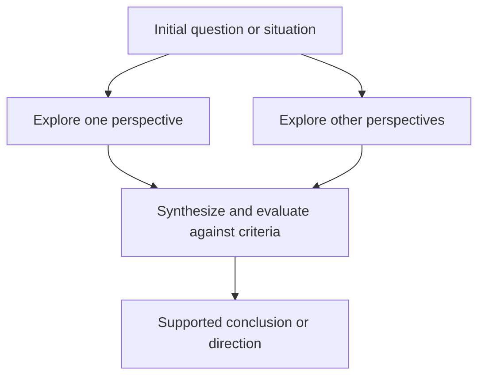
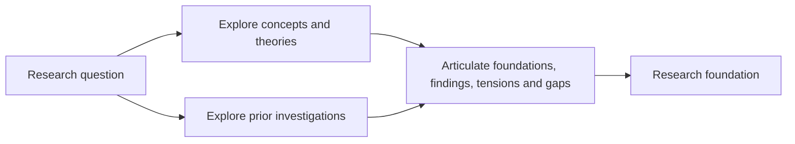
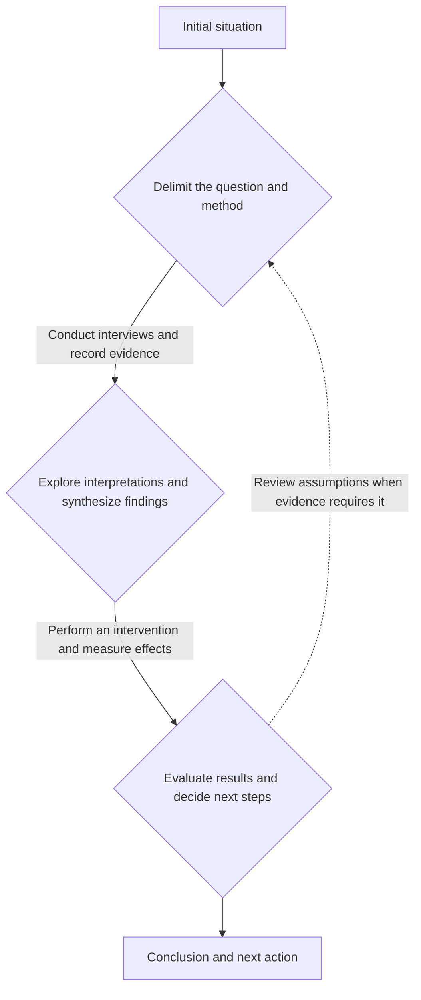

# Exploration–Action Framework

## A general model of exploration and action

A process can advance by **opening and delimiting a space of possibilities** or by **performing activities within a sufficiently defined working frame**. This framework represents these complementary behaviors through diamonds and directed activity lines.

A **Diamond** represents divergence and convergence: opening questions, interpretations, alternatives or complementary exploration avenues, then delimiting and articulating them through evidence, criteria, synthesis and decisions. An **Activity Flow** represents actions producing a result under an agreed purpose and completion conditions.

The framework can describe research, design, learning, administration and operations. It assumes no industry, methodology or fixed number of phases. Its names and graphic rules are a local modeling convention, not a universal notation or formal standard. Its practical purpose is to show when to open or revisit a working frame and when to act within it.

[Thesis workflow](thesis-workflow.md) specializes this model for Ohtia. Product behavior, data schemas and human authority retain their own canonical definitions.

## 1. Vocabulary and scale

- **Process:** phases and relationships directed toward a purpose.
- **Phase:** a process unit with a recognizable purpose and exit condition.
- **Diamond:** a phase that expands and then delimits a space of possibilities.
- **Divergence:** deliberately opening relevant questions, perspectives, hypotheses, interpretations or alternatives.
- **Exploration avenue:** an area of inquiry with an identifiable question and contribution to a phase's common purpose.
- **Convergence:** delimiting and articulating the explored space through synthesis, evaluation, selection, exclusion or integration.
- **Activity Flow:** actions transforming inputs into results within a sufficiently defined frame.
- **Activity:** a concrete action such as interviewing, recording, measuring, calculating, writing or submitting.
- **Working frame:** purpose, scope, criteria and constraints guiding the work.
- **Result:** an observable state change, evidence, decision, artifact or effect.
- **Feedback:** information justifying an activity adjustment, conclusion review or phase reopening.

“Exploratory phase” describes a diamond's function; “operational segment” describes an activity flow's function. Activity Flow is the general name: it implies neither software implementation nor manufacturing nor product delivery.

Keep the represented scale consistent. If diamonds represent week-long phases, lines represent comparable segments; minute-long tasks belong in a detail view. Shapes identify the dominant behavior at a particular scale.

## 2. The diamond

### Definition, divergence and convergence

A diamond expands a relevant space and then delimits and articulates it into a conclusion, synthesis or sufficiently supported direction. Name that space: exploring causes is different from exploring solutions. Possible subjects include problems, explanations, needs, hypotheses, designs, interpretations and courses of action.

Divergence broadens consideration, incorporates overlooked perspectives and challenges assumptions. It can explore alternative responses or complementary questions. It has a purpose and can be bounded by time, budget, scope and relevance; it is not indefinite idea accumulation. Interviews, reading, observations and experiments can all serve divergence.

Examples include exploring explanations for declining participation, different groups' needs, strategies for answering a question and alternative readings of testimony.

Convergence organizes findings, compares alternatives against explicit criteria, recognizes patterns, evaluates evidence, excludes possibilities and states a conclusion. With complementary avenues, it explains relationships and tensions while preserving each contribution's role. Integration need not combine everything into one undifferentiated section.

Examples include delimiting a worthwhile research question, selecting hypotheses to test, choosing an intervention by impact and feasibility, and synthesizing testimony with stated limits. A preference alone does not establish sufficient grounds.

### Characteristics and shape

- **Dominant purpose:** reformulate, understand, compare or decide within a space of possibilities.
- **What changes:** considered possibilities and the interpretation guiding the work.
- **Typical input:** a situation, question or alternatives insufficiently delimited.
- **Internal work:** exploration, generation, investigation, synthesis, evaluation and selection.
- **Typical output:** a clearer frame, better-formulated question, supported conclusion, bounded alternatives or a decision to gather more evidence.
- **Advance criterion:** sufficient grounds for a direction or next step.
- **Typical risk:** premature closure or exploration without an exit criterion.

The shape denotes the overall opening/closing pattern, not a requirement to finish all divergence before any evaluation. Smaller opening and closing cycles can coexist inside it.

Read a left-to-right diamond from its starting point through widening, greatest breadth, narrowing and exit. Width is qualitative; it measures neither idea count, uncertainty, effort nor time unless an additional variable and scale are declared.

The following diagram shows the internal logic with two illustrative branches:

These branches can represent alternatives, perspectives or complementary exploration avenues. They determine neither branch count nor parallel execution. Upper and lower positions can identify named avenues according to the diagram convention.

### Alternatives and complementary avenues

Alternative branches offer different responses to the same question and can compete or combine. Convergence compares, selects, excludes or combines them. Complementary avenues investigate different aspects of one purpose; convergence synthesizes and articulates contributions that may both remain necessary.

Exploring three methods illustrates alternatives. Exploring concepts and prior studies illustrates complementary avenues. One diamond can combine both: each avenue explores alternatives internally and contributes to a joint synthesis.

For named avenues, specify:

1. Their common purpose.
2. Each avenue's question and intended contribution.
3. Each avenue's pertinence and sufficiency criteria.
4. Exchanges, overlaps and dependencies between avenues.
5. The condition for a sufficiently supported integration.

Avenues can be agreed beforehand or emerge during exploration. Predetermining two questions does not determine the sources, interpretations or answers explored within them. Branch count does not impose parallel execution.

### Thesis example: theoretical foundations and prior research

The theoretical-foundations avenue asks which concepts, theories and relationships allow the problem to be formulated and examined. It contributes a delimited, justified conceptual framework.

The prior-research avenue asks what has been investigated, with which approaches, findings and limits. It contributes a critical understanding of earlier work and the thesis's potential contribution.

Both start from the same research question and converge in an articulated foundation:

This diagram explains contribution relationships; branch labels identify their function independently of viewer layout. If top/bottom placement carries meaning, declare and preserve it in the chosen representation.

The division concerns inquiry functions, not necessarily disjoint document sets. One source can supply theory and prior results. Joint convergence explains how concepts illuminate studies, how studies support or challenge the framework, and which connections or gaps ground the investigation. It can retain separate chapters with explicit connections; it does not choose theory instead of prior research.

### Limits of branch semantics

The upper and lower halves of a diamond have no intrinsic thematic identity. Named avenues are an additional declared convention, and there is no obligation to use exactly two. More avenues can appear internally or in a phase detail.

Dividing predefined work and concatenating outputs does not by itself justify a diamond. Parallel activity flows can represent that case. A diamond requires exploratory opening and supported delimitation or synthesis. Geometry communicates opening/closing; branch labels communicate which avenues contribute.

## 3. The activity flow

### Definition and sufficient working frame

An activity flow transforms input into a result under a sufficiently defined working frame. Work progresses by recording information, interviewing, collecting samples, executing an experiment, processing data, completing a form or performing an intervention.

Direction communicates progression between identifiable states. The defining condition is that an agreed operational purpose can organize and evaluate the work even when its eventual result is unknown.

Be able to explain:

1. Why the activity is undertaken.
2. Its inputs and scope.
3. The guiding procedure, protocol or constraints.
4. The intended kind of result, even if its content is unknown.
5. Conditions for completion or interruption.

Not every movement needs specification. An interview protocol can allow follow-up questions; a technical measurement can need finer instructions.

### Characteristics and interpretation limits

- **Dominant purpose:** produce evidence, complete work or create an effect within an agreed frame.
- **What changes:** work, inputs or the affected environment.
- **Typical input:** enough information, materials, instructions or conditions to start.
- **Internal work:** action, coordination, controls, local adjustments and result recording.
- **Typical output:** data, records, artifacts, completed tasks or observable effects.
- **Advance criterion:** outputs meet the agreed conditions.
- **Typical risk:** continuing execution after evidence questions the purpose or method.

A line does not imply predictable or guaranteed results, absence of uncertainty, unthinking execution, exclusively sequential work, no creativity or repetition, constant duration/cost, or lower difficulty or importance than a diamond. A complex uncertain data-collection campaign can be an activity flow under an adequate protocol.

Decompose dependencies, parallelism and exceptions when needed. The line abstracts a segment, not all its internal structure. Associate endpoints with identifiable states or results. Name operational work, such as “conduct interviews”; an unlabeled arrow may instead mean precedence. Length and thickness have no quantitative meaning without a legend.

## 4. The central distinction

Both shapes include thought and action. The difference is whether the phase **opens or revisits the frame** or **advances through activities within it**.

- **Organizer:** opening/delimiting possibilities for a diamond; an agreed operational purpose for a flow.
- **Question:** what to understand, consider or adopt for a diamond; what to do and produce within the frame for a flow.
- **What stays open:** relevant questions and interpretations for a diamond; action results and operational contingencies for a flow.
- **Output evaluation:** support and limits of synthesis/decision for a diamond; completion and quality of the agreed result for a flow.
- **Return trigger:** evidence invalidating a delimitation or revealing relevant alternatives for a diamond; evidence questioning purpose, procedure or assumptions for a flow.

Uncertainty about which result will appear can coexist with a defined method. Uncertainty about the worthwhile question or suitable method often justifies a diamond. These are modeling guides, not automatic classifications: a small uncertainty can be resolved locally while a consequential one reopens a phase.

## 5. Choosing a shape

Use a diamond when a question needs reformulation, several explanations/solutions are plausible, perspectives must be incorporated, selection criteria need discussion, evidence supports relevant competing interpretations, or an unexpected result challenges assumptions. Require recognizable opening and supported closure; routine choice under an agreed rule needs no separate diamond.

Use an activity flow for forms with known requirements, protocol-led interviews, collection under agreed inclusion/quality rules, procedural measurements, defined transformations or an intervention with agreed scope. Its answers, measurements and effects need not be known in advance.

The verb alone does not decide the shape:

- **Interview:** discover needs and reformulate a question in a diamond; conduct a defined recording round in a flow.
- **Analyze:** explore explanations in a diamond; apply an agreed transformation or calculation in a flow.
- **Complete a form:** explore objectives through its questions in a diamond; record and check known data in a flow.
- **Experiment:** compare hypotheses, design tests and revise explanations in a diamond; execute a protocol in a flow.
- **Write:** explore structures and arguments in a diamond; produce text under an agreed structure and criteria in a flow.

Choose by purpose, available frame and model scale.

## 6. Combining shapes

There is no mandatory alternation. A process can start with a flow when its frame is adequate, end in a diamond when its purpose is a conclusion, or contain consecutive shapes of either kind.

- **Diamond → flow:** adopt a frame, then act under it.
- **Flow → diamond:** produce evidence, then interpret it.
- **Diamond → flow → diamond:** formulate, test and revise.
- **Consecutive flows:** register, verify and process within a stable frame.
- **Consecutive diamonds:** delimit a problem, then explore solutions at the same scale.

Complementary avenues inside one diamond need not become separate phases. Separate phases when their purposes, exit conditions or relationships warrant it. Combine consecutive diamonds that explore the same space toward the same closure; combine consecutive flows when intermediate results need not be visible.

### Composite-process example

Here diamonds represent whole exploratory phases, labeled solid arrows represent operational work, rectangles denote entry/exit states, and the dashed return represents feedback:

The first and last unlabeled connections express precedence. The named intermediate arrows express activities. A diamond is a whole opening/convergence phase, not a binary decision node.

Read the sequence as: explore questions and methods; conduct interviews; synthesize interpretations; intervene and measure; evaluate; revisit the frame if warranted. An exploratory research phase can itself contain operational activities such as preparing interviews, contacting participants and organizing records. Show an overview and a separate detail rather than silently mixing scales.

## 7. Inputs, outputs and transitions

Every phase has a recognizable input, purpose and exit condition. Available evidence and work state justify transitions.

From diamond to flow, require a sufficiently delimited purpose, a supported approach, agreed criteria/constraints, manageable or explicitly treated remaining uncertainty, and an observable result with evaluation conditions. Closure needs sufficient clarity for the next segment, proportional to consequences and reversal costs, not absolute certainty.

From flow to diamond, require evidence sufficient to interpret or compare, relevant competing explanations or courses of action, challenged assumptions, or a question/method no longer guiding work. Completed activity does not guarantee adequate input: correct records, obtain more evidence or declare limits before advancing when needed.

Distinguish local adjustment from reopening:

- Fill a missing datum allowed by the procedure: continue the flow.
- Reschedule an interview: reorganize operations.
- Correct or repeat a poor-quality result: stay in the flow if the frame still fits.
- Questions fail to observe the intended phenomenon: revisit method and explore alternatives.
- Evidence contradicts the problem definition: reopen the problem.
- A routine decision has an agreed rule: apply it within the flow.

Importance determines the response. Changing a tool can be local; changing what is to be known changes the frame.

## 8. Evaluating progress

In a diamond, examine relevant perspectives, assumptions, compared alternatives, evidence sufficiency, explicit criteria and recorded conclusion limits. Idea or meeting counts do not prove quality. Many options can remain unsupported; a small supported set can reflect useful convergence.

In a flow, examine completed activities and conformity to agreed conditions: complete records, data quality, coverage, timing, resolved incidents and observable effects. Twenty interviews establish work performed, not that their evidence answers the research question.

Keep three dimensions distinct:

1. **Work completion:** planned activities occurred.
2. **Output quality:** the result meets agreed criteria.
3. **Purpose achievement:** the result contributes to the process objective.

Their separation prevents equating activity with knowledge or effects.

## 9. Complete examples

### Interview research

1. Diamond: compare questions and perspectives; delimit the question and approach.
2. Flow: conduct an interview round under a protocol and produce usable records.
3. Diamond: explore explanations, contrast evidence and synthesize findings.
4. Flow: prepare the agreed report with evidence and limitations.

If interviews show the question is unsuitable, return before finishing the round rather than mechanically completing it.

### Administrative form

1. Flow: gather the required documents.
2. Flow: complete and verify the form.
3. Flow: submit it and retain the receipt.

No diamond is needed when purpose, route and requirements are sufficient. Comparing possible routes first can justify an earlier diamond.

### Data collection and analysis

1. Diamond: compare variables/methods and adopt a measurement plan.
2. Flow: collect and prepare documented data meeting quality conditions.
3. Diamond: explore patterns and explanations and state bounded conclusions.
4. Flow: apply an agreed follow-up calculation periodically.

Cleaning is operational under defined rules. Deciding which observations count can change the meaning of analysis and require reopening the frame.

## 10. Drawing rules

1. Declare the legend: diamond semantics, named branch meanings and operational-line meanings.
2. Name phases by purpose, such as “delimit the question”.
3. Name operational segments by work performed, such as “record applications”.
4. Distinguish work from precedence connections.
5. Keep a consistent scale and detail internal activities separately.
6. Show relevant outputs and the next phase's needed inputs.
7. Label returns with the evidence or condition justifying review.
8. Declare any quantitative scale instead of inferring time/effort from geometry.
9. Do not force alternation.
10. Do not assign human or system roles from shape alone.

Ohtia's thesis map declares its own left-to-right reading, arrowless activity segments and output-circle legend. That visual specialization preserves the generic distinction between a phase's work and a mere connection.

## 11. Phase description template

Document:

- **Name:** a concrete purpose.
- **Type:** diamond or activity flow, with reasons where ambiguous.
- **Scale:** the represented process level.
- **Purpose:** what is to be resolved or produced.
- **Input:** needed information, materials, decisions or conditions.
- **Frame:** scope, criteria, constraints and assumptions.
- **Work:** main activities.
- **Output:** observable result.
- **Exit condition:** what establishes completion.
- **Review condition:** evidence requiring adjustment or reopening.
- **Responsibility:** who works and who decides closure.
- **Evidence:** records supporting the result and its acceptance.

For diamonds, add the expanded space, exploration approach, avenues and selection/integration criteria; name each avenue's question and contribution. For flows, add the input-transforming actions, quality controls and exception handling.

## 12. Frequent misreadings

- Diamond means thinking and line means doing: both include thought and action.
- A line eliminates uncertainty: the frame can be defined while outcomes remain unknown.
- Convergence establishes truth or one answer: it establishes sufficient grounds and may retain several options.
- Branches always compete: they may be complementary.
- Integration merges everything into one section: distinct contributions can retain explicit connections.
- Any parallel split/join is a diamond: exploratory opening and supported convergence are required.
- Every decision needs a diamond: routine rule-based choices can stay within a flow.
- Research uses only diamonds: operational segments can be essential.
- More width means more time/uncertainty: width is qualitative without another declared scale.
- A line requires serial execution: it can summarize parallel or repeated work.
- Processes only move forward: evidence can justify returns.
- Completed work achieves the goal: completion, quality and purpose are distinct.

## 13. Reusable definitions

**Diamond:** a divergence/convergence phase that expands and then delimits and articulates questions, interpretations, alternatives or complementary avenues into a sufficiently supported conclusion, synthesis or direction.

**Exploration avenue:** an inquiry area with an identifiable question and contribution within a common purpose, optionally represented by a diamond branch.

**Activity Flow:** actions transforming inputs into results within a sufficiently defined frame, with agreed purpose and completion conditions.

**Composite process:** exploratory phases and activity flows combined through transitions and returns justified by their results and available evidence.

The practical modeling question is whether the segment needs to open/delimit possibilities or can advance within a sufficiently agreed frame, considering purpose, scale and the consequences of remaining uncertainties.
