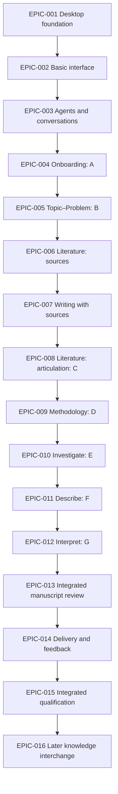

# Product roadmap

Ohtia is designed as a local desktop workspace for academic research, with an initial thesis-centered workflow and a shared path for scientific papers: organize sources, examine evidence, develop arguments, write and review a manuscript, and share versioned deliveries. Researchers retain authorship and decisions; optional agents provide attributable guidance and proposals. Local research does not require an Ohtia account or provider subscription. Enabled external services retain their own access conditions, costs and transfer restrictions.

The construction order is **desktop foundation → basic interface → agents and conversations → onboarding → the thesis workflow**. The [product definition][product] owns the experience and PRIN-001–016; [Thesis workflow][workflow] owns the academic progression. Each epic delivers its screens, interactions, durable behavior and verification together. Introduce shared mechanisms with their first consumer, with required safeguards working before the affected capability is enabled.

`EPIC-001`–`EPIC-016` are planning identifiers for this roadmap, not claims that GitHub epics or stories have been published. Implementation issues must refine their scope, acceptance criteria and enabling conditions before work begins. The sequence communicates intended outcomes without dates or effort promises; capability availability depends on demonstrated readiness and maintainer-authorized releases under the [release policy][release]. The first stable release requires a coherent useful journey, rather than completion of a particular epic or issue count.

## What researchers and contributors can expect

- A graphical application for Windows, macOS and Linux on x86-64 and ARM64, with local projects, a reusable source library and recoverable research history.
- Optional Virgilio and specialist assistance, initially through supported OpenAI and Anthropic routes in EPIC-003, with explicit scope and authorization; local reading, writing and review remain available without them.
- Initial literature discovery through OpenAlex and DOAJ in EPIC-005, extended through the same connections in EPIC-006.
- Progressive support from a first question or existing material through examined literature, methodology, documented investigation, descriptive results and researcher-authored interpretation.
- Academic editing, evidence-linked criticism, human-approved editorial proposals, versioned manuscript deliveries and attributed external feedback.
- An accessible, localized workspace whose tested platform, language, coverage and remaining limitations are stated with each delivery.
- Reproducible contributor setup on Linux, Windows and macOS, shared local/CI verification and a build/release pipeline constructed in EPIC-001 from the first runnable delivery.

## Initial scope

### Research workflows

The first detailed construction route is the seven-stage thesis workflow A–G. Its [existing paper adaptation](thesis-workflow.md#iteration-and-reentry) also supports entering with a narrow question, existing sources or results and using only the relevant artifacts. EPIC-004–014 must verify both a new thesis journey and a paper entering with existing work. Neither route imposes seven manuscript chapters or requires replaying completed academic stages.

Dedicated workflows for other academic document types, publication-specific routes and additional interchange/output formats are described under [Future features](#future-features). They require their own task, milestone and fidelity contracts rather than inheriting full support from the availability of an editor or export format.

### Desktop systems and processor architectures

EPIC-001 establishes development, builds and packaged verification for all six OS/CPU targets from the first runnable delivery:

| Operating system | x86-64 (`x64` / `amd64`) | ARM64 (`arm64` / `aarch64`) |
| ---------------- | ------------------------ | --------------------------- |
| Windows          | Required                 | Required                    |
| macOS            | Required, Intel          | Required, Apple Silicon     |
| Linux            | Required                 | Required                    |

Both processor families here are 64-bit. x86/ARM 32-bit targets are outside this baseline. OS versions, Linux distribution/libc and filesystem baselines, package formats and exact tools are qualified in EPIC-001 under the adopting ADRs; the six processor/system combinations are fixed scope rather than a later optional expansion.

Electron's current upstream platform inventory provides x64 and ARM64 binaries across these systems, and GitHub's current public-repository runner inventory includes native execution environments for each combination.[^electron-platforms][^github-runners] This supports the feasibility of the target matrix; it does not establish compatibility of Ohtia's locked components or a working release.

Use shared TypeScript application code with target-specific native dependencies and packages. Verify the actual embedded SQLite binding/engine, process confinement, credentials, parsers/converters, agent runtimes, installer, signing and update paths on every target that uses them. Native smoke and boundary tests are required; cross-compilation or x64 emulation on ARM does not establish native ARM64 support. A macOS universal installer may package both slices, but each slice still requires its own verification.

The contributor setup path covers the same six targets. The pinned Linux x86-64 E2E image selected by ADR-0019 remains a distinct test environment, supplemented by native ARM64 verification; its existing scope does not qualify ARM. Later product epics extend the same matrix. A failed required target prevents the coordinated delivery from satisfying its declared scope; narrowing that scope requires an explicit reviewed decision.

### Initial AI and search connections

OpenAI and Anthropic are the initial inference integration targets delivered through EPIC-003's independently qualified adapters. They are available only through verified permitted access modes and evaluated operation/language/runtime combinations. This sequence does not require AI connectivity in the EPIC-001 scaffold, and a supported core desktop target does not imply that every optional provider runtime supports it. Further AI providers belong to [Future features](#additional-ai-providers).

OpenAlex and DOAJ are the initial search sources for EPIC-005's bounded exploration and EPIC-006's formal literature work. Implement separate adapters behind the existing [search contract](architecture.md#search-adapter-contract), preserving per-provider queries, filters, pagination, provenance, failures and examined coverage. Discovery and metadata are distinct from full-text acquisition, reading and permission to transmit material for inference.

OpenAlex documents both basic keyless access and API-key access with different limits; an adapter must declare and verify the modes it exposes rather than assuming anonymous, unlimited use.[^openalex-access] DOAJ publishes journal/article metadata through its API and other channels, and identifies OpenAlex among systems reusing that metadata.[^doaj-metadata] The two sources can overlap; retain provider attribution and unresolved duplicate/version distinctions rather than counting them as independent evidence.

Before enabling either adapter, verify its current endpoint/version, access conditions, query/filter mappings, pagination, rate/usage limits and errors. User-supplied keys remain outside research content. Provider unavailability or a missing key disables only dependent operations. A source being selected in the roadmap is an implementation obligation, not a claim that its adapter or live access has already been tested.

## Product sequence

The first three epics establish progressively richer components: a runnable application, visual/navigation primitives, then conversational agents and bounded execution. EPIC-004 uses those components for the first integrated research experience. EPIC-005–EPIC-012 follow the thesis route, developing basic material into examined sources, methodological design, documented research, descriptive results and interpretation. Writing grows alongside that route. Whole-manuscript review and delivery follow those foundations.

| Order | Epic                                    | Observable delivery                                           |
| ----- | --------------------------------------- | ------------------------------------------------------------- |
| 1     | EPIC-001 — Desktop foundation           | Desktop, contributor setup and release infrastructure         |
| 2     | EPIC-002 — Basic interface              | Menus, navigation, Settings, About and visual primitives      |
| 3     | EPIC-003 — Agents                       | Virgilio, specialist access, conversations and safe execution |
| 4     | EPIC-004 — Onboarding: A                | Initial research profile and a useful first focus             |
| 5     | EPIC-005 — Topic–Problem: B             | Compared topics, question, objectives and justification       |
| 6     | EPIC-006 — Literature: source work      | Search strategy, selected library and examined references     |
| 7     | EPIC-007 — Writing with sources         | Visual academic editing, citations and source comparison      |
| 8     | EPIC-008 — Literature: articulation: C  | Concepts, prior-work synthesis, outline and framework         |
| 9     | EPIC-009 — Methodology: D               | Justified design, conditions and feasible schedule            |
| 10    | EPIC-010 — Investigate: E               | Acquired corpus, execution records and actual coverage        |
| 11    | EPIC-011 — Describe: F                  | Objective-linked observations and descriptive results         |
| 12    | EPIC-012 — Interpret: G                 | Researcher arguments, answer, contribution and limits         |
| 13    | EPIC-013 — Integrated manuscript review | Editorial/proofreading review of developed writing            |
| 14    | EPIC-014 — Delivery and feedback        | Versioned manuscript outputs and external comments            |
| 15    | EPIC-015 — Integrated qualification     | Integrated journeys on the supported release matrix           |
| 16    | EPIC-016 — Knowledge portability        | Later, explicitly specified complete interchange              |

This is the construction order for a new product. Within the delivered application, a researcher can enter with existing advanced work, write throughout, work on several stages and revisit earlier decisions. The UI must not impose a compulsory wizard or demand a `done` badge before independent work can proceed. Dependent work needs actual adequate inputs, permissions and reviewed conditions. A new researcher's complete journey is the integration test that guides construction.

The arrows show the planned delivery progression; integration prerequisites are specified separately below. They do not redefine the thesis map's diamonds or activity flows. Academic returns such as Literature → Topic–Problem and Investigate → Methodology retain their meaning in the research UI and create new reviewed versions of the affected work.

## Interface strategy

### Menus and navigation

Use **File, Edit, View and Help** as the initial application-menu structure, localized through the shared catalog and adapted to native platform conventions. Keep a stable Settings action in application chrome and the appropriate platform menu. Deliver each menu action with its functioning capability; unavailable actions explain the missing condition when they are relevant to the current journey.

| Surface             | Responsibility                                                          |
| ------------------- | ----------------------------------------------------------------------- |
| File                | Project actions, incorporation and delivered import/export capabilities |
| Edit                | Available editing commands, undo/redo and clipboard operations          |
| View                | Region visibility, focus mode, layout reset, zoom and appearance access |
| Help                | Help, application/version information and diagnostic access             |
| Project explorer    | Sources, research artifacts, manuscripts and deliveries                 |
| Central tabs        | Navigator and the selected documents/artifacts                          |
| Conversation region | Selected conversation, contributor and contextual findings              |
| Context menus       | Relevant actions on a source, passage, artifact or selection            |

The project explorer and tabs provide the working navigation. Action menus complement them. Use named application commands shared by menu, shortcut and contextual entry points so behavior, availability and permissions remain consistent. Shortcuts respect OS conventions, editor focus and IME composition.

The workspace has a project context bar, a left explorer, central document tabs and an optional right conversation/findings region. Navigator is its fixed first central tab. Changing conversation preserves the selected document. Resizing, hiding, restoring and focus mode preserve work and selection. Implement the [workspace layout][workspace] geometry and the [design system's][design] width classes, minimum region sizes and single-region arrangement below 1024 CSS px, with reflow to 320 CSS px.

### Settings grows with the product

EPIC-002 establishes the Settings shell, shared preference controls and global locale/appearance/layout/character choices. Subsequent epics add their actual settings to that shell. This is not an onboarding questionnaire.

| Setting                                       | Scope                         | First owner        |
| --------------------------------------------- | ----------------------------- | ------------------ |
| Interface language and system fallback        | Application                   | EPIC-002           |
| System/light/dark appearance                  | Application                   | EPIC-002           |
| Workspace layout preferences                  | Application                   | EPIC-002           |
| Animated/static/hidden character presentation | Application                   | EPIC-002           |
| Connections and credential actions            | Application                   | EPIC-003           |
| Allowed agent/model operation preferences     | Application; operation policy | EPIC-003           |
| Inference and local-processing concurrency    | Application                   | EPIC-003           |
| View/delete/share-preview diagnostics         | Application                   | EPIC-004           |
| Managed storage location and recovery         | Application                   | EPIC-004           |
| Analysis language and research profile        | Research project              | EPIC-004           |
| Source restrictions and project associations  | Material/project              | EPIC-005–EPIC-006  |
| Manuscript language and delivery choices      | Manuscript/delivery           | EPIC-007, EPIC-014 |

Application preferences use the typed SQLite records and separate broker-owned bootstrap locator in [ADR-0036][adr-0036]; the renderer has no independent preference-storage authority. Layout updates follow their per-window/last-accepted-write rules; confirmed locale, appearance and character choices apply across windows under their own contracts. Preferences remain distinct from research content and credentials. Interface language does not select analysis or manuscript language. A preference change preserves unsaved work and updates relevant windows; it never starts inference or clears paused/uncertain work.

### Agent selection and conversation model

**Virgilio is the default entry point, with direct access to specialists.** EPIC-003 delivers the common interaction module before onboarding. Its selector identifies Virgilio, reference librarian, analytical reader, critical evidence reviewer and writing review. Academic editing and proofreading are distinct modes/role definitions within writing review.

Use one shared conversation interface with project-scoped conversations attributed to their active contributor. Each contributor can have separate conversations/history, while a handoff can change the active contributor of an identified branch. Preserve the producer of every existing message. Selection alone neither executes a request nor transfers previous history. This design uses the same panel and components across roles; it does not require a separate window or independently designed chat application for each agent.

A source or manuscript action opens the appropriate conversation with the proposed material and scope visible. A direct specialist can respond without a mandatory Virgilio round trip. Virgilio may answer directly, request a bounded contribution or propose a handoff. Show who is contributing, the purpose, examined material, limitations and unresolved work. Returning to Virgilio uses explicitly selected permitted context and durable artifacts.

Role definitions and conversation routing are available from EPIC-003. Research operations become available with the materials and interfaces built in later epics: exploratory discovery in EPIC-005, reading/review in EPIC-006, source-attribution comparison in EPIC-007, editorial/proofreading proposals and their application in EPIC-013 and argument criticism in EPIC-012. The UI states unavailable capabilities honestly. Agent selection, restored tabs and opened history never authorize inference. Create a project scope before the first research request; installing/configuring an adapter can occur before project onboarding.

## Epics and product acceptance

### EPIC-001 — Desktop application foundation

**Experience:** an external contributor can prepare a clean Linux, Windows or macOS environment, run the graphical application, make a change and reproduce its quality checks and build. The app opens a minimal usable window and communicates with its supervised local data service. Build and release infrastructure grows with this first runnable delivery across the [six required OS/CPU targets](#desktop-systems-and-processor-architectures).

**Runtime and storage:** establish real package boundaries and locked toolchains; assemble Electron main/preload/utility and React/Vite targets; implement versioned runtime-validated IPC and controlled errors. Deliver the single broker/data-service authority, graphical one-time data-location selection with explicit open/create confirmation, atomic bootstrap-locator publication and controlled recovery, and a minimal durable command. Initialize typed preference storage and execution-limit defaults before admission, preserving existing valid values. Use Kysely, its Migrator and better-sqlite3 under ADR-0006–0007; demonstrate the actual embedded engine/native artifact before storage is enabled. Implement compatibility, immutable migration artifacts, exclusive transactional migration and verified checkpoint recovery before the first schema transition. Feature schemas arrive with their consumers.

**Contributor environments from day one:** provide maintained setup instructions and the working automation needed for all six required OS/CPU combinations, using the supported Linux distributions, Windows and macOS versions. Document system/native build dependencies, supported shells, exact tool selection through repository pins, isolated per-worktree environments, frozen installation, run/check/test/package commands, editor integration and troubleshooting. Cover the JavaScript and Python maintenance environments without turning developer tools into installed-product dependencies. Explain any command's host restrictions, including the existing POSIX-only PR provenance verifier, and provide a tested supported path rather than presenting it as native Windows functionality. Keep line endings, Unicode/space-containing paths and native-module compilation reproducible. Newcomers can run deterministic checks without signing credentials, paid providers or private maintainer configuration; external fork workflow approval remains the maintainer's separate execution-admission procedure under ADR-0020.

**Shared quality builds:** introduce common type/lint/format/test/build/documentation entries and meaningful packaged smoke tests, the immutable Linux E2E environment with active sandboxes, and native Windows/macOS/Linux verification. Qualify the six required OS/CPU targets and declare their package formats, native dependencies and filesystem assumptions. Include native ARM64 evidence alongside x86-64; the Linux x86-64 E2E image alone does not cover ARM64. Quality builds cover applicable PR changes and the actual integrated `main` source; distinguish synthetic-merge, integrated-source and final-artifact evidence. Required partitions, inventories and coverage must all succeed; uncertain impact selects the complete relevant checks. Keep `ci`, its reviewed inventory and repository permission/action allowlists aligned through the authorized policy procedure. PR execution has no signing or publication credentials.

**Candidate preparation and distribution:** implement the complete [scaffolding handoff][release-handoff] established by [issue #7](https://github.com/ohtia/ohtia/issues/7), the release policy and ADR-0021. Select and qualify installers, signing/notarization and update mechanisms for every supported platform, including Linux. Separate manually dispatched preparation and publication using protected-main definitions, independently enforced admission/authority and exact integrated application-source selection. Reserve versions permanently at candidate admission; bind source, locks, tools, components, schema compatibility, workflow/run/attempt, complete target set, final digests, licenses and verification to the candidate. Finish package/signing transformations before final verification, then promote the exact bytes without rebuilding. Apply SemVer and development/prerelease/channel ordering through the canonical policy rather than deriving publication from merges or commit types.

**Release safety and communication:** isolate every CI/development executable, internal candidate and optional preview from stable data, preserving the fixed bootstrap contract; final-candidate testing uses an independent OS profile or VM. Implement explicit preview opt-in/admission and identify each preview with its disclosed limitations. Keep channel eligibility in maintainer-controlled distribution metadata outside the package, preserving exact-byte candidate promotion. Implement application-wide publication serialization across both channels and every public surface, complete-asset activation, permanent version reservations, idempotent continuation, partial-publication reconciliation, update failure/recovery, withdrawal and compatible rollback admission. Capture proposed user change notes with implementation, assemble and edit them against the selected source/baseline, bind approved notes to candidate/channel authorization and use the GitHub release body as the canonical public note. Qualify note corrections, artifact/evidence retention and retirement before distribution. Keep credentials isolated and public publication disabled until its actual enabling facilities and mandatory readiness evidence exist.

**Done when:** independent clean-environment walkthroughs on all six required developer OS/CPU targets reproduce setup → launch → a representative change → checks → package without undocumented global dependencies or maintainer secrets. Retain exact OS/CPU/tool/native-dependency identities, commands, outcomes and measured onboarding time; establish the onboarding acceptance budget before trials and correct encountered failures. The actual renderer → preload → main → data-service path works with packaged CSP, controlled service failure and safe shutdown. Verify spoofed senders, invalid/oversized messages, bootstrap interruption/uncertainty, storage/migration failures and exclusion of fixtures/privileged renderer imports. Qualify the pipeline's admission, integrity, isolation, failure and communication paths against the first packaged capability; synthetic controls alone do not prove a signed installable public release. Later epics extend the same pipeline's fixtures, native journeys and notes as their behavior is added.

**Enabling contracts:** ADR-0000–0008, ADR-0010, ADR-0013–0014, ADR-0016–0022 and ADR-0036 as applicable; [System architecture][architecture], [Repository policy][policy], [Desktop builds, releases and change notes][release] and [CONTRIBUTING.md](../CONTRIBUTING.md). Native mechanisms, credentials and platform facilities must be qualified before the guarantees that use them are claimed.

### EPIC-002 — Basic interface, menus and extensible Settings

**Experience:** a researcher can understand the application's navigation, open Settings, choose language/appearance and operate the basic interface with keyboard or pointer.

**Screens and components:** application menus, Settings entry and Help/About with the running artifact's version; context bar, explorer, tabs, panels and separators; Settings sections for language, appearance, layout and character presentation; buttons, selectors, dialogs, notices, status labels, tooltips and contextual menus. Field controls support these concrete tasks. Use the design system's reference/semantic/component tokens, bundled fonts, local icons and Ohtia identity.

**First stories:** implement the menu-command registry and native integration; build semantic React primitives and the separate synthetic development catalog; implement global locale resolution and complete typed catalogs for delivered messages; add system/light/dark appearance; implement the one workspace controller, deterministic geometry, hide/resize/focus/reset and narrow presentation under the canonical layout contract. Deliver Animated/Static/Hidden controls, static fallback, cross-window preference behavior and system reduced-motion precedence. Preserve the original character geometry and validate any delivered illustration/event bindings; use static, attributed contributor identifiers. Add research-component visual specimens for attributed voices, proposals, evidence, coverage and conflicts, with actual domain actions supplied by later features.

**Done when:** every menu and setting delivered here works through the application port. Verify focus/shortcut behavior, theme changes without state loss, permitted contrast pairs, all declared type/font roles, Korean coverage, forced colors, reduced motion, 40% pseudolocalization expansion and 320-px reflow. The component catalog is excluded from the product build. Verify workspace scenarios V01–V12 for the controls delivered here; later project/chat capabilities complete the same scenarios through EPIC-003–007. Review complete pages as well as primitives and verify locale structure, contextual rendering, Korean typography and actual model-generation provenance. Human linguistic review of translations, terminology, name connotations and typography is a voluntary future improvement, not a delivery prerequisite.

**Enabling contracts:** design system, workspace layout, agent identity, frontend composition, ADR-0022–0025, ADR-0036 and packaged CSP. This epic establishes the common visual language and interaction infrastructure consumed by all later screens.

### EPIC-003 — Research agents and their conversation interface

**Experience:** the researcher can configure optional assistance, select Virgilio or a specialist, understand the active contributor and authorize a bounded request. The module is ready to support onboarding.

**Screens and components:** conversation selector/history, contributor header, message composer, contextual input preview, attributed message/artifact cards, questions/approval prompts and activity states. Settings gains connections, supported operation/model preferences and application-wide concurrency. The connection wizard separates installation, authentication, entitlement, operation readiness and restriction compatibility.

**First stories:** define all initial roles separately from bindings/sessions; implement the shared conversation module and direct/consultation/handoff contracts; integrate the normalized inference adapter lifecycle, permitted scoped tools, immutable contexts and current transfer checks. Deliver durable interventions/tasks, versioned contribution graphs, transactional allocation, event/receipt deduplication and separately bounded planning/contribution/synthesis turns. Honor explicit role selection, ask before speculative routing, accept handoffs through version-bound owner changes and keep accepted inputs immutable during redirection. Required/optional contributions and dependency failures retain their actual coverage. Implement inspectable, correctable project memory as a projection of attributed records; sessions are not its authority. Introduce the minimal persisted project identity and trusted scope records with the first project-scoped conversation or memory consumer, enforcing the data model's project ownership rather than deferring this prerequisite. Deliver project-scoped conversation creation/history/rename and any archive/delete action only with its retention/execution contract. The user-facing create/open/switch flows, profile and Navigator arrive in EPIC-004; they reuse these identities and scoping rules. Integrate the layout contract's Send/Stop, timeline, reading-anchor and uncertain-receipt behavior without inventing a second task state machine. Evaluate onboarding guidance on synthetic project contexts before EPIC-004 integrates it. Implement provider routes as independent conformance stories, using the architecture's initial Codex app-server stdio route and permitted Anthropic programmatic candidate after current access verification. Verify graphical installation/authentication/account/operation readiness separately; subscription eligibility is never inferred from a local login.

**Done when:** direct specialist use and Virgilio-mediated work retain attribution and work with inference concurrency one. Waiting coordination consumes no active inference slot; duplicate ready events do not create repeated synthesis. Verify current restrictions, inherited configuration, descendant containment, attempt capabilities, total work/turn/depth limits, the single retry budget, partial/uncertain results, cancellation, exit and explicit restart continuation. Credentials use protected storage or an explicit session-only mode. Unknown usage remains unknown; late reports follow ADR-0029's persisted deadline without renewing research authority. Verify all 20 deterministic collaboration scenarios at the shared module boundary, with editorial cases completed against the real editor in EPIC-013 and evidence/memory cases against the actual records in EPIC-005–008. Cover workspace V07–V08 and V13–V18 as their consuming functionality becomes available, with native input evidence separate from synthetic fixtures.

**Boundary:** deterministic module conformance uses persisted synthetic project identities before onboarding; actual project entry, switching and material use the same trusted scope at EPIC-004 integration. Later role operations require their own inputs and evaluated quality. Missing provider access disables its operation without blocking local project use. Native delegation is enabled only with complete equivalent scope/budget/lifecycle evidence.

**Enabling contracts:** agent collaboration, evaluation playbook, ADR-0011–0012, ADR-0015, ADR-0026–0029 and ADR-0037, with ADR-0036 preference admission. This is the early reusable agent capability; specialized research value grows with the following product epics.

### EPIC-004 — Onboarding and the first research focus: A

**Input:** interests, existing research or available material; a topic, large bibliography and provider are optional.

**Experience and output:** create/open/recent-project actions lead into a revisable initial profile and one useful focus. Virgilio can guide the conversation when the researcher requests assistance; context can also be entered or corrected locally over several sessions.

**Screens and first stories:** project entry using EPIC-001's application-store bootstrap; conversational/progressive onboarding; inspectable profile synthesis; Navigator's first stage/focus/actions view; simple researcher notes and an initial manuscript slice; Settings storage/recovery and Diagnostics. Record work/institution, supported requirements, citation/AI-use conditions, explicitly selected analysis language before assistance, academic support, deadlines, availability, experience/support needs and existing material with its actual attribution. Unknowns stay explicit. Add the initial canonical manuscript subset for title/paragraph writing and durable revision saving, then extend it in EPIC-007.

**Done when:** the researcher can correct and review the exact profile version, confirm a first focus and reopen the project with notes, writing and decisions intact. No long questionnaire or model choice is required for local use. Deadline questions occur early; missing dates do not produce a pace metric. Implement transactional receipts, UUID constraints, expected versions, exclusive schema migrations and verified checkpoint recovery before their first persistent use. Failed saves preserve recoverable input. Integrate relevant character events through committed, current findings only: one animation per batch, at most one deferred Navigator presentation while a manuscript was visible, static recovery and immediate cancellation in nonanimated/reduced-motion modes. Verify workspace project/form/tab cases V04–V06 and V09, the project-switching/history cases V08 and V13, and V05's conversation actions with real project ownership and the integrated user-facing flows. Project switching rejects obsolete responses and disposes scoped subscriptions.

**Review milestone:** the researcher confirms profile accuracy and focus or leaves identified questions unresolved. Imported requirements and model reformulations retain separate origins. Institutional approval is a separate evidenced event.

**Enabling contracts:** workflow A, data model, canonical draft grammar, ADR-0006–0010, ADR-0013 and ADR-0030–0035 as applicable. Profile and manuscript language remain distinct from UI locale.

### EPIC-005 — Explore and choose the topic and problem: B

**Input:** the initial profile, candidate interests and known resources/restrictions.

**Experience and output:** explore motivation and researchable problems, compare candidate investigations, and refine the same profile with topic, delimitation, question, objectives and justification.

**Screens and first stories:** interests/candidate records; OpenAlex and DOAJ adapters behind the existing search contract, with independent connection/access checks; bounded search and exploratory-reference tray; basic source metadata/original/text reader; candidate comparison; formulation/dependency view; explicit selection with reasons and unresolved issues. Introduce import/retained bytes, evidence anchors, current material restrictions and basic discovery when this journey first needs them. The librarian can help plan/search or select candidates through EPIC-003's interface. Preserve planned versus executed search and per-provider scope.

**Done when:** the chain interest → topic → delimitation → problem → question → objectives → justification is inspectable. Use the agreed five-to-ten relevant reference exploration budget per candidate reaching final comparison; disclose inadequate access instead of padding. Retain excluded candidates and their reasons. Exploratory references remain associated with Topic–Problem until explicit formal-library incorporation. Imported bytes are installed durably by exact hash before DB reference commit. Native parser confinement, resource bounds and safe rendering are demonstrated before enabling each format.

**Review milestone:** the researcher explains coherence and feasibility against their circumstances and confirms the bounded formulation. An existing approved topic can be examined without replacing it. External supervisor approval remains separate.

**Enabling contracts:** workflow B, the [initial search selection](#initial-ai-and-search-connections), source/discovery contracts, ADR-0009, ADR-0014–0015, ADR-0026 and ADR-0028. Neither a title/DOI match nor identical bytes automatically merges source identity, rights or review.

### EPIC-006 — Develop the bibliography through examined source work

**Input:** the working question/objectives/delimitation, exploratory references and access/time conditions.

**Experience and output:** agree a search strategy, select the formal working library and read the relevant material with attributable findings, coverage and researcher notes.

**Screens and first stories:** search-strategy editor; results with removable filters and execution history; selection/exclusion/access queues; reusable library versus project sources; bibliography editor; original/extracted/corrected text reader; analytical-reader and critical-review conversations; anchored proposal inspection and human confirm/correct/reject/defer controls. Preserve complete BibLaTeX entries, imported keys, collision diagnostics, original Unicode and required dependencies. Show attributed source correction/retraction or newer-version notices and identify affected arguments without silently replacing examined evidence. Extend OpenAlex and DOAJ from the initial exploration into formal literature search using demonstrated supported access modes. Additional providers follow the future-feature scope rather than silently expanding this epic.

**Done when:** planned queries and actual queries/cursors/pages/failures remain distinct. Every selected working-set reference has a reading/summary disposition with declared scope; inaccessible material remains pending. Corrections create new source-content versions and do not move old anchors. Claims distinguish author statements, extraction and agent interpretation. Human review checks exact versions atomically; agent tools cannot issue it. Shared sources can be associated with another project without copying notes or confirmations. Invalidated support identifies dependent work needing review.

**Review milestone:** the researcher examines pertinence and coverage, identifies gaps and reading priorities and revises the strategy. Source counts do not establish sufficiency. Reading/critical operations need operation/language quality evidence and an honest insufficient-evidence outcome.

**Enabling contracts:** workflow C search/source work, data model, ADR-0026–0029 and ADR-0035. EPIC-003's collaboration is exercised with real versioned artifacts, independent-review exposure records and bounded librarian/reader/reviewer contributions.

### EPIC-007 — Write with sources in the academic editor

**Input:** researcher writing from EPIC-004 and actual bibliography/evidence from EPIC-006.

**Experience and output:** develop the manuscript visually with academic structures and examine individual source attributions in an explicit review pass. This expands the initial writing slice and remains available throughout subsequent stages.

**Screens and first stories:** distinct writing/review modes with deferred observations and notices except data-loss warnings; academic editor and contextual controls; citation insertion/resolution and source lookup; notes/math/figures/tables/cross-reference tools; save/conflict/recovery and revision history; side-by-side manuscript/source comparison with anchored findings. Implement the complete canonical grammar in one trusted TypeScript parser/validator/serializer, a private ProseMirror adapter, Temml/MathML and version-bound bibliography/resource snapshots.

**Done when:** all claimed structures survive parse/serialize, edit/move/copy/split/merge/undo, save/reopen and restore. Preserve stable note/block identity, spanning tables, original math source and resource versions. Markdown TEXT is retained in immutable SQLite revisions with atomic current-pointer advancement; a generated Markdown file is an output. Check actual IME/clipboard, CSP, fonts, long-document performance and accessible editing. Unsupported content remains recoverable with locatable diagnostics.

**Comparison:** classify supported, partly supported, ambiguous, not located in examined content, contradicted and not verified. Criticism distinguishes verifiable error, defensible weakness and a likely reviewer question, with grounds and limitations rather than a grade. Preserve citation function and distinguish insufficient access from contrary evidence. Each finding remains a proposal with exact scope and separate human review. No inference starts while typing or opening a document.

**Researcher validation:** before the corresponding source-comparison delivery commitment, validate the minimal source → draft comparison → human decision route with researchers using synthetic or permitted public material, as required by [Product definition](product-definition.md#boundaries-and-decisions-requiring-further-evidence). Record whether participants can locate the examined evidence, understand coverage/uncertainty and make an informed decision, including rejection. Retain actual methods, participant/reviewer scope, results and limitations; acceptance feedback does not establish attribution precision or model quality.

**Editorial boundary:** agent output here is anchored criticism and source-attribution comparison. Replacement-text or structural-change proposals and their application remain unavailable until EPIC-013 supplies the dedicated, version-bound human approval command and its failure/replay/conflict checks. The researcher can continue local visual editing throughout; a comparison finding cannot authorize a manuscript change.

**Enabling contracts:** draft format, ADR-0014, ADR-0025, ADR-0030–0035. Individual comparisons grow from the preceding source work; whole-manuscript argument assessment follows developed results in EPIC-012/EPIC-013.

### EPIC-008 — Articulate literature into a research foundation: C

**Input:** examined references, source claims/notes, actual search coverage and the current question.

**Experience and output:** connect theoretical concepts and prior investigations into a conceptual map, research outline, prior-work synthesis and preliminary theoretical framework.

**Screens and first stories:** concept/definition records; comparison of theoretical positions and studies; justified typed relations; shared-data/derivation indicators; outline linked to canonical artifacts; theoretical working view and coverage/gap review. Use the reader/reviewer/librarian through their existing conversations, with attributed bounded synthesis when requested. The researcher writes chapter prose in EPIC-007.

**Done when:** theory and prior investigations are complementary avenues with explicit connections and tensions. Concepts are defined and related to the problem/objectives; studies retain methods, populations, context, qualifications and comparability limits. One source can serve both avenues. Shared datasets do not become independent confirmations. Contradiction proposals identify both propositions/anchors, incompatible point, assumptions and comparison conditions; unresolved comparability produces a question. Changing evidence preserves disagreement and marks dependent artifacts for review.

**Review milestone:** the researcher judges the foundation's fit and limits, explains conceptual choices and identifies unresolved relevant reading. Claimed gaps are bounded by examined coverage. Literature can reopen Topic–Problem with a recorded cause and affected versions.

**Enabling contracts:** workflow C theoretical/prior-work avenues, PRIN-004–010 and ADR-0035. Inspectable records and readable comparisons precede optional large graph visualization; no automatic corpus-wide knowledge generation is implied.

### EPIC-009 — Choose a justified methodology and feasible plan: D

**Input:** refined question/objectives, articulated literature, access conditions and actual availability.

**Experience and output:** compare designs, connect every objective to a viable answer path and build a schedule grounded in resources and constraints.

**Screens and first stories:** methodological alternatives; objective–evidence–source/unit–selection–instrument–analysis matrix; feasibility/ethics/permission conditions; pilot decisions; work schedule with dependencies, responsibilities, effort, dates, milestones and contingencies. Navigator adds plan-based priorities, three to five weekly actions and one feasible session action with reason, prerequisites and observable completion evidence.

**Done when:** methodological fitness and feasibility/ethics modify one another. Agree an analysis plan before acquiring dependent data; emergent designs record starting assumptions and revision rules. A missing permission blocks its dependent activity. Quantitative, qualitative, documentary and theoretical paths use appropriate vocabulary and fields. Methodological guidance is available through Virgilio/evaluated reader-reviewer capabilities; a dedicated methodologist requires its own operation and evaluation contract.

**Review milestone:** the researcher chooses the procedure, explains fit/limits and resolves or retains concrete pilot/access dependencies. Every objective has a justified answer path or triggers revision of question/objectives. Schedule pace measures agreed work/availability, not research quality. Ohtia records required approvals without certifying them.

**Enabling contracts:** workflow D, inspectable decisions and version-bound milestones. Changes in requirements, dates or availability identify affected planning and research dependencies.

### EPIC-010 — Carry out and document the investigation: E

**Input:** current design, instruments/pilots, analysis plan, schedule and enabling conditions for each activity.

**Experience and output:** record what was actually collected, produced or accessed, retaining versions, provenance, deviations, pending work and the corpus/subset available for analysis.

**Screens and first stories:** activity/acquisition records; planned/obtained/pending material views; instruments and procedure references; source-kind/origin/custody/restriction details; missing observations and deviation review; subset-specific milestone decisions. Reuse the source/material and retention mechanisms introduced in EPIC-005/EPIC-006 for published and private material.

**Done when:** observed work is distinct from the plan. Version identities, acquisition dates/procedure, custodian, relevant method, applicable ethical conditions and restrictions remain attributable. Restrictions propagate into excerpts, summaries and other derivatives. Material changes identify downstream results needing review. Local rescheduling and a design-invalidating failure have distinguishable consequences.

**Review milestone:** the researcher identifies which evidence is available, missing or unsuitable and accepts the bounded scope entering analysis. A deficient instrument or blocked answer path reopens Methodology and possibly Topic–Problem. Collection/analysis can iterate over identified subsets without silently enlarging the earlier corpus.

**Enabling contracts:** workflow E, source-kind/origin semantics, versioned storage and current transfer checks. Dataset/code/media/object locators record their declared evidence; they do not claim Ohtia executed code, analyzed recordings, examined an object or certified an event.

### EPIC-011 — Describe results with traceable evidence: F

**Input:** an identified corpus/subset, current objectives, methodological decisions and analysis plan.

**Experience and output:** organize observations and descriptive results pertinent to the objectives, with locatable input evidence, transformations, exclusions and actual coverage.

**Screens and first stories:** objective-linked result records; analytic-cut/category definitions; transformation/externally performed analysis records; missing/negative/discordant cases; tables/figures in the manuscript; result-to-input inspection and descriptive review. Reuse the academic editor, source locators and attributed research records.

**Done when:** every result identifies the source/dataset version, actual query/subset where relevant and method/coverage. Selection follows the question/design and retains justified exclusions. Proposed analysis differs from performed analysis. An unresolved coding/category/analytic-cut choice opens bounded exploration, records its justification and reopens method/question when consequential. Importing a chart does not establish execution or evidential support.

**Review milestone:** the researcher checks that descriptions answer the intended objectives and that preparation, transformations, missing cases and limitations are explicit. A numerical output or visible pattern is not automatically an interpretation. Unsupported execution remains unavailable with a useful next step.

**Enabling contracts:** workflow F and the Exploration–Action Framework. A statistical/data-execution specialist remains a separately specified extension requiring immutable data, reproducible code/environment/parameters and actual execution evidence; no general shell/SQL execution enters through these records.

### EPIC-012 — Interpret results and construct the researcher's answer: G

**Input:** descriptive results, the theoretical/prior-work foundation and methodological limits.

**Experience and output:** develop researcher-authored arguments, a supported answer, contribution, objections, uncertainty and limits through theory and comparison with alternatives.

**Screens and first stories:** argument/support/assumption/objection views; discussion matrix linking objective → result → evidence → concept/prior work → interpretation → limit; rival explanations and discordant cases; bounded independent criticism; objective-answer review and the draft traceability diagnostic.

**Done when:** arguments expose inferential steps and can include documented original reasoning/results. Preserve disagreements and unresolved alternatives. Critical review first examines original evidence without the earlier verdict when independence is requested; later disclosure is recorded. Virgilio can synthesize attributed contributions without voting or turning consensus into human confirmation. Every objective has a supported answer or an explicit reason it remains unanswered.

**Measurement:** on an examined manuscript revision, report complete locatable researcher-reviewed support paths over all eligible substantive propositions. Partial/stale support does not count as complete; inaccessible evidence remains in the denominator, pending classification is separate and a zero denominator is not applicable. This measures traceability, not truth.

**Review milestone:** the researcher can inspect and defend support and accepts stated limitations. Missing evidence routes back to Describe, Literature or acquisition/design work with explicit grounds. Finishing Interpret does not certify readiness for defense or final academic closure.

**Enabling contracts:** workflow G, product evaluation, PRIN-004–010, ADR-0035 and bounded collaboration from EPIC-003.

### EPIC-013 — Review developed writing with academic editor and proofreader

**Input:** the exact manuscript revision, developed arguments/results and supplied institutional/style requirements.

**Experience and output:** obtain anchored academic editing and proofreading contributions, distinguish substantive critique from language corrections and decide how to revise the manuscript.

**Screens and first stories:** writing-review mode selector; anchored observations and original/proposed comparison; evidence/meaning-impact explanation; review queue and rejection/deferral; explicit proposal modification/partial selection under the canonical editorial contract. Academic editor and proofreader use the common EPIC-003 conversation module with distinct definitions and evaluation.

**Done when:** proposed changes retain producer, input revision, target quote/hash, rationale and evidence dependencies. Preserve quotations, formulas, citations and disciplinary meaning; distinguish error, valid locale variant and preference. Meaning-changing corrections are labelled substantive. Under the editorial contract, a dedicated human command atomically validates proposal/manuscript versions, records exact approved changes, creates the revision and advances its pointer. Stale proposals require a new reconciliation and approval; replay creates no duplicate revision. Undo/restoration does not erase provenance.

**Boundary:** PRIN-002 and the canonical editorial contract permit exact human-approved changes; no agent or plugin can bypass the dedicated human command. Wording approval never confirms evidence, method or institutional AI compliance. Earlier EPIC-007 writing remains usable throughout the research route; this epic delivers integrated review against the developed work.

**Enabling contracts:** collaboration editorial flow, version-bound review, canonical AST and evaluated manuscript-language competence.

### EPIC-014 — Deliver the manuscript and incorporate external feedback

**Input:** a selected manuscript revision and its bibliography/resources/style/language, with explicit fidelity expectations.

**Experience and output:** generate versioned DOCX/PDF and Markdown/resource/BibLaTeX outputs, then retain returned supervisor material and relate its comments to the actual delivered version.

**Screens and first stories:** delivery configuration and scope preview; generation activity/failure states; fidelity report and delivery history; original returned-document import; attributed comment view, uncertain-anchor resolution and researcher revision. Delivery is an explicit file choice, never automatic sharing or supervisor access.

**Done when:** all outputs freeze their exact snapshot and generator/settings. Convert the validated AST to Pandoc writer input without another Markdown interpretation; use controlled local citeproc/CSL/templates and Typst PDF compilation. Inspect DOCX notes/OMML, merged tables, cross-reference fields, languages/fonts and Korean/long mathematics in named target readers. Validate the PDF/UA-1 target beyond metadata. Report every unsupported/degraded or unresolved element. Test converter isolation, resource/time/output bounds, interruption and license/notices/source obligations.

**Feedback:** preserve the returned original, attributed commenter and delivered version separately from extraction and agent interpretation. Uncertain correspondence needs researcher resolution. Neither an external comment nor extraction silently edits the manuscript. No lossless external-editing round trip is promised.

**Enabling contracts:** workflow writing/feedback for thesis and paper deliveries, ADR-0015 and ADR-0034. This delivery is constructed after writing/review foundations; once available, it can be used at intermediate research stages without a mandatory Interpret-complete badge or provider connection.

### EPIC-015 — Qualify the integrated desktop research experience

**Experience:** the researcher installs, updates and recovers the delivered capability set graphically on the declared tested Windows/macOS/Linux matrix.

**First stories:** use EPIC-001's existing environment, packaging, signing/update and release infrastructure to qualify the integrated selected research scope. Reconcile the tested OS/version/CPU/filesystem/hardware matrix and measured budgets with the declared baseline, assemble the verified fonts/converters and graphical optional-runtime setup paths introduced with their consumers, and exercise first use and the full A–G journey, a paper entering with existing work and delivery/feedback on final release artifacts across all six required OS/CPU combinations. Requalify affected mechanisms when integration changes them; constructing the pipeline, choosing its installer/update mechanisms and contributor setup belong to EPIC-001.

**Done when:** identify source commit, locks/components/tools, schema compatibility, target and final signed artifact digest after all transformations. Promote those exact bytes without rebuilding and verify actual installation/update interruption and compatible rollback. Exercise native pickers, credentials, IME/clipboard, process shutdown, migrations, offline work and disabled providers. Verify real keyboard/assistive journeys and record actual artifact/OS/tool omissions. Live repository policy and current CI workflow/run/tested-SHA provenance are separate required evidence from local tests.

**Enabling contracts:** release policy, ADR-0021 and the affected quality/native requirements. EPIC-015 is a full-journey qualification increment, not a prerequisite imposed on every earlier useful release; each earlier public candidate must independently meet the same mandatory gates for its declared scope. Researchers need no terminal, development Node/Python or developer Docker. Signing establishes origin/integrity; database downgrade, research quality and accessibility each retain their own evidence. Reduced pilot scope does not silently satisfy the complete platform baseline.

### EPIC-016 — Preserve complete research knowledge across installations

**Experience:** under a later approved interchange contract, export/import selected research knowledge while retaining stable identities, relationships, versions, restrictions and review meaning.

**First stories:** specify the archive/profile, inclusion/retention policy, collisions, compatibility and treatment of missing/restricted bytes and unfinished work; implement bounded export and staged/transactional import; verify a complete research case including profile, sources, plans, results, arguments, manuscripts, reviews, conversations/interventions/memory and deliveries.

**Done when:** supported imports preserve exact anchors/version links and actor attribution, disclose omissions and never silently overwrite conflicts. Source reuse does not create new human confirmations. Credentials/provider authentication and transient machine paths are excluded. Test malicious/corrupt/oversized archives, interrupted import, incompatible versions, shared-library collisions and offline reopening. Imported work cannot dispatch inference automatically.

**Enabling decision:** the sources defer complete knowledge serialization. Define it explicitly before implementation; the repository's OKF documentation conventions do not establish a research-data format. Manuscript delivery and pre-migration checkpoints have separate contracts. A general backup/disaster-recovery feature requires its own agreed scope.

## Integration dependencies and progressive infrastructure

The following table names outputs needed to integrate each delivery. These are dependencies on working product components, not on the numerical order of ADRs or an issue's closed state. Design and deterministic fixture work may start earlier; enabling real operations requires their controls and current authorization.

| Epic     | Integration prerequisites       | Required input                                                |
| -------- | ------------------------------- | ------------------------------------------------------------- |
| EPIC-001 | Applicable foundation decisions | Runtime/storage, contributor setup and release contracts      |
| EPIC-002 | EPIC-001                        | Packaged renderer, named commands and preference persistence  |
| EPIC-003 | EPIC-001, EPIC-002              | Conversation controls, trusted ports and local state          |
| EPIC-004 | EPIC-002, EPIC-003              | Interface and agent module ready for first project context    |
| EPIC-005 | EPIC-003, EPIC-004              | Profile, bounded assistance and material-processing controls  |
| EPIC-006 | EPIC-005                        | Question, exploratory references and basic source components  |
| EPIC-007 | EPIC-004, EPIC-006              | Initial writing, actual bibliography and inspected sources    |
| EPIC-008 | EPIC-006, EPIC-007              | Source work, anchored findings and writing/outline components |
| EPIC-009 | EPIC-005, EPIC-008              | Refined profile and articulated research foundation           |
| EPIC-010 | EPIC-009                        | Design, plan, conditions and acquisition-record components    |
| EPIC-011 | EPIC-007, EPIC-009, EPIC-010    | Actual corpus/subset, method and descriptive presentation     |
| EPIC-012 | EPIC-008, EPIC-009, EPIC-011    | Theory/prior work, method limits and descriptive results      |
| EPIC-013 | EPIC-007, EPIC-012              | Developed manuscript and argument/evidence records            |
| EPIC-014 | EPIC-007, EPIC-013              | Exact writing/review snapshots and isolated conversion        |
| EPIC-015 | EPIC-001, EPIC-014              | Complete selected journeys and final native verification      |
| EPIC-016 | EPIC-012, EPIC-013, EPIC-014    | Stable record contracts for complete knowledge interchange    |

The integration graph is acyclic. Academic reentry changes current research versions rather than adding an implementation dependency from an earlier epic to a later one. EPIC-016 is a later product increment, without being a prerequisite for EPIC-015 integrated qualification.

Build shared infrastructure progressively with its first consumer: minimal data/IPC, bootstrap/preference persistence, safe migration admission, contributor setup and build/release infrastructure in EPIC-001; preference controls and menu commands in EPIC-002; minimal project-identity/scope persistence, task/attempt/intervention authority and connection controls in EPIC-003; user-facing project lifecycle, profile/manuscript revisions and researcher-facing recovery in EPIC-004; retained objects, parser isolation and search admission in EPIC-005; formal source/review/version-dependency records in EPIC-006; full manuscript AST/editor fidelity in EPIC-007. Every schema transition, including those introduced before EPIC-004, uses the verified migration/checkpoint boundary. Subsequent product stories extend these same boundaries. A feature may not bypass a mandatory control because its wider subsystem is scheduled later.

Parallel implementation follows agreed output contracts. Shared migrations, AST grammar, lockfiles, IPC schemas, catalogs and CI inventories need an integrating owner. Native tests, provider accounts and review capacity can constrain parallel work. Each consuming epic owns combined verification with its shared components before completion.

## Acceptance shared by every delivery

- **Product completion:** review the screen/interaction design, implement the actual journey and verify it with its data and permissions. Include first-use, empty, filtered-empty, loading, unavailable, partial, conflicting, failed and uncertain states where applicable. Explain safety of existing work and the available next action. A refresh error after a successful command does not repeat that mutation.
- **Human authority and provenance:** distinguish evidence, author statements, researcher reasoning, agent proposals and external comments. Human confirmation checks exact versions and scope through a separate trusted action. Corrections retain history and mark dependent work; no inferred review, automatic truth badge or agent-issued human approval.
- **Durability:** one application store with explicitly scoped projects/library associations; immutable retained evidence and manuscript revisions; transactional receipts/version predicates; safe object-before-reference installation; complete migration metadata/checkpoints; checkpoint/failed-state purge and qualified database/journal sanitization before any promised destructive erasure; previous confirmed state and recoverable input on I/O failure. Removal respects all projects, history and retained recovery references.
- **Bounded execution:** producers define every required input/output/work/time/pending cap before enablement. Global inference/local-processing concurrency defaults to one each and respects adapter limits. Capacity admission/settings changes serialize; lower limits preserve admitted work and uncertainty quarantines persist. One cumulative retry budget covers all layers. Prove process/descendant cessation; unknown external dispatch/cessation remains uncertain. Exit/restart/suspension follow the canonical state machine and explicit continuation.
- **Security/privacy:** ADR-0000 applicability and evidence accompany each affected capability. Validate real boundaries, current restrictions and all outbound material, including queries/tool returns/derived content. Restrict source rendering, resources, parsers and agents. Logs follow the typed versioned content-free JSONL profile, OpenTelemetry mapping and retention bounds under ADR-0013, with graphical View/Delete and explicit sharing preview supplied in EPIC-004. Bootstrap failures stay graphical until a validated log root exists. No default private-project telemetry or diagnostic content capture.
- **Languages and accessibility:** each delivered surface uses the common locale service and complete typed catalogs for the product's locale inventory. Test ordered OS fallback/override, actual long translations, Korean/mixed scripts, packaged fonts, themes, forced colors, reduced motion, reflow and native IME. Apply WCAG 2.2 AA, ADR-0023's eleven selected AAA criteria and ATAG Part B guidance. Manual assistive claims identify actual artifact/platform/journey; automated checks do not establish conformance or linguistic fluency.
- **Verification:** apply [ADR-0016][adr-0016] for independent per-product-package line, branch and changed-executable-line coverage gates, denominator/exclusion rules and mandatory behavior checks, including own unimported code. Missing/invalid reports and incomplete mandatory inventories fail. Use common local/CI entries, real file-backed SQLite, IPC, confined processes and packaged artifacts. Mocks, provider conformance, model quality and native input/assistive evidence have separate scopes.
- **Agent quality:** evaluate each enabled operation/language/policy on public/synthetic versioned cases with explicit rubrics, error severity, thresholds and limits established before trials. Compare collaboration with a capable single-agent baseline on equivalent inputs and comparable total budgets; include context/planning/synthesis/review effort and critical-review ablation. Record unknown usage honestly, held-out cases and actual assessor competence. Chargeable trials require bounded authorization.
- **Contribution discipline:** create/reuse issues before implementation, build product code from scratch and follow worktree/review/signature/PR requirements. Introduce schemas/components for actual behavior. Issue publication, live policy application, commits, pushes and releases each follow their authorized scope under [AGENTS.md](../AGENTS.md).

The complete interface locale inventory is owned by [Product definition][product]; each delivered message requires structurally complete catalogs for that inventory. Language quality requires actual human review. Source, analysis and immutable manuscript-revision language remain separate from the interface locale.

## Enabling decisions for implementation

Canonical specifications and adopting ADRs retain authority over behavior and technology version lines. Referring roadmap text does not create another version selection. A required guarantee without evidence keeps its operation unavailable with an accurate explanation under PRIN-006, PRIN-007 and PRIN-016.

- **EPIC-001 — Native support and development:** qualify the six required OS/CPU combinations and select their supported OS versions, Linux distribution/libc baselines, package formats and storage filesystems; qualify native SQLite artifacts, atomic file publication, bootstrap recovery, installers, signing/notarization and update mechanisms. Set modest hardware and numeric startup/process-tree budgets with measured evidence, and define the contributor onboarding budget before clean-environment trials. Product consumers establish editing, parsing and export bounds before enablement.
- **EPIC-001 — Release authority:** qualify the independently enforced workflow-ref/policy/signing/publication controls, required credentials/facilities, target evidence and retention/retirement procedures under the release policy before enabling privileged execution or public distribution. A synthetic success is not a signed, installable release.
- **EPIC-003 — Connections and bounded work:** verify current permitted provider access, exact runtime protocols, native confinement, inherited configuration, protected or session-only credentials and supported graphical setup. Set operation/intervention bounds and quality thresholds before trials, using [the collaboration evaluation playbook][evaluation]. The persisted late-report clock is owned by ADR-0029; task/attempt authority is owned by ADR-0011–0012. No provider-native delegation is enabled without equivalent descendant accounting.
- **EPIC-002–004 — Identity and attention:** define product-event bindings only for the screens using an animation, with the design system's required frequency rule for Falling apart before use. Preserve geometry, human/AI attribution, manuscript-safe placement, relevant-event batching and reduced-motion/hidden behavior. Expanded specialist artwork requires recognition/accessibility evidence; the character catalog does not itself authorize inference or certify scientific completion.
- **EPIC-005–006 — Discovery and imported material:** qualify the selected OpenAlex and DOAJ adapters and their permitted modes, and select supported source/OCR formats and bibliography parser behavior with bounded acquisition/processing and fidelity checks. Wider media/dataset/software/object locators do not imply executable analysis or original-media interpretation.
- **EPIC-004, EPIC-007 and EPIC-014 — Manuscript language and fidelity:** preserve the current grammar and exact revision-language authority. The [design system's conformance blockers][design-blockers] require correct manuscript language and a reviewed new draft-profile version for language-of-parts support before affected mixed-language pages can claim AA conformance. Preserve historical revisions through any format migration. Resolve Hangul inside mathematics, Korean emphasis in outputs, save announcements, scroll-container focus and actual native IME/input with their first consuming editor/export delivery. Provider authentication also needs its own accessibility verification.
- **EPIC-014 — External formats:** select supported manuscript/returned-feedback imports, office/PDF target readers, controlled templates/CSL, converter packaging and required fidelity/accessibility validators before claiming support. No lossless external-editing round trip is promised.
- **EPIC-016 — Complete interchange:** define the archive/profile and import/retention/collision/compatibility semantics before implementation. Manuscript outputs, the repository's OKF documentation bundle and pre-migration database checkpoints do not establish that format. General backup management and device-loss recovery require a separately agreed contract.

## Future features

These directions extend the initial roadmap. They carry no delivery date or automatic inclusion in EPIC-001–016. Each needs a scoped issue, applicable product/architecture decisions and evidence before it is announced as supported. The initial paper adaptation above remains part of the shared research route; a dedicated document workflow is a further increment.

### Additional academic workflows and document formats

Develop dedicated scientific-paper routes for journal/conference requirements, working from existing results, submission preparation and external review rounds. Consider research reports, monographs and academic essays as separate workflow candidates, with their own entry points, artifacts, review milestones and completion criteria. Reuse sources, evidence, authorship and manuscript infrastructure while preserving each work type's purpose; a template alone does not establish a complete workflow.

Extend supported manuscript import/export formats, publication templates and external-feedback mappings through explicit fidelity/accessibility contracts. The initial Markdown/resource/BibLaTeX, DOCX and PDF deliveries retain their current scope; additional formats do not imply lossless external editing or complete project interchange. Systematic-review-specific workflows would need their own reproducible search, screening and coverage contract, without an unsupported guarantee of exhaustive retrieval.

### Additional AI providers

Add inference providers beyond OpenAI and Anthropic, including other hosted services and local/self-hosted runtimes where a conformant route is available. Select integrations by researcher demand, usable capabilities and sustainable maintenance. This is an extensible adapter direction rather than a promise to support every provider or model.

Each integration must preserve the existing lifecycle, current transfer restrictions, scoped tools, bounded execution, provenance, unknown-usage handling and human review. Qualify permitted authentication, graphical setup, native platform/CPU support and operation/language quality separately; protocol compatibility or a familiar API shape is insufficient. A new provider never receives project history or material automatically.

### Additional search sources

The future candidate set includes SciELO, PubMed, Europe PMC, OpenAIRE Graph, LILACS, LA Referencia, Redalyc, arXiv, Semantic Scholar, CORE and Crossref. These are candidates for separate integrations, not sources silently queried by the initial OpenAlex/DOAJ adapters.

Prioritize each addition by the research need it serves and its demonstrated contribution beyond already enabled sources. Establish a permitted programmatic route, supported query/filter semantics, coverage, overlap, licenses/conditions, credentials, resource limits and maintenance ownership before enablement. Access through an aggregator retains that aggregator's provenance and does not count as a direct integration with a collection it indexes. Metadata availability does not establish full-text processing rights.

### Further product directions

Cloud collaboration, mobile/tablet delivery, bibliography-manager synchronization, executable statistical analysis, a sustained specialist methodologist and defense/final academic closure require separate product scope and evidence. General backup/device-loss recovery remains separate from migration checkpoints, and complete knowledge interchange retains EPIC-016's prerequisite format agreement. None of these directions weakens independent local use or transfers research authority to a provider.

## Coverage of product and architecture

| Source responsibility                                      | Product owner                                 |
| ---------------------------------------------------------- | --------------------------------------------- |
| PRIN-001–003: guidance, authorship, intellectual work      | EPIC-003–EPIC-005; EPIC-007–EPIC-013          |
| PRIN-004–007: provenance, uncertainty, examined coverage   | EPIC-005–EPIC-012; all result views           |
| PRIN-008–010: disagreement, grounds, correction            | EPIC-006, EPIC-008, EPIC-012, EPIC-013        |
| PRIN-011–013: task language, source material, process      | EPIC-002–EPIC-006; every stage                |
| PRIN-014–016: exploratory/directed search, depth, stopping | EPIC-003, EPIC-005, EPIC-006; every operation |
| Workflow A initial profile/focus                           | EPIC-004                                      |
| Workflow B motivation/problem/convergence                  | EPIC-005                                      |
| Workflow C search, examination and articulation            | EPIC-006–EPIC-008                             |
| Workflow D methodological fitness/feasibility              | EPIC-009                                      |
| Workflow E actual acquisition and deviations               | EPIC-010                                      |
| Workflow F descriptive cut/results/coverage                | EPIC-011                                      |
| Workflow G theory, alternatives and supported answer       | EPIC-012                                      |
| Writing/review throughout; external feedback               | EPIC-004, EPIC-007, EPIC-013, EPIC-014        |
| Navigator, reentry, papers and reviewed transitions        | EPIC-004–EPIC-012                             |
| Visual identity, menus, layout and preference controls     | EPIC-002; every screen owner                  |
| Bootstrap, preference persistence and contributor setup    | EPIC-001; controls EPIC-002–004               |
| Character controls, event batches and contributor identity | EPIC-002–004; each consumer                   |
| Conversations, direct specialists and handoffs             | EPIC-003; operations in EPIC-004–EPIC-013     |
| Project/library ownership, bibliography and source kinds   | EPIC-003–EPIC-006, EPIC-010                   |
| Canonical draft, identities, resources and revisions       | EPIC-004, EPIC-007, EPIC-013, EPIC-014        |
| Tasks, isolation, transfers, secrets and usage             | EPIC-003; every consuming operation           |
| Build/release pipeline and native qualification            | EPIC-001; consumers; EPIC-015                 |
| Complete knowledge portability                             | EPIC-016 after format agreement               |

Every stage view presents purpose, inputs, available materials, avenues/activities, expected outputs, dependencies, pending proposals and transition history. Starting, reopening and completing a stage require explicit researcher decisions against identified artifact versions; stage state, focus and blockers remain separate. Views distinguish work performed, output quality and contribution to the objective. Unknown and not-applicable never become zero or 100%.

### Operational scenario ownership

[Workspace layout][workspace] owns V01–V18. EPIC-002 establishes geometry, visibility, resize/cancellation, narrow reflow, preferences, accessibility and Settings (V01–V03, V10–V12). EPIC-003 verifies chat, project-scoped history/actions, timeline, send/cessation, rich input and synchronization through the module and persisted synthetic project scopes (V07–V08, V13–V18). EPIC-004 completes the actual user-facing project forms, collection states and document/tab integration (V04–V06, V09), including V05's conversation actions and real project switching/history for V08 and V13. EPIC-005–007 complete reader/editor and rich-content cases as their formats become available. Every affected delivery reruns the relevant combined cases, including native evidence where required.

The [collaboration evaluation playbook][evaluation] owns twenty deterministic operational scenarios:

- **1–10, EPIC-003:** direct access, coordinator slot release, duplicate contribution races, graph rejection/budgets, event continuation, crash receipts, cancellation races, descendant accounting, explicit restart continuation and concurrent limit/admission changes.
- **11–12, EPIC-003 with EPIC-005–008:** trusted scope/transfer/human-confirmation/stale-capability rejection, and memory/source corrections with dependency invalidation. Exercise these first through synthetic module contracts, then through the actual evidence records.
- **13–14, EPIC-013 with EPIC-007:** exact editorial approval/replay/save failure and stale proposal/manuscript/partial-approval races. EPIC-003 defines the proposal boundary; the real editor completes it.
- **15, EPIC-001, EPIC-003–004 and every consumer:** sensitive markers through success, errors, stderr, traces and diagnostic sharing under ADR-0013.
- **16–20, EPIC-003 and consuming journeys:** stop/disconnect with late usage; explicit/ambiguous role selection; accepted/rejected/pending handoff races; redirection around child acceptance; and required/optional prerequisite failure with honest intervention coverage.

EPIC-015 verifies the actual native/runtime guarantees used by the integrated journeys. Deterministic scenarios do not replace provider/platform conformance, role/language quality trials, independent-review exposure records or contributor-recognition evaluation. These are verification assignments, not claims of completed tests.

### Canonical document ownership

These assignments identify where each document's requirements first become observable; every consuming delivery retains the full applicable contract. Indexes organize the bundle and add no separate product behavior.

| Canonical document                                         | Delivery ownership                                                 |
| ---------------------------------------------------------- | ------------------------------------------------------------------ |
| [Product definition][product]                              | All epics; PRIN-001–016 remain acceptance conditions               |
| [Thesis workflow][workflow]                                | EPIC-004–014; A–G, reentry, papers and milestone decisions         |
| [Exploration–Action Framework][exploration]                | EPIC-004–012; stage notation, adequate inputs and returns          |
| [System architecture][architecture]                        | EPIC-001; operational consumers EPIC-003–016                       |
| [Frontend architecture][frontend]                          | EPIC-001–004; each later screen and native journey                 |
| [Ohtia design system][design]                              | EPIC-002; every screen, editor and export consumer                 |
| [Workspace layout][workspace]                              | EPIC-002–004; reader/editor integration EPIC-005–007               |
| [Data model][data]                                         | EPIC-001; research schemas with EPIC-003–014 and EPIC-016          |
| [Draft format][draft]                                      | Initial slice EPIC-004; complete editor EPIC-007; EPIC-013–014     |
| [Agent collaboration][collaboration]                       | EPIC-003; research operations EPIC-004–013; retention EPIC-016     |
| [Ohtia and agent identity][identity]                       | EPIC-002–004; source/editor review and feedback consumers          |
| [Agent collaboration evaluation][evaluation]               | EPIC-003; each enabled operation/language; EPIC-015                |
| [Agent coordination implementation references][references] | EPIC-002–003; lessons and reuse boundary, no copied implementation |
| [Architecture decisions][decisions]                        | All epics; canonical choices/version ownership before enablement   |
| [Repository policy][policy]                                | EPIC-001 extends existing tooling; every contribution and release  |
| [Desktop builds, releases and change notes][release]       | EPIC-001 constructs infrastructure; every consumer; EPIC-015       |

### ADR coverage by product delivery

All 38 ADRs in the [register][register] have a delivery owner below. The table checks architectural coverage; it does not determine the product sequence. Each consuming story also verifies the applicable controls.

| ADR                  | First/main owner                 | Required contract                                          |
| -------------------- | -------------------------------- | ---------------------------------------------------------- |
| [ADR-0000][adr-0000] | EPIC-001; all epics              | Security applicability and actual control evidence         |
| [ADR-0001][adr-0001] | EPIC-001                         | Acyclic package/build contracts                            |
| [ADR-0002][adr-0002] | EPIC-001                         | Strict TypeScript and bounded validated IPC                |
| [ADR-0003][adr-0003] | EPIC-001, EPIC-015               | Electron privilege boundaries and platform evidence        |
| [ADR-0004][adr-0004] | EPIC-001                         | Locked JS tools and shared quality commands                |
| [ADR-0005][adr-0005] | EPIC-001                         | Isolated Python maintenance tooling                        |
| [ADR-0006][adr-0006] | EPIC-001, EPIC-004               | Effective SQLite engine and one local authority            |
| [ADR-0007][adr-0007] | EPIC-001, EPIC-004               | Kysely/binding, exclusive migrations and artifact identity |
| [ADR-0008][adr-0008] | EPIC-001, EPIC-003–004           | Trusted UUIDv7 and constrained BLOB relationships          |
| [ADR-0009][adr-0009] | EPIC-005                         | Durable exact-hash retained files                          |
| [ADR-0010][adr-0010] | EPIC-001, EPIC-004               | Verified pre-migration snapshot and recovery UI            |
| [ADR-0011][adr-0011] | EPIC-003                         | Durable tasks, bounds, exit and restart                    |
| [ADR-0012][adr-0012] | EPIC-003                         | Attempt capabilities and stale-effect rejection            |
| [ADR-0013][adr-0013] | EPIC-001, EPIC-003–004           | Private-content-free logs, rotation and viewer             |
| [ADR-0014][adr-0014] | EPIC-001, EPIC-005, EPIC-007     | Packaged CSP and restricted content/resources              |
| [ADR-0015][adr-0015] | EPIC-003, EPIC-005, EPIC-014     | Proven native agent/parser/converter isolation             |
| [ADR-0016][adr-0016] | EPIC-001; all epics              | Per-package coverage and complete shared gates             |
| [ADR-0017][adr-0017] | EPIC-001; all epics              | Real SQLite, IPC, process and native boundaries            |
| [ADR-0018][adr-0018] | EPIC-001                         | Vitest/Playwright with complete runtime inventories        |
| [ADR-0019][adr-0019] | EPIC-001, EPIC-002               | Pinned Linux E2E environment and active sandbox            |
| [ADR-0020][adr-0020] | EPIC-001; every contribution     | Trusted CI provenance and separate release authority       |
| [ADR-0021][adr-0021] | EPIC-001; consumers; EPIC-015    | Final immutable artifact and update compatibility          |
| [ADR-0022][adr-0022] | EPIC-001, EPIC-002               | Local React/Vite renderer and private privileged imports   |
| [ADR-0023][adr-0023] | EPIC-002; every UI               | AA/selected AAA criteria and native assistive evidence     |
| [ADR-0024][adr-0024] | EPIC-002; every UI               | Typed catalogs and ordered locale/system override          |
| [ADR-0025][adr-0025] | EPIC-002, EPIC-007, EPIC-014     | Bundled fonts, glyphs, math and output fidelity            |
| [ADR-0026][adr-0026] | EPIC-003, EPIC-005, EPIC-006     | Distinct inference/search capability/access contracts      |
| [ADR-0027][adr-0027] | EPIC-003                         | Scoped context, tools and inherited configuration          |
| [ADR-0028][adr-0028] | EPIC-003, EPIC-005               | Current transfer admission and explicit destinations       |
| [ADR-0029][adr-0029] | EPIC-003                         | Operation profiles, one budget and late usage              |
| [ADR-0030][adr-0030] | EPIC-004, EPIC-007               | One canonical academic Markdown profile                    |
| [ADR-0031][adr-0031] | EPIC-004, EPIC-007               | Trusted versioned TypeScript AST/parser/serializer         |
| [ADR-0032][adr-0032] | EPIC-004, EPIC-007               | Private editor, stable identities and native input         |
| [ADR-0033][adr-0033] | EPIC-007                         | Restricted Temml/MathML and literal unsupported source     |
| [ADR-0034][adr-0034] | EPIC-014                         | Isolated AST-based Pandoc/Typst and fidelity reports       |
| [ADR-0035][adr-0035] | EPIC-004–EPIC-006; later reviews | Exact-version human decisions and dependency review        |
| [ADR-0036][adr-0036] | EPIC-001; EPIC-002–004           | Typed preferences, bootstrap and feature-specific updates  |
| [ADR-0037][adr-0037] | EPIC-003; role consumers         | Bounded collaboration, direct access and human authority   |

[product]: product-definition.md
[workflow]: thesis-workflow.md
[exploration]: exploration-action-framework.md
[architecture]: architecture.md
[frontend]: frontend-architecture.md
[data]: data-model.md
[draft]: draft-format.md
[decisions]: architecture-decisions.md
[register]: adr/index.md
[design]: design-system.md
[collaboration]: agents/agent-collaboration.md
[evaluation]: agents/agent-collaboration-evaluation.md
[references]: agents/agent-coordination-references.md
[policy]: repository-policy.md
[workspace]: workspace-layout.md
[identity]: agents/agent-identity.md
[release]: release-policy.md
[release-handoff]: release-policy.md#scaffolding-implementation-handoff
[design-blockers]: design-system.md#conformance-blockers
[adr-0000]: adr/adr-0000-security-verification-frameworks.md
[adr-0001]: adr/adr-0001-monorepo-and-component-boundaries.md
[adr-0002]: adr/adr-0002-typescript-product-and-local-ipc.md
[adr-0003]: adr/adr-0003-electron-desktop-boundaries.md
[adr-0004]: adr/adr-0004-javascript-development-toolchain.md
[adr-0005]: adr/adr-0005-python-repository-tooling.md
[adr-0006]: adr/adr-0006-sqlite-application-storage.md
[adr-0007]: adr/adr-0007-sqlite-repositories-and-migrations.md
[adr-0008]: adr/adr-0008-uuidv7-entity-identifiers.md
[adr-0009]: adr/adr-0009-managed-imported-files.md
[adr-0010]: adr/adr-0010-pre-migration-recovery.md
[adr-0011]: adr/adr-0011-bounded-durable-local-tasks.md
[adr-0012]: adr/adr-0012-attempt-bound-process-capabilities.md
[adr-0013]: adr/adr-0013-private-content-free-structured-logging.md
[adr-0014]: adr/adr-0014-restricted-rendering-and-csp.md
[adr-0015]: adr/adr-0015-isolated-content-processing.md
[adr-0016]: adr/adr-0016-shared-quality-and-coverage-gates.md
[adr-0017]: adr/adr-0017-real-boundary-integration-tests.md
[adr-0018]: adr/adr-0018-vitest-and-playwright-desktop-tests.md
[adr-0019]: adr/adr-0019-immutable-linux-e2e-environment.md
[adr-0020]: adr/adr-0020-github-policy-and-trusted-ci.md
[adr-0021]: adr/adr-0021-versioned-desktop-artifacts.md
[adr-0022]: adr/adr-0022-react-vite-renderer.md
[adr-0023]: adr/adr-0023-desktop-accessibility-verification.md
[adr-0024]: adr/adr-0024-typed-localization-catalogs.md
[adr-0025]: adr/adr-0025-bundled-plex-and-noto-fonts.md
[adr-0026]: adr/adr-0026-capability-declared-adapters.md
[adr-0027]: adr/adr-0027-scoped-agent-contexts.md
[adr-0028]: adr/adr-0028-mediated-provider-transfers.md
[adr-0029]: adr/adr-0029-operation-profiles-and-usage-reports.md
[adr-0030]: adr/adr-0030-academic-markdown-boundary.md
[adr-0031]: adr/adr-0031-canonical-typescript-draft-ast.md
[adr-0032]: adr/adr-0032-prosemirror-editor-boundary.md
[adr-0033]: adr/adr-0033-temml-mathml-rendering.md
[adr-0034]: adr/adr-0034-pandoc-typst-manuscript-delivery.md
[adr-0035]: adr/adr-0035-version-bound-research-review.md
[adr-0036]: adr/adr-0036-application-preferences-and-bootstrap.md
[adr-0037]: adr/adr-0037-application-mediated-agent-collaboration.md

[^electron-platforms]: Electron's platform-support inventory lists Intel/x64 and ARM64 binaries for macOS, Windows and Linux; Ohtia qualifies its selected release and native dependencies separately.

[^github-runners]: GitHub's hosted-runner reference lists x64/Intel and ARM64 environments for public repositories; actual required Ohtia jobs and native journeys still need execution evidence.

[^openalex-access]: OpenAlex's authentication documentation distinguishes keyless and API-key access, paging and usage limits; recheck the supported modes when implementing the adapter.

[^doaj-metadata]: DOAJ's own metadata documentation describes API distribution, journal/article metadata and reuse by OpenAlex; discovery records do not establish rights over the described full text.
