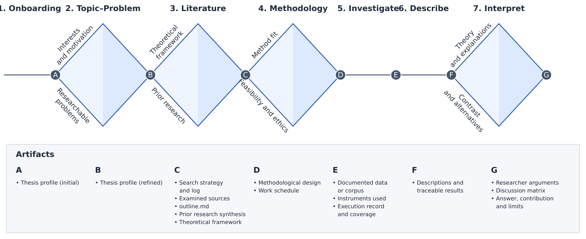

# Thesis workflow

## Scope and organizing idea

The workflow explains intellectual work, its outputs and the researcher's decisions. It does not prescribe a wizard, a mandatory chapter sequence or a universal methodology. [Product definition](product-definition.md) owns authorship and trust; [Architecture](architecture.md) owns local execution and persistence.

The [Exploration–Action Framework](exploration-action-framework.md) owns the generic notation, phase descriptions and transition criteria. Ohtia adapts the Design Council's divergence/convergence idea to academic research. The seven stages and their research-specific branches below are an Ohtia design, not a research method prescribed by the original Double Diamond.[^double-diamond]

## Diamonds, activity lines and avenues

- **Diamond:** the phase opens a space of possibilities and converges through justified selection, exclusion or integration. Its widening and narrowing communicate divergence and convergence.
- **Activity line:** work transforms inputs into an output under a sufficiently agreed purpose, scope and procedure. Unknown results, iteration and parallel tasks do not automatically make it a diamond.
- **Exploration avenue:** a question or complementary contribution within a diamond. Named avenues run through both divergence and convergence; they are not the diamond's two temporal halves.
- **Output circle:** the end of a phase, whether diamond or activity line. Its letter A–G refers to the artifact legend.
- **Review milestone:** the researcher examines the result, grounds and limitations and decides how to continue. Activity lines also have reviewable exit conditions.

Two avenues do not necessarily compete or run in parallel. In Literature, theoretical foundations and prior research are complementary functions that must be articulated, not alternatives from which one is discarded. Simply dividing predefined work and concatenating outputs would describe parallel activity flows, not exploratory convergence.

Read the map from left to right. Consecutive diamonds share an output/entry circle with no intervening activity line. The three activity stages use plain lines without arrows; returns are explained below so they do not distort the horizontal notation. The geometry does not measure duration, effort, uncertainty or research quality.

The artifact letters identify:

- **A — Onboarding:** initial thesis profile and first useful focus.
- **B — Topic–Problem:** a refined thesis profile with topic, problem, question, objectives and justification. Refined means complete for this milestone, not permanently final.
- **C — Literature:** search strategy and execution log, examined references, an outline, prior-research synthesis and preliminary theoretical framework.
- **D — Methodology:** methodological design and a feasible work schedule.
- **E — Investigate:** documented data/corpus, instruments used, execution record and actual coverage.
- **F — Describe:** descriptions and analytic results with traceable evidence.
- **G — Interpret:** researcher-authored arguments, discussion matrix or equivalent, answer, contribution and limits.

Artifact names describe research outputs, not new database entities, mandatory operational filenames or agent-written thesis chapters. Their operational authority remains in the [system architecture](architecture.md), with identities and project/library associations defined in the [data model](data-model.md). Manuscript and bibliography deliveries do not require a complete knowledge-interchange format. An initial and a refined profile are versions of the same research context, not independent documents that drift apart.

### Avenues within the four diamonds

- **Topic–Problem:** interests, motivation and experience; researchable problems explored through bounded initial literature. Their common output is a relevant, motivating and feasible question with coherent objectives.
- **Literature:** theoretical foundations; prior investigations, methods, findings and limits. Their common output articulates both functions without erasing disagreement.
- **Methodology:** fitness of evidence and methods to the question; feasibility and ethics under actual resources and access. Their common output is a justified, executable and scheduled design.
- **Interpret:** explanations informed by theory; contrast with prior research, discordant cases and alternative explanations. Both use the described results as a common input; the data are not an opposing branch to theory.

### Returns and reentry

- **Literature → Topic–Problem:** the literature challenges the formulation of the question.
- **Methodology → Literature:** the design needs additional conceptual or empirical foundations.
- **Investigate → Methodology:** a pilot or failed access invalidates the agreed procedure.
- **Interpret → Describe:** an additional description or data contrast is needed.
- **Interpret → Literature:** a missing theory or prior study limits the explanation.

The map shows common dependencies, not a compulsory stage sequence. Literature and methodological preparation may overlap; a sufficiently documented subset may be described while collection continues. Existing advanced research enters at its actual point. Writing and review run throughout. Finishing Interpret does not mean a thesis is ready for delivery, defense or final closure; that later academic route needs its own definition.

## Entry and project context

Begin with the material the researcher has: interests, an existing project, selected sources or a draft passage. Gather context progressively: work type, institution and known requirements, discipline and reasoning approach, research question, stage, target languages, available corpus, method, deadline and realistic availability. Unknown values remain unknown.

Creating a local project and recording this context require no provider connection. If the researcher requests agent assistance, show the necessary connection and outgoing scope at that point. An imported requirement or source is not an instruction to grant tools or send additional data.

Before any model-assisted questions or synthesis, explicitly select the project's analysis language. Keep it distinct from the institution's manuscript requirement and the OS-derived or user-overridden interface locale. Record the institution's citation and AI-use requirements with the document or statement that supports them, the supervisor/committee milestones, weekly availability, prior experience and any voluntarily disclosed support needs. The initial output is a revisable research profile and one useful focus. A researcher can start with a single source brief or citation comparison before formalizing the whole profile. Ohtia does not make a deadline, model choice or completed literature graph a prerequisite.

## 1. Onboarding

**Purpose:** understand the researcher's situation, begin the thesis profile and agree on a useful first move. **Input:** known context and available material; neither a chosen topic nor a bibliography is required. **Shape:** activity flow. Recording context follows a known purpose; research questions that emerge belong in Topic–Problem. The conversation can span several sessions.

Ask progressively about:

- **Work and institution:** bachelor-level thesis, dissertation, master's or doctoral work, paper, institution, program and modality.
- **Requirements:** applicable regulations/guidelines, approximate length, manuscript language, citation system, academic integrity and AI-use conditions, retaining the supporting document or attributed statement.
- **Analysis language:** the project's single analysis-language choice, distinguished from the academic language requirement and the separate application locale.
- **Academic support:** supervisor, co-supervisor, committee and externally required reviews or milestones, with known and unresolved conditions.
- **Time:** deadline, intermediate deliveries and actual weekly availability. Ask for a target date early; an unknown date remains unknown with a clarification action and does not enable a fabricated pace indicator.
- **Experience and support:** research experience, perceived autonomy, familiar tools, difficulties and voluntarily disclosed adaptations.
- **Starting material:** existing topic, question, objectives, bibliography, corpus, data, method, draft and decisions, with their actual evidence and review state.

Return a profile synthesis for correction, distinguish the researcher's statements from Ohtia's proposed reformulations and record gaps affecting the next action. Unknown information blocks only dependent activities; a change in deadline, requirements or availability triggers review of the affected plan.

- Collect and distinguish institutional requirements, researcher goals, available resources and unresolved information.
- Record what comes from a supplied document, a user statement or an agent inference.
- Identify the current entry route, restrictions and existing work worth preserving.

**Output:** an initial research profile, constraints and a selected next action.

**Review milestone:** the researcher checks the profile's accuracy and confirms the focus, or leaves specific questions unresolved. Completing fields does not certify feasibility or institutional approval.

## 2. Define the topic and problem

**Purpose:** turn interests and identified problems into a worthwhile, feasible investigation with a defensible question. **Input:** initial profile, candidate interests/topics and known restrictions. **Shape:** exploration and convergence, with interests/motivation and problems/exploratory literature as complementary branches.

### Interests and motivation

Ask which areas, courses, experiences or phenomena matter to the researcher; which problems they have observed; what they want to understand and why; which question could sustain their interest; what they know, can access or need to learn; what they do not want to investigate; and which personal or practical limitations constrain scope. Record candidates in the researcher's words, reasons and associated resources/restrictions. Recognizable, explainable interest is the criterion, not an AI motivation score.

### Researchable problems

Explore tensions, disagreements, open questions, needs and phenomena in those areas. A topic names a territory; a problem explains what merits understanding there. A replication, critical review or situated study can justify a thesis without claiming nobody studied the subject before. Each reference records its origin, pertinence to the candidate, examined scope and contribution to identifying a problem.

- Explore candidate questions, significance, boundaries and plausible contributions.
- Contrast researcher interests with identifiable problems and available sources.
- Separate a broad theme from a researchable problem, question, objectives and justification.
- Test feasibility against resources, access, time and ethical constraints without inventing missing requirements.

The avenue contributes a brief map of possible problems for each candidate, with supporting material and search limits. Its criterion is usefulness for delimitation, not the number of results found.

### Bounded initial literature and convergence

Use the baseline exploration budget of **five to ten relevant references per candidate topic**, agreed for the candidates reaching final comparison. Several candidates can exceed ten references in total. This is an initial work budget, not a universal bibliography quota or evidence of scientific sufficiency. Candidates may be prioritized in rounds to keep effort bounded. An early rejection retains its reason without filling a counter. If five pertinent references cannot be found, disclose the limitation and revise the candidate or scope instead of padding the set.

Exploratory references and their representations stay in the Topic–Problem working record until explicit incorporation into the formal project library. Retain the exact grounds and evidence supporting the choice, and the reasons alternatives were rejected; discard disposable work only when no retained decision or restriction requires it. A title or abstract is not represented as examination of full text.

The two avenues inform one another. Compare sustained interest, relevance, researchability, access, scope, time and resources. Preserve the chain **interest → topic → delimitation → problem → question → objectives → justification**. Delimitation identifies the material/units, place, time and dimensions when relevant; objectives state what the inquiry must achieve without anticipating the desired answer. An already approved topic is examined for grounds and coherence rather than replaced merely to replay the stage.

**Output:** the same versioned profile refined with topic/provisional title, motivation and justification; problem and delimitation with supporting references; research question; overall objective or objectives and linked specific objectives; initial feasibility, restrictions, uncertainty and rejected alternatives with reasons. Include assumptions and open questions with their actual grounds.

**Review milestone:** the researcher explains the topic–problem–question–objectives relationship, examines its initial evidence and checks feasibility against their circumstances. The Navigator identifies concrete incoherences and resolution tasks; filling every field does not prove coherence. A polished agent-generated formulation is not itself a decision or evidence of a gap. External supervisor approval is recorded separately when it occurs. The profile remains revisable; literature, access difficulties or academic review can reopen it with a stated reason and affected dependencies.

## 3. Develop the bibliography

**Purpose:** build a pertinent foundation for the problem, method and interpretation. **Input:** the working question, objectives and delimitation, exploratory references and time/access restrictions. Reuse examined work after checking its continuing relevance. **Shape:** exploration and convergence, with theoretical foundations and prior investigations as complementary branches.

Agree on the purpose of search before running it: vocabulary, concepts, relevant disciplines, time/language ranges, source kinds, provider choices and inclusion/exclusion reasoning. Preserve the actual queries and filters independently of provider sessions. An exploratory search is not an exhaustive systematic review.

- Discover and deduplicate candidates while retaining per-provider identifiers and access/coverage information.
- Select sources for relevance; record reasoned exclusions and pending access.
- Incorporate permitted originals or referenced representations, separate metadata from examined content and record versions.
- Examine methods, claims, supporting evidence, disagreement and shared underlying data.
- Produce attributed briefs and proposed relations; inspect and correct them before confirmation.

### Search strategy

Agree and record:

- **Purpose:** the question and the contribution needed from each avenue.
- **Vocabulary:** concepts, keywords, synonyms, translations, descriptors and operator combinations.
- **Search locations:** pertinent and accessible databases, catalogs, repositories and reference/citation routes through enabled adapters.
- **Scope:** periods, languages, contexts, populations and material kinds, justifying filters that might exclude relevant contributions.
- **Selection:** inclusion/exclusion, duplicate/version treatment and reasons for reading priorities.
- **Planned work:** initial queries, responsibilities, available time and exploratory/deep reading order.
- **Sufficiency:** coverage needed for the next milestone, how repeated contributions will be recognized and which gaps prevent closure. A time limit forces a decision; it does not demonstrate sufficiency.
- **Revision:** findings that require different terms, search locations, question or scope.

Keep planned and executed work separate: actual queries, services, filters, dates, results, selection and access limits. Finding no result does not establish absence. Strategy preparation is operational within the larger diamond when the purpose is adequate; if it reveals uncertainty about what to search or why, revisit the question. Both avenues use the agreed strategy and record reasons for changes.

### Theoretical foundations and prior investigations

The theory avenue asks which concepts, theories and relationships frame the problem. Explore definitions, authors, positions, assumptions, disagreements and their fit/limits. The researcher chooses and relates concepts with reasons and retains relevant objections. A list of author summaries is insufficient: central concepts must be defined, connected and related to the problem and objectives.

The prior-research avenue asks what was investigated, how, in which contexts/units, with what findings, disagreement and limitations. Explain comparability and differences that prevent transferring conclusions. Relate studies explicitly to the question and bound claimed gaps by actual examined coverage.

One source can contribute to both. Studies can question concepts; theory can explain different findings. Integrate those relationships without erasing disagreement or treating theory and prior work as competing alternatives.

### Source work and artifacts

All references included in the selected working set must be processed, read and summarized with declared coverage. This does not require deep reading of excluded search results or the entire historical library. Preserve consulted version, accessible and examined parts, relevant problem/concepts/method/findings, limitations, contribution to one or both avenues, anchored excerpts/claims and researcher notes distinguished from system inference. Inaccessible sources stay pending rather than receiving fabricated summaries. Confirming a proposed finding does not certify reading the whole work.

The outline includes a short synthesis of each included reference and is a research work map linking concepts, prior work, questions, provisional arguments and tasks to canonical source records and evidence; it does not duplicate editable claims or bibliography. A preliminary theoretical framework articulates concepts, positions and the researcher's justified choices. These are structured working artifacts; the researcher writes the actual thesis chapter. `outline.md`, `literature-search-strategy.md` and `preliminary-theoretical-framework.md` are possible export names, not independent live authorities.

Optional `references.bib` export distinguishes the sources cited by a particular manuscript revision from an explicitly selected library subset. Neither export is a prerequisite for research or writing. The initial five-to-ten reference budget does not cap this stage; further coverage and work quantities follow the project's justified needs. Pending relevant material is resolved or limits the claims and milestone scope explicitly.

**Output:** a search strategy and log, source library, anchored source work, a conceptual map, prior-research synthesis, a preliminary theoretical framework and an outline the researcher can revise. Bibliographic export is optional and does not become a second authority.

**Review milestone:** the researcher judges fitness for the question and identifies remaining gaps and reading priorities. A source count, citation network or extraction percentage cannot automatically close this stage.

## 4. Design the methodology

**Purpose:** decide what evidence is needed, how it is obtained/analyzed and when work will occur. **Input:** the current question and objectives, bibliographic foundations, restrictions and known access. **Shape:** exploration and convergence. Applying a familiar method without examining its fit closes exploration prematurely.

Compare ways to answer the question: research design, units and selection, data/corpus access, instruments, analytic procedure, quality criteria and applicable ethical obligations. The needed questions depend on the research; do not force samples and variables into a formal proof or historical interpretation.

Document alternatives, grounds, limitations, resource estimates and pilot needs. Distinguish an institutionally required approval from Ohtia's record of the researcher's plan. Ohtia does not issue ethical or methodological certification.

The fitness avenue asks what each objective needs, which design and evidence can answer it, what units/corpus and selection are appropriate, which instrument and analysis are justified, and which alternatives and limits remain. The feasibility/ethics avenue asks what access, permissions, consent, custody, identity protection, retention/deletion, skills, software, time and contingencies are actually available. Neither substitutes for the other.

For each specific objective, the integrated work matrix records:

- The evidence needed to answer it.
- The source or unit from which evidence is obtained.
- Selection boundaries: what is included and excluded.
- Technique and instrument for obtaining or constructing it.
- Planned analysis turning that evidence into results.
- Permissions, quality conditions and inference limits.

The methodological-fitness and feasibility/ethics avenues modify one another: an adequate method can be infeasible, while an easy method may not answer the question. Agree the analysis plan before obtaining the data that depend on it. Emergent designs instead record their starting point and revision rules, without pretending unknown categories were predetermined. Document pilots before extending collection.

The schedule maps that design into activities, expected outputs, dependencies, responsibilities, estimated effort, dates/windows, review milestones and contingency allowance. It follows actual availability and is revised against actual work. A permission still pending blocks its dependent activity, not independent preparation.

**Output:** a methodological design, access/ethics conditions, work plan, dependencies and milestones.

**Review milestone:** the researcher chooses the procedure and explains its fit, feasibility and limits. Missing access, approval or pilot evidence remains a visible dependency, not an implied success. Every objective needs a justified answer path; if none is viable, revisit the question or objectives rather than treating the design as closed.

## 5. Investigate

**Purpose:** execute the design by obtaining or constructing data, corpus, records and evidence. “Investigate” names this operational stage; research in its wider sense spans the whole route. **Input:** current design, relevant instruments/pilots, analysis plan, schedule and enabling conditions for each activity. **Shape:** activity flow governed by the agreed design, even when results are unknown.

The researcher conducts interviews, surveys, observation, experiments, queries or collection with appropriate tools. This workflow does not imply Ohtia executes analyses or connects arbitrary research databases. Distinguish planned, obtained and pending work.

Collect, produce or obtain evidence; document procedures, versions, dates, instruments and selection where applicable. Record deviations, failed access, missing observations and changes requiring a revised design. Keep private material's origin and processing restrictions attached to its representations and derivatives.

**Output:** a documented corpus or data collection, acquisition records, deviations and actual coverage.

**Review milestone:** identify the set available for analysis, what is missing, why and with which limits. Closure may cover a round or subset where the design permits collection/analysis cycles. Later incorporation records the change and affected results rather than silently changing a prior interpretation's corpus. Rescheduling an interview is local adjustment; an unsuitable instrument or blocked answer path reopens Methodology and possibly Topic–Problem. The researcher establishes which work was performed, which conditions remain unmet and what can responsibly enter analysis. An imported transcript can be compared as text without certifying the underlying event. Recording code or a dataset locator does not mean Ohtia executed it.

## 6. Describe

**Purpose:** produce an analytical description pertinent to the objectives and recognizable evidence for interpretation. **Input:** identified corpus/subset, current objectives and analysis plan. **Shape:** activity flow, with a bounded exploration when the analytic cut itself is unresolved. Description includes preparation, coding, calculations, comparison and organization, not just an account of where data came from. Separating results from explanation does not imply observation is concept-free.

Organize results against objectives and the agreed procedure. Separate observation from interpretation, record transformations, and keep negative and missing results visible. If an exploratory analytic choice changes the basis for interpretation, document it and revisit the relevant design decision.

The analytic cut is justified by question and design, not by selecting a favorable result. Document units, dimensions/variables, time, place, inclusion/exclusion, missing observations and transformations where relevant. A national census does not make every available variable relevant: identify the exact dataset version, query and subset supporting the objective. Retain discordant cases and explain exclusions. An out-of-scope finding can be recorded as a future research question rather than forcing it into the current analysis.

Describe needs an internal diamond when constructing categories, exploring unanticipated patterns or deciding which observations matter requires a new opening and convergence: **explore possible cuts/categories → contrast with data and objectives → justify the analytic scheme**. Then resume the activity flow. If the change alters method or question, reopen the corresponding stage and inspect its dependencies. The plain line denotes the dominant agreed activity, not a claim that analysis contains no intellectual choices.

**Output:** locatable observations and descriptive results, linked to their inputs, method and coverage, with appropriate tables or figures.

**Review milestone:** the researcher checks that the description answers the intended questions and that exclusions, transformations and limitations are explicit. Another reader must be able to trace each result back to the actual material and procedure. A chart or numerical output is not automatically a supported conclusion.

## 7. Interpret

**Purpose:** construct the researcher's own answer by relating results, theory and prior work. **Input:** described results with anchors/coverage, bibliographic foundations and methodological limits. **Shape:** exploration and convergence, with theoretical explanations and contrast/alternatives as complementary branches. Finding a pattern does not settle its meaning or scope.

### Explanations through theory

Ask what adopted concepts illuminate, which explanations are plausible, which assumptions they need and what remains unexplained. The avenue contributes interpretations explicitly connecting evidence and concepts with limits.

### Contrast and alternatives

Ask how results relate to prior research, whether contexts are comparable, and which discordant cases, rival explanations or methodological limits could alter the account. The avenue contributes objections and contrasts that support, revise or bound an interpretation.

### Convergence

Both avenues work with the same described results. Retain uncertainty or multiple explanations when justified; do not remove an unexpected result to force agreement. Relate **objective → result → evidence → concept or prior investigation → interpretation → limit**. Distinguish the finding, proposed meaning and supportable answer. Ohtia organizes questions, support and objections; the final position belongs to the researcher.

- Compare explanations grounded in the project's conceptual and empirical material.
- Test contrary evidence, alternative interpretations, methodological limitations and dependent sources.
- Explain the researcher's inferential steps rather than inventing a supporting source for each original deduction.
- Distinguish the answer warranted by the evidence from speculation, new questions and limits of generalization.

**Output:** researcher-authored arguments, a bounded answer to the question, contributions, objections, limitations and unresolved work.

**Review milestone:** the researcher can inspect and defend the support path and accepts the stated limits. Every objective has a supported answer or an explicit reason it cannot be answered; relevant alternatives have been addressed and conclusions respect data/method limits. Missing evidence leads to appropriate literature, description or acquisition work and design review when needed. An attractive interpretation does not retrospectively authorize a different question or enlarged corpus. Agreement between agents does not close an intellectual question.

## Writing and supervisor feedback

The manuscript develops across stages. The researcher writes; Ohtia can point to unsupported attributions, changed evidence, missing qualifications or plausible objections with their exact scope. The [draft format](draft-format.md) fixes the structures required for editing and delivery.

A delivery freezes the selected draft version, bibliography, resources and export settings. External supervisor feedback is incorporated as source material and linked to that delivery where justified. Preserve the original comment separately from extraction and interpretation. Unclear anchors require researcher resolution. Neither the supervisor's comment nor an agent suggestion silently edits the manuscript.

## Iteration and reentry

Literature can reframe the problem; a failed pilot can reopen methodology; interpretation can reveal missing description or theory. Reopening records the cause, affected outputs and next review, while preserving earlier work. Stage identifiers remain stable even when focus and plan change.

An advanced project imports existing material and records what it supports. It does not replay onboarding stages to obtain an artificial completion badge. A paper can enter with a narrow question and existing results, use a smaller selection of stage artifacts and iterate through the same evidence/review principles. Discipline or publication instructions govern the delivered structure; the seven stages do not force seven manuscript chapters.

## Navigator behavior

The Navigator answers four guiding questions: where am I, what is resolved, what needs review and what can I do today?

Stage, state and focus are distinct. Each stage has `not-started`, `in-progress` or `done`; reopening returns it to `in-progress`. A blocker is a separately explained condition with a resolution task, not a grade or an additional stage state. Ohtia proposes a stage transition, including starting and reopening, and the researcher confirms or rejects it. Creating an artifact or receiving model output never changes a stage to done automatically. The initial focus follows the most recently started/reopened stage; the researcher can choose the active work to attend to. External academic approval is a separately evidenced event.

Each stage view presents purpose, expected outputs, avenues/activities, available materials, dependencies, pending proposals and transition history. Show evaluable missing criteria and next steps only when the relevant capability can establish them. In a diamond, distinguish opening, comparison and synthesis; in an activity flow, show current activity, remaining work and exit checks. Separate work performed, output quality and contribution to the research objective. Source counts distinguish the whole library from the selected examined working set.

The Navigator distinguishes a stage's working condition, the researcher's selected focus and the evidence for a proposed next action. Several stages can be active. It summarizes recent decisions, pending reviews, changed dependencies and resumable work without launching inference merely because the project opened.

Suggest three to five weekly actions, highlighting one feasible next action for the current session, with the relevant artifact, reason and required connection or input. Each explains its objective/milestone, prerequisites, observable completion evidence, estimated effort and a response to a foreseeable obstacle. Prioritize useful dependencies, the next milestone, uncertainty and the agreed schedule; the researcher can change that priority. Existing recorded context supports deterministic suggestions; requested new analysis uses the bounded execution contract. A deadline indicator requires an agreed plan and availability and measures pace against it, not argument quality.

### Examples of useful next actions

- **Two insufficiently differentiated topics:** examine one pending reference for each and explain the problem each supports. Completion evidence is attributed reading notes, actual coverage and an updated comparison.
- **Poorly relevant search results:** revise a term combination against the question and try it through one selected provider. Retain query/results and the reason to keep or revise it.
- **An objective with no answer path:** complete its methodological matrix row, including access and technique. Produce a justified proposal or a concrete blocker.
- **A broad census without a pertinent description:** specify the objective-linked subset before generating tables. Record justified selection/exclusions and the dataset version/query.
- **An interpretation without objections:** examine a discordant case or relevant prior study, then narrow or revise the argument. Preserve evidence, limits or an explicit unresolved question.

### Milestones, decisions and reopening

Milestone actions specify the exact artifact versions reviewed, evidence considered, responsible human, observed decision time and remaining conditions. The historical decision keeps its reviewed version while materials evolve. Continuing, iterating, changing direction or pausing has an explicit reason. Closure enables work whose prerequisites hold, rather than preventing consultation of other stages. Access/permission constraints still govern dependent activities. A later content change identifies stale dependencies and explains why dependent results need review rather than silently carrying approval forward. Preserve earlier valid work and decision history when dependencies change; source anchors stay on the examined representation. Planning, sources, notes, doubts and reviews cross all stages. Sharing with a supervisor is the researcher's explicit file-delivery choice, not supervision access or an automatic send. Rejecting a suggestion, documenting a limitation or discarding an irrelevant source can be useful progress.

## Acceptance journeys

- Create a project without providers and record context; reopen it with its notes, draft and decisions intact.
- Start from one permitted document, request a bounded brief, inspect an anchor, correct a proposed claim and record the human review.
- Start from a draft attribution, provide its source, examine a coverage-limited comparison and decide whether to revise or reject the finding.
- Enter with advanced research, map only relevant artifacts, select a current focus and reopen an earlier milestone with a documented reason.
- Disable a provider during work, preserve completed local results and expose interrupted or uncertain work without blocking manual research.
- Export a delivery, incorporate external feedback and preserve the distinction between the delivered version, original comment and researcher revision.

These journeys establish observable behavior to validate. They do not claim the workflow has been user-tested or that a particular model is adequate for every discipline or language.

[^double-diamond]: The external framework supplies divergence and convergence; the seven-stage academic adaptation and review milestones are Ohtia's design.
